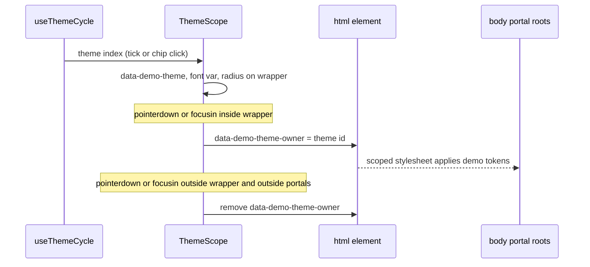

# Theme demo

## 1. Architecture

### 1.1 Overview

The site claims the table follows the user's shadcn/ui theme but never shows it. This part
adds a live demo: a real `ShadcnTable` that restyles as theme tokens, font and radius change,
built as four variants on `/dev/theme/<n>` for review. The picked variant later goes on the
homepage and on a theming docs page. Decisions: [decisions.md](decisions.md).

### 1.2 Goals

- Four variants reachable at `/dev/theme/1` to `/dev/theme/4`, indexed at `/dev/theme`
- One demo theme change restyles the table, its toolbar buttons, badges, checkboxes and every
  portalled menu, and nothing outside the demo
- Demo code adds under 20 KB gzipped to the route beyond the shared `ShadcnTable` chunk
- No layout shift on theme or font change beyond text reflow; no hydration warnings
- `prefers-reduced-motion`: autoplay off, first theme shown, chips still work

### 1.3 Current structure

```
apps/shadcn-table-docs/
├── app/(home)/page.tsx                  ← renders HomePage
├── components/dev-home/v12/
│   ├── signal-demo.tsx                  ← replaying homepage demo (pattern to follow)
│   └── signal-table.tsx                 ← ShadcnTable for it, dynamic ssr:false
├── lib/theme-presets.ts                 ← six site presets, hue only
└── themes/*.css                         ← :root[data-theme='x'] token sets
```

`app/dev/` was removed in `96485b5`; its layout and `DevShell` are in that commit's parent.

### 1.4 Target structure

```
apps/shadcn-table-docs/
├── app/dev/
│   ├── layout.tsx                       ← noindex metadata, no fumadocs layout
│   └── theme/
│       ├── page.tsx                     ← index: links to 1..4, one line each
│       ├── 1/page.tsx                   ← variant 1
│       ├── 2/page.tsx
│       ├── 3/page.tsx
│       └── 4/page.tsx
└── components/theme-demo/
    ├── demo-themes.ts                   ← DemoTheme list: tokens light/dark, font, radius
    ├── fonts.ts                         ← next/font instances for the demo fonts
    ├── theme-scope.tsx                  ← wrapper: scoped tokens, font, portal ownership
    ├── theme-table.tsx                  ← the showcase ShadcnTable (default export, lazy)
    ├── use-theme-cycle.ts               ← autoplay index, pause on interaction, reduced motion
    ├── theme-chips.tsx                  ← shared picker row (theme and font)
    └── variants/
        ├── terminal.tsx                 ← variant 1
        ├── stage.tsx                    ← variant 2
        ├── tokens.tsx                   ← variant 3
        └── grid.tsx                     ← variant 4
```

### 1.5 Flow



### 1.6 Components

#### 1.6.1 Data artifacts

- No registry, changelog or package change. Docs app only.
- `next/font/google` adds 3 families, subset `latin`, `display: 'swap'`, loaded only on
  `/dev/theme/*` routes (imported from `components/theme-demo/fonts.ts`, never from the root
  layout).

#### 1.6.2 DemoTheme data

Five themes that differ on every axis the table reads. Light and dark token sets each; the
demo follows the site light/dark class.

- Does hold every shadcn token the table reads: `background`, `foreground`, `card`,
  `popover`, `primary`, `secondary`, `muted`, `accent`, `destructive`, `border`, `input`,
  `ring`, each `-foreground` pair, plus `radius` and `font`
- Does NOT reuse or modify `themes/*.css` or `THEME_PRESETS`

| id        | Look                                  | Font           | Radius    |
| --------- | ------------------------------------- | -------------- | --------- |
| `neutral` | stock shadcn neutral                  | Inter (site)   | `0.625rem` |
| `paper`   | warm off-white, terracotta primary    | Source Serif 4 | `0.5rem`  |
| `brutal`  | high contrast, black borders, yellow  | JetBrains Mono | `0`       |
| `ocean`   | cool blue surfaces, cyan primary      | Space Grotesk  | `0.75rem` |
| `candy`   | pink primary, lilac accents           | Inter (site)   | `1.25rem` |

**Interfaces:**

```typescript
export type DemoTokenName =
  | 'background' | 'foreground' | 'card' | 'card-foreground'
  | 'popover' | 'popover-foreground' | 'primary' | 'primary-foreground'
  | 'secondary' | 'secondary-foreground' | 'muted' | 'muted-foreground'
  | 'accent' | 'accent-foreground' | 'destructive' | 'border' | 'input' | 'ring';

export interface DemoTheme {
  readonly id: 'neutral' | 'paper' | 'brutal' | 'ocean' | 'candy';
  readonly label: string;
  /** CSS value for --font-sans, references a next/font variable. */
  readonly font: string;
  readonly fontLabel: string;
  readonly radius: string;
  readonly light: Readonly<Record<DemoTokenName, string>>;
  readonly dark: Readonly<Record<DemoTokenName, string>>;
}

export const DEMO_THEMES: readonly DemoTheme[];
export type DemoThemeId = DemoTheme['id'];
```

#### 1.6.3 ThemeScope

Client wrapper that scopes a `DemoTheme` to its subtree and to the portals it opens.

- Does render one `<style>` element built from `DEMO_THEMES` with selectors for the wrapper
  (`[data-demo-theme='id']`, `.dark [data-demo-theme='id']`) and for portal roots under
  `html[data-demo-theme-owner='id']`
- Does set `--font-sans` and `--radius` on the wrapper and on owned portal roots, so the
  derived `--radius-*` scale follows
- Does set and clear `data-demo-theme-owner` on `<html>` per the flow in 1.5; clears it on
  unmount
- Portal roots covered: Radix popper wrappers and dialog overlay and content, the exact
  selectors verified against the rendered DOM of the radix edition
- Does NOT touch `data-theme` or the `.dark` class on `<html>`
- Does NOT support the Base UI edition (the demo renders the radix edition, as `SignalTable`)

**Interfaces:**

```typescript
export interface ThemeScopeProps {
  theme: DemoThemeId;
  /** Optional font override; defaults to the theme's font. */
  font?: DemoThemeId;
  className?: string;
  children: React.ReactNode;
}
```

**Usage:**

```tsx
<ThemeScope theme={current} className="rounded-xl border">
  <ThemeTable />
</ThemeScope>
```

#### 1.6.4 ThemeTable

The showcase table. Default export, loaded with `next/dynamic` `ssr: false` and a fixed
height loading state, same as `SignalTable`.

- Does render `ShadcnTable` from `@/components/ui-radix/shadcn-table`, about 8 rows, local
  data in the file
- Does show: custom toolbar buttons (one `default`, one `outline`), a status column rendered
  with `Badge` variants, row selection checkboxes, row actions menu, column filters toggle,
  pagination
- Does NOT fetch, autoplay or own theme state

**Interfaces:**

```typescript
export interface ThemeTableProps {
  /** Compact mode for the grid variant: fewer rows and columns, no toolbar. */
  compact?: boolean;
}
```

#### 1.6.5 useThemeCycle

- Does advance the theme index every `intervalMs` (default 3500) while not paused
- Does pause permanently on the first chip click or table interaction; exposes `resume()`
- Does start paused under `prefers-reduced-motion: reduce`
- Does pause while the demo is off screen (`IntersectionObserver`)

```typescript
export function useThemeCycle(options?: { intervalMs?: number }): {
  index: number;
  theme: DemoTheme;
  paused: boolean;
  select: (id: DemoThemeId) => void;
  resume: () => void;
  ref: React.RefCallback<HTMLElement>;
};
```

#### 1.6.6 ThemeChips

Shared picker: one chip per theme (swatch of its primary plus label), active chip marked with
`aria-pressed`. Optional second row for fonts when `showFonts`.

#### 1.6.7 Variants

Each variant is one client component plus a page that renders it inside the site nav
(`components/dev-home/v12/nav.tsx`) and a short heading. All share 1.6.2 to 1.6.6.

| # | Name       | Layout                                                                                          |
| - | ---------- | ----------------------------------------------------------------------------------------------- |
| 1 | `terminal` | Left: fake terminal typing `shadcn init`, the add command from `libraryAddCommand`, then a `globals.css` `:root` block whose values swap per theme. Right: table. Autoplay. |
| 2 | `stage`    | Chips above, one large table below, crossfade on change. Caption names theme, font, radius. Minimal. |
| 3 | `tokens`   | Left: token list (swatch, name, value) for the current theme, changed rows flash. Right: table. Chips on top. |
| 4 | `grid`     | Three compact tables side by side in three themes at once, no autoplay. One stacks at phone width. |

**Stays unchanged:** `app/(home)/page.tsx`, `components/dev-home/v12/*`, `themes/*.css`,
`lib/theme-presets.ts`, `app/layout.tsx`, everything under `packages/`.

### 1.7 Dependencies and env

- No new npm packages. `next/font/google` families: Source Serif 4, JetBrains Mono, Space
  Grotesk.
- Reuses `libraryAddCommand` and `perBase` from `@/lib/install`, `Nav` from
  `components/dev-home/v12/nav.tsx`, `Badge` and `Button` from the docs radix ui tree.

## 2. Instructions for AI

### 2.1 Phases

#### 2.1.1 Phase 1: Foundation (one agent)

- `app/dev/layout.tsx` (noindex) and `app/dev/theme/page.tsx` index
- `demo-themes.ts`, `fonts.ts`, `theme-scope.tsx`, `theme-table.tsx`, `use-theme-cycle.ts`,
  `theme-chips.tsx`
- `app/dev/theme/1/page.tsx` as a bare harness: chips plus one `ThemeTable` in a
  `ThemeScope`, so the foundation is checkable before variants exist
- Verify in the browser: open the row actions menu and a column filter select under each
  theme; portal content carries the demo tokens; the site nav theme picker menu does not

#### 2.1.2 Phase 2: Variants (four agents in parallel)

- One agent per variant file and its page; agents edit only their own `variants/<name>.tsx`
  and `app/dev/theme/<n>/page.tsx`
- Variant 1 replaces the phase 1 harness on `/dev/theme/1`
- Shared files change only with a note to the main session, never silently

#### 2.1.3 Phase 3: Review

- Main session checks each page with Playwright at 1280 and 390 wide, light and dark,
  reduced motion on and off
- Owner picks a variant on `/dev/theme`

#### 2.1.4 Final phase: Cleanup

- Integration of the picked variant into the homepage and a theming docs page is a separate
  plan after the pick
- `pnpm format` once, before commit

### 2.2 Gates

- `pnpm --filter shadcn-table-docs types:check`: no errors
- `pnpm --filter shadcn-table-docs lint`: no errors in new files
- `next dev`: `/dev/theme` and `/dev/theme/1..4` render with no console errors or hydration
  warnings, light and dark
- Radix edition only; the demo does not render the Base UI tree
