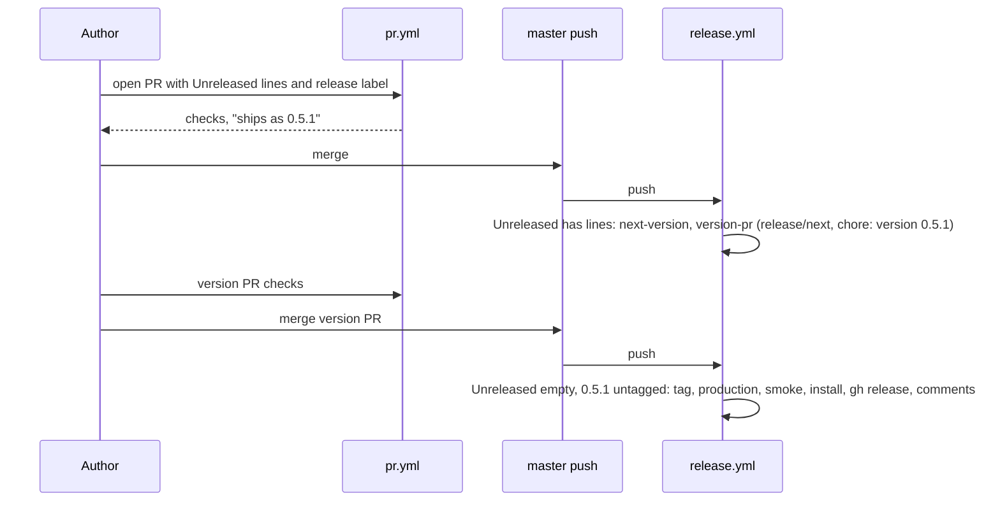

# 05: release flow

## 1. Architecture

### 1.1 Overview

Each release today costs two pull requests, a hand-run script on `master` and six workflow
runs, three of them redundant (`ci.yml` fires on every `master` push next to
`release.yml`). This part moves to the TanStack shape with no external apps: one workflow
for pull requests, one for `master` pushes, the level chosen per PR, the version computed,
the version PR opened by the workflow, release notes commented back on the PRs. Decision 7
in [decisions.md](decisions.md).

### 1.2 Goals

- `pr.yml` runs on `pull_request` only; `release.yml` on `push` to `master` only; no
  workflow runs twice for one event
- A feature PR carries its `## Unreleased` lines and a `release:` label; `pr.yml` fails a PR
  that changes shipped files without a label; the job summary shows the version it will ship
- A merge to `master` with pending lines opens or rewrites PR `chore: version <v>` from
  `release/next`; a merge of that PR tags, waits for production, smokes, installs, creates
  the GitHub release and comments "Released in v<v>" on every PR it shipped
- `scripts/release.mjs` retired; `scripts/release/next-version.mjs` added; `dev` stays as the owner's staging branch, fast-forwarded by hand
- Branch flow: work branches into `master` by PR; `claude/review` stays the agent branch
  and goes to `master` by PR as well

### 1.3 Current structure

```
.github/workflows/ci.yml        on: push [master, claude/review], pull_request
.github/workflows/release.yml   on: push master, tags v*, workflow_dispatch; skip when tagged
.github/workflows/install.yml   workflow_call, scenarios fresh existing base aria nextjs
scripts/release.mjs             hand-run on master: bump, close changelog, PR into master
scripts/release/{notes,smoke}.mjs
```

### 1.4 Target structure

```
.github/workflows/pr.yml        on: pull_request: release label check, version summary, library x3, tests x3, guard, docs, registry, install
.github/workflows/release.yml   on: push master: version job (open or rewrite release/next PR) or release job (tag, production, smoke, install, gh release, PR comments)
.github/workflows/install.yml   unchanged
.github/pull_request_template.md  changes, checklist, release impact (label and changelog line)
scripts/release/next-version.mjs  current version + level (label or headings) -> next version
scripts/release/version-pr.mjs    writes package.json x2, renames the section, commits on release/next, opens or updates the PR
scripts/release/{notes,smoke,comment}.mjs
```

### 1.5 Flow



### 1.6 Components

#### 1.6.1 Data artifacts

- `.github/pull_request_template.md`: Changes, Checklist (gates run locally), Release
  impact (one of `release:patch`, `release:minor`, `release:major`, `release:skip`; the
  changelog line under `## Unreleased` for the first three)
- Labels created in the repo: the four `release:` labels
- `docs/code-of-conduct/coding-standards.md` gates block and `CONTRIBUTING.md`: the new
  flow; `.ai/plans/v0.3.x/anindosarker/decisions.md` "Release" superseded by decision 7
  (a one-line pointer there)
- `CHANGELOG.md`: a `### Docs` heading allowed under `## Unreleased`

#### 1.6.2 `pr.yml`

- Jobs: `release-impact` (fails when files under `packages/shadcn-table/registry`,
  `apps/shadcn-table-docs/components/ui-*` or `skills/` changed and no `release:` label is
  set; prints the next version in the job summary), then the matrix from today's `ci.yml`
- Does NOT push anything to the PR branch

#### 1.6.3 `release.yml`

- `version` job, when `## Unreleased` has lines: level from the label of the merged PR
  (`gh pr list --search <sha>`), else from the headings (`Breaking`, `Added`, `Changed`
  minor while 0.x; `Fixed`, `Docs` patch); `next-version.mjs`; `version-pr.mjs` commits
  `chore: version <v>` on `release/next` (force-pushed, one commit) and opens or edits the PR
  with the closed section as its body
- `release` job, when `## Unreleased` is empty and `v<version>` is untagged: today's tag,
  wait for production, smoke, installs, `gh release create`; then `comment.mjs` posts
  "Released in v<v>: <release url>" on every PR merged since the previous tag and on the
  version PR
- A push that is neither (docs-only merge with `release:skip`): both jobs skip in seconds
- `workflow_dispatch` with `version` kept for a re-run after a failed late step
- Does NOT publish to npm (registry is the site, as today)

#### 1.6.4 Scripts

- `next-version.mjs <current> <level>`: prints the next semver; `--from-changelog` reads the
  headings when no level is given
- `version-pr.mjs <next>`: the file edits plus the branch and PR handling through `gh`
- `comment.mjs <tag>`: PRs since the previous tag from `git log --merges` plus `gh`

### 1.7 Dependencies and env

`GITHUB_TOKEN` with `contents: write` and `pull-requests: write` in `release.yml`; the
`master` ruleset already lets the workflow push tags; `release/next` is an ordinary branch.

## 2. Instructions for AI

Tracker `05-tracker.md`. Branch `v0.5/release-flow` from `claude/review`, worktree `07`. One
coder, one reviewer, one verifier who exercises the flow on a scratch branch: open a PR with
a changelog line and a label, see the summary, merge into a throwaway target is not possible
on `master`, so the verifier runs `release.yml` by `workflow_dispatch` with `dry_run` on
the branch and the scripts locally against a copy of the repo state. Halt on: a ruleset
change needed beyond the labels, a step that needs an app token.

### 2.1 Phases

#### 2.1.1 Phase 01: Scripts and template

- 1.6.4, 1.6.1

#### 2.1.2 Phase 02: Workflows

- 1.6.2, 1.6.3; `ci.yml` removed; `scripts/release.mjs` removed

#### 2.1.3 Final phase: Docs and gates

- Standards, CONTRIBUTING, the v0.3.x pointer; 2.2; merge into `claude/review`; the first
  real exercise is the next PR into `master`

### 2.2 Gates

- `node scripts/release/next-version.mjs` unit cases: 0.5.0 patch 0.5.1, minor 0.6.0,
  major 1.0.0, headings-derived cases, label precedence
- `act -l` lists `pr.yml` and `release.yml` jobs; `actionlint` or `gh workflow view` parses
  both; `pr.yml` green on the part's own PR into `claude/review` (opened for CI only)
- `release.yml` `workflow_dispatch` dry run green on `master` after the merge
