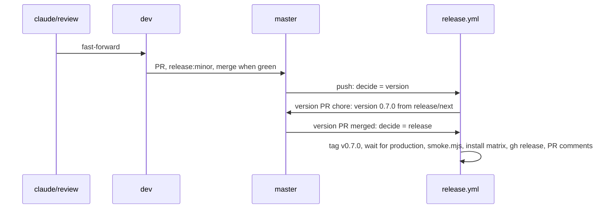

# 09: release

## 1. Architecture

### 1.1 Overview

Parts 01 to 08 prove the library with lint, types and Storybook; none of them runs the installed files in a Next 16 consumer. This part installs the table from the local registry into a Next 16 app per base, builds it and opens it with zero console warnings, then ships 0.7.0. The gate proves the menu anchors in state and `useEffectEvent` at runtime (D5), the canonical classes on the consumer's Tailwind (D16) and the consumer lint (D17). Runs after 07 and 08 merged; works on `claude/review`, `dev` and `master`, no part branch or worktree.

### 1.2 Goals

- Per base, an installed basic table page passes `next build` and opens with zero browser console warnings and errors (D5) (D16)
- `npx eslint components/ui/shadcn-table` zero problems in next-app, base only (D17); the `gate-radix` and `gate-aria` apps run `next build` and the console check only
- Every menu opens and closes on the gate page; focus returns to the element it opened from (D5)
- 0.7.0 released: version PR `chore: version 0.7.0` merged, `release.yml` green, `node scripts/release/smoke.mjs` green

### 1.3 Current structure

```
../test-projects/next-app/            ← sibling of the repo checkout, own git repo, owner work in progress
├── components.json                   ← style base-nova, one style per app
├── app/page.tsx                      ← owner's example page, uncommitted edits
└── components/ui/shadcn-table/       ← installed base library
CHANGELOG.md                          ← `## Unreleased` from parts 01 to 08
.github/workflows/release.yml         ← decide, version PR, tag, wait for production, smoke, install, gh release
```

### 1.4 Target structure

```
../test-projects/next-app/
└── app/release-gate/page.tsx         ← new, the basic table, base
<scratchpad>/gate-radix/, gate-aria/  ← throwaway Next apps, outside every repo, deleted after the gate
master                                ← tag v0.7.0, CHANGELOG `## 0.7.0 - <date>`
```

### 1.5 Flow



### 1.6 Components

#### 1.6.1 Data artifacts

- `CHANGELOG.md`: the version PR renames `## Unreleased` to `## 0.7.0 - <date>`; nothing edited by hand
- `packages/shadcn-table/package.json` `version` `0.7.0`, through the version PR
- next-app: `app/release-gate/page.tsx` new, `components/ui/shadcn-table` re-installed; `app/page.tsx` and the owner's untracked files untouched; nothing committed there

#### 1.6.2 Runtime gate

One `components.json` holds one style, so one Next app cannot render all three bases. next-app (base-nova) covers `base`; radix and aria each get a throwaway Next app made the way `.github/workflows/install.yml` makes its Next scenario.

- Registry: root `pnpm registry:dev` on `claude/review` after 07 and 08 merged builds `packages/shadcn-table/.dev` and serves it on port 5310 (`/r/shadcn-table-<base>.json`); not `preview`, which also starts the three Storybooks and exits when shared servers hold their ports
- Before any `shadcn add --overwrite` into next-app: `git -C ../test-projects/next-app status --short components/ui/shadcn-table` shows only untracked files, else halt with an ATTENTION item
- Page: one basic table, 20 rows, columns `firstName`, `lastName`, `age`, with `enableRowActions`, `enableCellActions`, `enableColumnFilterModes` and `enableRowSelection` on, so the column action, filter option, row action, cell action and show/hide columns menus all render
- Browser: agent-browser on `next dev` on the app's own port; each of the five menus opens and closes with Escape, focus lands on the element it opened from (D5); a column resize and a page change run; console zero warnings and errors
- Does NOT edit `app/page.tsx`, commit in next-app or change library source; a failure goes to `ATTENTION-<date>.md` naming the owning part

**Operations:**

| Operation | Status | Notes |
| --- | --- | --- |
| next-app `app/release-gate/page.tsx` | new | `base`; left in place for the owner |
| `gate-radix`, `gate-aria` apps | new | in the scratchpad, deleted in cleanup |

**Usage:**

```sh
# next-app, base
cd ../test-projects/next-app
git status --short components/ui/shadcn-table   # only untracked files, else halt
npx shadcn@latest add http://localhost:5310/r/shadcn-table-base.json --overwrite --yes
pnpm build
npx eslint components/ui/shadcn-table   # next-app only
pnpm dev -p <port>

# radix and aria, one throwaway app each
pnpm dlx shadcn@latest init --template next --base <base> --preset nova --name gate-<base> --yes
cd gate-<base>
npx shadcn@latest add http://localhost:5310/r/shadcn-table-<base>.json --yes
```

#### 1.6.3 Release

| Operation | Status | Notes |
| --- | --- | --- |
| `claude/review` into `dev` | keep | fast-forward, push |
| PR `dev` into `master` | keep | label `release:minor`, `pr.yml` green, merged |
| version PR `chore: version 0.7.0` | keep | opened by `release.yml` from `release/next`; merged when green |
| `release.yml` release path | keep | tag `v0.7.0`, wait for production, `node scripts/release/smoke.mjs`, install matrix per base, `gh release create`, PR comments |

**Stays unchanged:** `release.yml`, `install.yml`, `pr.yml`, `scripts/release/*`, rulesets, library source.

### 1.7 Dependencies and env: none new

## 2. Instructions for AI

### 2.1 Phases

#### 2.1.1 Phase 1: Runtime gate

Lane: agent

- 1.6.2 for `base` in next-app, then `radix` and `aria` in their throwaway apps; the `git status` pre-step before the next-app install; one root `pnpm registry:dev` serve on 5310, the agent's own dev ports, never stopping other servers
- Record per base in `09-tracker.md`: build result, eslint count, console count, each menu's focus target
- Halt: any console warning or error, any eslint problem, a menu that does not return focus; each goes to `ATTENTION-<date>.md` with the owning part
- Gates: per base `next build` green and console zero warnings and errors (D5) (D16); next-app `npx eslint components/ui/shadcn-table` zero (D17)

#### 2.1.2 Final phase: Release and cleanup

Lane: inline

- Delete the `gate-radix` and `gate-aria` apps; stop the `registry:dev` serve and the dev servers this part started
- 1.6.3 in order; push right after each merge
- Halt: `release.yml` or `smoke.mjs` red
- Gates: 2.2

### 2.2 Gates

- Per base: `next build` green, browser console zero warnings and errors on the gate page (D5) (D16)
- next-app (base): `npx eslint components/ui/shadcn-table` zero problems (D17)
- `pr.yml` green on the `dev` into `master` PR
- Version PR `chore: version 0.7.0` merged; `release.yml` green on its merge, install matrix included
- `node scripts/release/smoke.mjs` green against www.shadcn-table.com
