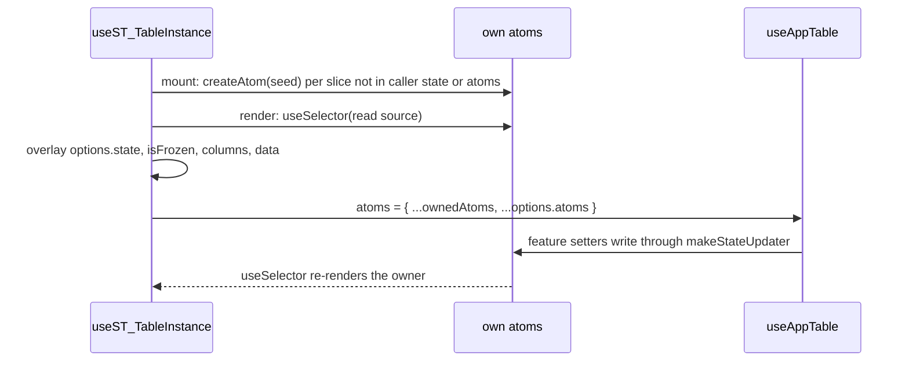

# 03: table instance atoms

## 1. Architecture

### 1.1 Overview

`hooks/useST_TableInstance.ts` reads the previous render's table through `tableRef.current?.store.state` to feed its option-time transforms, which the `refs` rule flags 39 times (F2) and part 02 leaves under a temporary `react-hooks/refs` block. D6: the hook owns its ten transform slices as TanStack atoms, created once, read with `useSelector`, handed to `useAppTable` through the v9 `atoms` option with the caller's atoms first. Runs inside the library sweep (index, Run schedule): branch `v0.7/library-sweep`, worktree `shadcn-react-table.worktrees/library-sweep`; merge commit into `claude/review` when the local gates are green, no CI wait.

### 1.2 Goals

- Zero `react-hooks/refs` in `hooks/useST_TableInstance.ts` with the part 02 temporary block deleted (D6)
- No `tableRef`, `columnDefsRef` or `table.store` in the file
- Owner re-render set: the `selectST_TransformState` slices plus the resize and drag flags, nothing more (D6 closes the resize and drag gap)
- Caller `atoms` and controlled `state` keep precedence; public options, types and behavior unchanged; file byte-identical in the three bases
- Done when: eslint with `react-hooks/refs` as an error on `hooks/useST_TableInstance.ts` exits 0 in every base, `grep -nE "tableRef|columnDefsRef|table\.store"` on that file prints nothing, and the three base copies diff empty (P51)

### 1.3 Current structure

```
hooks/useST_TableInstance.ts   ← per base, identical
├── transformStateDefaults     ← overlay base for the first render
├── selectST_TransformState    ← exported; ShadcnTable passes it as the table selector
├── useState(createSTTableHook), tableRef, initialState (useState initializer after part 02)
├── statefulTableOptions.state ← defaults, initialState, tableRef.current?.store.state, options.state
├── columns                    ← columnDefsRef.current while resizing or dragging, else prepareColumns
├── data memo, useAppTable, tableRef.current = table
└── useSelector(table.store, selectST_TransformState, { compare: shallow })
```

### 1.4 Target structure

```
hooks/useST_TableInstance.ts
├── ST_TRANSFORM_SLICES        ← new, the ten slice keys
├── transformStateDefaults     ← keep, overlay base
├── selectST_TransformState    ← keep, unchanged
├── useState(setup)            ← refactor: table hook, initialState, own atoms, read sources, owned atoms
├── useSelector per slice      ← new
├── isFrozen, held columns     ← new, replaces columnDefsRef
└── data memo, useAppTable({ atoms }), useST_Effects
```

### 1.5 Flow



### 1.6 Components

#### 1.6.1 Data artifacts

- `CHANGELOG.md` `## Unreleased` `### Fixed`: "Column definitions are rebuilt when a column resize or a drag ends, also when the owner's table selector leaves those slices out."
- `registry.json` unchanged in shape; `registry:build` and `lib:install <base>` refresh the copies
- `packages/shadcn-table/eslint.config.js`: the part 02 temporary `react-hooks/refs` block deleted

#### 1.6.2 Setup initializer

One `useState` initializer replaces the hook `useState` and the `initialState` initializer.

```typescript
const ST_TRANSFORM_SLICES = [
  'columnFilterFns', 'columnResizing', 'creatingRow', 'draggingColumn', 'draggingRow',
  'globalFilterFn', 'grouping', 'isLoading', 'pagination', 'showSkeletons',
] as const;
type ST_TransformSlice = (typeof ST_TRANSFORM_SLICES)[number];
type ST_TransformAtoms = {
  [K in ST_TransformSlice]: Atom<TableState<ST_Features>[K]>;
};
type ST_TransformSources = {
  [K in ST_TransformSlice]: SelectionSource<TableState<ST_Features>[K] | undefined>;
};

interface ST_InstanceSetup<TData extends ST_RowData> {
  useAppTable: ReturnType<typeof createSTTableHook<TData>>['useAppTable'];
  initialState: Partial<ST_TableState<TData>>;
  readSources: ST_TransformSources;       // caller atom, own atom, or the constant source
  ownedAtoms: Partial<ST_TransformAtoms>;  // own atoms passed to useAppTable
}
```

- Seed per slice: `getInitialTableState(stFeatures, initialState)[slice]`, the feature defaults with `initialState` on top, the value core's base atom would hold (full `columnResizing` shape, not `transformStateDefaults`' `{}`)
- Skip rule, fixed at mount: a slice in `definedTableOptions.atoms` reads the caller's atom and gets no own atom; a slice with an own key in `definedTableOptions.state` gets no atom (D6): its value is read from `definedTableOptions.state` in the overlay, and its `useSelector` reads one module-level constant source (`get` returns `undefined`, `subscribe` returns `{ unsubscribe() {} }`, the react-store `SelectionSource` shape) so every hook call stays unconditional (D4); every other slice goes into `ownedAtoms`
- `SelectionSource` is the `useSelector` source shape (`get`, `subscribe`), declared locally
- `createAtom` and `Atom` from `@tanstack/react-store` (re-exports `@tanstack/store`); `getInitialTableState` from `@tanstack/react-table`
- Does NOT follow caller `atoms` or `state` keys added after mount, as the table hook and features are fixed at mount

#### 1.6.3 Render reads and overlay

```typescript
const grouping = useSelector(readSources.grouping);          // likewise columnFilterFns, creatingRow,
                                                           // draggingColumn, draggingRow, globalFilterFn,
                                                           // isLoading, showSkeletons
const pageSize = useSelector(readSources.pagination, (p) => p?.pageSize);
const isResizingColumn = useSelector(readSources.columnResizing, (r) => r?.isResizingColumn);
```

- `statefulTableOptions.state` = `transformStateDefaults`, `initialState`, the values above, `definedTableOptions.state`, in that order
- Selectors on `pagination` and `columnResizing` keep page changes and pointer moves off the owner
- `isFrozen: boolean` from the overlaid state: resizing flag, `draggingColumn`, `draggingRow`; reactive, the owner renders on each flip

#### 1.6.4 Column build and data

- `columns`: `useMemo` on `[heldColumns, definedTableOptions, columnFilterFns, creatingRow, grouping]`, returning `heldColumns` when set, else the `prepareColumns` build as today
- `heldColumns`: `useState<ST_ColumnDef[] | null>(null)`, set to `columns` when `isFrozen` turns true and to `null` when it turns false, during render (D8 pattern)
- `definedTableOptions` is a new object on every owner render, so outside a freeze the build runs per owner render, as today; the freeze is what skips it
- Skeleton `data` memo: `[definedTableOptions.data, isLoading, showSkeletons, pageSize, columns]`

#### 1.6.5 `useAppTable` call

```typescript
const table = useAppTable(
  {
    ...definedTableOptions,
    atoms: { ...ownedAtoms, ...definedTableOptions.atoms },
    columns,
    data,
    globalFilterFn: statefulTableOptions.state.globalFilterFn,
    initialState,
  } as Omit<TableOptions<ST_Features, TData>, 'features'>,
  selector,
) as unknown as ST_TableInstance<TData, TSelected>;
```

- Core precedence `options.atoms[key]` over `options.state[key]` over base atoms (`@tanstack/table-core` 9.3.1 `dist/core/table/coreTablesFeature.types.d.ts:33`) is why controlled slices are never in `ownedAtoms`
- Feature setters (`makeStateUpdater`) write into the external atom, so ST and stock setters reach own atoms
- `table.reset()` does not reset external atoms; accepted (D6), no ST code calls it

| Operation | Status | Notes |
| --- | --- | --- |
| `tableRef` | refactor | deleted |
| `columnDefsRef` | refactor | deleted; `heldColumns` replaces it |
| `useSelector(table.store, selectST_TransformState)` | refactor | deleted; atom reads cover it; D13 lists the same site |
| `shallow`, `useRef` imports | refactor | deleted |
| `selectST_TransformState`, `transformStateDefaults` | keep | |

**Stays unchanged:** public options and types, `ST_TableInstance` shape, `useShadcnTable`, `ShadcnTable` (still passes `selectST_TransformState`), `stTableHook.tsx`, the feature files, `useST_Effects`, `useST_Rows`.

### 1.7 Dependencies and env: none new (`@tanstack/react-store` 0.11.2 exports `createAtom`)

## 2. Instructions for AI

### 2.1 Phases

#### 2.1.1 Phase 1: Base

Lane: workflow

- Coder: 1.6.2 to 1.6.5 in `registry/base`; the part 02 `refs` block narrowed to the radix and aria files; two new play stories in `stories/styling/RenderCounts.stories.tsx`: `ColumnsHoldWhileResizing` and `ColumnsHoldWhileDragging`, which set the resize flag or `draggingColumn` / `draggingRow` and a grouping from buttons, count column builds with the existing display-column-options proxy, and assert no build while frozen and the expand column after release
- Reviewer bounces on: a ref read or written in render; an owner re-render set other than 1.2 (`RootSkipsStateRenders`, `HookSelectorSkipsStateRenders` counts unchanged); a caller atom or controlled slice losing to an own atom; `isFrozen` not reactive (computed from anything but the selectors and the overlay); a public type touched
- Gates (verifier): `lint` with zero `react-hooks/refs` in the base file, `tsc:baseui`, `test:base`

#### 2.1.2 Phase 2: Radix and aria copies

Lane: agent

- Copy `hooks/useST_TableInstance.ts` to `registry/radix` and `registry/aria`; delete the `refs` block
- Gates: `check:bases` (file not on any `*-diff.json` list, so byte-identical), `tsc:radix`, `tsc:aria`, `test:radix`, `test:aria`, `lint`

#### 2.1.3 Final phase: Cleanup

Lane: inline

- 1.6.1 CHANGELOG line; `registry:build`; `lib:install` for the three bases
- `pnpm format`; merge commit into `claude/review` when the gates are green, no CI wait, push after each commit
- Gates: the full set in 2.2

### 2.2 Gates

- `pnpm --filter shadcn-table lint` zero problems; `grep -nE "tableRef|columnDefsRef|table\.store" registry/*/components/ui/shadcn-table/hooks/useST_TableInstance.ts` empty
- `pnpm --filter shadcn-table tsc:radix`, `tsc:baseui`, `tsc:aria` green
- `pnpm --filter shadcn-table test:base`, `test:radix`, `test:aria` green, including:
  - skeleton: `stories/features/Loading.stories.tsx` `LoadingWithDetailPanelExample`, `OnlyTopProgressBar`
  - grouping: `stories/styling/RenderCounts.stories.tsx` `HookSelectorFollowsTransformState`
  - resize and drag: `RenderCounts.stories.tsx` `ColumnsHoldWhileResizing`, `ColumnsHoldWhileDragging` (new)
  - owner re-render set and precedence: `RenderCounts.stories.tsx` `RootSkipsStateRenders`, `HookSelectorSkipsStateRenders`, `ControlledPagination`, `ControlledDensityAndSelection`, `ExternalAtomsDensityAndSelection`
- `pnpm check:bases` green; `pnpm --filter shadcn-table-docs types:check`, `lint`, `build` green
- Next-app `base` re-installed: `npx eslint components/ui/shadcn-table/hooks/useST_TableInstance.ts` zero
- `pr.yml` green on the PR
