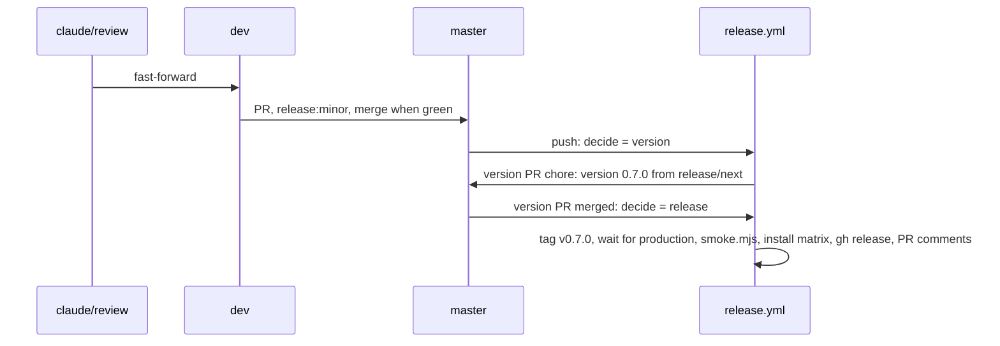

# 09: release

## 1. Architecture

### 1.1 Overview

Specs 01 to 08 prove the library with lint, types and Storybook; none of them runs the installed files in a Next 16 consumer. This spec installs the table from the local registry into a Next 16 app per base, builds it and opens it with zero console warnings, then ships 0.7.0. The gate proves the menu anchors in state and `useEffectEvent` at runtime (D5), the canonical classes on the consumer's Tailwind (D16), the consumer lint (D17), the icon editions as installed by the CLI (D30) and the logical direction classes on an RTL page (D31; the one `dir="rtl"` story lives in spec 10, this spec keeps the Next pages, D31 addendum). Workstream S6 (index, Run plan): runs inline in the main session after S5 merges; works on `claude/review`, `dev` and `master`, no spec branch or worktree. Release: label `release:minor` on the `dev` into `master` PR (the one `decide.mjs:55` reads), version 0.7.0; 10 and 11 ship in 0.7.0; spec PR labels only drive `release-impact`. Steps per P3.

### 1.2 Goals

- Per base, an installed basic table page passes `next build` and opens with zero browser console warnings and errors (D5) (D16)
- `npx eslint components/ui/shadcn-table` zero problems in the base gate app, base only (D17); `gate-radix` and `gate-aria` skip the eslint step and run every other check of 1.6.2
- In every app, every menu opens and closes on the gate page; a second click on the opener closes it (F61); focus returns to the element it opened from, and the opener reads `aria-expanded` (D5) (D26)
- Per base, the installed edition matches: `gate-base` (Lucide) has `icons.ts` importing `lucide-react`; `gate-radix` (Tabler) has `icons.ts` importing `@tabler/icons-react` only; `gate-aria` (Phosphor) the same with `@phosphor-icons/react`; the gate apps are initialized with `--icon-library` matching their edition (D30) (D40)
- An RTL gate page (`dir="rtl"`, `columnResizeDirection: 'rtl'`) shows the resize handle on the inline-end edge (left on screen in RTL) and a pinned column stuck to the correct side, per base (D31) (D40); the Storybook `dir="rtl"` story is spec 10's
- 0.7.0 released: version PR `chore: version 0.7.0` merged, `release.yml` green, `node scripts/release/smoke.mjs` green
- Acceptance: per base, `next build` exits 0 in the gate app and the browser check reports zero console errors; `eslint components/ui/shadcn-table` exits 0 in `gate-base`; `gh release view v0.7.0` succeeds and `node scripts/release/smoke.mjs` exits 0 (P6)

### 1.3 Current structure

```
../test-projects/next-app/            ← sibling of the repo checkout, own git repo, tracked and clean at 148addc
├── components.json                   ← style base-nova, one style per app
├── app/page.tsx                      ← owner's example page, committed
└── components/ui/shadcn-table/       ← installed base library, tracked
CHANGELOG.md                          ← `## Unreleased` from specs 01 to 08
.github/workflows/release.yml         ← decide, version PR, tag, wait for production, smoke, install, gh release
```

### 1.4 Target structure

```
../test-projects/next-app/
├── app/release-gate/page.tsx         ← new, the basic table, base, Lucide edition
└── app/release-gate/rtl/page.tsx     ← new, the same table under dir="rtl" with columnResizeDirection 'rtl' and a pinned column
<scratchpad>/gate-radix/, gate-aria/  ← throwaway Next apps, Tabler and Phosphor editions, outside every repo, deleted after the gate
master                                ← tag v0.7.0, CHANGELOG `## 0.7.0 - <date>`
```

### 1.5 Flow



### 1.6 Components

#### 1.6.1 Data artifacts

- `CHANGELOG.md`: the version PR renames `## Unreleased` to `## 0.7.0 - <date>`; nothing edited by hand
- `packages/shadcn-table/package.json` `version` `0.7.0`, through the version PR
- next-app: `app/release-gate/page.tsx` and `app/release-gate/rtl/page.tsx` new, `components/ui/shadcn-table` re-installed from the Lucide edition (a tracked change the owner reviews); `app/page.tsx` and `app/header-demo` untouched; nothing committed there

#### 1.6.2 Runtime gate

One `components.json` holds one style, so one Next app cannot render all three bases. Each base gets a throwaway Next app under `test-projects/checks/` made the way `.github/workflows/install.yml` makes its Next scenario (D40). The 0.7.0 run used `test-projects/next-app` for `base` and skipped it (A21); spec 09.1 reruns the base gate in `gate-base`.

- Registry: root `pnpm registry:dev` on `claude/review` after 07, 08, 10 and 11 merged builds `packages/shadcn-table/.dev` and serves it on port 5310 (`/r/shadcn-table-<base>.json`, `/r/shadcn-table-<base>-<library>.json`); not `preview`, which also starts the three Storybooks and exits when shared servers hold their ports
- Editions (D30): `gate-base` installs `shadcn-table-base` (Lucide), `gate-radix` installs `shadcn-table-radix-tabler`, `gate-aria` installs `shadcn-table-aria-phosphor`; each app is initialized with `--icon-library` matching its edition; after each install the table's `icons.ts` imports only the expected package (D40)
- Page: one basic table, 20 rows, columns `firstName`, `lastName`, `age`, with `enableRowActions`, `enableCellActions`, `enableColumnFilterModes` and `enableRowSelection` on, so the column action, filter option, row action, cell action and show/hide columns menus all render
- Browser, in next-app, `gate-radix` and `gate-aria` alike: agent-browser on `next dev` on the app's own port; each of the five menus opens and closes with Escape, a second click on its opener closes it (F61, D26 addendum), focus lands on the element it opened from and the opener's `aria-expanded` flips (D5) (D26); the search field opens focused and closes without a snap, programmatic: the panel width sampled twice during the 200 ms close transition, at about 60 ms and 140 ms after the first frame in which the width changes (D40), both samples strictly between `3rem` and `14rem` in pixels, then `inert` at rest (D25); a column resize and a page change run; console zero warnings and errors
- RTL page: `app/release-gate/rtl/page.tsx` in next-app and the same route in the gate apps render the table inside `<div dir="rtl">` with `columnResizeDirection: 'rtl'`, `enableColumnPinning` and one column pinned to `left`; the check reads the resize handle's bounding box against its header cell (handle at the inline-end edge, the left side on screen in RTL, D40) and the pinned cell's computed `inset-inline-start` (D31)
- Does NOT edit `app/page.tsx`, commit in next-app or change library source; a failure goes to `ATTENTION-<date>.md` naming the owning spec

**Operations:**

| Operation | Status | Notes |
| --- | --- | --- |
| next-app `app/release-gate/page.tsx` | new | `base`, Lucide edition; left in place for the owner |
| next-app `app/release-gate/rtl/page.tsx` | new | RTL variant (D31); left in place |
| `gate-radix`, `gate-aria` apps | new | Tabler and Phosphor editions (D30); in the scratchpad, deleted in cleanup |

**Usage:**

```sh
# next-app, base
cd ../test-projects/next-app
git status --short   # empty (clean at 148addc), else blocked
npx shadcn@latest add http://localhost:5310/r/shadcn-table-base.json --overwrite --yes
grep -l "lucide-react" components/ui/shadcn-table/icons.ts
pnpm build
npx eslint components/ui/shadcn-table   # next-app only
pnpm dev -p <port>

# radix and aria, one throwaway app each, a non-Lucide edition
pnpm dlx shadcn@latest init --template next --base <base> --preset nova --name gate-<base> --yes
cd gate-<base>
npx shadcn@latest add http://localhost:5310/r/shadcn-table-radix-tabler.json --yes      # gate-radix
npx shadcn@latest add http://localhost:5310/r/shadcn-table-aria-phosphor.json --yes     # gate-aria
grep -c "lucide-react" package.json   # 0
```

#### 1.6.3 Release

| Operation | Status | Notes |
| --- | --- | --- |
| `claude/review` into `dev` | keep | fast-forward, push |
| PR `dev` into `master` | keep | label `release:minor`, `pr.yml` green, merged |
| version PR `chore: version 0.7.0` | keep | opened by `release.yml` from `release/next`; merged when green |
| `release.yml` release path | keep | tag `v0.7.0`, wait for production, `node scripts/release/smoke.mjs`, install matrix per base, `gh release create`, PR comments |

**Stays unchanged:** `release.yml`, rulesets, library source. `install.yml`, `pr.yml` and `scripts/release/smoke.mjs` (`expectedItems` with `shadcn-table-core` and the four editions, a 200 check on `/r/<base>/shadcn-table-core.json`) were changed in the foundation (index, Run plan); this spec changes none of them.

### 1.7 Dependencies and env: none new

## 2. Instructions for AI

### 2.1 Milestones

#### 2.1.1 Milestone 1: Runtime gate

Lane: agent

- 1.6.2 for `base` in next-app, then `radix` and `aria` in their throwaway apps; the `git status` pre-step before the next-app install; one root `pnpm registry:dev` serve on 5310, the agent's own dev ports, never stopping other servers
- Record per base in `../trackers/09-tracker.md`: edition installed and its `icons.ts` import, build result, eslint count (next-app only), console count, each menu's focus target, `aria-expanded` and second-click result, the search field open and close result with the two width samples, the RTL handle edge and pinned offset; the same rows for all three apps
- Blocked: any console warning or error, any eslint problem, a menu that does not return focus or stays open on the second opener click, an edition whose `icons.ts` or `package.json` names the wrong icon package, an RTL handle on the end edge or a pinned column on the wrong side; each goes to `ATTENTION-<date>.md` with the owning spec (10, 11 or 06)
- Gates: per base `next build` green, console zero warnings and errors, the five menu checks and the search field check (D5) (D16) (D25) (D26); next-app `npx eslint components/ui/shadcn-table` zero (D17); edition checks (D30); RTL checks (D31)

#### 2.1.2 Final milestone: Release and cleanup

Lane: inline

- Delete the `gate-radix` and `gate-aria` apps; stop the `registry:dev` serve and the dev servers this spec started
- 1.6.3 in order; push right after each merge
- Blocked: `release.yml` or `smoke.mjs` red; the failed step goes under `## Attention` in `../trackers/09-tracker.md`, rerun per P3
- Gates: 2.2

### 2.2 Gates

- Per base: `next build` green, browser console zero warnings and errors on the gate page and the RTL page; the five menus return focus, flip `aria-expanded` and close on a second opener click (F61); the search field opens focused and closes without a snap: both width samples, taken relative to the transition start (D40), lie strictly between `3rem` and `14rem` (D5) (D16) (D25) (D26)
- `gate-base`: `npx eslint components/ui/shadcn-table` zero problems (D17)
- Per base: the installed edition's `icons.ts` imports only the expected package (D30) (D40)
- Per base: RTL page handle at the inline-end edge, pinned cell `inset-inline-start` set (D31) (D40)
- `pr.yml` green on the `dev` into `master` PR
- Version PR `chore: version 0.7.0` merged; `release.yml` green on its merge, install matrix included
- `node scripts/release/smoke.mjs` green against www.shadcn-table.com
