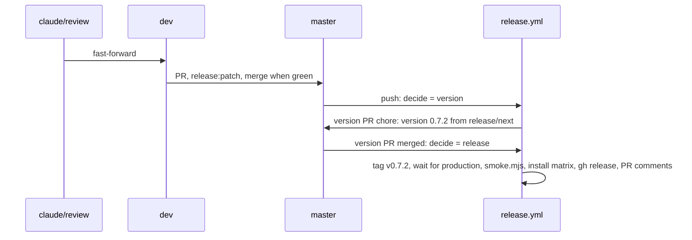

# 09.2: release 0.7.2

## 1. Architecture

### 1.1 Overview

Spec 09.1 reran the runtime gate in throwaway apps and shipped 0.7.1 with one consumer lint warning open (A38, now D59). This spec reruns that gate per base on the library with 02.1, 08.2 and 10.2 merged, adds the checks the round's decisions call for (hover bubble on the aria checkboxes, a hydration-clean `isLoading` page, zero consumer lint problems), then ships 0.7.2. Workstream T8 (index, Run plan): the gate milestone is one agent; the release runs inline in the main session on `claude/review`, `dev` and `master`, no spec branch or worktree. Release: label `release:patch` on the `dev` into `master` PR, version 0.7.2. Steps per P3.

### 1.2 Goals

- Per base, a throwaway Next 16 app under `test-projects/checks/gate-<base>/` installs the matching edition from `registry:dev`, passes `next build` and opens with zero console warnings and errors; the aria app logs zero React Aria warnings in `next dev` (D40) (D44)
- `gate-base`: `npx eslint components/ui/shadcn-table` zero problems, warnings included (D17) (D59)
- An `isLoading` page rendered on the server hydrates with no React hydration warning in any base (D50)
- Aria: hovering the row checkbox and the select-all checkbox shows the bubble with the localization text (D61); the spec 09.1 menu, search, Escape, RTL and pinned-column checks still pass in every app
- 0.7.2 released: version PR `chore: version 0.7.2` merged, `release.yml` green, `node scripts/release/smoke.mjs` green
- Acceptance: per base, `next build` exits 0 in `gate-<base>` and the browser check reports zero console warnings and errors on the gate, RTL and loading pages; `npx eslint components/ui/shadcn-table` exits 0 with zero warnings in `gate-base`; the aria bubble text equals `Toggle select row` on hover; `gh release view v0.7.2` succeeds and `node scripts/release/smoke.mjs` exits 0 (P6)

### 1.3 Current structure

```
../test-projects/
├── next-app/                         ← owner project, never touched (D40)
└── vite-app/                         ← owner project, never touched (D40)
CHANGELOG.md                          ← `## Unreleased` with the 02.1, 08.2, 10.2 blocks (D35)
.ai/plans/v0.7.x/anindosarker/trackers/09.1-tracker.md ← the 0.7.1 gate record: app setup, pages, checks, ports (reused as the recipe)
```

### 1.4 Target structure

```
../test-projects/checks/
├── gate-base/                        ← throwaway, Lucide edition
├── gate-radix/                       ← throwaway, Tabler edition (iconLibrary in components.json)
└── gate-aria/                        ← throwaway, Phosphor edition
    └── app/release-gate/page.tsx, app/release-gate/rtl/page.tsx, app/release-gate/loading/page.tsx ← the 09.1 pages plus the isLoading page, in every app
master                                ← tag v0.7.2, CHANGELOG `## 0.7.2 - <date>`
```

### 1.5 Flow



### 1.6 Components

#### 1.6.1 Data artifacts

- `CHANGELOG.md`: the `#### Spec NN.M` blocks regrouped under the standard headings (D35) before the `dev` into `master` PR; match `\n## Unreleased\n`, never the backticked text in the intro paragraph; the version PR renames `## Unreleased` to `## 0.7.2 - <date>`
- `packages/shadcn-table/package.json` `version` `0.7.2`, through the version PR
- `test-projects/checks/gate-<base>/`: created by this spec, deleted in cleanup; nothing in the repo

#### 1.6.2 Runtime gate

Spec 09.1 1.6.2 as the recipe (its tracker records the exact commands, ports and page shapes), three throwaway apps, plus this round's checks.

- Registry: root `pnpm registry:dev` on `claude/review` after 02.1, 08.2 and 10.2 merged, port 5310 (reuse if running, P4)
- Apps: `pnpm dlx shadcn@latest init --template next --base <base> --preset nova --name gate-<base> --yes` under `../test-projects/checks/`; the CLI has no `--icon-library` flag, so `iconLibrary` is set in `components.json` before the add (`lucide` base, `tabler` radix, `phosphor` aria); then `shadcn add` of `shadcn-table-base`, `shadcn-table-radix-tabler`, `shadcn-table-aria-phosphor` from 5310
- Edition check: the table's `icons.ts` imports only the chosen package (D40)
- Pages: the 09.1 `release-gate` and `release-gate/rtl` pages (same columns and options, `firstName` pinned `left`), plus `release-gate/loading`: a server-rendered page (no `'use client'` on the page; the table in a client component) whose table starts with `state={{ isLoading: true }}` and 10 placeholder rows, so the skeletons render on the server and hydrate on the client
- Browser (agent-browser, `next dev` on the app's port): the 09.1 menu, search, Escape, RTL and pinned-column checks (D40) (D45) (D46) (D47); on the loading page, the console after hydration holds no message matching `Hydration|hydrat|did not match` (D50); aria only: pointer over the first row checkbox shows `[role="tooltip"]` with text `Toggle select row`, over the header checkbox `Toggle select all`, and Tab from the previous control lands on the checkbox input (D61); console zero warnings and errors on every page, the aria app zero React Aria warnings (D44)
- `gate-base`: `npx eslint components/ui/shadcn-table` zero problems, zero warnings (D17) (D59)
- Does NOT touch `test-projects/next-app` or `vite-app`, commit outside this repo, or change library source; a failure goes to `ATTENTION-<date>.md` naming the owning spec (02.1, 08.2, 10.2, or an earlier one)

**Operations:**

| Operation | Status | Notes |
| --- | --- | --- |
| `gate-base`, `gate-radix`, `gate-aria` apps | new | under `test-projects/checks/`, deleted in cleanup (D40) |
| gate pages | new | per app, 09.1 pages plus `release-gate/loading` |

**Stays unchanged:** library source, `smoke.mjs`, `release.yml`.

#### 1.6.3 Release

| Operation | Status | Notes |
| --- | --- | --- |
| changelog regroup | keep | `#### Spec NN.M` lines under `### Fixed`, `### Docs` (D35); the intro paragraph untouched |
| `claude/review` into `dev` | keep | fast-forward, push |
| PR `dev` into `master` | keep | title `release: 0.7.2`, label `release:patch`, `pr.yml` green, merged `merge: release 0.7.2 (#<N>)` |
| version PR `chore: version 0.7.2` | keep | opened by `release.yml`; merged `merge: version 0.7.2 (#<N>)` |
| `release.yml` release path | keep | tag `v0.7.2`, wait for production, `smoke.mjs`, install matrix, `gh release create`, PR comments |

**Stays unchanged:** `release.yml`, rulesets, library source, `smoke.mjs`.

### 1.7 Dependencies and env: none new

## 2. Instructions for AI

### 2.1 Milestones

#### 2.1.1 Milestone 1: Runtime gate

Lane: agent

- 1.6.2 for base, radix and aria, one app each under `../test-projects/checks/`; the 09.1 tracker's runtime gate record is the recipe; the agent's own dev ports in 5340 to 5360 (P5)
- Record per base in `../trackers/09.2-tracker.md`: edition and `icons.ts` import, build result, eslint count (base, errors and warnings), console counts per page (warnings, errors, React Aria warnings, hydration messages), each menu's focus target and second-click result, the search ring and the two width samples, the full-screen Escape result, the RTL handle edge and pinned offset, the aria bubble text on the row and header checkboxes and the Tab target
- Blocked: any console warning or error, a hydration message, an eslint problem or warning, a menu or search or Escape or bubble check failing, a wrong edition import, an RTL edge wrong; each to `ATTENTION-<date>.md` with the owning spec
- Stop the servers this milestone started; leave the apps on disk and the 5310 registry running (P4)
- Gates: per base `next build` green, console zero on the three pages, the menu, search, Escape, RTL and bubble checks (D40) (D44) (D45) (D46) (D61), no hydration message (D50); `gate-base` eslint zero problems and zero warnings (D17) (D59)

#### 2.1.2 Final milestone: Release and cleanup

Lane: inline

- Delete `../test-projects/checks/gate-*`; stop the 5310 registry when this run started it (P5)
- 1.6.1 changelog regroup, then 1.6.3 in order; push right after each merge; after the release fast-forward `claude/review` and `dev` to `master` (P1)
- Blocked: `release.yml` or `smoke.mjs` red; the failed step under `## Attention` in `../trackers/09.2-tracker.md`, rerun per P3
- Gates: 2.2

### 2.2 Gates

- Per base: `next build` green; console zero warnings and errors on the gate page, the RTL page and the loading page; aria zero React Aria warnings (D44); no hydration message on the loading page (D50)
- Per base: the five menus return focus, flip `aria-expanded`, close on a second opener click (F61); search field ring visible after a pointer-opened reveal (D45), close without a snap (D40); Escape on the focused full-screen toggle exits (D46); RTL handle at the inline-end edge, pinned cell `inset-inline-start` set (D31) (D40); pinned column over the scrolled columns in both themes (D47, one capture per base and theme, judged only if a capture looks wrong to the agent)
- Aria: row and header checkbox bubbles with the localization text, no extra Tab stop (D61)
- `gate-base`: `npx eslint components/ui/shadcn-table` zero problems, zero warnings (D17) (D59)
- `pr.yml` green on the `dev` into `master` PR
- Version PR `chore: version 0.7.2` merged; `release.yml` green, install matrix included
- `node scripts/release/smoke.mjs` green against www.shadcn-table.com
