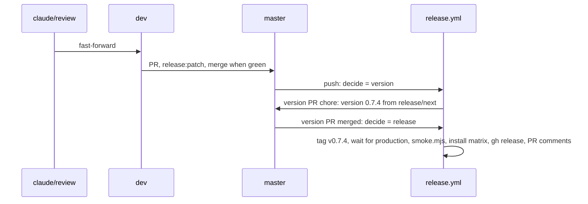

# 09.4: release 0.7.4

## 1. Architecture

### 1.1 Overview

Spec 09.3 ran the runtime gate in throwaway apps (D40). This spec reruns it per base, on the library with 10.4 merged, then ships 0.7.4 (D52, D65, D66). Workstream T12 (index, Run plan): inline in the main session after T11 merges; works on `claude/review`, `dev` and `master`, no spec branch or worktree. Release: label `release:patch` on the `dev` into `master` PR, version 0.7.4. Steps per P3.

### 1.2 Goals

- Per base, a throwaway Next 16 app under `test-projects/checks/gate-<base>/` installs the matching edition from `registry:dev`, passes `next build` and opens with zero console warnings and errors; the aria app logs zero React Aria warnings in `next dev` (D40) (D44)
- `gate-base`: `npx eslint components/ui/shadcn-table` zero problems (D17)
- The five menus, the search field (D45), the full-screen Escape from the focused toggle (D46), the RTL page and the pinned column over the scrolled columns in both themes (D47) pass in every app; the loading page logs no hydration warning (D50); the aria row checkbox shows its bubble on hover (D61); the select checkbox measures centred in the body cell and on the header line, the same in every app within 1 px (D64); in every app the single-selection page has one `role="radiogroup"` with one `role="radio"` per row, ArrowDown moves the check to the next row, and the progress bar on the loading page has `aria-label="Loading"` (D65) (D66)
- 0.7.4 released: version PR `chore: version 0.7.4` merged, `release.yml` green, `node scripts/release/smoke.mjs` green
- Acceptance: per base, `next build` exits 0 in `gate-<base>` and the browser check reports zero console warnings and errors; `eslint components/ui/shadcn-table` exits 0 in `gate-base`; `gh release view v0.7.4` succeeds and `node scripts/release/smoke.mjs` exits 0 (P6)

### 1.3 Current structure

```
../test-projects/
├── next-app/                         ← owner project, never touched (D40)
└── vite-app/                         ← owner project, never touched (D40)
CHANGELOG.md                          ← `## Unreleased` with the 10.4 block (D35)
```

### 1.4 Target structure

```
../test-projects/checks/
├── gate-base/                        ← throwaway, Lucide edition, --icon-library lucide
├── gate-radix/                       ← throwaway, Tabler edition, --icon-library tabler
└── gate-aria/                        ← throwaway, Phosphor edition, --icon-library phosphor
    └── app/release-gate/page.tsx, app/release-gate/rtl/page.tsx   ← the spec 09 gate pages, in every app
master                                ← tag v0.7.4, CHANGELOG `## 0.7.4 - <date>`
```

### 1.5 Flow



### 1.6 Components

#### 1.6.1 Data artifacts

- `CHANGELOG.md`: the `#### Spec 10.4` block regrouped under `### Fixed` (D35) before the `dev` into `master` PR; the version PR renames `## Unreleased` to `## 0.7.4 - <date>`
- `packages/shadcn-table/package.json` `version` `0.7.4`, through the version PR
- `test-projects/checks/gate-<base>/`: created by this spec, deleted in cleanup; nothing in the repo

#### 1.6.2 Runtime gate

Spec 09.3 1.6.2 as run on 2026-11-03 (`trackers/09.3-tracker.md`), three throwaway apps, one base after another (P4).

- Registry: root `pnpm registry:dev` on `claude/review` after 10.4 merged, port 5310 (`/r/shadcn-table-<edition>.json`)
- Apps: `pnpm dlx shadcn@latest init --template next --base <base> --preset nova --icon-library <set> --name gate-<base> --yes` under `../test-projects/checks/`, sets `lucide`, `tabler`, `phosphor`; then `shadcn add` of `shadcn-table-base`, `shadcn-table-radix-tabler`, `shadcn-table-aria-phosphor` from 5310
- Edition check: the table's `icons.ts` imports only the chosen package (D40)
- Pages: spec 09's `release-gate` and `release-gate/rtl` pages, same columns and options, plus `enableColumnPinning` with `firstName` pinned to `left` on the gate page so the pinned-edge shadow renders, and `release-gate/loading/page.tsx` rendering the table with `isLoading` for the hydration check (D50)
- Browser (agent-browser, `next dev` on the app's port): the spec 09 menu checks; the search field opens focused with a visible ring after a pointer click on the toggle (D45) and closes without a snap, width sampled relative to the transition start (D40); Escape with focus on the full-screen toggle after a mouse click exits full screen (D46); the RTL page handle at the inline-end edge and `inset-inline-start` set on the pinned cell (D31) (D40); a capture of the pinned column in light and dark on the gate page, scrolled to the middle, judged "pinned column over the scrolled columns, no text bleed" by three judges (D47); console zero warnings and errors on every page including the loading page (no hydration warning, D50), the aria app zero React Aria warnings (D44); in the aria app, hovering the visible `label[data-slot=checkbox]` of a row checkbox shows a `[data-slot=tooltip-content]` with "Toggle select row" (D61); on the gate page, `getBoundingClientRect` of the first body row's select control and its `td`, and of the header select control and its `th`: body control centre equals cell centre within 1 px, header control top equals the header text top within 1 px, the three apps equal within 1 px (D64), the four numbers recorded per base; `release-gate/single/page.tsx` renders the table with `enableMultiRowSelection: false`: one `[role=radiogroup]`, one `[role=radio]` per row, a click on row 2 checks it, ArrowDown moves the check to row 3 and `getState().rowSelection` has that row only (D65); on the loading page the progress bar element has `aria-label="Loading"` in every base (D66)
- Does NOT touch `test-projects/next-app` or `vite-app`, commit outside this repo, or change library source; a failure goes to `ATTENTION-<date>.md` naming the owning spec

**Operations:**

| Operation | Status | Notes |
| --- | --- | --- |
| `gate-base`, `gate-radix`, `gate-aria` apps | new | under `test-projects/checks/`, deleted in cleanup (D40) |
| gate pages | new | per app, from spec 09 1.6.2 plus the pinned column |

#### 1.6.3 Release

| Operation | Status | Notes |
| --- | --- | --- |
| changelog regroup | keep | `#### Spec NN.M` lines under `### Fixed`, `### Changed`, `### Docs` (D35) |
| `claude/review` into `dev` | keep | fast-forward, push |
| PR `dev` into `master` | keep | label `release:patch`, `pr.yml` green, merged |
| version PR `chore: version 0.7.4` | keep | opened by `release.yml`; merged when green |
| `release.yml` release path | keep | tag `v0.7.4`, wait for production, `smoke.mjs`, install matrix, `gh release create`, PR comments |

**Stays unchanged:** `release.yml`, rulesets, library source, `smoke.mjs`.

### 1.7 Dependencies and env: none new

## 2. Instructions for AI

### 2.1 Milestones

#### 2.1.1 Milestone 1: Runtime gate

Lane: agent

- 1.6.2 for base, radix and aria, one app each under `../test-projects/checks/`, one base after another (P4); one root `pnpm registry:dev` on 5310 (reuse if running, P4); the agent's own free dev ports in 5340 to 5360 (P5)
- Record per base in `../trackers/09.4-tracker.md`: edition and `icons.ts` import, build result, eslint count (base), console counts (warnings, errors, React Aria warnings), each menu's focus target and second-click result, the search ring and the two width samples, the full-screen Escape result, the RTL handle edge and pinned offset, the four D64 offsets, the radio group and ArrowDown result, the progress bar label, the capture paths and the three judge verdicts
- Blocked: any console warning or error, an eslint problem, a menu or search or Escape check failing, a wrong edition import, an RTL edge wrong, a D64 offset off by more than 1 px, a radio group, ArrowDown or label check failing, a judge majority against; each to `ATTENTION-<date>.md` with the owning spec (10.4, 10.3, 02.1, 10.2, 08.2, 11)
- Gates: per base `next build` green, console zero, the menu, search, Escape, RTL, shadow, alignment, radio group and label checks (D40) (D44) (D45) (D46) (D47) (D64) (D65) (D66); `gate-base` eslint zero problems and zero warnings (D17, D59)

#### 2.1.2 Final milestone: Release and cleanup

Lane: inline

- Delete `../test-projects/checks/gate-*`; stop the servers this spec started
- 1.6.1 changelog regroup, then 1.6.3 in order; push right after each merge
- Blocked: `release.yml` or `smoke.mjs` red; the failed step under `## Attention` in `../trackers/09.4-tracker.md`, rerun per P3
- Gates: 2.2

### 2.2 Gates

- Per base: `next build` green; console zero warnings and errors on the gate page and the RTL page; aria zero React Aria warnings (D44)
- Per base: the five menus return focus, flip `aria-expanded`, close on a second opener click (F61); search field ring visible after a pointer-opened reveal (D45), close without a snap (D40); Escape on the focused full-screen toggle exits (D46); RTL handle at the inline-end edge, pinned cell `inset-inline-start` set (D31) (D40); three judges pass the pinned-column captures in both themes (D47); the select checkbox offsets within 1 px of target and of each other (D64); one radio group per table, ArrowDown moves the selection (D65); progress bar `aria-label` "Loading" (D66)
- `gate-base`: `npx eslint components/ui/shadcn-table` zero problems (D17)
- `pr.yml` green on the `dev` into `master` PR
- Version PR `chore: version 0.7.4` merged; `release.yml` green, install matrix included
- `node scripts/release/smoke.mjs` green against www.shadcn-table.com
