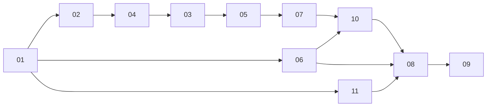

# v0.7.x plan

Index. Decisions: [decisions.md](decisions.md) D1 to D33; findings: [findings.md](findings.md) F1 to F60 (F21, F22 and F45 left open by the owner). Parts implement them and never re-decide. Released together as 0.7.0.

## Goals

- A Next 16 consumer on default `eslint-config-next`, React 19.3 and Tailwind 4.3 opens the installed library with zero editor errors, warnings, strikethroughs or canonical-class hints (F1 to F13)
- The library repo reports the same zero: `pnpm lint` and `pnpm check:tailwind` run the React Compiler rules, `no-deprecated` and the canonical-class check on every library file (D16) (D17) (D19)
- Shipped source carries no porting history, restated code, stale notes, file-wide suppressions or dead exports (D18 to D20)
- Three files sit in the folders of their kind, nothing else moves (D1)
- Docs: one install command with base, package manager, locale and icon library selectors, an optional short namespace form and a shadcn create section; a base selector on every example toolbar; the headless example explains the spacer column and the full-screen hook (D2) (D3) (D24) (D29) (D30) (D33)
- The bugs from the next-app header demo are fixed and every shadcn part is used as its primitive is designed, inside the current architecture: anchor spans stay, Collapsible stays, no public prop or type removed (D21 to D29)
- Icons follow the project: `shadcn-table-core` plus one edition item per icon library, one `icons.ts` per consumer, Lucide only when chosen (D30)
- Direction classes are logical and shadows follow the theme (D31) (D32)
- All three bases identical in every change; registry output regenerated, docs app copies re-installed

## Parts

| # | Part | Scope |
|---|---|---|
| 01 | [restructure](01-restructure.md) | `ST_Checkbox.tsx` to `components/inputs/`, `ST_Tooltip.tsx` to `components/buttons/`, `useST_MediaQuery.ts` to `hooks/`; imports, barrel, diff JSON lists, `registry:build`, docs app copies, standards line (D1) |
| 02 | [lint parity](02-lint-parity.md) | `eslint-plugin-react-hooks` 7 `recommended`, exemption block and `^_` patterns gone, `no-deprecated`, unused-directive and require-description gates; hooks unconditional, composed-ref hook, menu anchors in state, `useEffectEvent` with React peer `^19.2.0`, no param reassignment, `initialState` copied, reasoned handler disables, no setState in effects, inline memo functions and plain deps, complete dependency lists, `'use no memo'` on the virtualizer hooks, `_` bindings and ternary statements gone (D4) (D5) (D7) (D8) (D9) (D12) (D14) (D15) (D17) (D19) |
| 03 | [table instance atoms](03-table-instance-atoms.md) | `useST_TableInstance` owns its transform slices as TanStack atoms passed through `atoms`, read with `useSelector`, `tableRef` and `columnDefsRef` gone, `isFrozen` selector (D6) |
| 04 | [types without any](04-types-without-any.md) | 43 `any` sites to `unknown`, generics or `never[]`; casts and assertions the new types make unnecessary removed; typecheck across library, stories, docs examples and installs (D10) |
| 05 | [deprecations](05-deprecations.md) | registries from `aggregationFn_*`, `filterFn_*`, `sortFn_*` named imports; platform helper; `table.Subscribe`, `table.atoms.<slice>.get()`, per-atom page index subscription; zero `table.store` (D11) (D13) |
| 06 | [tailwind canonical](06-tailwind-canonical.md) | 22 canonical class forms at 37 sites; `check:tailwind` gate on `canonicalizeCandidates` and on physical direction classes; logical direction classes and inline-axis pinning; theme-driven shadows (D16) (D31) (D32) |
| 07 | [comments and dead code](07-comments-dead-code.md) | contract-only comments, shared rationale stated once, long blocks and the stale note cut, `getCommonToolbarStyles` deleted, `useST_MenuAnchor` hook, standards and review checklist line (D18) (D20) |
| 08 | [docs install UI](08-docs-install-ui.md) | `InstallCommand` with locale and icon library selectors and a Short form toggle, codes and export names generated from the registry, shadcn create section, Customize Icons editions section, the existing style rewrites verified, introduction and README lines, base selector on every example toolbar, headless example spacer note and `containerProps` (D2) (D3) (D24) (D29) (D30) (D33) |
| 09 | [release](09-release.md) | runtime gate per base in a Next 16 app from the local registry with one edition per base and an RTL page, `next build`, zero console warnings, zero consumer lint; release 0.7.0 through `dev` and `master`, smoke (D5) (D16) (D17) (D30) (D31) |
| 10 | [bug fixes and parts as designed](10-bug-fixes.md) | range filter copies state, ranked results on real filter change, pagination className, Collapsible panels one mechanism, menu anchor hook fixes and filter-mode submenu, show-hide checkbox items, parts-as-designed remainder, Button props type and full-screen container hook (D21) (D22) (D23) (D25) (D26) (D27) (D28) (D29) |
| 11 | [icon editions](11-icon-sets.md) | icon maps for Tabler, Phosphor, Hugeicons and Remix with the same keys, typed icons, core item plus five editions in the registry, locale and example items on core, editions in the docs app and next-app installs (D30) |

## Dependencies

- 01 first; every later library part touches import lines it moves.
- The library parts run in one chain, 02, 04, 03, 05, 07, 10, each branching from `claude/review` after the one before merged. 02 turns the new rules on and fixes everything local, so `claude/review` never sits red; 04 and 05 delete the part 02 temporary blocks they own; 03 needs the `refs` rule live; 05 needs 03 for the `useSelector(table.store)` site; 07 builds on the five menus in state (D5) and the composed-ref hook; 10 extends the menu-anchor hook from 07 (D20) (D26), uses the composed-ref hook from 02 (D5) and runs `check:tailwind` from 06 as a gate (D16), so it also waits for 06.
- 06 and 11 run parallel to that chain after 01, each in its own worktree. 11 owns `icons.ts`, `icons/`, the icon types in `types.ts` and two import lines, and 04 leaves `icons.ts:74` to it (D30); 06 touches class strings; the later merger rebases.
- 08 branches after 06, 10 and 11 merge: it publishes the React and Tailwind minimums (D5) (D16), the edition items (D30) and spreads the full-screen hook that 10 creates (D29).
- 09 runs last, after 08 (and so after every other part).
- Every part adds to `CHANGELOG.md` `## Unreleased`. The first part to merge creates `## Unreleased` in `CHANGELOG.md` (none today; the first heading is `## 0.6.4` at line 10).
- The later merger rebases; a hunk that only changes comments yields to the code change.

### File ownership

| Part | Owns |
|---|---|
| 02 | `packages/shadcn-table/eslint.config.*`, `package.json` peer and dev dependencies, `hooks/useST_ComposedRef.ts`; lint fixes in every library file |
| 03 | `hooks/useST_TableInstance.ts` and the readers of `tableRef`, `columnDefsRef`, `isFrozen` |
| 04 | type sites in every library file, `types.ts` except the icon types |
| 05 | `shared/fns/*` registries, platform helper, `table.store` readers in library, stories and docs examples |
| 06 | class strings in every library file, `scripts/check-tailwind.mjs`, `style.utils.ts` shadows, pinning offsets |
| 07 | comments in every library file, `hooks/useST_MenuAnchor.ts`, `getCommonToolbarStyles` deletion, the five menus |
| 10 | filters, ranked results effect, pagination, Collapsible users, menus, show-hide rows, `useST_FullScreenContainer.ts`, `ST_TableLayout.tsx` |
| 11 | `icons.ts`, `icons/*`, icon types in `types.ts`, two import lines, registry scripts and items, workflows |
| 08 | docs app only |

02, 04, 05 and 07 touch the same files with different edits (lint, types, deprecations, comments); their order is convenience, not a code dependency, once 02's config and 03's atoms exist. 06 and 11 touch disjoint lines and files.

### Run schedule

| Run | Parts | Branch, worktree | Starts |
|---|---|---|---|
| library sweep | 02, 03, 04, 05, 07 | `v0.7/library-sweep`, `library-sweep` | now |
| tailwind | 06 | `v0.7/tailwind-canonical`, `tailwind-canonical` | now |
| icons | 11 | `v0.7/icon-sets`, `icon-sets` | now |
| bug fixes | 10 | `v0.7/bug-fixes`, `bug-fixes` | sweep and tailwind merged |
| docs | 08 | `v0.7/docs-install-ui`, `docs-install-ui` | bug fixes and icons merged |
| release | 09 | none | docs merged |

Library sweep, one Workflow run, resumable:

1. Lead prework, one agent: 02 phase 1 (config, dependencies, `useST_ComposedRef.ts`), 03 phases 1 and 2 (atoms, all bases), 05 phase 1 (registries, platform helper), 07 phase 1 (`useST_MenuAnchor.ts`, dead export). No temporary disable blocks: the fan-out fixes the `any` and `no-deprecated` hits directly, so the blocks 02 planned for 04 and 05 are never written.
2. Fan-out by file set: each agent owns a disjoint set of library files, the same file in all three bases, and applies 02 phase 2, 04, 05 phase 2 and 07 phase 2 to them in one pass. Stories and docs examples (05 phase 3) are their own sets.
3. Gates once per base in parallel, fix loop at most 3 rounds, one fable verify against D4 to D20, then the cleanup phases of the five parts.

Trackers 02, 03, 04, 05 and 07 cite the shared commits and the run id. Part files keep their phases as the specification of what each file set receives; the run schedule above decides the order.

## Integration

- Branches and worktrees per the run schedule above; one worktree per run, none for 09, which changes no repo file.
- Each run: merge commit into `claude/review` the moment its local gates are green, pushed at once; CI on the push is the second run and never blocks. No PR before part 09 (the `dev` into `master` PR carries `release:minor`). A red run on `claude/review` is fixed forward by the running part.
- The next run never waits: it branches from the merge, or from the previous run's tip while that merge is pending.
- Runtime gate and release: [part 09](09-release.md).

## Process rules

- Trackers `NN-tracker.md`; owner judgment calls in `ATTENTION-<date>.md`.
- Halt on: a change to an existing registry item name or hosted path (part 11 adds `shadcn-table-core` and the edition items and re-points dependencies; it renames nothing), a part (shadcn ui file) edit of any kind, a public option or type removed, a GitHub ruleset or repository setting change, any `eslint-disable` added without a reason.
- A decision that no longer fits is an ATTENTION item, never a silent change.
