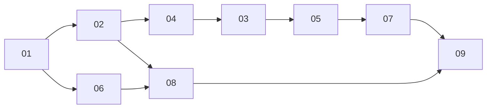

# v0.7.x plan

Index. Decisions: [decisions.md](decisions.md) D1 to D20; findings: [findings.md](findings.md) F1 to F26. Parts implement them and never re-decide. Released together as 0.7.0.

## Goals

- A Next 16 consumer on default `eslint-config-next`, React 19.3 and Tailwind 4.3 opens the installed library with zero editor errors, warnings, strikethroughs or canonical-class hints (F1 to F13)
- The library repo reports the same zero: `pnpm lint` and `pnpm check:tailwind` run the React Compiler rules, `no-deprecated` and the canonical-class check on every library file (D16) (D17) (D19)
- Shipped source carries no porting history, restated code, stale notes, file-wide suppressions or dead exports (D18 to D20)
- Three files sit in the folders of their kind, nothing else moves (D1)
- Docs: one install command with base, package manager and locale selectors; a base selector on every example toolbar (D2) (D3)
- All three bases identical in every change; registry output regenerated, docs app copies re-installed

## Parts

| # | Part | Scope |
|---|---|---|
| 01 | [restructure](01-restructure.md) | `ST_Checkbox.tsx` to `components/inputs/`, `ST_Tooltip.tsx` to `components/buttons/`, `useST_MediaQuery.ts` to `hooks/`; imports, barrel, diff JSON lists, `registry:build`, docs app copies, standards line (D1) |
| 02 | [lint parity](02-lint-parity.md) | `eslint-plugin-react-hooks` 7 `recommended`, exemption block and `^_` patterns gone, `no-deprecated`, unused-directive and require-description gates; hooks unconditional, composed-ref hook, menu anchors in state, `useEffectEvent` with React peer `^19.2.0`, no param reassignment, `initialState` copied, reasoned handler disables, no setState in effects, inline memo functions and plain deps, complete dependency lists, `'use no memo'` on the virtualizer hooks, `_` bindings and ternary statements gone (D4, D5, D7, D8, D9, D12, D14, D15, D17, D19) |
| 03 | [table instance atoms](03-table-instance-atoms.md) | `useST_TableInstance` owns its transform slices as TanStack atoms passed through `atoms`, read with `useSelector`, `tableRef` and `columnDefsRef` gone, `isFrozen` selector (D6) |
| 04 | [types without any](04-types-without-any.md) | 43 `any` sites to `unknown`, generics or `never[]`; casts and assertions the new types make unnecessary removed; typecheck across library, stories, docs examples and installs (D10) |
| 05 | [deprecations](05-deprecations.md) | registries from `aggregationFn_*`, `filterFn_*`, `sortFn_*` named imports; platform helper; `table.Subscribe`, `table.atoms.<slice>.get()`, per-atom page index subscription; zero `table.store` (D11, D13) |
| 06 | [tailwind canonical](06-tailwind-canonical.md) | 22 canonical class forms at 37 sites; `check:tailwind` gate on `canonicalizeCandidates` (D16) |
| 07 | [comments and dead code](07-comments-dead-code.md) | contract-only comments, shared rationale stated once, long blocks and the stale note cut, `getCommonToolbarStyles` deleted, `useST_MenuAnchor` hook, standards and review checklist line (D18, D20) |
| 08 | [docs install UI](08-docs-install-ui.md) | `InstallCommand` with a locale selector on the Localization guide, codes and export names generated from the registry, introduction and README lines, base selector on every example toolbar bound to the stored base (D2, D3) |
| 09 | [release](09-release.md) | runtime gate per base in a Next 16 app from the local registry, `next build`, zero console warnings, zero consumer lint; release 0.7.0 through `dev` and `master`, smoke (D5) (D16) (D17) |

## Dependencies

- 01 first; every later library part touches import lines it moves.
- The library parts run in one chain, 02, 04, 03, 05, 07, each branching from `claude/review` after the one before merged. 02 turns the new rules on and fixes everything local, so `claude/review` never sits red; 04 and 05 delete the part 02 temporary blocks they own; 03 needs the `refs` rule live; 05 needs 03 for the `useSelector(table.store)` site; 07 builds on the five menus in state (D5) and the composed-ref hook.
- 06 runs parallel to that chain after 01.
- 08 branches after 02 and 06 merge: it publishes their React and Tailwind minimums (D5) (D16).
- 09 runs last, after 07 and 08.
- Every part adds to `CHANGELOG.md` `## Unreleased`. The first part to merge creates `## Unreleased` in `CHANGELOG.md` (none today; the first heading is `## 0.6.4` at line 10).
- The later merger rebases; a hunk that only changes comments yields to the code change.

## Integration

- Branches `v0.7/<part-slug>`; worktrees at `shadcn-react-table.worktrees/<part-slug>`, one part per worktree, every part except 09, which changes no repo file.
- Each part: one PR into `claude/review` for CI only, merged by merge commit once green; pushed right after each commit.
- Runtime gate and release: [part 09](09-release.md).

## Process rules

- Trackers `NN-tracker.md`; owner judgment calls in `ATTENTION-<date>.md`.
- Halt on: a change to a registry item name or hosted path, a part (shadcn ui file) edit of any kind, a public option or type removed, a GitHub ruleset or repository setting change, any `eslint-disable` added without a reason.
- A decision that no longer fits is an ATTENTION item, never a silent change.
