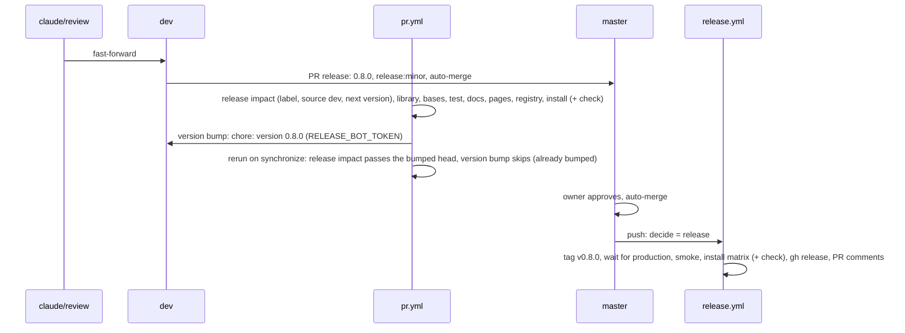

# 07: release 0.8.0

## 1. Architecture

### 1.1 Overview

Specs 01 to 06 prove the library with types, lint, Storybook play tests, judged captures and the docs page check; none of them runs the installed files in a consumer app. This spec installs the table from the local registry into a throwaway Next 16 app per base, builds it, opens it with zero console warnings and exercises the new chrome, then ships 0.8.0 as a minor release (D32). Workstream S (index, Run plan): inline in the main session after E merges; works on `claude/review`, `dev` and `master`, no spec branch or worktree. Release: label `release:minor` on the `dev` into `master` PR, version 0.8.0. Steps per P3.

### 1.2 Goals

- Per base, a throwaway Next 16 app under `../test-projects/checks/gate-<base>/` installs the matching edition from `registry:dev`, passes `next build` and opens with zero console warnings and errors; the aria app logs zero React Aria warnings in `next dev` (v0.7.x D40) (v0.7.x D44)
- `gate-base`: `npx eslint components/ui/shadcn-table` zero problems (v0.7.x D17)
- In every app the stock page shows the new look with persistence off: no `localStorage` key written, no inline `<script>` inside the table root, the server HTML carries the full body (D36); the toolbar sits above the frame with the group in D8's order (D1) (D8); the column menu opens from the chevron and from the label and lists D5's items only (D4) (D5); "Filter" adds a chip that opens its editor, "+ Filter" opens the picker, "Clear filters" empties the row (D9); the sort button opens the picker, a chosen column becomes a chip and the editor reorders by drag (D10); the view settings panel shows the seven rows and Reset view, Columns and Density are pinned (D11); a header drag previews in the header row, drops with the body slide and highlight, Escape cancels (D20) (D37); a locked column shows the striped overlay only while dragging and the disabled "Fixed position" item (D21); with columns hidden on a side the pinned edge casts the shadow and the hover chevron scrolls (D22); the search toggle clears and closes with one click and the field has no inline X (D35); the actions column is last, pinned, with horizontal dots (D14)
- The persisted page (`persistViewSettings: true`, a stored reorder) reloads without ever painting the default order: the pending mark is present before hydration and gone after, `aria-busy` while marked (D36)
- 0.8.0 released: `release.yml` green on the merge of the release PR, `node scripts/release/smoke.mjs` green
- Acceptance: per base, `next build` exits 0 in `gate-<base>` and the browser check reports zero console warnings and errors; `eslint components/ui/shadcn-table` exits 0 in `gate-base`; the chrome checks of 1.6.2 pass in every app; judged: captures of the install smoke page in light and dark per base against `reference/01-default-light.png` and `reference/01-default-dark.png` (D34), three judges on "toolbar above the frame, quiet header, rows-only lines, pages footer, same proportions" (P6); `gh release view v0.8.0` succeeds and `node scripts/release/smoke.mjs` exits 0

### 1.3 Current structure

```
../test-projects/
├── next-app/                         ← owner project and the reference demo, never touched (D34)
├── vite-app/                         ← owner project, never touched
└── checks/                           ← empty between release specs
CHANGELOG.md                          ← `## Unreleased` with the spec blocks and the `### Changed` way-back list (D32)
```

### 1.4 Target structure

```
../test-projects/checks/
├── gate-base/                        ← throwaway, Lucide edition, --icon-library lucide
├── gate-radix/                       ← throwaway, Tabler edition, --icon-library tabler
└── gate-aria/                        ← throwaway, Phosphor edition, --icon-library phosphor
    ├── app/release-gate/page.tsx     ← stock table, the demo's columns and data shape, two locked columns, row actions
    ├── app/release-gate/persisted/page.tsx  ← the same with persistViewSettings: true
    └── app/release-gate/rtl/page.tsx ← dir="rtl", columnResizeDirection 'rtl', a pinned column (v0.7.x D31)
master                                ← tag v0.8.0, CHANGELOG `## 0.8.0 - <date>`
```

### 1.5 Flow



### 1.6 Components

#### 1.6.1 Data artifacts

- `CHANGELOG.md`: the `#### Spec NN` blocks regrouped under `### Added`, `### Changed`, `### Fixed`, `### Docs` before the `dev` into `master` PR; `### Changed` keeps one line per flipped default with the option that restores it (D32); no `### Breaking`, no `### Removed` (D25 addendum); the release PR's last check renames `## Unreleased` to `## 0.8.0 - <date>`
- `packages/shadcn-table/package.json` `version` `0.8.0`, through the `version bump (release:prepare)` job
- `test-projects/checks/gate-<base>/`: created by this spec, deleted in cleanup; nothing in the repo

#### 1.6.2 Install smoke check

The CI step of epic 07.1 (D78, D79): the `install.yml` Next rows (`nextjs-base`, `nextjs-radix`, `nextjs-aria`) install the default edition per base, copy the install smoke pages, run `next build`, then `packages/shadcn-table/test/release/gate.mjs` against `next dev`.

- Pages: `release-gate`, `release-gate/persisted` (`persistViewSettings: true`), `release-gate/rtl` (v0.7.x D31), from `packages/shadcn-table/test/release/pages/`
- Checks: console zero warnings and errors per page, aria zero React Aria warnings (v0.7.x D40); the persisted view marked before first paint, `aria-busy` while marked, the stored order restored (D36); the RTL pinned header and resize handle on the inline-end edge; the chrome checks are the Storybook plays
- Captures: `default-light.png` and `default-dark.png` per base, compared by `pixelmatch` with the references under `packages/shadcn-table/test/release/reference/<base>/` (at most 500 differing pixels); the `gate-<base>` artifact carries the captures, any diff image and `result.json`
- Does NOT touch `test-projects/next-app` or `vite-app`, or change library source; a red is a rerun per P3, then an attention naming the owning epic

**Operations:**

| Operation | Status | Notes |
| --- | --- | --- |
| install smoke step | keep | `install / install (nextjs-<base> app)`, in `pr.yml` and `release.yml` |

#### 1.6.3 Release

| Operation | Status | Notes |
| --- | --- | --- |
| changelog regroup | keep | `#### Spec NN` lines under `### Added`, `### Changed`, `### Fixed`, `### Docs` (D32) |
| `claude/review` into `dev` | keep | fast-forward, push |
| PR `dev` into `master` | keep | label `release:minor`, `pr.yml` green, merged |
| version bump on the release PR | keep | `version bump (release:prepare)`, commit `chore: version 0.8.0` on `dev` |
| `release.yml` release path | keep | tag `v0.8.0`, wait for production, `smoke.mjs`, install matrix, `gh release create`, PR comments |

**Stays unchanged:** `release.yml`, rulesets, library source, `smoke.mjs`.

### 1.7 Dependencies and env: none new

## 2. Instructions for AI

### 2.1 Milestones

### Milestone: Release 0.8.0

- Files owned: none
- Depends on: Shared surface, Demo captures, Frame and body, Header, column menu and dragging, Toolbar chrome, Defaults and stories, Docs, Toolbar and filters, Cells and layout, Docs app, Stories and DefaultLook, Plays, Grouping header, Filters, toolbar, RTL, Docs follow-up, Edition icons, Component fixes (F3, F4, F5, F6), Check fixes (F8, F9), Multi-select filter on scalar values (F29), CI fixes after S6, S7, Filter editor focus ring (F31), Home demo columns (F32), Docs polish (F32, F33, F34, F35, F37), Popover-mode header widths (F38), Pinned view items in custom toolbars (F36), Last fixes (F19, F28, F30, F39, F40, F41, D56, D57), Custom toolbar actions follow row selection (F43), Subheader filter layout (F44), Home demo steps and titles (F45), Home demo polish (F45 follow-up), Moved column slides on top (F47), Home demo plays only with room for its popovers (F48, D63), Theme demo speed, Home demo cues and last title (F49, D65), Sanity pass (D58), Grouping column aligns start (F57), Expand column aligns start in every grouping mode (F58), View settings icons (D75), Home demo pace
- Review: none
- Task 1: Install smoke check (Lane: agent): 1.6.2 for base, radix and aria, one app each under `../test-projects/checks/`, bases concurrently (P4); one root `pnpm registry:dev` on 5310 (reuse if running, P4); the agent's own free dev ports in 5340 to 5360 (P5); Record per base in `../trackers/07-tracker.md`: edition and `icons.ts` import, build result, eslint count (base), console counts, each 1.6.2 check as pass or fail with the measured value where one exists (group order, translate values, scroll delta, pending attribute timing), the capture paths and the three judge verdicts; Blocked: any console warning or error, an eslint problem, a 1.6.2 check failing, a wrong edition import, a judge majority against; each to `attentions/ATTENTION-<date>.md` with the owning spec (02, 03, 04, 05, 01). Checks: per base `next build` green, console zero, the 1.6.2 checks; `gate-base` eslint zero problems and zero warnings
- Task 2: Release and cleanup (Lane: inline): Delete `../test-projects/checks/check-*`; stop the servers this spec started; 1.6.1 changelog regroup, then 1.6.3 in order; push right after each merge; Blocked: `release.yml` or `smoke.mjs` red; the failed step under `## Attention` in `../trackers/07-tracker.md`, rerun per P3. Checks: 2.2

### 2.2 Checks

- Per base: `next build` green; console zero warnings and errors on the three pages; aria zero React Aria warnings
- `gate-base`: `npx eslint components/ui/shadcn-table` zero problems
- The release is the one `dev` into `master` PR: `pr.yml` green including the check and the bump; `release.yml` green, install matrix included
- `node scripts/release/smoke.mjs` green against www.shadcn-table.com
