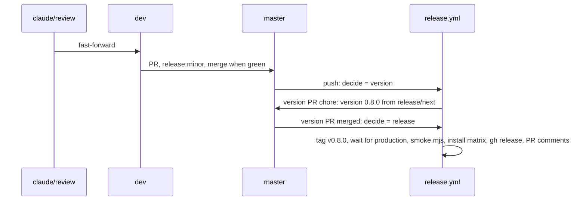

# 07: release 0.8.0

## 1. Architecture

### 1.1 Overview

Specs 01 to 06 prove the library with types, lint, Storybook play tests, judged captures and the docs page check; none of them runs the installed files in a consumer app. This spec installs the table from the local registry into a throwaway Next 16 app per base, builds it, opens it with zero console warnings and exercises the new chrome, then ships 0.8.0 as a minor release (D32). Workstream S (index, Run plan): inline in the main session after E merges; works on `claude/review`, `dev` and `master`, no spec branch or worktree. Release: label `release:minor` on the `dev` into `master` PR, version 0.8.0. Steps per P3.

### 1.2 Goals

- Per base, a throwaway Next 16 app under `../test-projects/checks/gate-<base>/` installs the matching edition from `registry:dev`, passes `next build` and opens with zero console warnings and errors; the aria app logs zero React Aria warnings in `next dev` (v0.7.x D40) (v0.7.x D44)
- `gate-base`: `npx eslint components/ui/shadcn-table` zero problems (v0.7.x D17)
- In every app the stock page shows the new look with persistence off: no `localStorage` key written, no inline `<script>` inside the table root, the server HTML carries the full body (D36); the toolbar sits above the frame with the group in D8's order (D1) (D8); the column menu opens from the chevron and from the label and lists D5's items only (D4) (D5); "Filter" adds a chip that opens its editor, "+ Filter" opens the picker, "Clear filters" empties the row (D9); the sort button opens the picker, a chosen column becomes a chip and the editor reorders by drag (D10); the view settings panel shows the seven rows and Reset view, Columns and Density are pinned (D11); a header drag previews in the header row, drops with the body slide and highlight, Escape cancels (D20) (D37); a locked column shows the striped overlay only while dragging and the disabled "Fixed position" item (D21); with columns hidden on a side the pinned edge casts the shadow and the hover chevron scrolls (D22); the search toggle clears and closes with one click and the field has no inline X (D35); the actions column is last, pinned, with horizontal dots (D14)
- The persisted page (`persistViewSettings: true`, a stored reorder) reloads without ever painting the default order: the pending mark is present before hydration and gone after, `aria-busy` while marked (D36)
- 0.8.0 released: version PR `chore: version 0.8.0` merged, `release.yml` green, `node scripts/release/smoke.mjs` green
- Acceptance: per base, `next build` exits 0 in `gate-<base>` and the browser check reports zero console warnings and errors; `eslint components/ui/shadcn-table` exits 0 in `gate-base`; the chrome checks of 1.6.2 pass in every app; judged: captures of the gate page in light and dark per base against `reference/01-default-light.png` and `reference/01-default-dark.png` (D34), three judges on "toolbar above the frame, quiet header, rows-only lines, pages footer, same proportions" (P6); `gh release view v0.8.0` succeeds and `node scripts/release/smoke.mjs` exits 0

### 1.3 Current structure

```
../test-projects/
├── next-app/                         ← owner project and the reference demo, never touched (D34)
├── vite-app/                         ← owner project, never touched
└── checks/                           ← empty between release specs
CHANGELOG.md                          ← `## Unreleased` with the spec blocks and the `### Changed` way-back list (D32)
```

### 1.4 Target structure

```
../test-projects/checks/
├── gate-base/                        ← throwaway, Lucide edition, --icon-library lucide
├── gate-radix/                       ← throwaway, Tabler edition, --icon-library tabler
└── gate-aria/                        ← throwaway, Phosphor edition, --icon-library phosphor
    ├── app/release-gate/page.tsx     ← stock table, the demo's columns and data shape, two locked columns, row actions
    ├── app/release-gate/persisted/page.tsx  ← the same with persistViewSettings: true
    └── app/release-gate/rtl/page.tsx ← dir="rtl", columnResizeDirection 'rtl', a pinned column (v0.7.x D31)
master                                ← tag v0.8.0, CHANGELOG `## 0.8.0 - <date>`
```

### 1.5 Flow



### 1.6 Components

#### 1.6.1 Data artifacts

- `CHANGELOG.md`: the `#### Spec NN` blocks regrouped under `### Added`, `### Changed`, `### Fixed`, `### Docs` before the `dev` into `master` PR; `### Changed` keeps one line per flipped default with the option that restores it (D32); no `### Breaking`, no `### Removed` (D25 addendum); the version PR renames `## Unreleased` to `## 0.8.0 - <date>`
- `packages/shadcn-table/package.json` `version` `0.8.0`, through the version PR
- `test-projects/checks/gate-<base>/`: created by this spec, deleted in cleanup; nothing in the repo

#### 1.6.2 Runtime gate

Spec v0.7.x 09.4 1.6.2 as run on 2026-11-04 (`.ai/plans/v0.7.x/anindosarker/trackers/09.4-tracker.md`), three throwaway apps, bases concurrently on their own ports (P4).

- Registry: root `pnpm registry:dev` on `claude/review` after S4 merged, port 5310 (`/r/shadcn-table-<edition>.json`)
- Apps: `pnpm dlx shadcn@latest init --template next --base <base> --preset nova --icon-library <set> --name gate-<base> --yes` under `../test-projects/checks/`, sets `lucide`, `tabler`, `phosphor`; then `shadcn add` of `shadcn-table-base`, `shadcn-table-radix-tabler`, `shadcn-table-aria-phosphor` from 5310
- Edition check: the table's `icons.ts` imports only the chosen package; every D18 key resolves to an icon in that set (no `undefined` render, `check:icons` green in the repo)
- Pages: `release-gate` (stock options, the demo's column set with `columnDef.icon` on each data column, `enableColumnOrdering: false` on Name and Due, `enableRowActions` with three items, 50 rows), `release-gate/persisted` (the same with `persistViewSettings: true`), `release-gate/rtl` (as v0.7.x 09.4)
- Browser (agent-browser, `next dev` on the app's port, viewport 1800 by 1150): per page, console zero warnings and errors; aria zero React Aria warnings. Gate page checks in order: no `localStorage` key starting `shadcn-table:` after interaction with persistence off and no `<script>` inside `[data-slot=st-table-layout]`; toolbar group order by `aria-label` (search toggle, filter, sort, pinned Columns, pinned Density, full screen, view settings) (D8); chevron click opens the column menu, label click opens the same menu, items present per state (D4) (D5), second click closes (D25); "Filter" on Status adds a chip and opens its popover, a value filters rows, "Clear filters" removes it (D9); sort button opens the picker, choosing Due adds the chip, the editor lists one rule, "Add sort" then Status gives two, drag handle reorders them, "Delete sort" clears (D10); view settings panel lists Columns, Density, Wrap cell text, Grid lines, Sticky header, Alternating row colors, Row numbers, Reset view; toggling Row numbers adds the `#` column pinned start; Reset view restores (D11); header drag of Assignee onto Project: during the drag the Project header carries a non-zero `translate` and body cells carry none, after drop the column order changes and the moved column's cells run the highlight animation, Escape mid-drag restores (D37); drag over Name shows the striped overlay and the not-allowed cursor, Name's menu has a disabled "Fixed position" (D21); with the window narrowed so columns overflow, the pinned-end edge cell has the drop shadow and hovering the table shows the right chevron, a click scrolls by about 80 percent of the visible unpinned width (D22); search toggle opens the field focused, typing filters, one click on the toggle clears and closes, no `[aria-label=Clear search]` inside the field (D35); the last column is the actions column, `position: sticky` with `right` set, trigger with the horizontal-dots icon (D14); captures light and dark of the default state for the judges. Persisted page: reorder two columns, reload, assert the root carried `data-st-view-pending` before hydration (a `MutationObserver` installed via `page.addInitScript` records the attribute's presence on first observation), and that after hydration the order is the stored one and the attribute is gone (D36). RTL page as v0.7.x 09.4
- Does NOT touch `test-projects/next-app` or `vite-app`, commit outside this repo, or change library source; a failure goes to `attentions/ATTENTION-<date>.md` naming the owning spec

**Operations:**

| Operation | Status | Notes |
| --- | --- | --- |
| `gate-base`, `gate-radix`, `gate-aria` apps | new | under `test-projects/checks/`, deleted in cleanup |
| gate pages | new | per app, three routes |

#### 1.6.3 Release

| Operation | Status | Notes |
| --- | --- | --- |
| changelog regroup | keep | `#### Spec NN` lines under `### Added`, `### Changed`, `### Fixed`, `### Docs` (D32) |
| `claude/review` into `dev` | keep | fast-forward, push |
| PR `dev` into `master` | keep | label `release:minor`, `pr.yml` green, merged |
| version PR `chore: version 0.8.0` | keep | opened by `release.yml`; merged when green |
| `release.yml` release path | keep | tag `v0.8.0`, wait for production, `smoke.mjs`, install matrix, `gh release create`, PR comments |

**Stays unchanged:** `release.yml`, rulesets, library source, `smoke.mjs`.

### 1.7 Dependencies and env: none new

## 2. Instructions for AI

### 2.1 Milestones

#### 2.1.1 Milestone 1: Runtime gate

Lane: agent

- 1.6.2 for base, radix and aria, one app each under `../test-projects/checks/`, bases concurrently (P4); one root `pnpm registry:dev` on 5310 (reuse if running, P4); the agent's own free dev ports in 5340 to 5360 (P5)
- Record per base in `../trackers/07-tracker.md`: edition and `icons.ts` import, build result, eslint count (base), console counts, each 1.6.2 check as pass or fail with the measured value where one exists (group order, translate values, scroll delta, pending attribute timing), the capture paths and the three judge verdicts
- Blocked: any console warning or error, an eslint problem, a 1.6.2 check failing, a wrong edition import, a judge majority against; each to `attentions/ATTENTION-<date>.md` with the owning spec (02, 03, 04, 05, 01)
- Gates: per base `next build` green, console zero, the 1.6.2 checks; `gate-base` eslint zero problems and zero warnings

#### 2.1.2 Final milestone: Release and cleanup

Lane: inline

- Delete `../test-projects/checks/gate-*`; stop the servers this spec started
- 1.6.1 changelog regroup, then 1.6.3 in order; push right after each merge
- Blocked: `release.yml` or `smoke.mjs` red; the failed step under `## Attention` in `../trackers/07-tracker.md`, rerun per P3
- Gates: 2.2

### 2.2 Gates

- Per base: `next build` green; console zero warnings and errors on the three pages; aria zero React Aria warnings
- Per base: the 1.6.2 chrome checks pass; three judges pass the default-state captures in both themes against `reference/01-default-*.png` (D34)
- `gate-base`: `npx eslint components/ui/shadcn-table` zero problems
- `pr.yml` green on the `dev` into `master` PR
- Version PR `chore: version 0.8.0` merged; `release.yml` green, install matrix included
- `node scripts/release/smoke.mjs` green against www.shadcn-table.com
