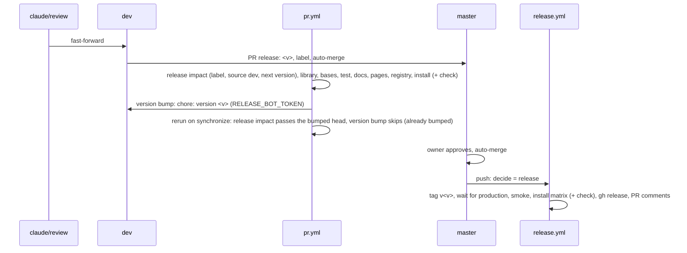

# 07.1: Release automation

Follow the project planning rules: docs/code-of-conduct/planning-guidelines.md, CLAUDE.md:9. Keep the expedition contract.

## 1. Architecture

### 1.1 Overview

The 0.8.0 release took 80 minutes, 13 agents and 1.8M tokens: three install smoke agents re-derived by hand what the Storybook plays and `install.yml` already prove, three judges looked at captures, and `release.yml` opened a bot version PR that the owner merged in a second round (D78) (D79) (D80) (v0.5.x D7). This epic ships 0.8.1 with no library change: the install smoke check of epic 07 1.6.2 becomes a checked-in Playwright script run by `install.yml` in a Next app per base, with the two default-state captures compared by `pixelmatch` against committed references (D78) (D79) (P14); the version bump becomes the last `pr.yml` job on the one `dev` into `master` PR, so `release.yml` runs once, on the merge, and the `version` job, `version-pr.mjs` and branch `release/next` go (D83). Two milestones (D82), no shared file: "Gate step (07.1)" owns `install.yml`, the check script, its pages and references and the package devDependencies it needs; "Version bump (07.1)" owns `pr.yml`, `release.yml`, `scripts/release/`, the process and docs lines that describe the flow. Repository settings (auto-merge, required checks) are the main session's task with the owner's one-time authorization, never an agent's (D80) (P5). Job renames and a sticky comment are not in this epic: every job keeps its name.

### 1.2 Goals

- `install.yml` runs a Next scenario per base (`nextjs-base`, `nextjs-radix`, `nextjs-aria`), each with a install smoke step that runs `packages/shadcn-table/test/release/gate.mjs` against `next dev` of the scaffolded app: zero console warnings and errors on `/release-gate`, `/release-gate/persisted` and `/release-gate/rtl` (aria: zero React Aria warnings, v0.7.x D40); on the persisted page `data-st-view-pending` observed before `DOMContentLoaded` with `aria-busy="true"` while marked, gone after hydration, the stored order restored (D36); on the RTL page the pinned Name header and its resize handle boxes on the inline-end edge and a 60 px handle drag widening the column (v0.7.x D31); `default-light.png` and `default-dark.png` at 1800 by 1150, full table frame with the toolbar (D78)
- Each capture is compared with `test/release/reference/<base>/default-<theme>.png` by `pixelmatch` (threshold 0.1, anti-aliased pixels ignored, at most 500 differing pixels); above the maximum the step fails and the `gate-<base>` artifact carries the capture, the diff image and `result.json`; without a reference the step uploads the capture and passes with a `::notice::` (D79)
- The references are the first CI run's artifacts, committed from a `workflow_dispatch` of `install.yml` on the milestone branch, no PR (D79)
- `scripts/release/prepare.mjs` (`pnpm release:prepare`) bumps both `package.json` files and renames `## Unreleased` to `## <version> - <date>` on the current branch; its `--check` mode exits 0 when the head is already bumped (D83)
- `pr.yml` ends with `version bump (release:prepare)`: needs every other job, runs only for a PR into `master`, skips when the head is already bumped, commits `chore: version <v>` to the PR head with `secrets.RELEASE_BOT_TOKEN`, fails with a clear message when the secret is missing; `release impact` fails a PR into `master` whose head is not `dev` and passes a bumped head (D83)
- `release.yml` has two modes, release or nothing: the `version` job, `version-pr.mjs` and branch `release/next` are gone, `decide.mjs` has no `version` mode, the remaining jobs behave as today (D83)
- Repository settings (main session, D80): auto-merge on, the `master` ruleset lists the `pr.yml` job names as required checks, the owner creates `RELEASE_BOT_TOKEN`
- P3, epic 07 1.6.2 and 2.2, `CONTRIBUTING.md` and `coding-standards.md` describe the new flow; the judges line is gone
- Acceptance: programmatic. Check step: a `workflow_dispatch` run of `install.yml` on the milestone branch green with the install smoke step on the three Next rows and three `gate-<base>` artifacts (`act pull_request -j install` is the local alternative, D81 addendum). Version bump: `node --test scripts/release/*.test.mjs` green; `grep -rnE "version-pr|release/next([^-]|$)" .github scripts` empty; the first `pr.yml` run on the release PR green including `version bump (release:prepare)` and a `chore: version 0.8.1` commit on `dev`

### 1.3 Current structure

```
.github/workflows/
├── install.yml          ← workflow_call only, input source (:6-19); matrix fresh/radix, existing/radix, base/base, aria/aria, nextjs/radix (:59-63); `matrix.scenario == 'nextjs'` guards (:80, :84, :129, :154, :191, :206); Next mount (2 columns) + next build (:153-186); failure dump only (:247-252)
├── pr.yml               ← pull_request [opened, synchronize, reopened, labeled, unlabeled] (:7-9); release-impact reads labels from the event payload (:33), errors "needs lines under ## Unreleased" when next-version exits 2 (:64-69); library, bases, test, docs, pages, registry; install `uses: install.yml` (:225-230), the last job
└── release.yml          ← header with 3 modes (:3-15); decide outputs mode/version/level, `pull-requests: read` (:40-64); version job `version PR (release/next)` (:66-98); wait-for-production, smoke, install, release (:100-204)
scripts/release/
├── decide.mjs           ← modes version (:53-58, mergedLabel :92-104), release, none; LEVELS (:31)
├── decide.test.mjs      ← 6 tests, two `version` cases (:15-47)
├── next-version.mjs     ← exports LEVELS, bump, unreleasedLines, levelFromChangelog, run (:33-123); reused as is
├── next-version.test.mjs
├── version-pr.mjs       ← VERSION regex (:31), docsPackage (:57-65), setVersion (:84-94), date + rename (:96-102), branch, bot identity, force push, gh pr (:104-167)
├── comment.mjs, notes.mjs, smoke.mjs ← untouched
packages/shadcn-table/
├── package.json         ← devDependencies playwright ^1.64.1, @vitest/browser-playwright (:72, :78); no pixelmatch; pngjs 7.0.0 transitive in the lockfile
├── eslint.config.js     ← globalIgnores dist, storybook-static, parts (:20); files **/*.{ts,tsx}
└── test/                ← does not exist
package.json             ← root scripts, no release:prepare
docs/code-of-conduct/coding-standards.md:111-113 ← "release.yml ... opens or rewrites the version PR"
CONTRIBUTING.md:79, :81, :294, :304-314            ← version PR flow, scripts list, install line
CHANGELOG.md:6-8                                    ← "The version pull request that the release workflow opens renames that heading"
.ai/plans/v0.8.x/anindosarker/process.md P3:17      ← "release.yml run 1 opens the bot PR"
.ai/plans/v0.8.x/anindosarker/epics/07-release.md 1.6.2, 2.2 ← agent-browser check, three judges
origin refs/heads/release/next                      ← stale bot branch
.ai/plans/v0.8.x/anindosarker/reference/07.1-gate/{gate.mjs, init.js, setup07r.sh, src/app/release-gate/{page,persisted/page,rtl/page}.tsx, src/components/check/{check-table.tsx,make-data.ts}, src/icons/lucide.ts} ← the sources to port (the 2026-11-06 scratchpad run, base set; the page sets of the three bases were identical)
```

### 1.4 Target structure

```
.github/workflows/
├── install.yml          ← workflow_call + workflow_dispatch (same `source` input, dispatch default the dev URL); matrix nextjs-base, nextjs-radix, nextjs-aria; install smoke pages copied before next build; install smoke steps + artifact upload on the Next rows
├── pr.yml               ← release-impact: live labels, source check, bumped-head pass; bases runs the release script tests; version-bump last
└── release.yml          ← two modes; decide (release or nothing); no version job
scripts/release/
├── prepare.mjs          ← release:prepare: bump both package.json, rename ## Unreleased; --check
├── prepare.test.mjs     ← pure-function tests
├── decide.mjs           ← modes release, none; Unreleased lines on a push warn
├── decide.test.mjs      ← the version cases become none
├── next-version.mjs, next-version.test.mjs, comment.mjs, notes.mjs, smoke.mjs ← unchanged
packages/shadcn-table/test/release/
├── gate.mjs             ← the Playwright check: console, persisted timing, RTL boxes, captures, pixel diff, result.json
├── init.js              ← the MutationObserver init script (page.addInitScript)
├── pages/
│   ├── app/release-gate/page.tsx, persisted/page.tsx, rtl/page.tsx ← copied into the scaffolded app
│   └── components/check/check-table.tsx, make-data.ts, check-icons.ts ← the check table (18 columns, 50 deterministic rows, row actions), Lucide icons
└── reference/<base>/default-light.png, default-dark.png ← 6 files, committed from the first CI run
packages/shadcn-table/package.json ← devDependencies pixelmatch, pngjs
packages/shadcn-table/eslint.config.js ← globalIgnores + test/release/pages (consumer-app sources, compiled by the app's next build)
pnpm-lock.yaml
package.json             ← "release:prepare": "node scripts/release/prepare.mjs"
```

### 1.5 Flow



### 1.6 Components

#### 1.6.1 Data artifacts

- `CHANGELOG.md` (P9): `## Unreleased` with `### Changed` is created above `## 0.8.0` by the first milestone that merges (today the file has no such section); "Gate step (07.1)" appends `#### Spec 07.1 install smoke step` under `### Changed` (the install smoke check as an `install.yml` step with pixel-diffed captures, D78, D79); "Version bump (07.1)" appends `#### Spec 07.1 version bump` under `### Changed` (one PR per release, the version bumped by CI, the version PR gone, D83) and rewrites the header prose at `:6-8` ("The version pull request that the release workflow opens renames" becomes "The release pull request's last check renames"). The release label is `release:patch`, so the label level wins over the `Changed` heading and 0.8.1 ships (`next-version.mjs` run, `--level` first)
- `packages/shadcn-table/package.json`: devDependencies `pixelmatch` and `pngjs` added with one `pnpm install` in "Gate step (07.1)" (P5); `pnpm-lock.yaml` regenerated once. Root `package.json`: script `release:prepare` in "Version bump (07.1)", no dependency
- `packages/shadcn-table/test/release/reference/<base>/default-{light,dark}.png`: 6 PNGs, 1800 by 1150, committed from the `gate-<base>` artifacts of the bootstrap run (1.6.4). The 2026-11-06 scratchpad captures are not references: macOS font rendering
- Trackers `trackers/07.1-release-automation-tracker.md` ("Gate step (07.1)") and `trackers/07.1-version-bump-07-1-tracker.md` ("Version bump (07.1)", the name `status.py` expects): check lines, the dispatch run ids, the bootstrap commit; under `## Attention` anything the owner must do (the secret, the settings) with the exact command
- Branch `release/next` on origin: deleted after "Version bump (07.1)" merges (`git push origin :release/next`), housekeeping in the cleanup task
- `.github/pull_request_template.md`: unchanged, it names no version PR

#### 1.6.2 Check step in install.yml (D78)

`.github/workflows/install.yml`. The Next scenario runs once per base and gains the check after `next build`.

- Triggers: `workflow_call` as today and a new `workflow_dispatch` with the same `source` input, default `http://localhost:5310/r/<item>.json`; `inputs.source` serves both events. The dispatch is the bootstrap and the local proof of a workflow edit (D81 addendum)
- Matrix: `fresh/radix`, `existing/radix`, `base/base`, `aria/aria`, `nextjs-base/base`, `nextjs-radix/radix`, `nextjs-aria/aria`; the single `nextjs/radix` row goes. Every `matrix.scenario == 'nextjs'` guard becomes `startsWith(matrix.scenario, 'nextjs')` (`!=` becomes `!startsWith(...)`). Jobs report as `install / install (nextjs-base app)` and so on, the names of the required checks (1.6.8)
- Items: the default edition per base (`ITEM: shadcn-table-${{ matrix.base }}`, Lucide), as today; no icon editions, so the `release.yml` source template `/r/<base>/shadcn-table.json` stays
- Next mount step: before `next build`, copies `repo/packages/shadcn-table/test/release/pages/app/release-gate/` into `app/release-gate/` and `.../pages/components/check/` into `components/check/`; on base and radix wraps the layout's children in `TooltipProvider` from `@/components/ui/tooltip` (the `app/layout.tsx` `ThemeProvider` line, as `setup07r.sh` did; the step fails when the pattern is not found); keeps the two-column `app/page.tsx`; `next build` compiles the install smoke pages too
- Check steps, `if: startsWith(matrix.scenario, 'nextjs')`, after `next build`: (1) `pnpm --filter shadcn-table exec playwright install --with-deps chromium` in `repo/` (as `pr.yml:135`); (2) `pnpm exec next dev -p 5341` in the app in the background, polled with `curl` for 120 s; `next dev`, not `next start`, because React Aria warnings exist only in development builds and the aria row must see them (v0.7.x D40); (3) `pnpm --filter shadcn-table exec node test/release/gate.mjs --base "$BASE" --url http://localhost:5341 --out "$RUNNER_TEMP/check"` in `repo/`, so `playwright`, `pixelmatch` and `pngjs` resolve from the package; (4) `actions/upload-artifact@v4`, `if: always() && startsWith(matrix.scenario, 'nextjs')`, `name: gate-${{ matrix.base }}`, `path: ${{ runner.temp }}/check/`, uploaded on success too so the bootstrap run yields the references
- `release.yml` calls the same workflow against the public item, so the install smoke runs at release too, with the same references; a red there is a rerun per P3
- Does NOT change the Vite rows, the locale and example steps, the dependency checks, or the failure dump

**Operations:**

| Operation | Status | Notes |
| --- | --- | --- |
| `workflow_dispatch` trigger | new | `source` input, dev URL default |
| matrix rows `nextjs-<base>` | refactor | replaces `nextjs` |
| install smoke pages copy + TooltipProvider | new | inside the Next mount step, before `next build` |
| Playwright install, `next dev`, install smoke run | new | three steps, Next rows only |
| `gate-<base>` artifact | new | `if: always()` |

**Stays unchanged:** `permissions`, the `DROP_LABEL_IMPORT` steps, `shadcn-add.log`.

#### 1.6.3 Check script (D78)

`packages/shadcn-table/test/release/gate.mjs`, `init.js`, `pages/`. A rewrite of `reference/07.1-gate/gate.mjs` on the Playwright API, keeping the D78 checks only.

- CLI: `node test/release/gate.mjs --base <base|radix|aria> --url <origin> --out <dir> [--reference <dir>] [--no-diff]`; `--reference` defaults to `test/release/reference/<base>` relative to the package; `--no-diff` captures without comparing (a local run on another OS)
- Browser: `chromium.launch()`, one context, viewport 1800 by 1150, navigation timeout 120 s (`next dev` compiles each route on its first request), `addInitScript` with `init.js` (the `MutationObserver` that records the first observation of `[data-st-view-pending]`, its `aria-busy`, the removal and `DOMContentLoaded` in `window.__pend`). Console: every `warning` and `error` console message and every `pageerror`, per page; on aria, messages matching the React Aria pattern (`react aria|must be focusable|interactive ARIA role|aria-label`) are also counted as `ariaWarnings`
- Captures, `/release-gate`: for `light` then `dark`: `localStorage.theme = <m>`, `emulateMedia({ colorScheme })`, reload, assert `html.dark` present for dark and absent for light, remove every `nextjs-portal` element, mouse at 1790 by 1140, `document.fonts.ready` (F56) then 500 ms, `page.screenshot({ fullPage: true })` to `<out>/default-<m>.png`
- Persisted, `/release-gate/persisted`: clear storage, reload, reorder Assignee onto Project through the drag path (`dragstart`, `dragenter`, `dragover`, `drop`, `dragend` with a `DataTransfer`, as the scratchpad check did), assert one `shadcn-table:` key; reload; assert `__pend.seen`, `__pend.seenAt < __pend.dcl`, `__pend.ariaBusy === 'true'`, the attribute absent now, and `window.__gateTable.getVisibleLeafColumns()` ids equal the stored order (D36)
- RTL, `/release-gate/rtl`: `direction` of `[data-slot=st-table-layout]` is `rtl`; the Name `th` and its resize handle boxes: the handle's left edge within 12 px of the header's left edge (inline end in RTL); `th` and its `td` `position: sticky` with `inset-inline-start: 0`; a 60 px mouse drag of the handle to the left widens the header by 55 to 65 px (v0.7.x D31). The RTL drag preview is play-covered (06.4) and not repeated
- Diff, per theme, unless `--no-diff`: when `<reference>/default-<m>.png` exists, both PNGs read with `pngjs`, equal dimensions required, `pixelmatch(a, b, diff, w, h, { threshold: 0.1, includeAA: false })`; `diffPixels <= 500` passes; above it the diff image is written to `<out>/default-<m>-diff.png` and the check fails. No reference: `::notice::no reference for <base> <m>; capture uploaded, commit it as the reference` and pass
- Output: `<out>/result.json` (`base`, per page `warnings`, `errors`, `ariaWarnings` with the messages, `persisted` timings, `rtl` boxes, per theme `diffPixels` or `null`); every failure as a `::error::` annotation; exit 1 on any failure, else 0
- Does NOT repeat the play-covered checks of epic 07 1.6.2 (toolbar order, column menu, filter, sort, view settings, header drag, locked column, overflow chevron, search, actions column, storage with persistence off); does NOT read `localStorage` for anything but the persisted page

**Interfaces:**

```typescript
// test/release/gate.mjs, CLI only
// node test/release/gate.mjs --base <base> --url <origin> --out <dir> [--reference <dir>] [--no-diff]
// exit 0 pass, 1 any failure; <out>/default-{light,dark}.png, default-<m>-diff.png on a failed diff, result.json
```

```typescript
// test/release/pages/components/check/check-table.tsx
export function GateTable({ persist = false, rtl = false }: { persist?: boolean; rtl?: boolean }): JSX.Element;
// test/release/pages/components/check/make-data.ts
export const data: Task[]; // 50 rows, index-derived, no randomness
```

**Stays unchanged:** `packages/shadcn-table/vitest.config.ts`, `stories/`, `scripts/check-aria-warnings.mjs`.

#### 1.6.4 References and bootstrap (D79)

`packages/shadcn-table/test/release/reference/<base>/`.

- The bootstrap is a task of "Gate step (07.1)": push the milestone branch, `gh workflow run install.yml --ref <branch>` (the `source` default), `gh run watch <id> --exit-status`, `gh run download <id> -n gate-<base> -D <dir>` for the three bases, copy `default-{light,dark}.png` into `reference/<base>/`, commit `test(release): check references from run <id>`, dispatch again: green with `diffPixels` 0 to a few in `result.json`
- A later look change ships with new references: the milestone that changes the look dispatches `install.yml` on its branch, downloads the artifacts and commits the PNGs (a failing diff: the owner in triage; the main session reads the diff image in an unattended run, D79)
- Does NOT use the scratchpad captures of 2026-11-06 (macOS rendering) or the `reference/01-default-*.png` of D34 (demo captures, not the install smoke page)

#### 1.6.5 prepare.mjs (D83)

`scripts/release/prepare.mjs`, `prepare.test.mjs`, root `package.json`. The `version-pr.mjs` logic as a local script without git.

- `node scripts/release/prepare.mjs [--level patch|minor|major]`: the next version from `next-version.mjs` `run([...], { version, changelog })` (the label level when given, else the `## Unreleased` headings); writes it into `packages/shadcn-table/package.json` and the docs app's `package.json` (found by name `shadcn-table-docs`, in-place line replace, exactly one `"version"` line each); renames `## Unreleased` to `## <next> - <YYYY-MM-DD>`; prints `<next>`. Exit 2 with "no lines under ## Unreleased" when there is nothing to version; exit 1 on a bad level or a malformed section
- `node scripts/release/prepare.mjs --check --base-version <v>`: exit 0 when the head is already bumped (no `## Unreleased` lines and the library version differs from `<v>`); exit 2 when not bumped (`## Unreleased` has lines); exit 1 when inconsistent (no lines and the version equals `<v>`). `<v>` is the `master` version the caller reads; the script never runs git. The clause "version equals the computed next" is not used: on a bumped head `next-version` bumps the bumped version again, so it never holds
- No git operations, no branch, no identity, no PR: the CI job commits. The tree need not be clean
- `package.json` (root): `"release:prepare": "node scripts/release/prepare.mjs"`
- `prepare.test.mjs` (`node:test`): `setVersion` replaces the one version line and throws on zero or two; `prepare()` returns the bumped versions and the renamed changelog for a level and for the headings; exit 2 without lines; `check()` for the three outcomes
- Does NOT change `next-version.mjs` or its tests

**Interfaces:**

```typescript
// scripts/release/prepare.mjs
export const setVersion: (packageJsonText: string, next: string) => string; // throws unless exactly one version line
export const prepare: (
  argv: string[],
  deps: { version: string; changelog: () => string; now: () => Date },
) => { code: 0; next: string; changelog: string } | { code: 1 | 2; err: string };
export const check: (
  deps: { version: string; baseVersion: string; changelog: () => string },
) => { code: 0 | 1 | 2; line: string };
```

#### 1.6.6 pr.yml: release impact, bases, version bump (D83)

`.github/workflows/pr.yml`. Triggers, concurrency and every job name stay; `pull_request` only, no `push` trigger (P1: the release PR is the CI run; `dev` is untouched during the sprints, D83).

- `release impact (label, next version)`: labels read live, `gh pr view "$PR" --json labels --jq '[.labels[].name | select(startswith("release:"))]'`, not from the event payload (run 42104722808 on PR #130: the `opened` run saw no label and failed while the labels run passed; as a required check the payload read is racy). First step: when `github.base_ref == 'master'` and `github.head_ref != 'dev'`, `::error::a PR into master comes from dev only` and exit 1 (a ruleset cannot see the head branch, 1.6.8) (D83 addendum). Bumped head: when `next-version.mjs --level L --from-changelog` exits 2, read the `master` library version (`gh api repos/$GITHUB_REPOSITORY/contents/packages/shadcn-table/package.json?ref=master --jq .content | base64 -d`), run `prepare.mjs --check --base-version <v>`; exit 0 prints `Ships as <package version> (already bumped)` and passes; otherwise the error as today. The CHANGELOG-in-files check stays (the rename changes the file)
- `bases (base guard)`: one more step, `node --test scripts/release/*.test.mjs` (today the tests run nowhere in CI, only `coding-standards.md:116` locally)
- `version-bump`, name `version bump (release:prepare)`, the last job: `needs: [release-impact, library, bases, test, docs, pages, registry, install]`; `if: github.base_ref == 'master' && !contains(fromJSON('["labeled", "unlabeled"]'), github.event.action)` (a red or skipped need skips it by the default `needs` rule); `permissions: contents: read, pull-requests: read`; `env` `GH_TOKEN`, `PR`, `RELEASE_BOT_TOKEN: ${{ secrets.RELEASE_BOT_TOKEN }}`. Steps: (1) `test -n "$RELEASE_BOT_TOKEN"` else `::error::secret RELEASE_BOT_TOKEN is missing; the owner creates it (Settings, Secrets and variables, Actions): a token with contents: write on this repository` and exit 1; (2) `actions/checkout@v4` with `ref: ${{ github.head_ref }}`, `token: ${{ secrets.RELEASE_BOT_TOKEN }}`, `fetch-depth: 0`; (3) `actions/setup-node@v4` 22; (4) the live label as above; none or `release:skip` prints `no release, no bump` and exits 0; (5) the `master` version with `git show origin/master:packages/shadcn-table/package.json`; `prepare.mjs --check --base-version <v>` exit 0 prints `already bumped` and exits 0; (6) `next=$(node scripts/release/prepare.mjs --level "$level")`, `git add` the three files, commit `chore: version $next` as `github-actions[bot]` `41898282+github-actions[bot]@users.noreply.github.com` (the identity the 0.8.0 version PR merged with under the ruleset), `git push origin HEAD:"$GITHUB_HEAD_REF"`. The push with the token fires `synchronize`, `pr.yml` reruns once, `release impact` passes the bumped head, `version bump` exits at step (5). No ruleset covers `dev`
- `install`: unchanged; the check rides inside the called workflow and reports as `install / install (<scenario> app)`
- Does NOT rename a job, add a sticky comment, change `library`, `test`, `docs`, `pages` or `registry`, or add a `push` trigger

**Operations:**

| Operation | Status | Notes |
| --- | --- | --- |
| live labels in release-impact | refactor | `gh pr view` replaces `PR_LABELS` |
| source check | new | step in release-impact, master PRs from `dev` only |
| bumped-head pass | new | `prepare.mjs --check` |
| release script tests in `bases` | new | `node --test scripts/release/*.test.mjs` |
| `version-bump` job | new | last job, `RELEASE_BOT_TOKEN` |

**Stays unchanged:** `concurrency` (the bot push is the job's last step, so the cancel of the old run is harmless), `permissions: contents: read` at the top.

#### 1.6.7 release.yml and decide.mjs (D83)

`.github/workflows/release.yml`, `scripts/release/decide.mjs`, `decide.test.mjs`, `version-pr.mjs` (deleted).

- `release.yml`: the header comment describes two modes (release, none); triggers stay (`push` master, `workflow_dispatch` version and dry_run); `decide` renamed `decide (release or nothing)`, outputs `mode` and `version` only, `pull-requests: read` dropped; the `version` job deleted; `wait-for-production`, `smoke`, `install`, `release` unchanged
- `decide.mjs`: a push with `## Unreleased` lines (next-version exit 0) is mode `none` with `::warning::CHANGELOG.md has ## Unreleased lines on master: merged without the version bump; nothing released` (possible only when the source check and the bump were bypassed); exit 2 untagged is `release`, exit 2 tagged is `none`, a dispatch is `release`, other codes pass through, as today. `LEVELS`, `mergedLabel`, `level` and the `gh` call go; `$GITHUB_OUTPUT` gets `mode` and `version`. Header comment rewritten
- `decide.test.mjs`: the two `version` cases (`:15-47`) become one `none: Unreleased lines on master warn and release nothing`; `deps()` loses `mergedLabel`; the other four stay
- `version-pr.mjs` deleted; it had no test. `comment.mjs` is untouched (its lookup of the version PR by title finds nothing, harmless; the header line `:11` goes stale, left as is)
- Does NOT change `smoke.mjs`, `notes.mjs`, `next-version.mjs`, the tag step, the production poll, or the `gh release create` step

**Interfaces:**

```typescript
// scripts/release/decide.mjs
export const decide: (
  env: { EVENT: string; INPUT_VERSION: string; GITHUB_SHA: string },
  deps: { version: string; changelogStatus: () => number; tagged: (tag: string) => boolean },
) => { code: number; mode?: 'release' | 'none'; version?: string; lines: string[] };
```

#### 1.6.8 Repository settings (D80)

Main session, inline, with the owner's one-time authorization; never an agent (P5). Run after both milestones merged into `claude/review`, before the release PR.

- `gh api -X PATCH repos/anindosarker/shadcn-table -F allow_auto_merge=true` (today false)
- Ruleset 25521193 (`master`): add a `required_status_checks` rule, `strict_required_status_checks_policy: false`, contexts: `release impact (label, next version)`, `library (base: tsc, lint, storybook build)`, `library (radix: tsc, lint, storybook build)`, `library (aria: tsc, lint, storybook build)`, `bases (base guard)`, `test (base: vitest browser mode)`, `test (radix: vitest browser mode)`, `test (aria: vitest browser mode)`, `docs (types, next build)`, `pages (base: check-pages)`, `pages (radix: check-pages)`, `pages (aria: check-pages)`, `registry (validate, dry-run add)`, `install / install (fresh app)`, `install / install (existing app)`, `install / install (base app)`, `install / install (aria app)`, `install / install (nextjs-base app)`, `install / install (nextjs-radix app)`, `install / install (nextjs-aria app)`, `version bump (release:prepare)`. The labels run reports its skipped jobs under unexpanded names, so it does not collide. `required_approving_review_count` stays 0 (1 would block the owner's own PR). The source rule cannot be a ruleset condition (conditions match the target ref only), hence the `release impact` step
- Secret `RELEASE_BOT_TOKEN`: created by the owner, the App token D83 names, `contents: write` on this repository; the job only reads the secret. The repo has no secrets today
- `gh api -X PUT repos/anindosarker/shadcn-table/actions/permissions/workflow -f default_workflow_permissions=read -F can_approve_pull_request_reviews=false` (turned on for `version-pr.mjs`, v0.5.x ATTENTION-2026-10-28; no workflow creates a PR anymore)
- Does NOT change `delete_branch_on_merge`, `allow_merge_commit`, the `pull_request` rule's merge methods, or add a `dev` ruleset

#### 1.6.9 Process and docs

Text that describes the flow, rewritten by "Version bump (07.1)".

- `process.md` P3 `:17`: one `release.yml` run on the merge; the PR's last check commits `chore: version <v>` and `pr.yml` reruns once; the watcher counts `FAILURE`, `ERROR`, `CANCELLED`; the installs are seven, the check inside the Next rows; the rerun path stays. P1 `:11` already states the flow; P4 known flakes gain `PanelCollapse` "Progress And Banner Collapse" (aria, F60), same one-rerun rule; P5: "never edit ... after the first sprint" gains "unless the milestone block of a release-automation epic owns the file (D82, 07.1)"
- Epic 07 `07-release.md`: 1.2 Goals `:15` becomes "0.8.0 released: `release.yml` green on the merge of the release PR, `node scripts/release/smoke.mjs` green"; 1.5 flow `:50-54` becomes the 07.1 1.5 flow with `release:minor` and 0.8.0; 1.6.1 `:61` ends "the release PR's last check renames `## Unreleased` to `## 0.8.0 - <date>`" and `:62` "through the `version bump (release:prepare)` job"; 1.6.2: the check is the CI step of 07.1 (`install.yml` Next rows, `test/release/gate.mjs`, references under `test/release/reference/`); the agent-browser list goes; 1.6.3 row `:90` becomes `| version bump on the release PR | keep | `version bump (release:prepare)`, commit `chore: version 0.8.0` on `dev` |`; 2.2: the judges line and the version PR line go, "the release is the one `dev` into `master` PR, `pr.yml` green including the check and the bump, `release.yml` green"
- `docs/code-of-conduct/coding-standards.md:111-113`: `pr.yml`'s last job bumps the version on the release PR; `release.yml` tags, verifies production, creates the release
- `CONTRIBUTING.md`: `:79` "release on every push to master (step 7)"; `:81` "next-version, prepare, decide, notes, smoke, comment"; the tree gains `packages/shadcn-table/test/release/  # the install smoke check: Playwright script, install smoke pages, reference captures`; `:294` "and into a Next.js app per base, with the browser check and capture diff"; `:304` `master` takes pull requests from `dev` only; `:306-307` replaced by: the release PR's last check runs `release:prepare` and commits `chore: version <v>`; the owner approves; auto-merge merges; `:308-309` stay; the code block gains `pnpm release:prepare --level patch   # bump both package.json files and close ## Unreleased on this branch`
- `CHANGELOG.md:6-8` header prose (1.6.1)
- Does NOT touch `README.md`, `skills/shadcn-table/SKILL.md`, the PR template, or the v0.5.x decisions

### 1.7 Dependencies and env

- `pixelmatch` 8.0.0 and `pngjs` 7.0.0 (already transitive) as `packages/shadcn-table` devDependencies; `playwright` ^1.64.1 reused from the same package
- `secrets.RELEASE_BOT_TOKEN`: owner-created, `contents: write`, read by `pr.yml` `version-bump` only
- Reused: the dev registry on 5310 in `install.yml`, `actions/upload-artifact@v4`, `gh` with `GH_TOKEN` in every job

## 2. Instructions for AI

### 2.1 Milestones

### Milestone: Gate step (07.1)

- Files owned: `.github/workflows/install.yml`, `packages/shadcn-table/test/release/gate.mjs`, `packages/shadcn-table/test/release/init.js`, `packages/shadcn-table/test/release/pages/`, `packages/shadcn-table/test/release/reference/`, `packages/shadcn-table/package.json`, `packages/shadcn-table/eslint.config.js`, `pnpm-lock.yaml`
- Depends on: Release 0.8.0
- Review: none
- Task 1: Script and pages: `pnpm add -D pixelmatch@8.0.0 pngjs@7.0.0` in `packages/shadcn-table` (one `pnpm install`, P5); port `reference/07.1-gate/src/` and `init.js` into `test/release/pages/` and `test/release/init.js` (1.6.3, Lucide `check-icons.ts`); write `gate.mjs` on the Playwright API with the D78 checks, the diff and `result.json` (1.6.3); `test/release/pages` in `eslint.config.js` `globalIgnores`. Local proof: scaffold a Next app as `install.yml` does (dev registry on 5310 reused, P4; the app's port in 5340 to 5360, P5), copy the pages, `next build`, `next dev`, run the script with `--no-diff` per base one after another, exit 0, the two captures per base written. Checks: `pnpm --filter shadcn-table lint`; `node --check packages/shadcn-table/test/release/gate.mjs`; the local run exit 0 per base
- Task 2: install.yml: the dispatch trigger, the three `nextjs-<base>` rows, the `startsWith` guards, the pages copy and `TooltipProvider` patch before `next build`, the install smoke steps and the `gate-<base>` artifact (1.6.2). Push the branch; `gh workflow run install.yml --ref <branch>`; `gh run watch <id> --exit-status`: seven jobs green, the three Next jobs pass with the no-reference notice and upload `gate-<base>`. Checks: `act -l` parses the workflows; the dispatch run green, its id in the tracker
- Task 3: References: `gh run download <id> -n gate-<base>` for the three bases, commit the six PNGs under `test/release/reference/<base>/` (1.6.4); dispatch again: green with `diffPixels` under 500 in every `result.json`. Checks: the second dispatch run green, its id in the tracker
- Task 4: Cleanup and checks once: `pnpm format`; the `#### Spec 07.1 install smoke step` changelog block (1.6.1); the tracker records both run ids and the artifact sizes. Checks: 2.2

### Milestone: Version bump (07.1)

- Files owned: `.github/workflows/pr.yml`, `.github/workflows/release.yml`, `scripts/release/prepare.mjs`, `scripts/release/prepare.test.mjs`, `scripts/release/decide.mjs`, `scripts/release/decide.test.mjs`, `scripts/release/version-pr.mjs`, `package.json`, `docs/code-of-conduct/coding-standards.md`, `CONTRIBUTING.md`, `.ai/plans/v0.8.x/anindosarker/process.md`, `.ai/plans/v0.8.x/anindosarker/epics/07-release.md`
- Depends on: Release 0.8.0, Gate step (07.1)
- Review: fable
- Task 1: prepare.mjs: the script, its tests and the root `release:prepare` script (1.6.5); `version-pr.mjs` deleted; `decide.mjs` without the `version` mode and `decide.test.mjs` updated (1.6.7). Checks: `node --test scripts/release/*.test.mjs` green; `node scripts/release/prepare.mjs --check --base-version 0.8.0` exits 2 on the branch (Unreleased has lines); `grep -rnE "version-pr|release/next([^-]|$)" scripts` empty
- Task 2: Workflows: `pr.yml` release-impact (live labels, source step, bumped-head pass), the `bases` test step, the `version-bump` job (1.6.6); `release.yml` two modes, `decide` renamed, the `version` job deleted (1.6.7). Checks: `act -l` parses the workflows; `act pull_request -j bases` green (the new test step on Linux); `grep -rnE "version-pr|release/next([^-]|$)" .github scripts` empty
- Task 3: Process and docs: P3 in `process.md`, epic 07 1.6.2 and 2.2, `coding-standards.md:111-113`, `CONTRIBUTING.md` (1.6.9), the `CHANGELOG.md` header prose and the `#### Spec 07.1 version bump` block (1.6.1). Checks: `grep -rnE "version PR|version-pr|release/next([^-]|$)" CONTRIBUTING.md docs/code-of-conduct/coding-standards.md .ai/plans/v0.8.x/anindosarker/process.md .ai/plans/v0.8.x/anindosarker/epics/07-release.md` empty
- Task 4: Repository settings (main session, inline, owner-authorized, D80; never an agent): after both milestones merged into `claude/review`: auto-merge on, the required checks on ruleset 25521193, `can_approve_pull_request_reviews` off (1.6.8); the owner creates `RELEASE_BOT_TOKEN`; `git push origin :release/next`. Checks: `gh api repos/anindosarker/shadcn-table --jq .allow_auto_merge` is `true`; `gh api repos/anindosarker/shadcn-table/rulesets/25521193 --jq '[.rules[] | select(.type == "required_status_checks")] | length'` is `1`; `git ls-remote --heads origin release/next` empty
- Task 5: Cleanup and checks once: `pnpm format`; dead references; the tracker records the check commands and, after the release PR, the first `pr.yml` run id with `version bump (release:prepare)` green and the `chore: version 0.8.1` commit. Checks: 2.2

### 2.2 Checks

- Check step: a `workflow_dispatch` run of `install.yml` on the milestone branch green, seven jobs, three `gate-<base>` artifacts with `result.json`, `default-light.png`, `default-dark.png`; the second run with the references committed, `diffPixels` under 500 per theme; `pnpm --filter shadcn-table lint` green with the pages ignored; `pnpm install --frozen-lockfile` green (the lockfile matches)
- Version bump: `node --test scripts/release/*.test.mjs` green; `act -l` lists `version-bump` and no `version` job; `act pull_request -j bases` green; `grep -rnE "version-pr|release/next([^-]|$)" .github scripts` empty
- Release 0.8.1 (the proof of both, after the settings of 1.6.8): the `dev` into `master` PR with `release:patch` and auto-merge; its first `pr.yml` run green including `install / install (nextjs-<base> app)` with the check and `version bump (release:prepare)` with a `chore: version 0.8.1` commit on `dev`; the rerun green with `version bump` printing `already bumped`; `release.yml` green on the merge with the seven installs
- `pnpm format` clean; `pnpm check:bases` green (no library file touched)
