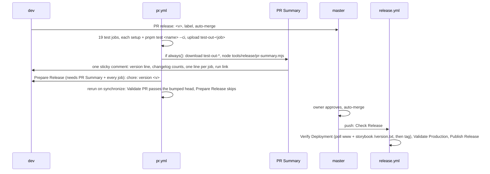

# 08: Tests and CI

Follow the project planning rules: docs/code-of-conduct/planning-guidelines.md, CLAUDE.md:9. Keep the expedition contract.

## 1. Architecture

### 1.1 Overview

The checks of this repository live in four places with four conventions: `scripts/release/` at the root, `packages/shadcn-table/scripts/` and `packages/shadcn-table/test/release/`, `apps/shadcn-table-docs/scripts/page-checks/`, and 300 lines of shell inside `install.yml` and `pr.yml` that no agent can run natively. This epic moves every test under `test/<name>/` behind one runner and one contract (`pnpm test <name>`), every non-test tool under `tools/`, and rewrites `pr.yml` as twenty-one jobs that each run `pnpm test <name>` plus PR Summary, `release.yml` as four jobs (D85) (D86) (D87). No library source changes and no check changes its behaviour: the same assertions, moved and renamed. Three milestones by file ownership (D82): "Test runner and tests (08)" does the whole move (the runner, the eight tests, `tools/registry/`, the moved `tools/release/` scripts, `package.json` files, the lockfile, every importer) in one commit per logical step; "Tools and workflows (08)" writes the three new release tools and the two workflows and deletes `install.yml`; "Docs and process (08)" rewrites the text that names the old paths (D88). The ruleset rewrite is a main-session task inside the workflows milestone (D80) (D86). Measured on run 42146767270: Docs E2E is the critical path (check-pages a to e about 820 s per base); nothing here changes a test's cost.

### 1.2 Goals

- `test/run.mjs` lists and runs eight tests through one contract: `typecheck`, `lint`, `storybook-tests`, `docs-e2e`, `validate-repo`, `installation-e2e`, `validate-pr`, `validate-production`; `--list`, `--all`, `--changed`, `--base`, `--scenario`, `--ci`; every run ends with one summary line and a JSON record under `test/.out/` (D85)
- `tools/` holds everything a workflow or a developer runs that is not a test: `tools/release/` (eight scripts, four with a `*.test.mjs`), `tools/registry/` (the registry build, hosted, examples, add-part, bases, lib, the four diff lists), `tools/preview.mjs`; `scripts/`, `packages/shadcn-table/scripts/`, `packages/shadcn-table/test/` and `apps/shadcn-table-docs/scripts/` are gone (D85 with addenda)
- `pr.yml` has the twenty-one jobs of D86 and D87 with the exact names (`Typecheck (base)`, `Lint`, `Storybook Tests (radix)`, `Docs E2E Tests (aria)`, `Validate Repo`, `Installation E2E (nextjs-aria)`, `Validate PR`, `PR Summary`, `Prepare Release`), each test job setup steps plus `pnpm test <name> --ci`; `install.yml` is deleted; `workflow_dispatch` with the input `installation-e2e-only` (D86 addendum)
- `release.yml` has the four jobs Check Release, Verify Deployment, Validate Production, Publish Release, in that order; Verify Deployment polls `/version.txt` on www and storybook and tags after both match (D83 addendum) (D86 addendum)
- PR Summary rewrites one sticky comment per PR from the `test-out-<job>` artifacts (D87)
- The `master` ruleset 25521193 lists the twenty-one job names as required checks, rewritten by the main session before `dev` fast-forwards (D80) (D86)
- `CONTRIBUTING.md`, `coding-standards.md`, the registry and docs READMEs, the PR template, `planning-guidelines.md` and `process.md` P5 and P9 name the new layout and `pnpm test <name>` (D88)
- Acceptance: programmatic. `pnpm test --list` prints the eight test names; `pnpm test --all` green locally (`installation-e2e` with `--no-diff` on macOS); a `workflow_dispatch` run of the new `pr.yml` on the milestone branch green for every job including PR Summary (Validate PR and Prepare Release skipped off a PR); `grep -rnE "scripts/release|packages/shadcn-table/scripts|packages/shadcn-table/test|page-checks|install\.yml" .github package.json packages/*/package.json apps/*/package.json` empty

### 1.3 Current structure

```
scripts/
├── preview.mjs                      ← imports ../packages/shadcn-table/scripts/preview.mjs (:29-33); runs node scripts/registry/hosted.mjs (:42)
└── release/
    ├── next-version.mjs, next-version.test.mjs   ← ROOT = dirname/../.. (:3); the test spawns scripts/release/next-version.mjs (:99-111)
    ├── decide.mjs, decide.test.mjs               ← NEXT_VERSION = 'scripts/release/next-version.mjs' (:12)
    ├── prepare.mjs, prepare.test.mjs             ← the bump; usage names pnpm release:prepare (:3-8)
    ├── notes.mjs, comment.mjs                    ← release notes, "Released in" comment
    └── smoke.mjs                                 ← HTTP smoke; imports ../../packages/shadcn-table/scripts/registry/lib.mjs (:32)
packages/shadcn-table/
├── scripts/
│   ├── preview.mjs                  ← PKG = dirname/.. (:19); node scripts/registry/build.mjs --dev (:21); serves .dev on 5310 (:87)
│   ├── check-icons.mjs              ← imports ./registry/{bases,lib}.mjs (:16-17)
│   ├── check-tailwind.mjs           ← one base per argument (:21-22, :52)
│   ├── check-aria-warnings.mjs, check-storybook.mjs   ← local-only; deleted (D85 addendum)
│   └── registry/
│       ├── lib.mjs                  ← PKG = dirname/../.., ROOT = PKG/../.. (:11-19); REGISTRY_BASE_URL (:48)
│       ├── build.mjs                ← spawns the sibling examples.mjs by path (:27-29)
│       ├── examples.mjs, hosted.mjs, add-part.mjs, bases.mjs, check-bases.mjs, bases.d.mts, lib.d.mts
│       └── {base,aria,examples-base,examples-aria}-diff.json
├── test/release/
│   ├── gate.mjs                     ← HERE-relative init.js and reference/<base> (:21-25); bare playwright, pixelmatch, pngjs
│   ├── init.js
│   ├── pages/app/release-gate/**, pages/components/gate/*   ← copied into the Next app by install.yml:186-189
│   └── reference/{base,radix,aria}/default-{light,dark}.png
├── package.json                     ← preview, registry:build, registry:dev on scripts/ (:11-13); check:tailwind, check:icons, check:aria-warnings (:24-26); pixelmatch, pngjs (:78-80)
├── eslint.config.js                 ← globalIgnores test/release/pages, comment names install.yml (:18-26)
├── .storybook/main.ts:4, .storybook/themes.ts:8, vite.config.ts:5, registry/{radix,base,aria}/registry.ts:7   ← import scripts/registry/bases.mjs
apps/shadcn-table-docs/
├── scripts/
│   ├── check-pages.mjs              ← APP_DIR = dirname/.. (:13); CHECKS_DIR = scripts/page-checks (:25); createRequire playwright via packages/shadcn-table (:32-46); next start -p 5320
│   ├── page-checks/{_helpers.mjs, a.mjs … e.mjs, global.d.ts}   ← import ../../../../packages/shadcn-table/scripts/registry/bases.mjs
│   ├── install.mjs                  ← APP = dirname/.. (:7); imports lib.mjs (:45-47)
│   └── example-map.mjs              ← imports ../lib/*.mjs (:37-46); HEADER names scripts/example-map.mjs (:51); no package script
├── lib/{base-tabs.mjs:4,13, example-prompt.ts:5, example-variant-dir.mjs:1, install.ts:9}   ← import ../../packages/shadcn-table/scripts/registry/*
├── app/version.txt/route.ts         ← serves pkg.version; comment names release.yml (:7)
└── package.json                     ← build runs pnpm -w registry:build, registry:items, registry:hosted (:10); lib:install = node scripts/install.mjs (:19)
.github/workflows/
├── install.yml                      ← reusable (call + dispatch); DROP_LABEL_IMPORT, WRAP_TOOLTIP_PROVIDER (:54-79); matrix (:84-90); heredoc fixtures (:158-173, :193-221, :274-290); gate steps and gate-<base> artifact (:247-252)
├── pr.yml                           ← release-impact (:30-92), library x3 (:97-123), bases (:128-139), test x3 (:141-158), docs (:160-174), pages x3 (:176-210), registry (:212-245), install (:247-252), version-bump (:261-318)
└── release.yml                      ← decide (:40-59), wait-for-production (:61-103, tags then polls), smoke (:105-120), install (:122-126), release (:128-165)
package.json                         ← preview, release:prepare, registry:items, registry:hosted, add-part, check:bases, check:tailwind, check:icons (:15-24)
vercel.json                          ← storybook service root packages/shadcn-table, buildCommand the three per-base builds, outputDirectory storybook-static
ruleset 25521193 (master)            ← 21 old contexts; rules deletion, non_fast_forward, pull_request; no bypass actors
```

### 1.4 Target structure

```
test/
├── run.mjs                          ← runner: discovers */run.mjs; --list --all --changed --base --scenario --ci; unknown flags go to the test
├── lib/
│   ├── define.mjs                   ← defineTest({ name, paths, bases, scenarios, run })
│   ├── exec.mjs                     ← run(), spawnServer() with a ready poll and stop(), freePort(5340, 5360)
│   └── report.mjs                   ← the summary line, .out/<name>[-<base>|-<scenario>].json, ::error:: under --ci
├── .out/                            ← gitignored
├── typecheck/run.mjs, test.mjs      ← tsc:<radix|baseui|aria>; radix also docs types:check
├── lint/run.mjs, test.mjs           ← package lint, docs lint
├── storybook-tests/run.mjs, test.mjs   ← test:<base>
├── docs-e2e/run.mjs, test.mjs, lib/{helpers.mjs, a.mjs … e.mjs, global.d.ts}   ← check-pages.mjs and page-checks, moved
├── validate-repo/run.mjs, test.mjs, lib/{bases-identical, icon-maps, tailwind-classes, registry-valid, unit}.mjs
├── installation-e2e/
│   ├── run.mjs, test.mjs            ← the install.yml shell per scenario, as Node
│   ├── lib/{init.js, browser.mjs}   ← browser.mjs is gate.mjs, moved
│   └── fixtures/{table-demo.tsx, page.tsx, vite/App.tsx, vite/App-example.tsx, pages/, reference/<base>/default-{light,dark}.png}
├── validate-pr/run.mjs, test.mjs, lib/{source-branch, release-label, version-bump-dry-run}.mjs
└── validate-production/run.mjs, test.mjs   ← smoke.mjs logic, then docs-e2e --url per base
tools/
├── preview.mjs                      ← the root and package previews merged; ROOT = dirname/..
├── registry/
│   ├── lib.mjs                      ← ROOT = dirname/../.., PKG = ROOT/packages/shadcn-table; REGISTRY_BASE_URL kept
│   ├── build.mjs, examples.mjs, hosted.mjs, add-part.mjs, bases.mjs, bases.d.mts, lib.d.mts
│   └── {base,aria,examples-base,examples-aria}-diff.json
└── release/
    ├── next-version.mjs, next-version.test.mjs   ← moved; usage strings fixed
    ├── check-release.mjs, check-release.test.mjs ← decide.mjs renamed; NEXT_VERSION = tools/release/next-version.mjs
    ├── prepare-release.mjs, prepare-release.test.mjs   ← prepare.mjs renamed
    ├── notes.mjs, comment.mjs       ← moved
    ├── verify-deployment.mjs        ← new: polls www and storybook /version.txt
    ├── publish-release.mjs          ← new: notes, gh release create, comment
    └── pr-summary.mjs, pr-summary.test.mjs   ← new: the sticky comment (D87)
packages/shadcn-table/
├── registry/, stories/              ← unchanged
├── package.json                     ← registry:build, registry:dev, preview on ../../tools; storybook:build (3 builds + version.txt); check:* gone; pixelmatch, pngjs gone; playwright kept
└── eslint.config.js                 ← the test/release/pages ignore gone
apps/shadcn-table-docs/
├── lib/install.mjs, lib/example-map.mjs   ← moved; imports repointed; the three generated map headers regenerated
├── app/version.txt/route.ts         ← comment names Verify Deployment
└── package.json                     ← lib:install = node lib/install.mjs; build wording kept
.github/workflows/
├── pr.yml                           ← 21 jobs (1.6.10)
└── release.yml                      ← 4 jobs (1.6.11); install.yml deleted
package.json                         ← test, preview, registry:items, registry:hosted, add-part on test/ and tools/; release:prepare and check:* gone; devDependencies playwright, pixelmatch, pngjs
pnpm-lock.yaml, .gitignore (test/.out/), vercel.json (storybook buildCommand pnpm storybook:build)
```

### 1.5 Flow



### 1.6 Components

#### 1.6.1 Data artifacts

- `CHANGELOG.md` (P9): under `## Unreleased`, `### Changed`, one block per milestone: `#### Epic 08 Test runner and tests`, `#### Epic 08 Tools and workflows`, `#### Epic 08 Docs and process` (D82 addendum: `#### Epic NN <milestone>` for an epic with several milestones)
- `package.json` (root): `"test": "node test/run.mjs"`, `"preview": "node tools/preview.mjs"`, `registry:items`, `registry:hosted`, `add-part` on `tools/registry/`; `release:prepare`, `check:bases`, `check:tailwind`, `check:icons` removed; devDependencies `playwright` `^1.64.1` (the package's range, one Chromium build for both), `pixelmatch` `8.0.0`, `pngjs` `7.0.0`. `packages/shadcn-table/package.json`: `pixelmatch` and `pngjs` removed, `playwright` kept (D85 addendum); `check:tailwind`, `check:icons`, `check:aria-warnings` removed; `storybook:build` added (1.6.11). One `pnpm install` in "Test runner and tests (08)", the first milestone; `pnpm-lock.yaml` regenerated once (P6)
- `apps/shadcn-table-docs/package.json`: `lib:install` becomes `node lib/install.mjs`; `build` keeps its wording (the root scripts it calls are repointed in the same commit, so the Vercel docs build never sees a gap)
- `.gitignore`: `test/.out/`
- `test/installation-e2e/fixtures/reference/<base>/default-{light,dark}.png`: the six PNGs `git mv`ed from `packages/shadcn-table/test/release/reference/`, bytes unchanged (D79 addendum); never re-captured by this epic
- `apps/shadcn-table-docs/examples/map.tsx`, `example-groups/map.tsx`, `lib/locales.ts`: line 1 names the generator; regenerated by `node apps/shadcn-table-docs/lib/example-map.mjs` after the move, never hand-edited
- Trackers under `trackers/`, one per milestone, as `status.py` expects: check lines per D84 (`- Check: typecheck (radix), pnpm test typecheck --base radix at <sha>: pass`), the dispatch run id, the ruleset PUT response
- `.github/workflows/install.yml`: deleted in "Tools and workflows (08)"; `scripts/`, `packages/shadcn-table/scripts/`, `packages/shadcn-table/test/`, `apps/shadcn-table-docs/scripts/`: deleted in "Test runner and tests (08)"
- Ruleset 25521193: `required_status_checks` contexts rewritten (1.6.12); the other rules resent unchanged

#### 1.6.2 Runner and contract (D85)

`test/run.mjs`, `test/lib/define.mjs`, `exec.mjs`, `report.mjs`. The one file the runner reads per test is `run.mjs`; `run.mjs` imports only `test.mjs`; `lib/` and `fixtures/` are private to the folder.

- CLI: `pnpm test <name> [--base base|radix|aria] [--scenario <s>] [--ci] [<test flags>]`; `pnpm test --list` prints the eight names, one per line, with their bases or scenarios; `pnpm test --all` runs every test serially, per base for a based test, per scenario for `installation-e2e`, and exits 1 if any run failed; `pnpm test --changed` runs the tests whose `paths` match a changed file (`git diff --name-only $(git merge-base origin/claude/review HEAD)` plus the working tree), prints `no test matches the change` and exits 0 when none does. A based test without `--base` runs every base serially. Flags the runner does not own (`--url`, `--no-browser`, `--no-diff`) go to the test
- `--ci`: the fixed CI ports (docs 5320, dev registry 5310, Next app 5341), `::error::` and `::notice::` annotations, no colour. Without `--ci` every server the test starts takes a free port from 5340 to 5360 (P6); the shared 5310 and the owner's 5320 are never used by a local run
- Record: `test/.out/<name>[-<base>|-<scenario>].json`, written on pass and fail; the summary line is the last line of output: `<name> (<base>): <summary>` or `<name> (<base>): FAIL <summary>`. The summary strings are what PR Summary prints (1.6.9)
- `exec.mjs`: `run(cmd, args, { cwd, env, capture })` with the exit code, `spawnServer(cmd, args, { cwd, readyUrl, timeoutMs })` polling `readyUrl` and returning `stop()`, `freePort(from, to)`; every test stops what it starts, on failure too
- Does NOT run tests in parallel (the browser tests saturate the shared machine, P5); does NOT typecheck `test/` or `tools/` (the same as `scripts/` today; no eslint config covers them)

**Interfaces:**

```typescript
// test/lib/define.mjs
export interface TestContext {
  readonly base?: 'base' | 'radix' | 'aria';
  readonly scenario?: string;
  readonly ci: boolean;
  readonly flags: readonly string[]; // the flags the runner did not own
  readonly root: string; // the repository root
  readonly out: string; // test/.out
  readonly log: (line: string) => void;
}
export interface TestResult {
  readonly status: 'pass' | 'fail';
  readonly summary: string; // one line, printed by the runner and by PR Summary
  readonly details?: Record<string, unknown>;
  readonly errors?: readonly string[];
}
export interface TestDef {
  readonly name: string; // the folder name
  readonly paths: readonly string[]; // globs for --changed
  readonly bases?: readonly ('base' | 'radix' | 'aria')[];
  readonly scenarios?: readonly string[];
  readonly run: (ctx: TestContext) => Promise<TestResult>;
}
export const defineTest: (def: TestDef) => TestDef;

// test/lib/report.mjs: the record shape of test/.out/<name>[-<base>|-<scenario>].json
export interface TestRecord extends TestResult {
  readonly name: string;
  readonly base?: string;
  readonly scenario?: string;
  readonly startedAt: string;
  readonly durationMs: number;
  readonly sha: string;
}
```

**Usage:**

```typescript
// test/typecheck/run.mjs
import { defineTest } from '../lib/define.mjs';
import { run } from './test.mjs';
export default defineTest({ name: 'typecheck', paths: ['packages/shadcn-table/**', 'apps/shadcn-table-docs/**'], bases: ['base', 'radix', 'aria'], run });
```

#### 1.6.3 typecheck, lint, storybook-tests

`test/typecheck/`, `test/lint/`, `test/storybook-tests/`. Thin wrappers over the package scripts, which stay as implementation (D85).

- `typecheck` (bases): `pnpm --filter shadcn-table tsc:<radix|baseui|aria>` (the package names the base `baseui`; the test maps `base` to it); on `radix` also `pnpm --filter shadcn-table-docs types:check` (D86 addendum). Summary `tsc clean` or the error count
- `lint` (no bases): `pnpm --filter shadcn-table lint` and `pnpm --filter shadcn-table-docs lint`, both run before the exit. Summary `0 warnings`
- `storybook-tests` (bases): `pnpm --filter shadcn-table test:<base>`; the summary parses the vitest count (`609 passed`). Under `--ci` the job installs Chromium first (1.6.10); the test does not
- Does NOT build Storybook (D86 removed `storybook-build`)

#### 1.6.4 docs-e2e

`test/docs-e2e/test.mjs`, `lib/{helpers.mjs, a.mjs … e.mjs, global.d.ts}`. `apps/shadcn-table-docs/scripts/check-pages.mjs` and `page-checks/` moved; the clusters and their assertions unchanged.

- Without `--url`: `pnpm --filter shadcn-table-docs build`, `next start -p <port>` in the app (5320 under `--ci`, a free 5340 to 5360 port otherwise; never the `start` script, which hard-codes 5320), the ready poll, then clusters `a` to `e` with `--base`; every cluster runs before the exit, the failures collected. With `--url`: the clusters only against that origin
- Paths: `APP_DIR = ROOT/apps/shadcn-table-docs`, `CHECKS_DIR = ./lib`; `base-tabs.mjs` imported from `../../apps/shadcn-table-docs/lib/base-tabs.mjs`; `bases.mjs` from `../../../tools/registry/bases.mjs` in the clusters; `playwright` resolved from the root devDependencies (the `createRequire` into the package goes). `_helpers.mjs` becomes `helpers.mjs`; `global.d.ts` moves with the clusters (no `tsc` runs over it; it documents the page globals)
- Summary: `5 clusters, <n> pages` or the failing cluster and page
- Does NOT change a cluster's assertions, the viewport, or the page list

#### 1.6.5 validate-repo

`test/validate-repo/test.mjs`, `lib/{bases-identical, icon-maps, tailwind-classes, registry-valid, unit}.mjs`. The five checks run in that order, all of them before the exit.

- `bases-identical`: `check-bases.mjs` moved; imports `../../../tools/registry/lib.mjs`; reads the diff lists from `ROOT/tools/registry/` (today `path.join(PKG, 'scripts/registry', diffList)`)
- `icon-maps`: `check-icons.mjs` moved; imports `bases.mjs` and `lib.mjs` from `tools/registry/`
- `tailwind-classes`: `check-tailwind.mjs` moved; runs every base in one call instead of one base per argument (the three `library` jobs each ran their base; the result set is the same)
- `registry-valid`: `pnpm --filter shadcn-table exec shadcn registry validate` on the checkout (`./registry.json`, shadcn 4.22.0 default) (D86 addendum); the six `shadcn add --dry-run` steps and the GitHub-address validation of today's `registry` job are dropped
- `unit`: `node --test "tools/**/*.test.mjs"` (D85 addendum)
- Summary: `bases identical, icon maps complete, tailwind valid, registry valid, <n> unit tests`
- Does NOT typecheck or lint (those are tests of their own)

#### 1.6.6 installation-e2e (D78) (D79)

`test/installation-e2e/test.mjs`, `lib/{init.js, browser.mjs}`, `fixtures/`. The `install.yml` shell (`:106-318`) as Node, one scenario per call; the browser phase is `gate.mjs` moved.

- Scenarios (`--scenario`): `fresh` (radix, Vite), `existing` (radix, Vite, `pnpm add @tanstack/react-table@9.3.1 @tanstack/react-store@0.11.2 @tanstack/react-query` before the item), `base` (base, Vite), `aria` (aria, Vite), `nextjs-base`, `nextjs-radix`, `nextjs-aria`; the scenario name decides base and template, as `install.yml:84-90`
- Build phase, per scenario, in a fresh directory under the OS temp dir (`$RUNNER_TEMP` under `--ci`): `pnpm dlx shadcn@latest init --template vite|next --base $BASE --preset nova --name app --yes`; the dev registry built with `node tools/registry/build.mjs --dev` and served on 5310 under `--ci`, otherwise on a free agent port passed through `REGISTRY_BASE_URL` (`lib.mjs:48`), never the shared 5310; the item added from that registry; the aria label fix (`DROP_LABEL_IMPORT`, now a function in `test.mjs`); Vite: `fixtures/vite/App.tsx`, `tsc -p tsconfig.app.json`, `vite build`, then the locale and `example-basic --overwrite` with `fixtures/vite/App-example.tsx` and both builds again; Next: `fixtures/table-demo.tsx`, `fixtures/page.tsx` and `fixtures/pages/` copied in, the `TooltipProvider` wrap (`WRAP_TOOLTIP_PROVIDER`, a function; not on aria), `next build`; the `package.json` asserts (one `react-table` 9.x, no `radix-ui` on base, the aria dependencies)
- Browser phase, Next scenarios only (`--no-browser` skips it): `next dev` on 5341 under `--ci`, else a free agent port; `node test/installation-e2e/lib/browser.mjs --base <b> --url <origin> --out <dir> [--no-diff]`: the D78 checks and the pixel diff against `../fixtures/reference/<base>/` (threshold 0.1, anti-aliased ignored, at most 500 pixels), `result.json`, the captures and any diff image in `<out>`. `init.js` is loaded from `lib/`; `playwright`, `pixelmatch`, `pngjs` resolve from the root devDependencies. `--no-diff` captures without comparing (macOS rendering, D79)
- Summary: `built` for a Vite scenario; `built, browser pass, diff 12 px` for a Next scenario; the captures copied to `test/.out/installation-e2e-<scenario>/` so the job artifact carries them (D86 addendum: run captures are artifacts only)
- Does NOT change a check of `gate.mjs`, the viewport, the thresholds, or the references; does NOT run the install against the public registry (D86 dropped the post-merge install)

**Interfaces:**

```typescript
// test/installation-e2e/lib/browser.mjs, CLI only (gate.mjs moved)
// node test/installation-e2e/lib/browser.mjs --base <base> --url <origin> --out <dir> [--reference <dir>] [--no-diff]
// exit 0 pass, 1 any failure; <out>/default-{light,dark}.png, default-<m>-diff.png on a failed diff, result.json
```

#### 1.6.7 validate-pr and validate-production (D83) (D86)

`test/validate-pr/test.mjs`, `lib/{source-branch, release-label, version-bump-dry-run}.mjs`; `test/validate-production/test.mjs`.

- `validate-pr` runs on a PR only (`GH_TOKEN`, `PR`, `GITHUB_BASE_REF`, `GITHUB_HEAD_REF`): `source-branch` fails a PR into `master` whose head is not `dev` (D83 addendum); `release-label` reads the labels live (`gh pr view "$PR" --json labels`) and requires exactly one `release:` label on a PR into `master`; on another base a label is required only when the PR changes shipped files (`pr.yml:52-62` today: `packages/shadcn-table/registry/`, `apps/shadcn-table-docs/components/ui-*/`, `skills/`), else the record reads `No release: label missing` and passes; `version-bump-dry-run` runs `tools/release/next-version.mjs` with the label level and the changelog, and on exit 2 `tools/release/prepare-release.mjs --check --base-version <master version>` (`gh api .../contents/packages/shadcn-table/package.json?ref=master`), as `pr.yml:40-92` today. `details` carries `version`, `label`, `reason` and the changelog counts by heading (`{ added, changed, fixed, ... }`) for PR Summary. Summary `Ships as 0.8.2 (release:patch)` or the reason
- `validate-production` (`--url`, default `https://www.shadcn-table.com`): the `smoke.mjs` HTTP checks (version, registry items, Storybook, `SKILL.md`, docs pages) with the registry list from `tools/registry/lib.mjs`, then `node test/run.mjs docs-e2e --base <b> --url <site>` per base (D86 addendum); all before the exit. Summary `http pass, docs-e2e 3/3`
- Does NOT write the PR comment (PR Summary does, D87 addendum)

#### 1.6.8 tools/registry, tools/preview.mjs, the docs lib moves (D85)

`tools/registry/*`, `tools/preview.mjs`, `apps/shadcn-table-docs/lib/{install,example-map}.mjs`, every importer.

- `tools/registry/lib.mjs`: `ROOT = dirname/../..`, `PKG = ROOT/packages/shadcn-table`, `DOCS` unchanged; every registry script reads `PKG`, so this one line is load-bearing. `build.mjs` keeps spawning the sibling `examples.mjs` by path; `examples.mjs:39,42` usage comments name `tools/registry`. `bases.d.mts` and `lib.d.mts` move with their modules. The four diff lists move (P9 already names `tools/registry/`)
- `tools/preview.mjs`: `scripts/preview.mjs` and `packages/shadcn-table/scripts/preview.mjs` merged, `ROOT = dirname/..`, `PKG = ROOT/packages/shadcn-table`; the root mode as today (`pnpm preview`), the package mode as today (`pnpm --filter shadcn-table preview`, script `node ../../tools/preview.mjs --package`); `node tools/registry/build.mjs --dev`, `tools/registry/hosted.mjs`, `.dev` on 5310 (the owner's preview, D72)
- Package scripts: `registry:build` = `node ../../tools/registry/build.mjs && shadcn build`, `registry:dev` = `node ../../tools/registry/build.mjs --dev && shadcn build .dev/registry.json --output .dev/r`
- Importers repointed in the same commit as the move: `.storybook/main.ts:4`, `.storybook/themes.ts:8`, `vite.config.ts:5`, `registry/{radix,base,aria}/registry.ts:7` (`../../../../tools/registry/bases.mjs` from `registry/<base>/`), `apps/shadcn-table-docs/lib/{base-tabs.mjs:4,13, example-prompt.ts:5, example-variant-dir.mjs:1, install.ts:9}` (`../../../tools/registry/`); without this, `storybook-tests`, `typecheck` and the Vercel docs build fail at config load
- `apps/shadcn-table-docs/lib/install.mjs`: `APP = dirname/..` unchanged, imports `../../../tools/registry/lib.mjs`; `example-map.mjs`: imports `./`, `HEADER` names `lib/example-map.mjs`, the three generated files regenerated (1.6.1)
- Path comments updated in the move commit (facts, not churn): `apps/shadcn-table-docs/.gitignore:6`, `next.config.mjs:27`, `lib/example-files.mjs:3`, `lib/example-pages.mjs:3,69,81`, `lib/example-variants.mjs:4-5`, `lib/install.ts:46`, `tsconfig.{radix,baseui,aria}.json`, `registry/*/registry.ts:2-5`, `bases.mjs:6-15,38`
- `packages/shadcn-table/eslint.config.js`: the `test/release/pages` ignore and its `install.yml` comment go
- Does NOT change what any registry script produces: `pnpm registry:build` and the docs `build` output are byte-identical before and after (the proof in 2.1)

#### 1.6.9 tools/release (D83) (D86) (D87)

`tools/release/*.mjs` and `*.test.mjs`. Five moved, three new.

- Moved: `next-version.mjs` (`ROOT` depth unchanged, usage strings fixed), `next-version.test.mjs` (spawns `tools/release/next-version.mjs`), `decide.mjs` as `check-release.mjs` (`NEXT_VERSION = 'tools/release/next-version.mjs'`; outputs `mode` and `version` as today) with `check-release.test.mjs`, `prepare.mjs` as `prepare-release.mjs` (usage names `node tools/release/prepare-release.mjs`; `./next-version.mjs` import kept) with `prepare-release.test.mjs`, `notes.mjs`, `comment.mjs`
- `verify-deployment.mjs --version <v>`: polls `https://www.shadcn-table.com/version.txt` and `https://storybook.shadcn-table.com/version.txt` every 30 s for at most 20 min until both serve `<v>`; exit 0, else 1 with the last bodies. The tag is the job's next step (1.6.11); the tool never runs git
- `publish-release.mjs --version <v>`: the notes from `notes.mjs`, `gh release create v<v> --title v<v> --notes-file`, then `comment.mjs` ("Released in v<v>" on the merged PRs), the logic of `release.yml:149-165`
- `pr-summary.mjs`: reads every `test/.out/*.json` of the downloaded artifacts; builds the comment: line 1 `Ships as <version> (<label>).` or the reason from the `validate-pr` record; line 2 the changelog counts (`Added 2, Changed 1, Fixed 4`); one line per job in D86 order with the record's `summary` (`Storybook Tests (radix): 609 passed`), `<job>: no record (skipped or cancelled)` without one; the run link `$GITHUB_SERVER_URL/$GITHUB_REPOSITORY/actions/runs/$GITHUB_RUN_ID`; the hidden marker `<!-- shadcn-table:pr-summary -->` first. API: `GET repos/{repo}/issues/{pr}/comments` paginated, the comment with the marker is `PATCH`ed, else `POST`. On a `labeled` or `unlabeled` event only Validate PR ran: the tool rewrites lines 1 and 2 from its record and keeps the previous job lines. On a `workflow_dispatch` there is no PR: the comment goes to `$GITHUB_STEP_SUMMARY`. `pr-summary.test.mjs` covers `buildComment` for a full run, a label event, and missing records
- Does NOT change `notes.mjs` or `comment.mjs` logic; `comment.mjs:11` header text updated to the new path only

**Interfaces:**

```typescript
// tools/release/pr-summary.mjs
export const buildComment: (
  records: readonly TestRecord[],
  opts: { readonly runUrl: string; readonly previous?: string; readonly labelEvent: boolean },
) => string; // starts with the marker
export const upsertComment: (
  api: { readonly repo: string; readonly pr: number; readonly token: string },
  body: string,
) => Promise<'created' | 'updated'>;
// tools/release/verify-deployment.mjs, CLI: --version <v> [--timeout-min 20] [--interval-s 30]
// tools/release/publish-release.mjs, CLI: --version <v>
```

#### 1.6.10 pr.yml (D86) (D87)

`.github/workflows/pr.yml`, rewritten. Triggers `pull_request` `[opened, synchronize, reopened, labeled, unlabeled]` and `workflow_dispatch` with the boolean input `installation-e2e-only` (D86 addendum); `concurrency` and the top-level `permissions: contents: read` stay.

- Every test job: `actions/checkout@v4`, `pnpm/action-setup`, `actions/setup-node@v4` Node 22 with the pnpm cache, `pnpm install --frozen-lockfile`, the browser jobs `pnpm --filter shadcn-table exec playwright install --with-deps chromium`, then `pnpm test <name> --ci [--base <b>|--scenario <s>]`, then `actions/upload-artifact@v4` `name: test-out-<job>`, `path: test/.out/`, `if: always()`, `include-hidden-files: true` (`.out` is hidden)
- Jobs and names: `typecheck` matrix base `[base, radix, aria]`, `name: Typecheck (${{ matrix.base }})`; `lint`, `Lint`; `storybook-tests`, `Storybook Tests (<base>)`; `docs-e2e`, `Docs E2E Tests (<base>)`; `validate-repo`, `Validate Repo`; `installation-e2e` matrix scenario `[fresh, existing, base, aria, nextjs-base, nextjs-radix, nextjs-aria]`, `Installation E2E (${{ matrix.scenario }})`, under `installation-e2e-only` with `--no-diff`; `validate-pr`, `Validate PR`, `permissions: pull-requests: read`, `if: github.event_name == 'pull_request'`; `pr-summary`, `PR Summary`, `if: always()`, `needs` the nineteen test jobs, `permissions: contents: read, pull-requests: write`, `actions/download-artifact@v4` `pattern: test-out-*`, `merge-multiple: true`, `path: test/.out/`, `node tools/release/pr-summary.mjs`; `prepare-release`, `Prepare Release`, `needs: [pr-summary, <every test job>]`, `if: github.event_name == 'pull_request' && github.base_ref == 'master' && github.head_ref == 'dev' && !contains(fromJSON('["labeled", "unlabeled"]'), github.event.action)`, the steps of epic 07.1 1.6.6 with `node tools/release/prepare-release.mjs --check --base-version <v>` and `node tools/release/prepare-release.mjs --level <l> --base-version <v>`, `RELEASE_BOT_TOKEN` (D83 addendum). Artifact names: `test-out-typecheck-<base>`, `test-out-lint`, `test-out-storybook-tests-<base>`, `test-out-docs-e2e-<base>`, `test-out-validate-repo`, `test-out-installation-e2e-<scenario>`, `test-out-validate-pr` (19)
- Label events: every test job but Validate PR has `if: !contains(fromJSON('["labeled", "unlabeled"]'), github.event.action)` (as `pr.yml:99` today); skipped jobs satisfy the required checks and report unexpanded matrix names, harmless (run 42146701181); PR Summary runs and rewrites the version lines only (1.6.9)
- `workflow_dispatch`: `installation-e2e-only: true` runs the seven Installation E2E jobs with `--no-diff` and uploads the captures (the reference refresh path); `false` runs every job but Validate PR and Prepare Release
- Dropped: `storybook:build:<base>` in the library jobs, the six dry-run adds, `uses: install.yml` (D86)
- Does NOT add a `push` trigger, does NOT change `concurrency`

**Operations:**

| Operation | Status | Notes |
| --- | --- | --- |
| nineteen test jobs | refactor | setup + `pnpm test <name> --ci` + `test-out-<job>` artifact |
| `PR Summary` | new | `if: always()`, downloads `test-out-*` |
| `Prepare Release` | refactor | `version-bump` renamed; `tools/release/prepare-release.mjs` |
| `workflow_dispatch` `installation-e2e-only` | new | D86 addendum |
| `install.yml` | deleted | folded into `installation-e2e` |

#### 1.6.11 release.yml and the version files (D83) (D86)

`.github/workflows/release.yml`, `packages/shadcn-table/package.json` `storybook:build`, `vercel.json`, `apps/shadcn-table-docs/app/version.txt/route.ts`.

- Jobs, in order: `check-release` `Check Release` (`node tools/release/check-release.mjs`, outputs `mode`, `version`; every later job `if: needs.check-release.outputs.mode == 'release'`); `verify-deployment` `Verify Deployment` (`node tools/release/verify-deployment.mjs --version <v>`, then `git tag v<v>` and `git push origin v<v>`; the poll before the tag, D83 addendum); `validate-production` `Validate Production` (`pnpm test validate-production --ci`); `publish-release` `Publish Release` (`node tools/release/publish-release.mjs --version <v>`, `contents: write`, `pull-requests: write`). Triggers stay (`push` to `master`, `workflow_dispatch` `version` and `dry_run`; the tag step of Verify Deployment runs on `push` only (`release.yml:75-76` today) and Publish Release keeps `if: ${{ !(github.event_name == 'workflow_dispatch' && inputs.dry_run) }}` (`release.yml:133`)). The post-merge install job is gone (D86)
- `packages/shadcn-table/package.json` `storybook:build`: the three per-base builds, then `storybook-static/version.txt` written from the package's `version` (`node -e`); `vercel.json` storybook `buildCommand` becomes `pnpm storybook:build` (the service root is `packages/shadcn-table`, so a root-only script would never run on Vercel); the root turbo `storybook:build` stays. Served at `storybook.shadcn-table.com/version.txt` (D86 addendum)
- `apps/shadcn-table-docs/app/version.txt/route.ts:7`: the comment names Verify Deployment
- Does NOT change the redirect or rewrite rules of `vercel.json`, the Storybook output layout, or the docs route logic

#### 1.6.12 Repository settings (D80) (D86)

Main session, inline, in "Tools and workflows (08)" after the new `pr.yml` is proven by its dispatch run and before `dev` fast-forwards; never an agent (P7).

- `gh api repos/anindosarker/shadcn-table/rulesets/25521193 > r.json`; rewrite the `required_status_checks` contexts to: `Typecheck (base)`, `Typecheck (radix)`, `Typecheck (aria)`, `Lint`, `Storybook Tests (base)`, `Storybook Tests (radix)`, `Storybook Tests (aria)`, `Docs E2E Tests (base)`, `Docs E2E Tests (radix)`, `Docs E2E Tests (aria)`, `Validate Repo`, `Installation E2E (fresh)`, `Installation E2E (existing)`, `Installation E2E (base)`, `Installation E2E (aria)`, `Installation E2E (nextjs-base)`, `Installation E2E (nextjs-radix)`, `Installation E2E (nextjs-aria)`, `Validate PR`, `PR Summary`, `Prepare Release`; `gh api -X PUT repos/anindosarker/shadcn-table/rulesets/25521193 --input r.json` with the `deletion`, `non_fast_forward` and `pull_request` rules unchanged, `strict_required_status_checks_policy` unchanged, no bypass actors
- Does NOT change `allow_auto_merge` (true), `RELEASE_BOT_TOKEN`, or add a `dev` ruleset

#### 1.6.13 Process and docs (D88)

Text that names the old layout, rewritten by "Docs and process (08)"; the PR template line by "Tools and workflows (08)" (Task 2).

- `CONTRIBUTING.md`: the tree (`:50-61`) lists `test/`, `tools/`, `apps/shadcn-table-docs/lib/`; `:69,71,74,79,82` the new paths; `:121,128` `pnpm test validate-repo`; `:177-180` `pnpm test docs-e2e --base <b>` and `test/docs-e2e/lib/<cluster>.mjs`; `:272,276-295` the step 6 command list becomes `pnpm test <name>` per D86 name and the install prose names `installation-e2e`; `:297,307-316` the D86 job names, `node tools/release/prepare-release.mjs`; `:344` `pnpm test validate-repo`; `:358` step 7 the four release jobs
- `docs/code-of-conduct/coding-standards.md`: Layout (`:13-14,23`) gains `test/` and `tools/`; Bases (`:41-42,55-56`) names `tools/registry/`; Checks (`:88-117`) becomes one line per test, `pnpm test <name>` with its D86 name, then the job list (21 PR jobs, 4 release jobs) and `node --test` through `validate-repo`
- `packages/shadcn-table/registry/README.md:5,25-28,41-42,54,70,84`: `tools/registry/`, `pnpm test validate-repo`, the job `Validate Repo`
- `apps/shadcn-table-docs/README.md:20`: `lib/install.mjs`
- `.github/pull_request_template.md:7`: `pnpm test --changed` or the named tests
- `docs/code-of-conduct/planning-guidelines.md:233`: `pnpm test docs-e2e`
- `process.md` (main session, D88): P9 drops the "today `packages/shadcn-table/scripts/registry/`" parenthetical; P5 names the flakes by test (`storybook-tests`, `Profiled Thousand Rows`; `PanelCollapse`, aria)
- Does NOT touch `README.md` (no test or CI text), `skills/shadcn-table/SKILL.md`, or any decision

### 1.7 Dependencies and env

- Root devDependencies: `playwright` `^1.64.1`, `pixelmatch` `8.0.0`, `pngjs` `7.0.0`; the package drops `pixelmatch` and `pngjs`, keeps `playwright` (vitest browser mode resolves it there, D85 addendum). One `pnpm install` in the first milestone (P6)
- `REGISTRY_BASE_URL` (`tools/registry/lib.mjs`): set by `installation-e2e` to the agent port of its dev registry; default `http://localhost:5310/r` kept
- `RELEASE_BOT_TOKEN`: read by Prepare Release only (D83 addendum); `GH_TOKEN` in Validate PR, PR Summary, Verify Deployment, Publish Release
- Reused: `actions/upload-artifact@v4` and `download-artifact@v4`, `gh`, `shadcn` 4.22.0 (`registry validate`), `serve` for the dev registry, `act` as the optional Linux run (P3)

## 2. Instructions for AI

### 2.1 Milestones

### Milestone: Test runner and tests (08)

- Files owned: `test/`, `tools/registry/`, `tools/preview.mjs`, `tools/release/next-version.mjs`, `tools/release/next-version.test.mjs`, `tools/release/check-release.mjs`, `tools/release/check-release.test.mjs`, `tools/release/prepare-release.mjs`, `tools/release/prepare-release.test.mjs`, `tools/release/notes.mjs`, `tools/release/comment.mjs`, `scripts/`, `packages/shadcn-table/scripts/`, `packages/shadcn-table/test/`, `apps/shadcn-table-docs/scripts/`, `apps/shadcn-table-docs/lib/install.mjs`, `apps/shadcn-table-docs/lib/example-map.mjs`, `apps/shadcn-table-docs/lib/base-tabs.mjs`, `apps/shadcn-table-docs/lib/example-prompt.ts`, `apps/shadcn-table-docs/lib/example-variant-dir.mjs`, `apps/shadcn-table-docs/lib/install.ts`, `apps/shadcn-table-docs/examples/map.tsx`, `apps/shadcn-table-docs/example-groups/map.tsx`, `apps/shadcn-table-docs/lib/locales.ts`, `packages/shadcn-table/.storybook/main.ts`, `packages/shadcn-table/.storybook/themes.ts`, `packages/shadcn-table/vite.config.ts`, `packages/shadcn-table/registry/radix/registry.ts`, `packages/shadcn-table/registry/base/registry.ts`, `packages/shadcn-table/registry/aria/registry.ts`, `packages/shadcn-table/eslint.config.js`, `package.json`, `packages/shadcn-table/package.json`, `apps/shadcn-table-docs/package.json`, `pnpm-lock.yaml`, `.gitignore`, `vercel.json`
- Depends on: none
- Review: none
- Local CI: `pnpm test --all` (`installation-e2e` with `--no-diff`); the old `pr.yml` is broken on `claude/review` until "Tools and workflows (08)" merges, harmless because `pr.yml` runs on the release PR only (P1)
- Task 1: Dependencies and the tools move: `pnpm add -Dw playwright@^1.64.1 pixelmatch@8.0.0 pngjs@7.0.0`, `pnpm remove pixelmatch pngjs` in the package (one `pnpm install`, P6); `git mv` `packages/shadcn-table/scripts/registry/*` to `tools/registry/` with the `ROOT` and `PKG` lines of 1.6.8, `scripts/release/*` to `tools/release/` with the renames of 1.6.9 (no new tool yet), the two previews merged into `tools/preview.mjs`, `install.mjs` and `example-map.mjs` into `apps/shadcn-table-docs/lib/`; every importer and path comment of 1.6.8 repointed; the three generated maps regenerated; root, package and docs `package.json` scripts of 1.6.1 and 1.6.8 (`test` included, stub until Task 2), `storybook:build` and `vercel.json` of 1.6.11; `.gitignore`. Checks: `pnpm install --frozen-lockfile`; `pnpm registry:build` output identical to the output on `origin/claude/review` (`git status --porcelain packages/shadcn-table/registry.json packages/shadcn-table/public` empty); `pnpm --filter shadcn-table-docs build`; `pnpm --filter shadcn-table tsc:radix`; `node --test "tools/**/*.test.mjs"`; `git status --porcelain apps/shadcn-table-docs/examples/map.tsx` shows only the header line
- Task 2: Runner and the wrappers: `test/run.mjs`, `test/lib/{define,exec,report}.mjs` (1.6.2); `typecheck`, `lint`, `storybook-tests` (1.6.3); `validate-repo` with `check-bases.mjs`, `check-icons.mjs`, `check-tailwind.mjs` moved into `lib/` (1.6.5); `validate-pr` from the `pr.yml:40-92` shell (1.6.7). Checks: `pnpm test --list` prints the eight names (the folders of Tasks 3 and 4 may be stubs that `--list` sees and `--all` skips until filled); `pnpm test typecheck`, `pnpm test lint`, `pnpm test validate-repo` pass; `pnpm test storybook-tests --base radix` passes; `pnpm test --changed` on the branch names `validate-repo`
- Task 3: `docs-e2e` and `validate-production`: `check-pages.mjs` and `page-checks/` moved (1.6.4), `smoke.mjs` into `validate-production/test.mjs` (1.6.7). Checks: `pnpm test docs-e2e --base base` passes on an agent port (`lsof -i :5320` shows no process of the test); `pnpm test validate-production` passes against the live site; `pnpm test docs-e2e --base radix --url https://www.shadcn-table.com` passes
- Task 4: `installation-e2e`: `test.mjs` from the `install.yml` shell, `gate.mjs` as `lib/browser.mjs`, `init.js`, the fixtures and the six references `git mv`ed (1.6.6). Checks: `pnpm test installation-e2e --scenario fresh` and `--scenario nextjs-base --no-diff` pass on agent ports (the registry served through `REGISTRY_BASE_URL`, `lsof -i :5310` unchanged); `git diff --stat origin/claude/review -- "*.png"` shows renames only; `node --check test/installation-e2e/lib/browser.mjs`
- Task 5: Cleanup and checks once: delete `scripts/`, `packages/shadcn-table/scripts/`, `packages/shadcn-table/test/`, `apps/shadcn-table-docs/scripts/`, `check-aria-warnings.mjs` and `check-storybook.mjs` with them; the `eslint.config.js` ignore; `pnpm format`; the `#### Epic 08 Test runner and tests` changelog block. Checks: `pnpm test --all` (`installation-e2e` with `--no-diff`) green; `grep -rnE "scripts/release|packages/shadcn-table/scripts|packages/shadcn-table/test|page-checks" package.json packages/*/package.json apps/*/package.json packages/shadcn-table/.storybook packages/shadcn-table/vite.config.ts packages/shadcn-table/registry apps/shadcn-table-docs/lib test tools` empty; 2.2

### Milestone: Tools and workflows (08)

- Files owned: `.github/workflows/pr.yml`, `.github/workflows/release.yml`, `.github/workflows/install.yml`, `.github/pull_request_template.md`, `tools/release/verify-deployment.mjs`, `tools/release/publish-release.mjs`, `tools/release/pr-summary.mjs`, `tools/release/pr-summary.test.mjs`, `apps/shadcn-table-docs/app/version.txt/route.ts`
- Depends on: Test runner and tests (08)
- Review: fable
- Local CI: `act pull_request -j validate-repo` and `act pull_request -j lint` (the new job shape on Linux); the dispatch run of Task 2 is the full proof
- Task 1: Release tools: `verify-deployment.mjs`, `publish-release.mjs`, `pr-summary.mjs` with `pr-summary.test.mjs` (1.6.9); the `route.ts` comment (1.6.11). Checks: `node --test "tools/**/*.test.mjs"` green; `node tools/release/verify-deployment.mjs --version 0.8.1 --timeout-min 1` exits 0 against production (0.8.1 is live); `node --check` on the three tools
- Task 2: Workflows: `pr.yml` with the twenty-one jobs (1.6.10), `release.yml` with the four jobs (1.6.11), `install.yml` deleted, the PR template line (1.6.13). Push the branch; `gh workflow run pr.yml --ref <branch> -f installation-e2e-only=false`; `gh run watch <id> --exit-status`: nineteen test jobs green, PR Summary green with the summary in the step summary, Validate PR and Prepare Release skipped; `gh run download <id> -n test-out-validate-repo` holds `validate-repo.json`. Checks: `act -l` lists the twenty-one jobs under their names and no `install.yml`; the dispatch run green, its id in the tracker; `grep -rnE "scripts/release|packages/shadcn-table/scripts|packages/shadcn-table/test|page-checks|install\.yml" .github` empty
- Task 3: Repository settings (main session, inline, owner-authorized, D80; never an agent): after the dispatch run of Task 2 is green and before `dev` fast-forwards, the ruleset rewrite of 1.6.12. Checks: `gh api repos/anindosarker/shadcn-table/rulesets/25521193 --jq '[.rules[] | select(.type == "required_status_checks") | .parameters.required_status_checks[].context]'` lists the twenty-one names; `--jq '[.rules[].type]'` still lists `deletion`, `non_fast_forward`, `pull_request`, `required_status_checks`
- Task 4: Cleanup and checks once: `pnpm format`; the `#### Epic 08 Tools and workflows` changelog block; the tracker records the run id, the artifact names and the ruleset PUT. Checks: 2.2

### Milestone: Docs and process (08)

- Files owned: `.github/workflows/` (D90), `test/docs-e2e/lib/` (D89), `CONTRIBUTING.md`, `docs/code-of-conduct/coding-standards.md`, `docs/code-of-conduct/planning-guidelines.md`, `packages/shadcn-table/registry/README.md`, `apps/shadcn-table-docs/README.md`, `.ai/plans/v0.8.x/anindosarker/process.md`
- Depends on: Tools and workflows (08)
- Review: none
- Local CI: none
- Task 1: The docs of 1.6.13 except `process.md` and the PR template (owned by "Tools and workflows (08)"): `CONTRIBUTING.md`, `coding-standards.md` (Layout, Bases, Checks), the registry and docs READMEs, `planning-guidelines.md:233`. Checks: `grep -rnE "scripts/release|packages/shadcn-table/scripts|packages/shadcn-table/test|page-checks|install\.yml|check:bases|check:tailwind|check:icons|release:prepare|check-pages|release impact|version bump" CONTRIBUTING.md docs/code-of-conduct packages/shadcn-table/registry/README.md apps/shadcn-table-docs/README.md` empty; every `pnpm test <name>` the docs name is one of the eight (`pnpm test --list`)
- Task 2: `process.md` P5 and P9 (main session, D88). Checks: `grep -n "packages/shadcn-table/scripts" .ai/plans/v0.8.x/anindosarker/process.md` empty
- Task 3: Docs E2E page lists by section (D89): `lib/a.mjs` to `e.mjs` merged into `getting-started.mjs`, `api.mjs`, `guides.mjs`, `examples.mjs` (every page kept, none duplicated); `test.mjs` runs the four and splits each section's pages across its workers; `--section <name>` runs one; `helpers.mjs` unchanged. Checks: `pnpm test docs-e2e --base base` passes with 107 pages; `pnpm test docs-e2e --section api --base base` runs 10 pages
- Task 4: Workflow and run names (D90): the four matrices become called workflows `typecheck.yml`, `storybook-tests.yml`, `docs-e2e.yml`, `installation-e2e.yml` (`workflow_call`, the matrix, setup, `pnpm test <name>`), `pr.yml` keeps nine jobs with `uses:` for those four; the required-check contexts on ruleset 25521193 are rewritten to the nested names (`Typecheck / Typecheck (base)`, `Installation E2E / Installation E2E (fresh)`, the five singles) by the main session (D80, D86 addendum); `pr.yml` `name: PR checks` with `run-name` `PR checks: ${{ github.event.pull_request.title || inputs.job || 'all' }}` (the dispatch input named per the merged pr.yml); `release.yml` `name: Release` with a `run-name` of `Release <version>` read from `packages/shadcn-table/package.json` (a first job reads it when `run-name` cannot, else the expression). Checks: `act -l` parses both; `gh workflow run pr.yml --ref <branch>` shows the run as `PR checks: all` in `gh run list`
- Task 5: Cleanup and checks once: `pnpm format`; the `#### Epic 08 Docs and process` changelog block. Checks: 2.2

### 2.2 Checks

- Runner: `pnpm test --list` prints `typecheck`, `lint`, `storybook-tests`, `docs-e2e`, `validate-repo`, `installation-e2e`, `validate-pr`, `validate-production`; `pnpm test --all` green locally with `installation-e2e --no-diff` (every record under `test/.out/`); `pnpm install --frozen-lockfile` green
- Moves: `pnpm registry:build` and `pnpm --filter shadcn-table-docs build` produce the same files as on `origin/claude/review`; `pnpm --filter shadcn-table tsc:radix`, `tsc:baseui`, `tsc:aria` green; `pnpm --filter shadcn-table test:<base>` green per base (the config imports resolve)
- Workflows: `act -l` lists the twenty-one `pr.yml` jobs and the four `release.yml` jobs; the `workflow_dispatch` run of `pr.yml` on the milestone branch green for every job incl. PR Summary, Validate PR and Prepare Release skipped; `grep -rnE "scripts/release|packages/shadcn-table/scripts|packages/shadcn-table/test|page-checks|install\.yml" .github package.json packages/*/package.json apps/*/package.json` empty
- Ruleset 25521193 lists the twenty-one names and its three other rules unchanged
- Release (the proof of all three, after the merge of the epic): the next `dev` into `master` PR green on the twenty-one jobs, the sticky comment present with one line per job, `release.yml` green on the merge with the four jobs and `storybook.shadcn-table.com/version.txt` serving the version
- `pnpm format` clean; `pnpm test validate-repo` green (no library file touched)
