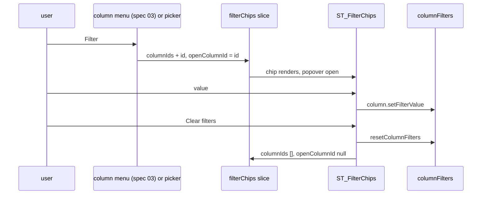

# 04: toolbar chrome

## 1. Architecture

### 1.1 Overview

The top toolbar becomes the demo's: one right-aligned button group, filters as chips on the left with a searchable column picker, a sort editor behind a toolbar button and a chip, table preferences behind one view settings button with pinnable items, one search clear control, and every menu opening from a real trigger (D8) (D9) (D10) (D11) (D18) (D24) (D25) (D35) (D36) (D37). This spec owns the toolbar files, the show-hide and row action menus, the search field and toggle, the toolbar buttons and the persistence hook in all three bases. Workstream C (index, Run plan): branch `v0.8/toolbar-chrome`, worktree `03`, cut from `claude/review` after spec 01 merged, parallel to specs 02 and 03, one builder, draft PR at the first push (P2), one fable review on the whole diff (`Review: fable`). The slices it writes come from spec 01; the cells that read them are spec 02's; the default flips (`chips`, `enableSortPopover`, `enableViewSettings`) are spec 05's.

### 1.2 Goals

- The internal button group renders, in order: search field and toggle, filter picker (chips mode), sort button, the pinned view items, full screen, view settings; buttons are ghost `size="icon"`; only the filter button while filters exist and the sort button while sorts exist carry `variant="secondary"`; the search field expands inline to the left of the group (D8)
- In chips mode one chip per filtered column shows icon, label and a value summary; clicking it opens a popover with the column's filter input; "+ Filter" opens a searchable column picker; "Clear filters" clears every value and chip; a chip for a hidden column says the column must be shown; the header filter label does not render (D9)
- The sort button opens the picker when no sort exists and the editor otherwise; the editor lists one row per rule with a drag handle, a column select (used columns excluded), a direction select and a remove button, "Add sort" and "Delete sort"; while sorts exist a chip before the filter chips opens the same editor and the button is secondary (D10) (D8 addendum)
- The view settings button opens a panel with Columns, Density, Wrap cell text, Grid lines, Sticky header, Alternating row colors, Row numbers and Reset view; each row has a pin toggle; pinned rows render in the toolbar as icon buttons whose icon follows the value; Columns and Density are pinned by default; Reset view restores every row, the pins, density, column visibility, order and pinning and deletes the stored view (D11) (D36)
- With `persistViewSettings` on, the view is written to storage on every change and applied once after hydration; the pending mark spec 02 renders is removed after the apply (D36)
- The search toggle is never disabled; open, one click clears and closes; the field has no inline X unless `showClearSearchButton`; Escape clears first, then closes (D35)
- `ST_ShowHideColumnsMenu` and `ST_RowActionMenu` open from a `trigger` element and keep `anchorEl`; the existing columns, density and filters buttons stay exported but leave the default group (D25)
- A Columns menu drop slides header and body together and highlights the moved column (D37)
- Acceptance: programmatic, the play tests of 1.6.9 pass in `test:base`, `test:radix`, `test:aria` (group order by `aria-label`; chip flow: add, filter, clear; sort flow: picker, chip, two rules, reorder by drag, delete; view settings: rows present, Row numbers toggles the `#` column, pin and unpin an item, Reset view restores the seeded state and removes the storage key; search: toggle opens focused, one click clears and closes, no inline X by default; persistence: a change writes the key, a reload-like remount applies the stored view and the pending attribute is gone); judged, captures of the `DefaultLook` story with two chips (one open), the sort editor with two rules, and the view settings panel, per base, against `reference/01-chips-*.png`, `reference/01-sort-editor-*.png` and `reference/01-view-settings-*.png` (D34), three judges on "same controls in the same order, same chip and row layout, same icons" (P6)

### 1.3 Current structure

```
packages/shadcn-table/registry/<base>/components/ui/shadcn-table/
├── components/toolbar/ST_ToolbarInternalButtons.tsx ← columns, density, filters, search, full screen (7-11, 22-61); filters gate mode !== 'popover' (52-54)
├── components/toolbar/ST_TopToolbar.tsx         ← left slot renderTopToolbarCustomActions ?? <span /> (65); fullscreen sticky top-0 (20); stackAlertBanner 95-98
├── components/buttons/ST_ToggleGlobalFilterButton.tsx ← disabled while text (25-35); click toggles only (20-22)
├── components/inputs/ST_GlobalFilterTextField.tsx ← inline clear X (170-183); 250 ms debounce not cleared on close (66-76, 96-105)
├── components/buttons/ST_ShowHideColumnsButton.tsx ← anchorEl state, menu mounted while open (22-51)
├── components/menus/ST_ShowHideColumnsMenu.tsx  ← anchorEl required (21-33); span anchor (105-123); Unpin all resetColumnPinning(true) (159-167)
├── components/menus/ST_ShowHideColumnsMenuItems.tsx ← handleDragEnd with 01's helper and cancel rule (80-95)
├── components/menus/ST_RowActionMenu.tsx        ← anchorEl (20-37, 49-52, 76-92); returns null without items (73)
├── components/buttons/ST_ToggleRowActionMenuButton.tsx ← openerProps and anchorEl (46-56, 107-128)
├── components/head/ST_TableHeadCellFilterLabel.tsx ← renders in every mode (146-150); summary helper 75-123
├── components/head/ST_TableHeadCellFilterContainer.tsx ← open from showColumnFilters or popover (44-56); aria maps open to isExpanded (62-66)
├── hooks/useST_Effects.ts                       ← table effects; no persistence
└── features/stFilterChipsFeature.ts, stViewSettingsFeature.ts, shared/utils/viewSettingsStorage.utils.ts ← from 01
packages/shadcn-table/stories/                   ← SearchField, MenuOpeners (RowActions, ShowHideColumns), MenuFocusReturn, ColumnHiding, RenderCounts, HeadlessFullScreen, TableProvider, Toolbar, Search, DensePadding plays name the old buttons
```

### 1.4 Target structure

```
packages/shadcn-table/registry/<base>/components/ui/shadcn-table/
├── components/toolbar/ST_ToolbarInternalButtons.tsx ← the D8 group
├── components/toolbar/ST_TopToolbar.tsx         ← chip row left (sort chip, separator, filter chips, custom actions), group right; no fullscreen sticky
├── components/toolbar/ST_FilterChips.tsx        ← new: chips, "+ Filter", "Clear filters", chip popovers, the toolbar filter button
├── components/toolbar/ST_ColumnPicker.tsx       ← new: searchable column list (combobox part)
├── components/toolbar/ST_SortPopover.tsx        ← new: sort button, chip, picker, editor
├── components/toolbar/ST_ViewSettingsButton.tsx ← new: panel
├── components/toolbar/ST_ViewSettingsItems.tsx  ← new: pinned icon buttons
├── components/buttons/ST_ToggleGlobalFilterButton.tsx ← clear and close
├── components/inputs/ST_GlobalFilterTextField.tsx ← inline X behind showClearSearchButton; debounce cleared on close
├── components/buttons/ST_ShowHideColumnsButton.tsx ← passes its button as trigger
├── components/menus/ST_ShowHideColumnsMenu.tsx  ← trigger, open, onOpenChange beside anchorEl
├── components/menus/ST_ShowHideColumnsMenuItems.tsx ← setColumnFlipPending before the reorder
├── components/menus/ST_RowActionMenu.tsx        ← trigger beside anchorEl
├── components/buttons/ST_ToggleRowActionMenuButton.tsx ← its button as trigger
├── components/head/ST_TableHeadCellFilterLabel.tsx ← null in chips mode
├── hooks/useST_ViewPersistence.ts               ← new: read once after hydration, write on change, remove the pending mark
├── hooks/useST_Effects.ts                       ← mounts useST_ViewPersistence
└── index.ts                                     ← the five new components and the hook
packages/shadcn-table/stories/features/FilterChips.stories.tsx, SortPopover.stories.tsx, ViewSettings.stories.tsx ← new
packages/shadcn-table/scripts/registry/base-diff.json, aria-diff.json ← new toolbar files whose base or aria copy differs (triggers, Select and Popover parts)
```

### 1.5 Flow



### 1.6 Components

#### 1.6.1 Data artifacts

- `CHANGELOG.md` `#### Spec 04` under `### Added` (D32): chips mode, sort editor, view settings and pinned items, persistence hook, one search X, `trigger` prop on the two menus, with the option that restores each (`columnFilterDisplayMode: 'subheader'`, `enableSortPopover: false`, `enableViewSettings: false`, `showClearSearchButton: true`)
- `registry.json` regenerated (the `switch` part joins the registry dependencies when imported); diff files updated for per-base copies

#### 1.6.2 Internal button group and top toolbar

`ST_ToolbarInternalButtons.tsx`, `ST_TopToolbar.tsx` (D8) (D9) (D10).

- Group, in order, each behind its gate: `ST_GlobalFilterTextField` and `ST_ToggleGlobalFilterButton` (`enableGlobalFilter`), the chips-mode filter button from `ST_FilterChips` (`columnFilterDisplayMode === 'chips'`), `ST_SortPopover` button (`enableSortPopover === true`), `ST_ViewSettingsItems` (`enableViewSettings === true`), `ST_ToggleFullScreenButton` (`enableFullScreenToggle`), `ST_ViewSettingsButton` (`enableViewSettings === true`); spec 05 sets both defaults; `ST_ToggleFiltersButton` only when `columnFilterDisplayMode === 'subheader'`; `ST_ShowHideColumnsButton` and `ST_ToggleDensePaddingButton` only when `enableViewSettings` is not `true` (today's group for consumers who turn the panel off); container `flex h-9 shrink-0 items-center gap-0.5 self-start`
- `ST_TopToolbar`: left slot becomes `div.flex min-h-9 min-w-0 flex-1 flex-wrap items-center gap-1.5 py-1` holding the sort chip, a vertical `Separator` (`data-[orientation=vertical]:h-4 self-center`) when both a sort chip and filter chips exist, `ST_FilterChips`, then `renderTopToolbarCustomActions` output; the group on the right `shrink-0`; the alert banner stacking reads the chip row's presence; the fullscreen `sticky top-0` goes (the frame holds the toolbar above it, spec 02)
- Does NOT change `renderToolbarInternalActions` (still replaces the whole group) or `positionGlobalFilter`

**Stays unchanged:** `ST_ToggleFullScreenButton`; `ST_ToolbarAlertBanner`; `ST_LinearProgressBar`.

#### 1.6.3 Filter chips and column picker

`ST_FilterChips.tsx`, `ST_ColumnPicker.tsx`, `ST_TableHeadCellFilterLabel.tsx` (D9) (D18) (D24).

- `ST_FilterChips` (chips mode): for each id in `filterChips.columnIds` a `Button size="sm" variant="secondary"` chip with the column icon (`columnDef.icon`, D3), the header label and a summary (`localization.rangeSummary`, `beforeValue`, `afterValue`, `yes` / `no`, list values joined with "+n" past two, through the `ST_TableHeadCellFilterLabel` summary helper lifted into `shared/utils/filterSummary.utils.ts`), `ExpandMoreIcon` caret, `max-w-45 truncate` label; the chip is a `Popover` trigger; content `align="start" w-auto min-w-65 sideOffset={8}` with `ST_TableHeadCellFilterContainer` for the column's header (`open` prop from 01) and a "Remove filter" button (`DeleteIcon`) that clears the value and removes the id; a hidden column (no header in `getFlatHeaders()`) shows `localization.showColumnToEditFilter` instead; `openColumnId` opens that chip's popover and focuses its first input (`filterInputRefs[\`${id}-0\`]`)
- "+ Filter" (`AddIcon`, `localization.addFilter`, ghost sm) opens `ST_ColumnPicker` with the filterable columns not yet in the list; picking adds the id and opens it; the list ends with `deleteAllFilters`; "Clear filters" (`CloseIcon`, `localization.clearFilters`) calls `resetColumnFilters` and empties the slice; both render only while at least one sort or one filter exists (the rule: an empty table shows no chip-row controls) except the toolbar filter button
- The toolbar filter button (in the group): `FilterListIcon`, `aria-label` `localization.filter`, `variant="secondary"` while any chip or column filter exists, opens the same picker
- Column filters set from `initialState`, controlled `columnFilters` or the header produce chips: the slice syncs on mount and on `columnFilters` change (ids with a value join `columnIds`; a cleared value keeps its chip until removed)
- `ST_ColumnPicker`: the `combobox` part inline (`open`, `autoHighlight`, no trigger, `value` null), `placeholder` `localization.filterBy` or `sortBy`, items with the column icon and label, `localization.noColumns` when empty, `max-h-[min(24rem,var(--available-height))] w-65 gap-0 overflow-hidden p-0` content; used by chips, the sort button and "Add sort"
- `ST_TableHeadCellFilterLabel` returns `null` when `columnFilterDisplayMode === 'chips'`
- Does NOT change the `ST_Filter*` inputs or the filter functions; chips are new toolbar components, so no mode folder is created (D29)

**Interfaces:**

```typescript
export const ST_FilterChips: <TData extends ST_RowData>(props: { table: ST_TableInstance<TData> }) => ReactNode;
export const ST_FilterPickerButton: <TData extends ST_RowData>(props: { table: ST_TableInstance<TData> }) => ReactNode;
export interface ST_ColumnPickerProps<TData extends ST_RowData> { readonly columns: readonly ST_Column<TData>[]; readonly onPick: (column: ST_Column<TData>) => void; readonly placeholder: string; readonly table: ST_TableInstance<TData>; readonly trailing?: ReactNode; }
```

#### 1.6.4 Sort popover

`ST_SortPopover.tsx` (D10) (D18) (D24).

- Toolbar button: `SwapVertIcon`, `aria-label` `localization.sort`, ghost `size="icon"`, `variant="secondary"` while `sorting.length > 0`; with no sort it opens `ST_ColumnPicker` over the sortable columns (`column.getCanSort()`), picking sets one ascending rule; with sorts it opens the editor
- Chip (left slot, before the filter chips): `Button size="sm" variant="secondary"` with `SwapVertIcon` and the one column's label or `localization.sortsCount` with `{n}`; opens the editor
- Editor `PopoverContent w-80`: one row per rule (`li flex items-center gap-1.5 rounded-md px-1 py-0.5`): `DragHandleIcon` handle (`draggable`, `aria-label` `dragToReorder`, HTML5 drag between rows, dragged row `opacity-50`, target `bg-muted`), column `Select size="sm" flex-1 text-xs` listing sortable columns minus those used by other rules, direction `Select w-29.5` (`ascending` / `descending`), remove `Button size="icon-xs" variant="ghost"` with `CloseIcon` and `aria-label` `removeSortOn`; footer "Add sort" (`AddIcon`, opens the picker for the remaining columns, appends ascending) and "Delete sort" (`DeleteIcon`, `setSorting([])`)
- Writes `table.setSorting`; respects `enableSorting`, `enableMultiSort` (with multi-sort off the editor holds one row and "Add sort" is absent)
- Does NOT show the sort index badge in the header (D2)

#### 1.6.5 View settings panel and pinned items

`ST_ViewSettingsButton.tsx`, `ST_ViewSettingsItems.tsx` (D11) (D18) (D24) (D36).

- Button: `SettingsIcon`, `aria-label` `localization.viewSettings`, ghost `size="icon"`, opens `PopoverContent align="end" w-80 gap-0 p-1`
- Rows (`flex min-h-9 items-center gap-2 ps-2`, icon `size-4 text-muted-foreground`, label, control, pin `Button size="icon-sm" variant="ghost" aria-pressed` with `PushPinIcon` / `PushPinOffIcon` and `pinToToolbar` / `unpinFromToolbar`): Columns (`ViewColumnIcon`, `columnsShown` with the visible count, a `ChevronRightIcon` button that opens `ST_ShowHideColumnsMenu` with the row as `trigger`); Density (`DensitySmallIcon`, `DensityMediumIcon`, `DensityLargeIcon` by value, `Select` of `densityCompact` / `densityComfortable` / `densitySpacious`, writes `setDensity`); Wrap cell text (`WrapTextIcon` off, `SingleLineIcon` on, `Switch`); Grid lines (`GridLines*Icon` by value, `Select` of the four); Sticky header (`StickyHeaderOnIcon` / `StickyHeaderOffIcon`, `Switch`); Alternating row colors (`StripedOnIcon` / `StripedOffIcon`, `Switch`); Row numbers (`RowNumbersOnIcon` / `RowNumbersOffIcon`, `Switch`); `Separator my-1`; Reset view (`RestartAltIcon`, `Button variant="ghost" justify-start`)
- Reset view: `resetViewSettings()`, `setDensity(initialState.density)`, `resetColumnVisibility()`, `resetColumnOrder()`, `resetColumnPinning()` (to `initialState`, not `true`), pins back to the default two, `removeStoredView(key)` (F1)
- `ST_ViewSettingsItems`: for each id in `viewSettings.pins` in list order, a ghost `size="icon"` button: Columns (`ViewColumnIcon`, `aria-label` `showHideColumns`, trigger of `ST_ShowHideColumnsMenu`), Density (`aria-label` `toggleDensity`, steps compact, comfortable, spacious), Grid lines (steps none, rows, columns, all), the four toggles (`aria-pressed`, `aria-label` the row label); the icon follows the value with a keyed swap (`animate-in fade-in zoom-in-75 duration-200 motion-reduce:animate-none`); tooltips `label: value` for the steppers; no secondary fill
- Row numbers and Sticky header write the slice; spec 02 reads it for the container and body, `displayColumn.utils` reads `enableRowNumbers || viewSettings.rowNumbers` (spec 02) so the `#` column appears pinned start
- Does NOT persist by itself (1.6.7 does) and does NOT render when `enableViewSettings` is false

#### 1.6.6 Search field and toggle

`ST_ToggleGlobalFilterButton.tsx`, `ST_GlobalFilterTextField.tsx` (D35).

- Toggle: never `disabled`; closed, click sets `showGlobalFilter` true (the field focuses itself on open, existing); open, click clears the debounced setter, calls `setGlobalFilter(undefined)` then `setShowGlobalFilter(false)`; icon `SearchIcon` closed, `SearchOffIcon` open; hidden as today when `initialState.showGlobalFilter` is true
- Field: the inline-end `InputGroupButton` clear renders only with `showClearSearchButton`; closing the field cancels the pending debounce and clears the local value; Escape behaviour unchanged
- Does NOT change `positionGlobalFilter` or the field's width transition

#### 1.6.7 Persistence hook

`useST_ViewPersistence.ts`, mounted from `useST_Effects.ts` (D36).

- Key from `getViewSettingsKey` (01) with `viewSettingsKeyInput`, `persistViewSettings` and the leaf column ids; `null` ends the hook
- After hydration (`useSyncExternalStore` with the 01 adapter): applies a stored view once to `viewSettings`, density, `columnVisibility`, `columnOrder`, `columnPinning` (controlled slices with `on*Change` win: the stored value is passed to the consumer's setter), then removes `data-st-view-pending` from the root (`tableContainerRef.current.closest('[data-st-view-pending]')`) in the same commit
- On every change of those slices after the apply: `writeStoredView(key, view)` (synchronous, the payload is small)
- Does NOT persist sorting, column filters or the global filter; does NOT run on the server

**Interfaces:**

```typescript
export const useST_ViewPersistence: <TData extends ST_RowData>(table: ST_TableInstance<TData>) => void;
```

#### 1.6.8 Menus from triggers

`ST_ShowHideColumnsMenu.tsx`, `ST_ShowHideColumnsButton.tsx`, `ST_RowActionMenu.tsx`, `ST_ToggleRowActionMenuButton.tsx`, `ST_ShowHideColumnsMenuItems.tsx` (D25) (D37).

- Both menus gain `trigger?: ReactElement`, `open?`, `onOpenChange?` beside `anchorEl` / `setAnchorEl` (now optional); with `trigger`, radix `DropdownMenuTrigger asChild`, base `render`, aria `MenuTrigger` with the trigger as its pressable child; focus returns through the primitive; without, the span anchor path stays
- `ST_ShowHideColumnsButton` passes its button as `trigger`; `ST_ToggleRowActionMenuButton` passes its dots button as `trigger` (`MoreHorizIcon`, D14); `ST_RowActionMenu` with a `trigger` and no items renders the trigger disabled instead of `null`
- `ST_ShowHideColumnsMenuItems` `handleDragEnd`: records the current header and cell positions into `columnFlipPending` (`dragDrop: false`, `movedId`) before `applyColumnReorder` so spec 03's hook slides header and body together and highlights
- Does NOT remove `anchorEl` / `setAnchorEl` or `useST_MenuAnchor`

#### 1.6.9 Stories and play tests

- `FilterChips.stories.tsx` (new): chips mode with seeded filters; plays for add through the picker, value filtering, remove, clear, the hidden-column notice, the column-menu Filter item adding a chip (spec 03's menu, read-only here)
- `SortPopover.stories.tsx` (new): no-sort picker, two rules, reorder by drag, remove, delete; the chip label for one and two sorts
- `ViewSettings.stories.tsx` (new): all rows, pin and unpin, pinned steppers, Row numbers adding the `#` column, Reset view with seeded state, persistence with `persistViewSettings: true` (write on change, remount applies, `localStorage` cleared in `beforeEach`)
- `SearchField`, `Search`, `ColumnHiding`, `DensePadding`, `Toolbar`, `HeadlessFullScreen`: updated for the toggle's clear-and-close and the pinned Columns and Density buttons (same `aria-label`s `showHideColumns` and `toggleDensity`, so most clicks keep working); `MenuOpeners` and `MenuFocusReturn` are not edited here (spec 05 rewrites both; excluded from this spec's `test:<base>` runs, noted in the tracker); `RenderCounts` and `TableProvider` are spec 02's and spec 05's
- Does NOT edit `Filtering.stories.tsx` or `Pagination.stories.tsx` (spec 05)

### 1.7 Dependencies and env: none new (the `switch`, `popover`, `select`, `separator`, `combobox` parts exist in every base)

## 2. Instructions for AI

### 2.1 Milestones

#### 2.1.1 Milestone 1: Group, chips, picker, sort editor

Lane: agent

- 1.6.2 to 1.6.4 in the radix tree, then base and aria; per-base copies listed in the diff files where the parts differ (aria `Popover` is the content, `Select` exports differ)
- Gates: per base `tsc`; `lint`; `check:tailwind`; `check:bases`

#### 2.1.2 Milestone 2: View settings, search, persistence, triggers

Lane: agent

- 1.6.5 to 1.6.8
- Gates: per base `tsc`; `check:bases`; `check:aria-warnings`

#### 2.1.3 Milestone 3: Stories, captures, judges

Lane: agent

- 1.6.9; captures into the session scratchpad, paths in `../trackers/04-tracker.md`; the Acceptance plays and the judges, loop on failures
- Gates: `test:base`, `test:radix`, `test:aria`, each with `stories/fixed-bugs/MenuOpeners.stories.tsx` and `MenuFocusReturn.stories.tsx` excluded

#### 2.1.4 Final milestone: Cleanup and gates once

Lane: agent

- Dead imports; `pnpm format`; `pnpm registry:build`; `pnpm --filter shadcn-table-docs lib:install <base>` per base; `#### Spec 04` changelog block
- Gates: 2.2

### 2.2 Gates

- Per base: `tsc`, `test:<base>` green with the two MenuOpeners and MenuFocusReturn files excluded; `storybook:build:<base>` green
- `lint`, `check:tailwind`, `check:bases`, `check:icons` green; aria: `check:aria-warnings` zero
- Judges: majority pass on the three chrome captures per base and theme against the named references
- `node reference/01-check.mjs` still exits 0
