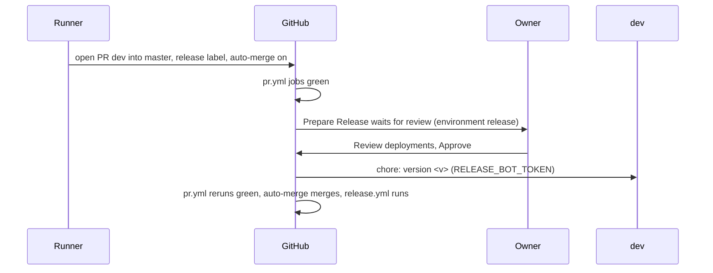

# 05: Version bump waits for the owner's approval
- Epic: E2

Follow the project planning rules: docs/code-of-conduct/planning-guidelines.md, CLAUDE.md:9. Keep the expedition contract.

## 1. Architecture

### 1.1 Overview

The release PR's last job, `prepare-release` (`.github/workflows/pr.yml:165-222`), bumps the version and pushes `chore: version <v>` to `dev` by itself once every other job is green; the owner's only step today is enabling auto-merge afterwards (v0.8.x D88, A23). D3 gates that one job behind a GitHub Environment `release` whose required reviewer is the owner: CI stays automatic, the bump waits for Approve, auto-merge is set when the PR is opened. No release is planned for v0.9.x (P4); this spec puts the gate in place for the next one.

### 1.2 Goals

- `prepare-release` runs only after the owner approves the `release` environment deployment; every other `pr.yml` job is unchanged (D3).
- The environment `release` exists on `anindosarker/shadcn-table` with the owner (`anindosarker`, GitHub user id 29659719) as its one required reviewer and self-review allowed; D3 is the one-time authorization for the setting (P7).
- No agent approves a deployment, in the UI or through `gh api`; the run reports the wait and continues (D3, P4).
- Acceptance: programmatic. `gh api repos/anindosarker/shadcn-table/environments/release --jq '[.protection_rules[] | select(.type == "required_reviewers") | .reviewers[].reviewer.login]'` prints `["anindosarker"]`; `grep -c '^    environment: release$' .github/workflows/pr.yml` prints `1`, inside the `prepare-release` job; `pnpm test validate-repo` green. The gate proves itself on the next release PR (Prepare Release shows "Waiting for review").

### 1.3 Current structure

```
.github/workflows/pr.yml
├── :159-164   ← comment: the last job, bumps once every job is green
├── :165-176   ← prepare-release: name, needs, if, runs-on, permissions, env
└── :177-222   ← steps: secret check, checkout with RELEASE_BOT_TOKEN, bump and push
GitHub repository settings: no environments (gh api .../environments: total_count 0)
```

### 1.4 Target structure

```
.github/workflows/pr.yml
└── prepare-release           ← `environment: release` after `runs-on`; comment names the owner's Approve
GitHub repository settings
└── environment release       ← required_reviewers: anindosarker; prevent_self_review false
```

### 1.5 Flow



### 1.6 Components

#### 1.6.1 Data artifacts

- `CHANGELOG.md` (P9): `#### Spec 05 Release approval` under `## Unreleased`: the version bump waits for the owner's approval of the `release` environment (D3).
- The tracker `trackers/05-release-approval-tracker.md`: the `gh api` output that created the environment and the check lines.

#### 1.6.2 The `release` environment (D3, P7)

Created once with the GitHub CLI under the owner's login (D3 authorizes the setting):

```sh
gh api -X PUT repos/anindosarker/shadcn-table/environments/release \
  --input - <<'JSON'
{ "prevent_self_review": false,
  "reviewers": [ { "type": "User", "id": 29659719 } ],
  "deployment_branch_policy": null }
JSON
```

- Required reviewer: the owner; self review allowed, since the owner opens the PR under the same account (A23).
- No wait timer, no branch policy: the job's own `if` already limits it to `dev` into `master`.
- Does NOT touch ruleset 25521193, the `RELEASE_BOT_TOKEN` secret or auto-merge settings (all unchanged from v0.8.x D83, D86).

#### 1.6.3 `prepare-release` gated (D3)

- `.github/workflows/pr.yml`, the `prepare-release` job: one line `environment: release` after `runs-on: ubuntu-latest`; the comment block at `:159-164` gains one sentence: the job waits for the owner's Approve on the `release` environment before it runs.
- Does NOT change `needs`, `if`, `permissions`, the steps, any other job, `release.yml` or `tools/release/*` (the sticky comment of `pr-summary.mjs` is unchanged; the environment wait is GitHub's own "Waiting for review" state on the check).

**Stays unchanged:** `tools/release/prepare-release.mjs`, `pr-summary.mjs`, `release.yml`.

### 1.7 Dependencies and env: none

## 2. Instructions for AI

### 2.1 Milestones

### Milestone: Release approval

- Files owned: `.github/workflows/pr.yml`
- Depends on: none
- Review: none
- Local CI: `pnpm test validate-repo`, `pnpm test lint`
- Task 1: Create the `release` environment (1.6.2) and record the `gh api` response in the tracker. Checks: the Acceptance `gh api ... --jq` line prints `["anindosarker"]`
- Task 2: Gate `prepare-release` (1.6.3). Checks: `grep -c '^    environment: release$' .github/workflows/pr.yml` prints `1`; `act pull_request -l` lists the job (P3, optional); `pnpm test validate-repo` green
- Task 3: Cleanup: the changelog block of 1.6.1, `pnpm format`. Checks: 2.2

### 2.2 Checks

- `pnpm test validate-repo` and `pnpm test lint` green
- `gh api repos/anindosarker/shadcn-table/environments/release` shows the required reviewer `anindosarker`
- Review: none (one workflow line and one repository setting authorized by D3)
