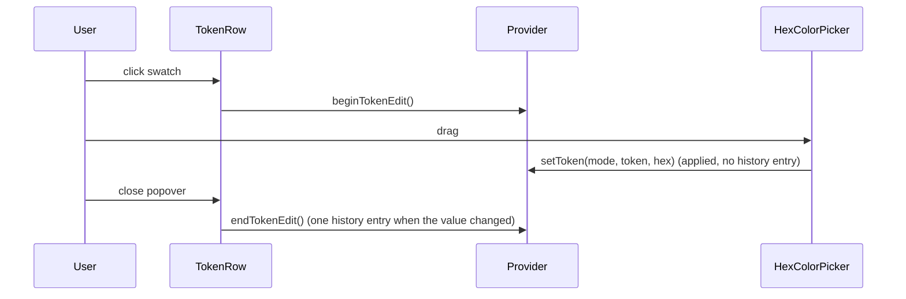

# 10: Color swatches open a picker
- Epic: E4

Follow the project planning rules: docs/code-of-conduct/planning-guidelines.md, CLAUDE.md:9. Keep the expedition contract.

## 1. Architecture

### 1.1 Overview

In the panel's Colors tab each token row shows a static swatch (`<span aria-hidden>`) and a text input; the only way to change a color is typing a value. D23 makes the swatch a button that opens a popover with `react-colorful`'s `HexColorPicker` above the input: a drag writes the token live, and closing the popover records one undo step. Typed values keep their per-keystroke history (Q46, D23).

### 1.2 Goals

- Every token row's swatch opens a popover with a hex picker and the text input; dragging changes the computed variable at once (D23).
- Closing the popover after a change leaves one history entry; Undo returns to the value before the popover opened (D23).
- An invalid typed value still applies nothing (spec 04 1.6.4).
- Acceptance: programmatic. `pnpm test docs-e2e --base base /` green with the checks of 1.6.4: clicking the `primary` swatch opens a dialog holding a `react-colorful` root; setting the picker to `#ff0000` changes the computed `--primary`; pressing Escape then `ControlOrMeta+z` restores the previous value in one step; `pnpm test typecheck --base radix`, `pnpm test lint`, `pnpm test validate-repo` green; `pnpm install --frozen-lockfile` clean.

### 1.3 Current structure

```
apps/shadcn-table-docs/
├── components/theme-customizer.tsx:580-611   ← ColorsTab: rows per TOKENS entry, "Reset colors"
├── components/theme-customizer.tsx:613-650   ← TokenRow: label, <span aria-hidden style={{backgroundColor}}>, <Input> text, setToken on change
├── components/design-system-provider.tsx:177-183 ← setToken(mode, token, value): setConfig with the override (one history entry per call)
├── components/design-system-provider.tsx:121-145 ← apply without history; setConfig records `previous` (:142)
├── lib/design-system/history.ts              ← past and future stacks, record, undo, redo
└── components/ui-radix/popover.tsx           ← present (used by spec 04)
```

### 1.4 Target structure

```
apps/shadcn-table-docs/
├── components/theme-customizer.tsx       ← TokenRow: swatch button + Popover(HexColorPicker, Input); text input stays beside the swatch
├── components/design-system-provider.tsx ← beginTokenEdit, endTokenEdit around a picker session
├── package.json                          ← react-colorful
└── test/docs-e2e/lib/getting-started.mjs ← the picker checks (1.6.4)
pnpm-lock.yaml
```

### 1.5 Flow



### 1.6 Components

#### 1.6.1 Data artifacts

- `apps/shadcn-table-docs/package.json` and `pnpm-lock.yaml`: `react-colorful` 5.8.1 added (P6: this milestone owns both for E4; no other E4 milestone adds a dependency).
- `CHANGELOG.md` (P9): `#### Spec 10 Theme panel: color picker` under `## Unreleased` (D23).

#### 1.6.2 Token row

`components/theme-customizer.tsx`, status `refactor`, `TokenRow`.

- The swatch becomes a `<button type="button" aria-label="Pick <token>">` that is the `PopoverTrigger`; the `PopoverContent` holds `HexColorPicker` (`color` = the current value as hex, `onChange` = `setToken(mode, token, hex)`) and a copy of the text input bound to the same value.
- The row's text input stays beside the swatch as today (typed values, per-keystroke history).
- `onOpenChange(true)` calls `beginTokenEdit()`; `onOpenChange(false)` calls `endTokenEdit()`.
- The current value reaches the picker as hex: a client-only `toHex(value)` helper in `lib/design-system/tokens.ts` returns the value when it already is hex and otherwise resolves it through the browser (the computed color of a hidden element). No color library is added. The picker's output is written as hex; `buildThemeCss` emits it unchanged.
- Does NOT change `ColorsTab`'s "Reset colors" or the invalid-value handling.

**Operations:**

| Operation | Status | Notes |
| --- | --- | --- |
| `TokenRow` swatch | refactor | button, `PopoverTrigger` |
| picker popover | new | `HexColorPicker` plus input |
| `toHex()` | new | `lib/design-system/tokens.ts` |

**Stays unchanged:** `Swatch` (the preset swatches, `:469-486`), `ColorsTab` layout, Typography and Other tabs.

#### 1.6.3 Provider

`components/design-system-provider.tsx`, status `refactor`.

- `beginTokenEdit()` stores the current config as the session's start; while a session is open `setToken` applies and stores without recording history; `endTokenEdit()` records one entry holding the start config when the config changed, then clears the session. Nested or unmatched calls are no-ops.
- `setToken` outside a session keeps recording one entry per call (Q46).

**Interfaces:**

```typescript
export interface DesignSystemContextValue {
  // existing members
  beginTokenEdit: () => void;
  endTokenEdit: () => void;
}
```

#### 1.6.4 Docs E2E checks

`test/docs-e2e/lib/getting-started.mjs`, status `refactor`, on `/` with the panel open, Colors tab:

- `picker opens`: clicking the button named `Pick primary` shows a `.react-colorful` element.
- `picker writes live`: setting the picker (click at the saturation square's corner, or dispatching on the hidden input) changes the computed `--primary`.
- `picker undoes in one step`: Escape closes the popover; `ControlOrMeta+z` restores the value from before the click; a second `ControlOrMeta+z` does not change `--primary` further relative to the pre-click value chain (the shuffle check keeps its own state).
- These run on the shipped code first and fail there (no `Pick primary` button) (P11).

### 1.7 Dependencies and env

- `react-colorful` 5.8.1 (`HexColorPicker`), peer deps react and react-dom only, in `apps/shadcn-table-docs`.

## 2. Instructions for AI

### 2.1 Milestones

### Milestone: Theme color picker

- Files owned: `apps/shadcn-table-docs/package.json`, `pnpm-lock.yaml`, `apps/shadcn-table-docs/components/theme-customizer.tsx`, `apps/shadcn-table-docs/components/design-system-provider.tsx`, `apps/shadcn-table-docs/lib/design-system/tokens.ts`, `test/docs-e2e/lib/getting-started.mjs`
- Depends on: Theme panel shortcut row
- Review: none
- Local CI: `pnpm test typecheck --base radix`, `pnpm test lint`, `pnpm test docs-e2e --base base /`, `pnpm test validate-repo`
- Task 1: Reproduce: write the checks of 1.6.4, run `pnpm test docs-e2e --base base /` on the shipped code, record the red lines in the tracker (P11). Checks: the three picker checks fail
- Task 2: Dependency: `pnpm add react-colorful --filter shadcn-table-docs` (1.6.1). Checks: `pnpm install --frozen-lockfile` clean
- Task 3: Provider session (1.6.3), `toHex` (1.6.2). Checks: `pnpm --filter shadcn-table-docs types:check`
- Task 4: Token row popover (1.6.2). Checks: `pnpm test docs-e2e --base base /` green
- Task 5: Cleanup: `pnpm format`, the changelog block. Checks: 2.2

### 2.2 Checks

- `pnpm test typecheck --base radix` and `pnpm test lint` green
- `pnpm test docs-e2e --base base /` green: the theme checks and the picker checks
- `pnpm test validate-repo` green
