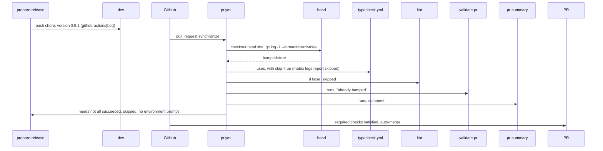

# 16: Test jobs skip the version bump commit
- Epic: E6

Follow the project planning rules: docs/code-of-conduct/planning-guidelines.md, CLAUDE.md:9. Keep the expedition contract.

## 1. Architecture

### 1.1 Overview

After the owner's Approve, `prepare-release` pushes `chore: version <v>` to `dev` (author `github-actions[bot]`, `pr.yml:219-222`); that push is a `synchronize` event and every test job runs again on a commit that changes `CHANGELOG.md` and two `package.json` files only (0.9.0: run 42501252444, about 10 minutes). D35 skips the test jobs on that commit. A first job reads the PR head commit; the four called workflows get a `skip` input and skip their matrix job inside the called file, so every required check context (`Typecheck / Typecheck (base)` and the other eighteen, the `master` ruleset 25521193) is still reported, as skipped, which the ruleset counts as passed; Lint and Validate Repo skip in place; Validate PR and PR Summary still run (the comment reads "already bumped"); Prepare Release is skipped because its needs did not all succeed, so the bump push prompts nobody (D35 consequence note).

### 1.2 Goals

- On a PR head whose last commit is `chore: version <v>` by `github-actions[bot]`, no test job runs: typecheck, storybook-tests, docs-e2e, installation-e2e (every leg), lint and validate-repo report skipped; validate-pr and pr-summary run; prepare-release is skipped (D35).
- On any other head every job runs as today; no change to a regular push.
- Acceptance: programmatic, under `act` first (P3): on a scratch branch whose head is a `chore: version 9.9.9` commit authored `github-actions[bot] <41898282+github-actions[bot]@users.noreply.github.com>`, `act pull_request -W .github/workflows/pr.yml -j lint -e <event.json>` prints the `head` job's `bumped=true` and Lint as skipped; on a normal head the same command runs Lint. Then the 0.9.1 release PR (the next one): the run on the bump commit shows the nineteen test contexts and Prepare Release as skipped, Validate PR and PR Summary green, auto-merge merged, recorded in the release tracker.

### 1.3 Current structure

```
.github/workflows/
├── pr.yml:37-40, 63-71, 96-101        ← caller jobs typecheck, storybook-tests, docs-e2e, installation-e2e: `if:` on the event, `uses:` the called workflow
├── pr.yml:42-62, 75-95                ← lint, validate-repo: `if:` on the event, steps in place
├── pr.yml:106-131                     ← validate-pr (reads the labels live; its record carries `note: already bumped`, test/validate-pr/test.mjs:75-80)
├── pr.yml:137-157                     ← pr-summary: `if: always()`, needs the seven test jobs
├── pr.yml:159-224                     ← prepare-release: needs every job, `environment: release`, "already bumped" exit at :211-215
├── pr.yml:219-222                     ← the bump commit: user.name github-actions[bot], `chore: version <next>`, pushed with RELEASE_BOT_TOKEN
├── typecheck.yml:7-8, 13-20           ← workflow_call without inputs; job typecheck, matrix base
├── storybook-tests.yml                ← same shape
├── docs-e2e.yml:10-11, 16-23          ← same shape
└── installation-e2e.yml:10-16, 21-28  ← workflow_call with input no-diff; job installation-e2e, matrix scenario
ruleset 25521193 (master)              ← required contexts: Lint, Validate Repo, Validate PR, PR Summary, Prepare Release, `Typecheck / Typecheck (<b>)`, `Storybook Tests / Storybook Tests (<b>)`, `Docs E2E Tests / Docs E2E Tests (<b>)`, `Installation E2E / Installation E2E (<s>)`
```

### 1.4 Target structure

```
.github/workflows/
├── pr.yml                 ← new first job `head` (outputs.bumped); the six test jobs need it; the four callers pass `with: skip:`; lint and validate-repo add the condition to their `if:`; the prepare-release comment names the skip
├── typecheck.yml          ← `workflow_call.inputs.skip` (boolean, default false); job `if: ${{ !inputs.skip }}`
├── storybook-tests.yml    ← same
├── docs-e2e.yml           ← same
└── installation-e2e.yml   ← `skip` beside `no-diff`; job `if: ${{ !inputs.skip }}`
```

### 1.5 Flow



### 1.6 Components

#### 1.6.1 Data artifacts

- `CHANGELOG.md` (P9): `#### Spec 16 CI: test jobs skip the version bump commit` under `## Unreleased`, `### Changed` (D35).

#### 1.6.2 The `head` job

`pr.yml`, status `refactor`: a new first job.

- `head`: `runs-on: ubuntu-latest`, `if:` the label condition alone (`!contains(labeled/unlabeled)`; it runs on the `installation-e2e-only` dispatch too, because `installation-e2e` needs it and a skipped need skips the dependent), steps: `actions/checkout` with `fetch-depth: 2` (the default merge commit; a `ref: head.sha` cannot be proven under act, which fetches the sha from GitHub); one step `id: commit` running `git log -1 --format='%an%n%s' "$HEAD_SHA"` with `HEAD_SHA` from `github.event.pull_request.head.sha` (empty on a dispatch) and writing `bumped=true` when the author is exactly `github-actions[bot]` and the subject matches `^chore: version [0-9]`, else `bumped=false`; job `outputs: { bumped: ${{ steps.commit.outputs.bumped }} }`. Without a pull request (dispatch) `bumped` is `false`.
- Does NOT read the PR through the API and does NOT depend on the label.

**Interfaces:**

```yaml
head:
  outputs:
    bumped: ${{ steps.commit.outputs.bumped }}
```

#### 1.6.3 The test jobs

`pr.yml`, status `refactor`.

- `typecheck`, `storybook-tests`, `docs-e2e`, `installation-e2e`: `needs: [head]`; `with: skip: ${{ needs.head.outputs.bumped == 'true' }}` (installation-e2e keeps `no-diff`). Their `if:` is unchanged: the skip happens inside the called workflow so every matrix leg still reports its check context.
- `lint`, `validate-repo`: `needs: [head]`; `if:` gains `&& needs.head.outputs.bumped != 'true'` (a direct job's skipped status is reported under its own name).
- `validate-pr`, `pr-summary`, `prepare-release`: unchanged `if:`; `pr-summary` and `prepare-release` add `head` to nothing (they need the test jobs, which need `head`). The `prepare-release` comment (`:159-165`) gains one sentence: on the bump commit the test jobs are skipped and this job is skipped with them (D35).
- Does NOT change the concurrency group, the permissions or any step of the jobs.

#### 1.6.4 The called workflows

`typecheck.yml`, `storybook-tests.yml`, `docs-e2e.yml`, `installation-e2e.yml`, status `refactor`.

- `on.workflow_call.inputs.skip`: `description: Skip the job (the PR head is the version bump commit, D35)`, `type: boolean`, `default: false`.
- The one job: `if: ${{ !inputs.skip }}` on every step (`always() && !inputs.skip` on the upload), never at job level: a job-level `if:` is read before the matrix expands and GitHub reports one unexpanded skipped job instead of the leg contexts (actions/runner#952), so each leg runs no step and reports success under its own context. (Run of 2026-11-09, Q53.)
- The header comment of each file names the input in one sentence.

### 1.7 Dependencies and env

- `act` 0.2.96 and Docker Desktop (P3, P6). The event file for the act proof: `{"pull_request": {"head": {"sha": "<scratch head>"}, "title": "proof", "number": 0}, "action": "synchronize"}` in the session scratchpad; `act` checks out the working tree, so the scratch commit is made in the milestone worktree and reset afterwards.

## 2. Instructions for AI

### 2.1 Milestones

### Milestone: CI skip bump commit

- Files owned: `.github/workflows/pr.yml`, `.github/workflows/typecheck.yml`, `.github/workflows/storybook-tests.yml`, `.github/workflows/docs-e2e.yml`, `.github/workflows/installation-e2e.yml`
- Depends on: none
- Review: fable
- Local CI: `act -W .github/workflows/pr.yml -l` (the workflow parses, every job listed), `act pull_request -W .github/workflows/pr.yml -j lint -e <event.json>` on a bump head and on a normal head, `pnpm test validate-repo`
- Task 1: Reproduce: in the milestone worktree commit `chore: version 9.9.9` as `github-actions[bot]` (a one-byte change to `CHANGELOG.md`), run `act pull_request -W .github/workflows/pr.yml -j lint -e <event.json>` on the shipped workflows, record in the tracker that Lint ran (P11); reset the scratch commit. Checks: the tracker line
- Task 2: The `head` job, the callers, lint and validate-repo (1.6.2, 1.6.3); the `skip` input and the step `if:` in the four called workflows (1.6.4). Checks: `act -W .github/workflows/pr.yml -l` lists `head`; the scratch bump head: `act ... -j lint` prints `bumped=true` and skips Lint; a normal head runs Lint
- Task 3: Cleanup: the comments, the changelog block, `pnpm format`. Checks: 2.2

### 2.2 Checks

- `act -W .github/workflows/pr.yml -l` lists every job, `head` first
- `act pull_request -W .github/workflows/pr.yml -j lint -e <event.json>`: Lint skipped on the bump head, run on a normal head
- `pnpm test validate-repo` green
- Review: fable (the release flow and every required check context)
- At the 0.9.1 release (its release spec): the bump run shows the nineteen test contexts and Prepare Release skipped, Validate PR and PR Summary green, the PR merged by auto-merge; a context left "Expected" there is an ATTENTION item (fallback: the owner's admin bypass, D16, once)
