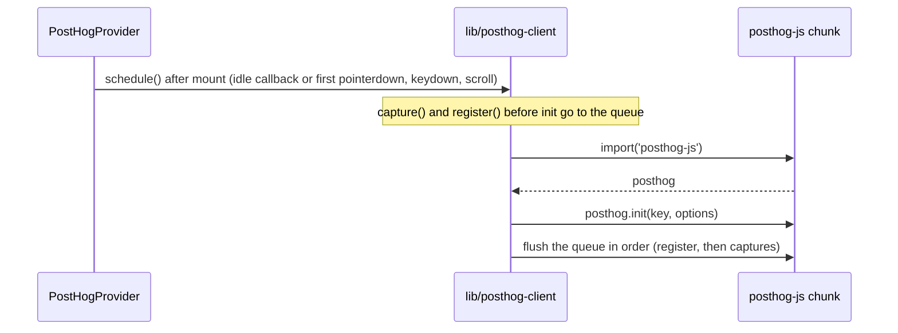

# 34: posthog-js loads after hydration

Follow the project planning rules: docs/code-of-conduct/planning-guidelines.md, CLAUDE.md:9. Keep the expedition contract.

## 1. Architecture

### 1.1 Overview

`components/posthog-provider.tsx` and `lib/analytics.ts` import `posthog-js` at module top, and the provider sits in the root layout, so every page carries posthog-js (about 114 KB of transfer) in its first script load. On `/` that is most of the 580 KB left after spec 30, whose 450 KB target was unreachable inside the home components (Q30, D62). D70 moves the library out of the first load: it is fetched with a dynamic `import()` after hydration, on the first idle moment or the first interaction, and events raised before that are queued and sent on init. Session replay needs no option: posthog-js records once the project setting is on (D67), so it starts with the same init. Nothing the visitor sees changes.

### 1.2 Goals

- No initial chunk of `/` (or of a docs page) contains posthog-js; it loads in its own chunk after hydration (D70).
- The first page view still reaches `/ingest/*`; a custom event raised before init (for example `base_switched` in the first second) is sent after init, not dropped (D70).
- Without `NEXT_PUBLIC_POSTHOG_KEY` nothing loads and nothing is queued, as today.
- The `/` script transfer is under 450 KB, the original D59 target (D70).
- Acceptance: programmatic. On a production build served on a P6 port with `NEXT_PUBLIC_POSTHOG_KEY` set to a dummy value and `NEXT_PUBLIC_SITE_URL` to that origin: the Lighthouse line of spec 30 1.2 (`npx lighthouse@12 http://localhost:<port>/ --preset=desktop --only-categories=performance --output=json ...` and its `node -e` reducer over `network-requests`, three runs, the median counts) prints under 450 KB and under 300 ms; `for f in $(curl -s localhost:<port>/ | grep -oE '/_next/static/chunks/[^"]+\.js' | sort -u); do curl -s localhost:<port>$f | grep -l "posthog" >/dev/null && echo $f; done` prints nothing (no chunk the HTML references contains posthog-js); with a browser (agent-browser or Playwright) on `/`: within 10 s of load a request to `/ingest/` with `$pageview` is observed, and after a base switch made in the first second a `base_switched` event is observed once (both recorded in the tracker with the request URLs). `pnpm test docs-e2e --base base` green, with "icons: the pick survives a reload" (`test/docs-e2e/lib/getting-started.mjs:674`) among the passes.

### 1.3 Current structure

```
apps/shadcn-table-docs/
├── components/posthog-provider.tsx:4      ← import posthog from 'posthog-js'
├── components/posthog-provider.tsx:5      ← import { PostHogProvider as PostHogClientProvider } from 'posthog-js/react' (no component calls usePostHog)
├── components/posthog-provider.tsx:28-38  ← posthog.init(...) in an effect on mount; :40-42 posthog.register({ base }); :44-46 trackSearchUsed()
├── lib/analytics.ts:1,24-26               ← import posthog from 'posthog-js'; capture() sends only when posthog.__loaded
└── app/layout.tsx                         ← mounts <PostHogProvider> inside fumadocs' RootProvider
```

### 1.4 Target structure

```
apps/shadcn-table-docs/
├── lib/posthog-client.ts                  ← new: the loader, the queue, capture() and register() (no static posthog-js import)
├── components/posthog-provider.tsx        ← schedules the load after hydration; no posthog-js or posthog-js/react import
└── lib/analytics.ts                       ← capture() goes through lib/posthog-client.ts
CHANGELOG.md (P9)                          ← #### Spec 34 under ## Unreleased, ### Changed
```

### 1.5 Flow



### 1.6 Components

#### 1.6.1 Data artifacts

- `CHANGELOG.md` (P9): `#### Spec 34 posthog-js loads after hydration` under `## Unreleased`, `### Changed`: analytics load after the page is interactive; the home page's first script load drops under 450 KB (D70).

#### 1.6.2 Loader and queue (D70)

`lib/posthog-client.ts`, status `new`.

- Holds the key (`process.env.NEXT_PUBLIC_POSTHOG_KEY`), the loaded client (typed with `import type { PostHog } from 'posthog-js'`) and a queue of pending calls.
- `schedule()`: no-op without the key or when already scheduled; otherwise loads on the first of `requestIdleCallback` (with a timeout, and a `setTimeout` fallback where the API is missing) or a first `pointerdown`, `keydown` or `scroll`; the listeners are removed once it fires.
- The load: `const { default: posthog } = await import('posthog-js')`, then `posthog.init(key, { ... })` with exactly today's options (`api_host: '/ingest'`, `ui_host`, `capture_pageview: 'history_change'`, `capture_pageleave: true`, `person_profiles: 'identified_only'`, `autocapture: false`), then the queue flushed in order.
- `capture(event, properties)` and `register(properties)`: call the client when loaded, queue when the key is set and the client is not loaded yet, no-op without the key.
- Does NOT pass any session recording option (D67: the project setting decides); does NOT call `identify`.

#### 1.6.3 Provider (D70)

`components/posthog-provider.tsx`, status `refactor`.

- Calls `schedule()` in the mount effect, `register({ base })` when the base changes, `trackSearchUsed()` when the search opens, and renders its children. The `posthog-js` and `posthog-js/react` imports go: no component reads the client through React context. The doc comment is updated to describe the deferred load.
- Does NOT change where the provider is mounted (`app/layout.tsx` is not edited).

#### 1.6.4 Events (D70)

`lib/analytics.ts`, status `refactor`.

- The private `capture` helper delegates to `lib/posthog-client.ts`; the `posthog-js` import goes. Every exported `track*` function keeps its name, its properties and its event name.

**Stays unchanged:** `app/layout.tsx`, `next.config.mjs` (the `/ingest` rewrites), every caller of the `track*` functions, `package.json` (posthog-js stays a dependency).

### 1.7 Dependencies and env

- `NEXT_PUBLIC_POSTHOG_KEY` (existing): unset locally, so the Acceptance run sets a dummy value; the `/ingest` requests then fail upstream, which is enough to observe that they are made.

## 2. Instructions for AI

### 2.1 Milestones

### Milestone: PostHog after hydration

- Files owned: `apps/shadcn-table-docs/lib/posthog-client.ts`, `apps/shadcn-table-docs/components/posthog-provider.tsx`, `apps/shadcn-table-docs/lib/analytics.ts`
- Depends on: none
- Review: none
- Local CI: `pnpm test typecheck --base base`, `pnpm test lint`, `pnpm test validate-repo`, `pnpm test docs-e2e --base base`
- Task 1: Record the before numbers on `claude/review` (the Lighthouse line, three runs) in the tracker. Checks: the numbers are in the tracker
- Task 2: The loader, the provider and the events helper (1.6.2 to 1.6.4). Checks: `pnpm --filter shadcn-table-docs types:check`; `pnpm --filter shadcn-table-docs lint`; `grep -rn "from 'posthog-js" apps/shadcn-table-docs/components apps/shadcn-table-docs/lib apps/shadcn-table-docs/app | grep -v "import type"` prints nothing
- Task 3: Prove the Acceptance of 1.2 on a production build served on a P6 port; record the after numbers, the chunk loop result and the two observed requests; stop the server. Checks: the lines of 1.2
- Task 4: Cleanup: `pnpm format`, the changelog block (1.6.1). Checks: 2.2

### 2.2 Checks

- `pnpm test typecheck --base base`, `pnpm test lint`, `pnpm test validate-repo` green
- `pnpm test docs-e2e --base base` green, "icons: the pick survives a reload" passing
- The Lighthouse numbers, the chunk loop and the two requests of 1.2
- Review: none (three files, no visible change, proven by the measurements; P7 untouched)
