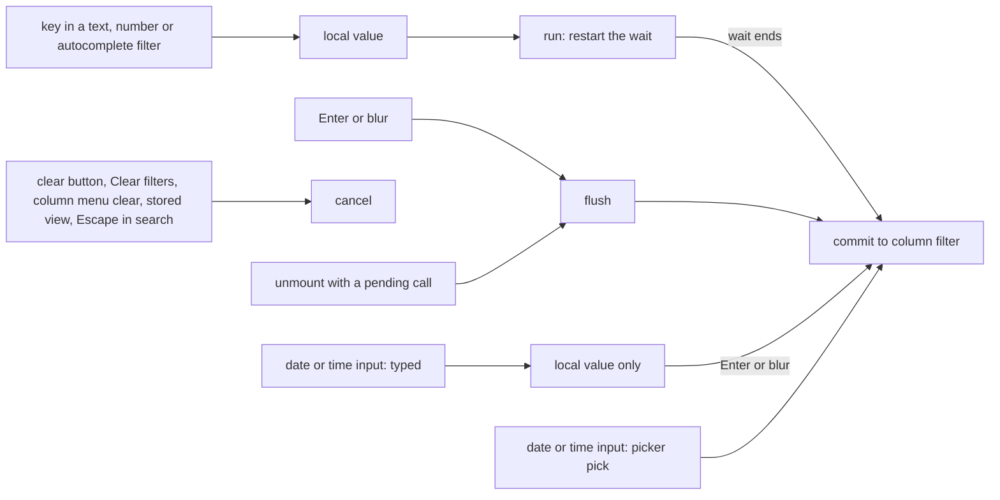

# 39: Typed filters use one debounce hook

Follow the project planning rules: docs/code-of-conduct/planning-guidelines.md, CLAUDE.md:9. Keep the expedition contract.

## 1. Architecture

### 1.1 Overview

Every typed column filter (text, number, autocomplete, date, datetime, time, both ends of a range) commits through one debounced function created once per mount in `ST_FilterTextField.tsx`; global search has its own in `ST_GlobalFilterTextField.tsx`. Both are 1:1 ports of Material React Table v3 and use the `debounce` util of `shared/utils/utils.ts`, which has `clear()` and no flush. The owner types slower than the 200 ms wait, so filters fire mid-word, and a native date or time input emits a valid value after every digit of the year (`0002`, `0020`, `0202`), so a pause applies a wrong date (Q74). The lookup also proved races: the field's clear button, Clear filters, the column menu clear, a stored view load and the global clear or Escape do not cancel a pending call, which then writes the old text back; Enter and blur do not commit; a pending call fires after unmount; callback and wait are frozen at mount. D88 replaces both debounces with one hook, `useST_DebouncedCallback`, with fixed commit and cancel rules, a 500 ms wait, a complete-value rule for date and time inputs, and a table option with a per-column override.

### 1.2 Goals

- One hook `useST_DebouncedCallback(fn, wait)` per base, returning `run`, `flush`, `cancel`, `isPending`; it calls the latest `fn` and reads `wait` live; no new dependency (D88).
- Typed column filters (text, number, autocomplete, each range end) and global search commit 500 ms after the last key, with and without `manualFiltering` (D88).
- Enter and blur commit at once; every clear path cancels the pending call; an unmount with a pending call commits it (D88).
- Date, datetime and time inputs never commit per keystroke: a typed value commits on Enter or blur, a value chosen in the native picker commits at once (D88).
- Select, multi-select, checkbox, range slider and edit cells behave as today (D88).
- The wait is configurable: table options `columnFilterDebounceMs` and `globalFilterDebounceMs` (default 500), column option `filterDebounceMs` overriding the table value for that column (D88).
- Acceptance: programmatic. Three plays that fail on the code before the change (P11, failure recorded in the tracker) and pass after, on the three bases: `Filtering.stories.tsx` `TypeThenClearFiltersStaysCleared` (type in a text filter, click Clear filters inside the wait, wait 700 ms: the column filter state is empty and all rows show), `TypeThenEnterAppliesAtOnce` (type, press Enter: the rows are filtered within 100 ms, before the wait ends), `HalfTypedYearAppliesNothing` (in a date filter type month, day and one year digit with the keyboard, wait 700 ms: `columnFilters` is empty; then blur: the filter applies); `Search.stories.tsx` `ClearCancelsPendingSearch` (type, clear inside the wait, wait 700 ms: the global filter is empty); `Filtering.stories.tsx` `CustomFilterDebounce` (a table with `columnFilterDebounceMs: 50` and one column with `filterDebounceMs: 1000`: the first column filters within 300 ms, the second not before 800 ms). `grep -rn "debounce(" packages/shadcn-table/registry/*/components/ui/shadcn-table` prints nothing. `pnpm test storybook-tests` green on the three bases with `RenderCounts.stories.tsx` unchanged.

### 1.3 Current structure

Paths under `packages/shadcn-table/registry/<base>/components/ui/shadcn-table/`; line numbers are the Base UI copy, Radix and React Aria in brackets.

```
components/inputs/ST_FilterTextField.tsx:52          ← imports debounce
components/inputs/ST_FilterTextField.tsx:212-232     ← handleChangeDebounced = useMemo(() => debounce(..., isTextboxFilter ? (manualFiltering ? 400 : 200) : 1), [])  (radix :214-230, aria :229-245)
components/inputs/ST_FilterTextField.tsx:234-237     ← handleChange: local state, then the debounced commit
components/inputs/ST_FilterTextField.tsx:239-248     ← handleTextFieldChange (text and number inputs)
components/inputs/ST_FilterTextField.tsx:250-265     ← autocomplete input change and option pick
components/inputs/ST_FilterTextField.tsx:266-288     ← handleClear: writes the store, never cancels
components/inputs/ST_FilterTextField.tsx:299-314     ← outside-change sync: resets the local value, never cancels
components/inputs/ST_FilterTextField.tsx:414-417     ← onKeyDown: stopPropagation only
components/inputs/ST_FilterTextField.tsx:420-426     ← commonDatePickerProps.onChange: handleChange(event.target.value) (aria :445)
components/inputs/ST_FilterTextField.tsx:477-497     ← native time, datetime-local and date inputs
components/inputs/ST_FilterTextField.tsx:548,600     ← select and multi-select call handleChange (1 ms wait today)
components/inputs/ST_GlobalFilterTextField.tsx:67-77 ← handleChangeDebounced, manualFiltering ? 500 : 250 (aria :70-74)
components/inputs/ST_GlobalFilterTextField.tsx:89-92 ← handleClear: no cancel
components/inputs/ST_GlobalFilterTextField.tsx:108-120 ← Escape clears, then closes: no cancel
components/inputs/ST_GlobalFilterTextField.tsx:123-130 ← closing the field calls .clear() (the one cancel today)
shared/utils/utils.ts:56-77                          ← Cancelable, debounce(func, wait = 166); used by the two files above only; not exported from index.ts
features/stConfigFeature.ts:77,216,279               ← columnFilterDisplayMode, stFilterDatePickerProps, stSearchTextFieldProps (table options); :561,653 column options
hooks/useST_TableOptions.ts:39,88                     ← option defaults (columnFilterDisplayMode = 'chips', manualFiltering)
hooks/                                               ← useST_<Name>.ts, one copy per base; no debounce hook, no useDeferredValue
```

- `shared/utils/utils.ts` and `shared/utils/column.utils.ts` are byte-identical on the three bases; the two input files differ per base in their markup, not in the debounce code.
- `registry/<base>/registry.ts` lists every file of the tree as an item file (`tools/registry/lib.mjs` `buildBaseItems`), so a new hook file needs no hand-written registry entry; `registry.json` is generated (P9).
- Stories: no fake timers anywhere; 11 story files type into filters and rely on `waitFor`'s 1000 ms default. `RenderCounts.stories.tsx` counts renders after typing.
- Docs: `apps/shadcn-table-docs/lib/prop-tables/tableOptions.ts:982` (`manualFiltering`), `:1130` (`stSearchTextFieldProps`); `columnOptions.ts:541` (`stFilterDatePickerProps`); `content/docs/guides/production-ready-tables.mdx:312` says "500ms for search, 400ms for filters" and `:373` says the inputs debounce "in manual mode".
- `test/docs-e2e/lib/helpers.mjs:722-727` sets the live demo date filter with Playwright `fill`, which raises no key events.

### 1.4 Target structure

```
hooks/useST_DebouncedCallback.ts                     ← new, identical on the three bases
components/inputs/ST_FilterTextField.tsx             ← typed variants commit through the hook; select and multi-select commit directly; Enter and blur flush; clear paths and the outside sync cancel; date and time rule
components/inputs/ST_GlobalFilterTextField.tsx       ← the hook; clear, Escape and close cancel; Enter and blur flush
features/stConfigFeature.ts                          ← columnFilterDebounceMs, globalFilterDebounceMs (table), filterDebounceMs (column)
hooks/useST_TableOptions.ts                          ← defaults 500 and 500
shared/utils/utils.ts                                ← debounce and Cancelable removed
index.ts (P9)                                        ← export of the hook under `// spec 39`
packages/shadcn-table/stories/features/Filtering.stories.tsx, Search.stories.tsx ← the plays of 1.2
apps/shadcn-table-docs/lib/prop-tables/tableOptions.ts, columnOptions.ts ← rows for the three options
apps/shadcn-table-docs/content/docs/guides/production-ready-tables.mdx  ← lines 312 and 373: the numbers and "in manual mode" corrected (ride-along)
CHANGELOG.md (P9)                                    ← #### Spec 39 under ### Added
```

### 1.5 Flow



### 1.6 Components

#### 1.6.1 Data artifacts

- `CHANGELOG.md` (P9): `#### Spec 39 Typed filters wait for you to finish typing` under `## Unreleased`, `### Added`: the hook, the three options, the 500 ms default, Enter and blur apply at once, a cleared filter no longer comes back, date and time filters apply a complete value (D88).
- Generated, never hand-edited (P9): `registry.json`, `apps/shadcn-table-docs/components/ui-<base>/` (`pnpm lib:install <base>`), `public/r/`.

#### 1.6.2 Hook (D88)

`hooks/useST_DebouncedCallback.ts`, status `new`, the same file on the three bases.

- `useST_DebouncedCallback<Args extends unknown[]>(fn: (...args: Args) => void, wait: number)` returns a stable object `{ run(...args), flush(), cancel(), isPending() }`.
- `run` stores the arguments and restarts the timer; when it ends the latest `fn` (kept in a ref updated after each render) is called with the last arguments. `wait` is read when `run` is called.
- `flush` calls `fn` now with the pending arguments and clears the timer; a no-op with nothing pending. `cancel` drops the pending call. `isPending` reports a running timer.
- On unmount a pending call is flushed (the effect cleanup calls `flush`): a chip editor that closes mid-wait keeps what the user typed, as blur does and as the fire-after-unmount of today did. A cleared field has nothing pending, because every clear path cancels first.
- A `wait` of 0 or less calls `fn` synchronously.
- JSDoc on the export; no other comment. Exported from each base's `index.ts` under `// spec 39` (P9).
- Does NOT use `@tanstack/react-pacer` or any new package; does NOT touch `package.json` or the lockfile.

#### 1.6.3 Column filter field (D88)

`components/inputs/ST_FilterTextField.tsx`, status `refactor`, three bases.

- The commit function (today the body of the debounced callback, lines 215-227) becomes a plain `commitFilterValue(newValue)`; `useST_DebouncedCallback(commitFilterValue, wait)` wraps it, `wait` being `columnDef.filterDebounceMs ?? table.options.columnFilterDebounceMs`.
- Text, number and autocomplete input changes and each range end: local state, then `run`. Select, multi-select and the autocomplete option pick: local state, then `commitFilterValue` directly after `cancel` (no 1 ms timer).
- `onKeyDown` of every typed input: Enter calls `flush`; the existing `stopPropagation` and the user's `onKeyDown` stay. `onBlur` of every typed input calls `flush`, then the user's `onBlur`.
- `handleClear`, `handleClearEmptyFilterChip` and the outside-change sync block (lines 299-314) call `cancel` before they write or reset; the sync block's cancel covers Clear filters (`ST_FilterChips.tsx:277`), the column menu clear (`ST_ColumnActionMenu.tsx:157`) and stored views.
- Date, datetime and time inputs: a change that follows a key press in the input since its last commit is typing: it updates the local value only, and Enter or blur commits it. A change with no key press since the last commit is a pick in the native picker (or a programmatic `fill`): it commits at once. An empty value (`''`) from a cleared or incomplete input commits `undefined` on Enter or blur like any other typed value. Task 2 records, per input type and in Chromium, WebKit and Firefox as available, which events a picker pick and a typed digit raise, and adjusts only the detection (not the rule) when a browser differs.
- Does NOT change the markup, classes, the filter mode button, `rangeFilterIndex` handling, `columnDef.Filter`, or the slider and checkbox components.

#### 1.6.4 Global search (D88)

`components/inputs/ST_GlobalFilterTextField.tsx`, status `refactor`, three bases.

- `useST_DebouncedCallback((value: string) => setGlobalFilter(value || undefined), table.options.globalFilterDebounceMs)`; `handleChange` sets `searchValue` and calls `run`.
- `handleClear` and the Escape branch cancel before they clear; the close branch (lines 123-130) calls `cancel` in place of `.clear()`; Enter and blur flush.
- Does NOT change the Escape order (clear first, then close), focus return, or the mode menu.

#### 1.6.5 Options (D88)

`features/stConfigFeature.ts` and `hooks/useST_TableOptions.ts`, status `refactor`, three bases.

- Table options, next to `manualFiltering`'s group: `columnFilterDebounceMs?: number` and `globalFilterDebounceMs?: number`, JSDoc "Milliseconds a typed column filter (global search) waits after the last key before it applies. Default 500." Column option next to the filter props: `filterDebounceMs?: number`, JSDoc "Overrides `columnFilterDebounceMs` for this column."
- Defaults in `useST_TableOptions.ts`: both 500.
- `apps/shadcn-table-docs/lib/prop-tables/tableOptions.ts` and `columnOptions.ts`: one row per option in the shape of the neighbouring rows (`manualFiltering` at :982, `stFilterDatePickerProps` at :541).
- Additive only: no option or type is renamed or removed (P7).

#### 1.6.6 Removal and ride-along

- `shared/utils/utils.ts`: `debounce` and `Cancelable` removed on the three bases once nothing imports them (they are not exported from `index.ts`).
- Ride-along, `content/docs/guides/production-ready-tables.mdx`: line 312 becomes a sentence that says the search box and the typed column filters wait 500 ms by default and names `globalFilterDebounceMs` and `columnFilterDebounceMs`; line 373 drops "in manual mode". No other docs wording changes.

**Stays unchanged:** `ST_FilterRangeSlider.tsx`, `ST_FilterCheckbox.tsx`, `ST_EditCellTextField.tsx`, `ST_FilterRangeFields.tsx`, `shared/fns/filterFns.ts`, every toolbar component, `RenderCounts.stories.tsx`, `test/docs-e2e/**`.

### 1.7 Dependencies and env: none

## 2. Instructions for AI

### 2.1 Milestones

### Milestone: Filter debounce hook

- Files owned: `packages/shadcn-table/registry/base/components/ui/shadcn-table/hooks/useST_DebouncedCallback.ts`, `packages/shadcn-table/registry/radix/components/ui/shadcn-table/hooks/useST_DebouncedCallback.ts`, `packages/shadcn-table/registry/aria/components/ui/shadcn-table/hooks/useST_DebouncedCallback.ts`, `packages/shadcn-table/registry/base/components/ui/shadcn-table/components/inputs/ST_FilterTextField.tsx`, `packages/shadcn-table/registry/radix/components/ui/shadcn-table/components/inputs/ST_FilterTextField.tsx`, `packages/shadcn-table/registry/aria/components/ui/shadcn-table/components/inputs/ST_FilterTextField.tsx`, `packages/shadcn-table/registry/base/components/ui/shadcn-table/components/inputs/ST_GlobalFilterTextField.tsx`, `packages/shadcn-table/registry/radix/components/ui/shadcn-table/components/inputs/ST_GlobalFilterTextField.tsx`, `packages/shadcn-table/registry/aria/components/ui/shadcn-table/components/inputs/ST_GlobalFilterTextField.tsx`, `packages/shadcn-table/registry/base/components/ui/shadcn-table/features/stConfigFeature.ts`, `packages/shadcn-table/registry/radix/components/ui/shadcn-table/features/stConfigFeature.ts`, `packages/shadcn-table/registry/aria/components/ui/shadcn-table/features/stConfigFeature.ts`, `packages/shadcn-table/registry/base/components/ui/shadcn-table/hooks/useST_TableOptions.ts`, `packages/shadcn-table/registry/radix/components/ui/shadcn-table/hooks/useST_TableOptions.ts`, `packages/shadcn-table/registry/aria/components/ui/shadcn-table/hooks/useST_TableOptions.ts`, `packages/shadcn-table/registry/base/components/ui/shadcn-table/shared/utils/utils.ts`, `packages/shadcn-table/registry/radix/components/ui/shadcn-table/shared/utils/utils.ts`, `packages/shadcn-table/registry/aria/components/ui/shadcn-table/shared/utils/utils.ts`, `packages/shadcn-table/stories/features/Filtering.stories.tsx`, `packages/shadcn-table/stories/features/Search.stories.tsx`, `apps/shadcn-table-docs/lib/prop-tables/tableOptions.ts`, `apps/shadcn-table-docs/lib/prop-tables/columnOptions.ts`, `apps/shadcn-table-docs/content/docs/guides/production-ready-tables.mdx`
- Depends on: none
- Review: fable
- Local CI: `pnpm test typecheck --base base`, `pnpm test typecheck --base radix`, `pnpm test typecheck --base aria`, `pnpm test lint`, `pnpm test validate-repo`, `pnpm test storybook-tests --base base`, `pnpm test storybook-tests --base radix`, `pnpm test storybook-tests --base aria`, `pnpm test docs-e2e --base base`
- Task 1: Plays first (P11): write the five plays of 1.2 and run the four that need no new option on the code before the change, on the three bases; record each failure line in the tracker. Checks: `ST_BASE=<base> pnpm exec vitest run stories/features/Filtering.stories.tsx stories/features/Search.stories.tsx -t "<play name>"` fails as required per play and base
- Task 2: The hook (1.6.2) on the three bases, its `index.ts` export; the column filter field (1.6.3) and global search (1.6.4); the browser record for date, datetime and time inputs in the tracker. Checks: `pnpm test typecheck --base <base>` on the three bases; the plays of Task 1 pass; `cmp` shows the three hook files identical
- Task 3: Options and defaults (1.6.5), the `CustomFilterDebounce` play, the docs prop table rows, the util removal and the guide lines (1.6.6). Checks: the `grep` line of 1.2 prints nothing; `pnpm --filter shadcn-table-docs types:check`; the play passes on the three bases
- Task 4: Regenerate (`pnpm lib:install base`, `radix`, `aria`; `pnpm registry:build`), `pnpm format`, the changelog block (1.6.1). Checks: 2.2

### 2.2 Checks

- `pnpm test typecheck --base base`, `pnpm test typecheck --base radix`, `pnpm test typecheck --base aria`, `pnpm test lint`, `pnpm test validate-repo`, `pnpm test storybook-tests --base base`, `pnpm test storybook-tests --base radix`, `pnpm test storybook-tests --base aria` green; `RenderCounts.stories.tsx` plays pass without an edit to that file
- `pnpm test docs-e2e --base base` green (its live demo date filter uses `fill`, which commits at once under 1.6.3)
- The five plays of 1.2 on the three bases, with the before-the-change failures in the tracker
- `git diff origin/claude/review -- packages/shadcn-table/registry/*/components/ui/shadcn-table/index.ts packages/shadcn-table/registry/*/components/ui/shadcn-table/types.ts | grep '^-export'` prints nothing (P7)
- Review: fable (new public hook and three options; shared commit path of every typed filter)
