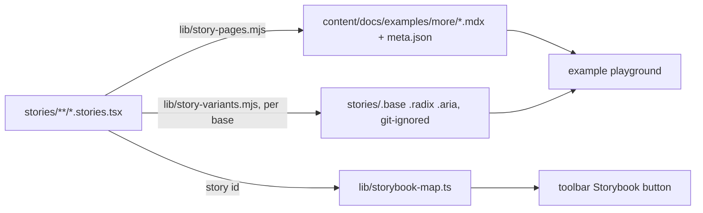

# 56: Storybook and docs match one to one
- Epic: E14

Follow the project planning rules: docs/code-of-conduct/planning-guidelines.md, CLAUDE.md:9. Keep the expedition contract.

## 1. Architecture

### 1.1 Overview

The docs have 42 example pages and Storybook has 652 stories in 81 files, and the two do not match: 33 example pages link a story, but only 14 different stories, so the toolbar Storybook button often opens a different table. D106 makes the two sides one to one: every docs example gets one exact story, story groups get one naming style and "Fixed Bugs" becomes "Miscellaneous", a test story that only copies another is merged into it, and every story is a page in the docs under "More examples" (D103). The docs page owns all text; a story only links back. The text of every story page is written inside this spec, in the format of the example pages (D104): the owner ruled on 2026-11-17 that the epic contains the stage where the texts are written.

The first milestone is the pairing audit. It is read-only on code and its counts size the three milestones after it.

This spec uses the preview as the reference only: the EX B captures saved by spec 53 show the accepted "More examples" list and its group names. Its branches are created from `origin/v0.9/docs-layout` and merge into `v0.9/docs-layout` (D109); the audit file, like every plan file, is committed on `claude/review`.

### 1.2 Goals

- A markdown audit lists every docs example with its story: exact pair, close pair, no partner; and every pair of stories that show the same table (D106).
- Every story group name is Title Case with spaces and without the word "Examples"; the folder "Fixed Bugs" is "Miscellaneous" (D106).
- Every docs example has exactly one exact story; the toolbar Storybook button opens the same table (D106).
- A story that shows the same table as another and only adds a check is merged into it (D106).
- Every story without a paired example page has a docs page under "More examples", in Storybook's groups and order, showing the story itself and its source (D106, D103).
- Every story page has a description, "Try it" steps above its table and "Related guides" below it, in the format of the 42 example pages (D106, D104); no story page is left with a table and a button only.
- `reference/docs-layout/story-text-checklist.md` lists every story page on one line with its description and steps. The spec produces it; the owner's wording review of it gates a later release, not this merge.
- Every story links to its docs page from Storybook (D106).
- Pages and stories cannot drift: a story without its page, or a page without its story, fails `pnpm test validate-repo`.
- Acceptance: programmatic, plus a reference. `pnpm test storybook-tests --base base|radix|aria`, `pnpm test validate-repo` and `pnpm test docs-e2e --base base|radix|aria` green; the parity check of 1.6.5 passes; for each of the 42 example pages the toolbar Storybook button's story id is in `storybook-static/base/index.json` and is the story the audit names as its exact pair. Judged: three judges read every description, Try it step and Related guides line of the story pages against the four criteria of D104 (wording, no slop, no unnecessary jargon, simple and short enough), with the 42 example pages of spec 54 as the reference for tone and size; a majority fail on one line sends that line back. Reference: the "More examples" list on a production build next to the EX B captures of spec 53 (`reference/docs-layout/captures/`), three judges on group order, group names and the collapse behaviour; three story pages next to the same story on a local Storybook build, judges on "same table".

### 1.3 Current structure

```
packages/shadcn-table/
├── stories/Basic.stories.tsx                        ← title 'Basic'; RendersRows :52 copies Default :49
├── stories/features/   (40 files, 511 stories, 185 with a play)   ← titles 'Features/<Name> Examples'
├── stories/styling/    (15 files, 71 stories, 31 with a play)     ← titles 'Styling/…'
├── stories/fixed-bugs/ (25 files, 68 stories, 51 with a play)     ← titles 'Fixed Bugs/…', mixed styles
├── .storybook/preview.tsx:113-160                   ← decorator: intro text, ResetAfterPlay; :149 GitHub link to stories/features
├── .storybook/main.ts:15, vite.config.ts:13,19      ← ST_BASE picks the base; alias '@' = registry/<base>
└── package.json                                     ← storybook 10.6.2, @storybook/react-vite, @faker-js/faker
apps/shadcn-table-docs/
├── lib/storybook-map.ts:13-69                       ← hand-kept: 33 example slugs to 14 stories; :72 examplePageSlug
├── lib/examples-entry.mjs:38-46                     ← preview suffix helper (dead once spec 54 removed the pages)
├── components/example-playground.tsx:43,343         ← toolbar Storybook button, storybookExampleUrl(base, slug)
├── lib/example-variants.mjs                         ← copies examples to examples/.<base>/ with imports rewritten per base
├── components/ui-{radix,base,aria}/                 ← the library copies the docs render from
├── tsconfig.json                                    ← '@/*' = the docs root; no alias to a base tree
└── package.json                                     ← no storybook, no faker
test/storybook-static/test.mjs:26                    ← STORY_ID 'features-pagination-examples--pagination-compact-more-data'
test/validate-repo/                                  ← bases-identical, registry-fresh, unit
```

- The Storybook sidebar folders come from the first segment of each `title`, not from the directory. There is no `storySort`.
- Every story file imports `@/components/ui/shadcn-table`, `storybook/test` and `@storybook/react-vite` types; 50 import `@faker-js/faker`; 4 import `../../.storybook/themes` (`Filtering`, `FilterChips`, `Toolbar`, `AriaTooltips`). `args` and `render` live in the meta.
- 24 pairs of stories show the same table. In 2 the copied story has no check of its own: `Basic` "Renders Rows" over "Default", and `SearchField` "Open Close And Escape" over "Position Right". In the other 22 both stories carry their own check.
- Nine example pages have no story: `minimal`, `advanced`, `custom-headless`, `persistent-view`, `export-csv`, `export-pdf`, `react-query`, `remote`, `dynamic-columns`.
- The coding standards require a play in every story file.

### 1.4 Target structure

```
packages/shadcn-table/
├── stories/**/*.stories.tsx                         ← titles in one style; exact stories added; copies merged
├── stories/miscellaneous/                           ← the directory follows the title (was fixed-bugs)
└── .storybook/preview.tsx                           ← the intro line links the story's docs page
apps/shadcn-table-docs/
├── lib/storybook-map.ts                             ← every example slug to its exact story
├── lib/story-pages.mjs                              ← new: syncs the story pages and their meta from the story files
├── lib/story-variants.mjs                           ← new: per-base copies of the story files the docs can render
├── components/story-example.tsx                     ← new: mounts one story in the example playground
├── content/docs/examples/more/                      ← new: meta.json and one page per unpaired story
├── content/docs/examples/meta.json                  ← + "more"
├── components/sidebar-section.tsx, sidebar-subgroup.tsx ← sub-groups of "More examples" do not collapse
├── lib/story-text-checklist.mjs                     ← new: writes the story text checklist from the pages
└── package.json                                     ← + @storybook/react, storybook, @faker-js/faker
test/validate-repo/lib/story-pages.mjs               ← new: stories and pages one to one, same order as Storybook
.ai/plans/v0.9.x/anindosarker/reference/docs-layout/story-pairing-audit.md ← the audit
```

### 1.5 Flow



### 1.6 Components

#### 1.6.1 Data artifacts

- `reference/docs-layout/story-pairing-audit.md`: four lists. (1) exact pairs: example slug, story file and story, same options, columns and data. (2) close pairs: example slug, the closest story, what differs. (3) no partner: example pages without a story. (4) same-table story pairs: both stories, and whether the copied story has a check of its own. A header with the counts: new stories to build, copies to merge, story pages that result.
- `CHANGELOG.md` (P9): `#### Spec 56 <milestone>` blocks under `## Unreleased`: story groups renamed (D106), an exact story per docs example (D106), every story has a docs page with a description, steps and guides (D106, D104). The six text milestones add no block of their own; "Story text checklist" writes the one for the texts.
- `reference/docs-layout/story-text-checklist.md`: one line per story page with its description and steps, for the owner's wording review.
- `packages/shadcn-table/package.json`, `apps/shadcn-table-docs/package.json` and `pnpm-lock.yaml`: every dependency E14 adds (1.7), added by the milestone "Exact stories and merged copies", the first that needs one, which owns the three files for E14 (P6). "Story pages in the docs" later edits the `scripts` lines of `apps/shadcn-table-docs/package.json` only; "Exact stories and merged copies" has merged a sprint earlier by then, so P6 holds.
- `content/docs/examples/more/**`: committed pages, written by `lib/story-pages.mjs`; a page's body is never overwritten once it holds text.

#### 1.6.2 Story group names (D106)

`packages/shadcn-table/stories/**/*.stories.tsx`, the `title` of each meta, status `refactor`.

- "Fixed Bugs/…" becomes "Miscellaneous/…"; the directory `stories/fixed-bugs` becomes `stories/miscellaneous`.
- Every group name is Title Case with spaces and loses a trailing "Examples": "Features/Aggregation Examples" becomes "Features/Aggregation", "sticky-footer" "Sticky Footer", "useEffects" "Use Effects". "click-propogation" becomes "Click Propagation".
- No two groups of one folder share a name.
- Story ids change with the titles; `lib/storybook-map.ts`, `test/storybook-static/test.mjs:26` and the GitHub link of `.storybook/preview.tsx:149` follow in the same change.
- Does NOT rename a story export, move a story between groups, or change any story's table.

#### 1.6.3 Exact stories and merged copies (D106)

- For each example in audit list 2 or 3, a new story is built from the example: the same columns, options and data. It joins the story group of its feature under the example's sidebar label (D103); an example whose feature has no group gets a group named after its docs sidebar group ("Features/Export", "Features/Server Data", "Features/Customization").
- An example that fetches from the docs app's `/api/data` gets a story that serves the same rows from a function inside the story. The stories for `react-query`, `export-csv` and `export-pdf` use the packages their examples use (1.7).
- `lib/storybook-map.ts` maps all 42 example slugs, each to its exact story; no slug shares a story.
- Merged copies, the strict reading of D106: a pair of audit list 4 is merged only when the copied story has no check of its own. The copy's check moves onto the story it copies and the copy is deleted. The pairs where both stories carry their own check stay as they are and stay listed.
- Guides (D105): `reference/docs-layout/guide-example-plan.md` names, for each of the 46 guides, the page its Example section shows, chosen in this order: an existing example page that already shows the guide's feature; an existing story; a new story. Where an existing example shows the feature once one option is enabled (the owner's case: row numbers), the option is enabled on that example and on its exact story, only when that changes no sentence and no Try it step of the example's page; otherwise a story is used. A story a guide needs and that does not exist is built here, in the group of its feature; it becomes a page under "More examples" (1.6.4) and gets its text from the text milestones (1.6.7).
- Every new story file has a play (coding standards, Checks).
- Does NOT change a docs example, delete a story that has its own table, or hide any story.

#### 1.6.4 Story pages in the docs (D106, D103)

`lib/story-pages.mjs`, `lib/story-variants.mjs`, `components/story-example.tsx`, `content/docs/examples/more/**`, status `new`.

- One page per story that is not the exact story of an example page; an example page is its story's page. URL `/docs/examples/more/<story id>`, the id Storybook gives the story.
- Page title and sidebar label: the story's name. The sidebar lists the pages under "More examples", one sub-group per story group, in Storybook's group and story order, with the names of 1.6.2. The row numbers and the counts are those of D103, built by spec 53. The collapse behaviour is D103's: "More examples" starts closed, opens when the current page is inside it, and keeps the visitor's state after a reload; a sub-group label inside it has no toggle. The preview renders those sub-groups through the collapsible `SidebarSubgroup` (`sidebar-section.tsx:86`), so this spec changes `components/sidebar-section.tsx` and `components/sidebar-subgroup.tsx`.
- A page shows the story itself in the example playground: the Preview, Code and Both tabs, the base selector and the Storybook button. The Preview mounts the story from the selected base's library copy through `composeStories` of `@storybook/react` 10.6.2. The Code tab shows the story file's source. Story code is not copied into `examples/`.
- The story renders without the Storybook-only decorator (intro text, reset after play), and its play does not run in the docs.
- A visitor's story chunk carries no test library: nothing from `storybook/test` or a testing library is in the client bundle.
- A new page starts with the title, the table and the Storybook button; the text milestones of 1.6.7 write its text. The sync never overwrites a page's description or body once it holds text.
- Story pages are listed like example pages in the sitemap, the search index and the llms output; no extra rule is added for them.
- Does NOT change an example page, the playground's look, or how examples are rendered.

**Interfaces:**

```typescript
// components/story-example.tsx
export function StoryExample(props: { id: string }): JSX.Element; // id: the Storybook story id
```

```mdx
---
title: 'Aggregation Default'
sidebarTitle: 'Aggregation Default'
---

<StoryExample id="features-aggregation--aggregation-default" />
```

#### 1.6.5 Parity check

`test/validate-repo/lib/story-pages.mjs`, status `new`, imported and run by `test/validate-repo/test.mjs`, so `pnpm test validate-repo` runs it.

- Fails when a story has neither an example page (`lib/storybook-map.ts`) nor a page under `more/`, when a page under `more/` names a story that does not exist, or when the order of `more/meta.json` differs from the story files' order. The message names `node lib/story-pages.mjs`.
- `pnpm test storybook-static --base base` also checks that the page list matches `storybook-static/base/index.json`.

#### 1.6.6 Link back from Storybook (D106)

`packages/shadcn-table/.storybook/preview.tsx`, status `refactor`.

- The intro line the preview decorator already renders above each story carries a link to that story's docs page: the example page for an exact story, else `/docs/examples/more/<story id>`, on `https://www.shadcn-table.com`.
- Produced from the story id in this one place; no story file carries a typed docs URL.
- Does NOT add a toolbar addon (D106).

#### 1.6.7 Story page texts (D106, D104)

`content/docs/examples/more/<story id>.mdx`, every story page, status `refactor`.

- Each page gets the three parts of the example page format (D104): a `description` in the frontmatter, one or two plain sentences on what this story's table is set up to show; `### Try it` with a `<TryIt>` list of 2 to 4 steps directly above `<StoryExample>`; `## Related guides` with a link list below it.
- A step is one short line, an action and a few words of result, with on-screen labels and typed values in backticks, the exact label the table shows (`locales/en.ts`).
- Every step is true to the story's code and data on base, radix and aria. For a story with a play, the steps follow actions its play performs and asserts, so `pnpm test storybook-tests` on the three bases proves them. For a story without a play, each step is run once in a browser on base and its labels are read in the radix and aria library copies.
- Related guides: the guide pages for the story's feature; every link resolves.
- The four-point text check of D104 runs inside each text milestone; a text that fails one criterion is rewritten.
- The pages are cut by Storybook folder and group (a page whose story id starts `basic--` goes with A to C) into six milestones that run side by side, each owning its own page files; no page has two owners.
- A last milestone writes `reference/docs-layout/story-text-checklist.md` from the pages: one line per story page in sidebar order, `- [ ] <group> / <story name>: <description> Try it: <steps joined by " / ">`, and makes the three parts a rule of the parity check (1.6.5).
- Does NOT change a story, an example page, a page title or URL, or the `StoryExample` tag.

**Stays unchanged:** `packages/shadcn-table/registry/**`, the 42 example pages' text, `apps/shadcn-table-docs/examples/**` except an option enabled for a guide (1.6.3), `components/ui-<base>/`.

### 1.7 Dependencies and env

- `apps/shadcn-table-docs/package.json`: `@storybook/react` 10.6.2 (`composeStories`), `storybook` 10.6.2 (the story files import `storybook/test`) and `@faker-js/faker` at the version of `packages/shadcn-table/package.json`.
- `packages/shadcn-table/package.json`: `@tanstack/react-query`, `export-to-csv`, `jspdf` and `jspdf-autotable`, at the docs app's versions, for the stories built from the `react-query`, `export-csv` and `export-pdf` examples.
- One `pnpm install` for all of them, in the first task of "Exact stories and merged copies".
- The per-base story copies `stories/.base/`, `stories/.radix/`, `stories/.aria/` of the docs app get the ignore entries the example copies have: `apps/shadcn-table-docs/.gitignore`, `apps/shadcn-table-docs/eslint.config.mjs:20-23`, `apps/shadcn-table-docs/tsconfig.json:30`, `apps/shadcn-table-docs/tsconfig.build.json:23`, the root `.prettierignore:8-10`. Added in the same task.

## 2. Instructions for AI

### 2.1 Milestones

### Milestone: Story pairing audit

- Files owned: `.ai/plans/v0.9.x/anindosarker/reference/docs-layout/story-pairing-audit.md`
- Depends on: none
- Review: none
- Local CI: none
- Task 1: Lists 1 to 3 (1.6.1): each of the 42 example pages compared with the stories of its feature, on options, columns and data, per `examples/base/<name>/TS.tsx` and the story source. Checks: 42 rows in total across the three lists; every "exact" row names one story and no story is named twice
- Task 2: List 4 (1.6.1): every pair of stories whose body is the same with the play removed, and whether the copied story has its own check. Checks: `Basic` "Renders Rows" and `SearchField` "Open Close And Escape" are in the list
- Task 3: The counts header. Checks: new stories = rows of lists 2 and 3; copies to merge = list 4 rows whose copied story has no check; story pages = stories minus merged copies plus new stories minus 42

### Milestone: Story group names

- Files owned: `packages/shadcn-table/stories/**`, `packages/shadcn-table/.storybook/preview.tsx`, `apps/shadcn-table-docs/lib/storybook-map.ts`, `test/storybook-static/test.mjs`
- Depends on: Preview lands on review
- Review: none
- Local CI: `pnpm test storybook-tests --base base`, `pnpm test storybook-tests --base radix`, `pnpm test storybook-tests --base aria`, `pnpm test storybook-static --base base`, `pnpm test typecheck --base radix`, `pnpm test lint`, `pnpm test docs-e2e --base base`
- Task 1: The titles and the directory (1.6.2). Checks: `grep -rhn "title: '" packages/shadcn-table/stories | grep -c "Fixed Bugs\| Examples'"` prints 0; every title segment matches `^[A-Z][A-Za-z0-9]*( [A-Z0-9][A-Za-z0-9]*)*$`; no title appears twice; `ls packages/shadcn-table/stories` lists `Basic.stories.tsx features miscellaneous styling`
- Task 2: The ids that follow: `lib/storybook-map.ts`, `test/storybook-static/test.mjs`, the GitHub link of `preview.tsx` (1.6.2). Checks: after `pnpm --filter shadcn-table storybook:build:base`, every id in `lib/storybook-map.ts` and the `STORY_ID` are in `storybook-static/base/index.json`
- Task 3: Cleanup: `pnpm format`, the changelog block. Checks: 2.2

### Milestone: Exact stories and merged copies

- Files owned: `packages/shadcn-table/stories/**`, `apps/shadcn-table-docs/lib/storybook-map.ts`, `apps/shadcn-table-docs/lib/examples-entry.mjs`, `.ai/plans/v0.9.x/anindosarker/reference/docs-layout/guide-example-plan.md`, `apps/shadcn-table-docs/examples/**`, `apps/shadcn-table-docs/registry.json`, `packages/shadcn-table/registry.json`, `tools/registry/examples-base-diff.json`, `tools/registry/examples-aria-diff.json`, `packages/shadcn-table/package.json`, `apps/shadcn-table-docs/package.json`, `pnpm-lock.yaml`, `apps/shadcn-table-docs/.gitignore`, `apps/shadcn-table-docs/eslint.config.mjs`, `apps/shadcn-table-docs/tsconfig.json`, `apps/shadcn-table-docs/tsconfig.build.json`, `.prettierignore`
- Depends on: Story pairing audit, Story group names, Example page format
- Review: none
- Local CI: `pnpm test storybook-tests --base base`, `pnpm test storybook-tests --base radix`, `pnpm test storybook-tests --base aria`, `pnpm test typecheck --base base`, `pnpm test typecheck --base radix`, `pnpm test typecheck --base aria`, `pnpm test lint`, `pnpm test validate-repo`, `pnpm test docs-e2e --base base`, `pnpm test storybook-static --base base`
- Task 1: Every dependency of 1.7 with one `pnpm install`, and the ignore entries for the per-base story copies (1.7). Checks: `pnpm install --frozen-lockfile` passes on a clean checkout of the branch; `git diff origin/v0.9/docs-layout -- packages/shadcn-table/package.json apps/shadcn-table-docs/package.json` shows only the packages of 1.7; `pnpm test lint` and `pnpm --filter shadcn-table-docs types:check` pass with an empty `stories/.base/` folder present
- Task 2: A story for each example of audit lists 2 and 3 (1.6.3), in file sets by story folder. Checks: per new story, its columns, options and data read against `examples/base/<name>/TS.tsx`; each new story file has a play; the story renders on the three bases (`pnpm test storybook-tests`)
- Task 3: The guide example plan and the stories guides need (1.6.3). Checks: `guide-example-plan.md` has 46 lines in the order of `content/docs/guides/meta.json`, each naming an example page slug or a story id and one of "example page", "example page, option enabled", "existing story", "new story"; every named story id is in `storybook-static/base/index.json` after `pnpm --filter shadcn-table storybook:build:base`; for an example whose option was enabled, the three base copies are in step, its exact story matches, its page's text and Try it steps are unchanged and still true, and `pnpm test validate-repo` is green with the generated registry files regenerated
- Task 4: `lib/storybook-map.ts` maps the 42 slugs to their exact stories; the dead preview suffix helper leaves `lib/examples-entry.mjs` and the map (1.6.3). Checks: 42 keys, 42 different values, each in `storybook-static/base/index.json`; `grep -rn "PREVIEW_SUFFIX\|examplePageSlug" apps/shadcn-table-docs` prints nothing; on a production build the Storybook button of `/docs/examples/editing-crud-inline-cell` links the inline cell story
- Task 5: The copies of audit list 4 whose copied story has no check are merged (1.6.3). Checks: the merged story's play passes on the three bases; the copy's export is gone; `grep -rn "<copy id>"` over the repo outside `.ai/` prints nothing
- Task 6: Cleanup: `pnpm format`, the changelog block. Checks: 2.2

### Milestone: Story pages in the docs

- Files owned: `apps/shadcn-table-docs/lib/story-pages.mjs`, `apps/shadcn-table-docs/lib/story-variants.mjs`, `apps/shadcn-table-docs/components/story-example.tsx`, `apps/shadcn-table-docs/components/example-playground.tsx`, `apps/shadcn-table-docs/components/mdx.tsx`, `apps/shadcn-table-docs/content/docs/examples/meta.json`, `apps/shadcn-table-docs/content/docs/examples/more/**`, `apps/shadcn-table-docs/components/sidebar-section.tsx`, `apps/shadcn-table-docs/components/sidebar-subgroup.tsx`, `apps/shadcn-table-docs/package.json`, `packages/shadcn-table/.storybook/preview.tsx`, `test/validate-repo/lib/story-pages.mjs`, `test/validate-repo/test.mjs`, `test/storybook-static/test.mjs`, `test/docs-e2e/lib/examples.mjs`
- Depends on: Exact stories and merged copies, Example row numbers, Guide example block, Example page format
- Review: fable
- Local CI: `pnpm test typecheck --base radix`, `pnpm test lint`, `pnpm test validate-repo`, `pnpm test docs-e2e --base base`, `pnpm test docs-e2e --base radix`, `pnpm test docs-e2e --base aria`, `pnpm test storybook-static --base base`
- Task 1: The per-base story copies (1.6.4); the `build`, `predev` and `types:check` scripts of `apps/shadcn-table-docs/package.json` run `node lib/story-variants.mjs`, as they run `node lib/example-variants.mjs` (`package.json:10,11,15`). Checks: `node lib/story-variants.mjs` writes one copy per story file and base; `pnpm --filter shadcn-table-docs types:check`; `pnpm --filter shadcn-table-docs build` passes on a clean checkout with `stories/.base` absent; `git diff origin/v0.9/docs-layout -- apps/shadcn-table-docs/package.json` shows only the three script lines
- Task 2: `StoryExample` in the playground: Preview, Code, Both, the base selector, the Storybook button (1.6.4). Checks: on a production build a story page renders its table on each base; the Code tab shows the story file; the built client chunks of a story page contain no `@testing-library` and no `storybook/test` code (a grep of `.next/static`, the command in the tracker)
- Task 3: `lib/story-pages.mjs`: the pages and `more/meta.json`, "more" in the Examples `meta.json` (1.6.4). Checks: the page count equals the "story pages" count of the audit; a second run changes nothing; a page with body text keeps it after a run; `/docs/examples/more/<id>` returns 200 for the first and the last story
- Task 4: The sidebar: "More examples" and its sub-groups, numbers and counts (1.6.4). Checks: on a production build the last Examples row number equals 42 plus the page count; "More examples" shows that page count in brackets and each sub-group label its own count; on `/docs/examples/basic` the folder is closed; on a page inside it the folder is open; closed by hand on `/docs/examples/basic`, it is still closed after a reload, and opened by hand it is still open after a reload; a sub-group label inside it has no toggle and a click on it hides nothing; the Guides and API sidebars are unchanged; the captures for the judges of 1.2
- Task 5: The parity checks (1.6.5). Checks: `pnpm test validate-repo` green; it fails when one page file is deleted and when one story export is added, each with the message naming the script (both tried, then reverted)
- Task 6: The link back from Storybook (1.6.6). Checks: on a local Storybook build of base, the intro line of an exact story links its example page and of another story its `more/` page; both URLs return 200 on the production build of the branch with the host swapped
- Task 7: Build cost. Checks: `pnpm --filter shadcn-table-docs build` passes with the memory settings of spec 47.1; the tracker records build time and `.next` size before and after
- Task 8: Cleanup: `pnpm format`, the changelog block, a docs E2E check that opens one story page per base and one for the first and last Examples row number. Checks: 2.2

### Milestone: Story texts A to C

- Files owned: `apps/shadcn-table-docs/content/docs/examples/more/features-[a-c]*.mdx`, `apps/shadcn-table-docs/content/docs/examples/more/basic-*.mdx`
- Depends on: Story pages in the docs
- Review: none
- Local CI: `pnpm test typecheck --base radix`, `pnpm test lint`, `pnpm test validate-repo`
- Task 1: Site table: per page of this milestone, its story's columns, options and play actions, the labels its steps will name, and the guide pages for its feature. Checks: one row per page file the glob matches
- Task 2: The three parts on every page (1.6.7). Checks: `grep -L "TryIt" <the glob>` and `grep -L "## Related guides" <the glob>` print nothing; every page has a non-empty `description`; each page has 2 to 4 steps directly above `<StoryExample>`; `git diff origin/v0.9/docs-layout --stat` lists only files the glob matches
- Task 3: Step truth (1.6.7). Checks: for a story with a play, each step names an action of that play, and `pnpm test storybook-tests --base base`, `--base radix` and `--base aria` are green; for a story without one, each step run once on a production build with base selected, on a P6 port, and the labels it names read in the radix and aria library copies (`components/ui-radix`, `components/ui-aria`); the server stopped
- Task 4: The text check of D104 by three judges on every description, step and guide line (1.2). Checks: every line passes by majority; a failed line is rewritten and judged again
- Task 5: Cleanup: `pnpm format`. Checks: every Related guides link of these pages returns 200 on a production build; `pnpm --filter shadcn-table-docs build` passes

### Milestone: Story texts D to F

- Files owned: `apps/shadcn-table-docs/content/docs/examples/more/features-[d-f]*.mdx`
- Depends on: Story pages in the docs
- Review: none
- Local CI: `pnpm test typecheck --base radix`, `pnpm test lint`, `pnpm test validate-repo`
- Task 1: Site table, as in "Story texts A to C" Task 1, for this milestone's pages. Checks: one row per page file the glob matches
- Task 2: The three parts on every page (1.6.7). Checks: as "Story texts A to C" Task 2, on this glob
- Task 3: Step truth (1.6.7). Checks: as "Story texts A to C" Task 3
- Task 4: The text check of D104 by three judges (1.2). Checks: every line passes by majority; a failed line is rewritten and judged again
- Task 5: Cleanup: `pnpm format`. Checks: every Related guides link of these pages returns 200 on a production build; `pnpm --filter shadcn-table-docs build` passes

### Milestone: Story texts G to R

- Files owned: `apps/shadcn-table-docs/content/docs/examples/more/features-[g-r]*.mdx`
- Depends on: Story pages in the docs
- Review: none
- Local CI: `pnpm test typecheck --base radix`, `pnpm test lint`, `pnpm test validate-repo`
- Task 1: Site table, as in "Story texts A to C" Task 1, for this milestone's pages. Checks: one row per page file the glob matches
- Task 2: The three parts on every page (1.6.7). Checks: as "Story texts A to C" Task 2, on this glob
- Task 3: Step truth (1.6.7). Checks: as "Story texts A to C" Task 3
- Task 4: The text check of D104 by three judges (1.2). Checks: every line passes by majority; a failed line is rewritten and judged again
- Task 5: Cleanup: `pnpm format`. Checks: every Related guides link of these pages returns 200 on a production build; `pnpm --filter shadcn-table-docs build` passes

### Milestone: Story texts S to Z

- Files owned: `apps/shadcn-table-docs/content/docs/examples/more/features-[s-z]*.mdx`
- Depends on: Story pages in the docs
- Review: none
- Local CI: `pnpm test typecheck --base radix`, `pnpm test lint`, `pnpm test validate-repo`
- Task 1: Site table, as in "Story texts A to C" Task 1, for this milestone's pages. Checks: one row per page file the glob matches
- Task 2: The three parts on every page (1.6.7). Checks: as "Story texts A to C" Task 2, on this glob
- Task 3: Step truth (1.6.7). Checks: as "Story texts A to C" Task 3
- Task 4: The text check of D104 by three judges (1.2). Checks: every line passes by majority; a failed line is rewritten and judged again
- Task 5: Cleanup: `pnpm format`. Checks: every Related guides link of these pages returns 200 on a production build; `pnpm --filter shadcn-table-docs build` passes

### Milestone: Story texts Styling

- Files owned: `apps/shadcn-table-docs/content/docs/examples/more/styling-*.mdx`
- Depends on: Story pages in the docs
- Review: none
- Local CI: `pnpm test typecheck --base radix`, `pnpm test lint`, `pnpm test validate-repo`
- Task 1: Site table, as in "Story texts A to C" Task 1, for this milestone's pages. Checks: one row per page file the glob matches
- Task 2: The three parts on every page (1.6.7). Checks: as "Story texts A to C" Task 2, on this glob
- Task 3: Step truth (1.6.7). Checks: as "Story texts A to C" Task 3
- Task 4: The text check of D104 by three judges (1.2). Checks: every line passes by majority; a failed line is rewritten and judged again
- Task 5: Cleanup: `pnpm format`. Checks: every Related guides link of these pages returns 200 on a production build; `pnpm --filter shadcn-table-docs build` passes

### Milestone: Story texts Miscellaneous

- Files owned: `apps/shadcn-table-docs/content/docs/examples/more/miscellaneous-*.mdx`
- Depends on: Story pages in the docs
- Review: none
- Local CI: `pnpm test typecheck --base radix`, `pnpm test lint`, `pnpm test validate-repo`
- Task 1: Site table, as in "Story texts A to C" Task 1, for this milestone's pages. Checks: one row per page file the glob matches
- Task 2: The three parts on every page (1.6.7). Checks: as "Story texts A to C" Task 2, on this glob
- Task 3: Step truth (1.6.7). Checks: as "Story texts A to C" Task 3
- Task 4: The text check of D104 by three judges (1.2). Checks: every line passes by majority; a failed line is rewritten and judged again
- Task 5: Cleanup: `pnpm format`. Checks: every Related guides link of these pages returns 200 on a production build; `pnpm --filter shadcn-table-docs build` passes

### Milestone: Story text checklist

- Files owned: `.ai/plans/v0.9.x/anindosarker/reference/docs-layout/story-text-checklist.md`, `apps/shadcn-table-docs/lib/story-text-checklist.mjs`, `test/validate-repo/lib/story-pages.mjs`
- Depends on: Story texts A to C, Story texts D to F, Story texts G to R, Story texts S to Z, Story texts Styling, Story texts Miscellaneous
- Review: none
- Local CI: `pnpm test typecheck --base radix`, `pnpm test lint`, `pnpm test validate-repo`, `pnpm test docs-e2e --base base`
- Task 1: No story page is left with a table and a button only. Checks: `ls apps/shadcn-table-docs/content/docs/examples/more/*.mdx | wc -l` equals the sum of the six globs' file counts; `grep -L "TryIt" apps/shadcn-table-docs/content/docs/examples/more/*.mdx` and `grep -L "## Related guides" apps/shadcn-table-docs/content/docs/examples/more/*.mdx` print nothing; every page has a non-empty `description`
- Task 2: The three parts become a rule of the parity check (1.6.5, 1.6.7). Checks: `pnpm test validate-repo` green; it fails when the Try it block of one page is removed, with a message naming the page (tried, then reverted)
- Task 3: The checklist (1.6.7), written by `node lib/story-text-checklist.mjs`. Checks: one line per page file, in the order of `more/meta.json`; a second run changes nothing
- Task 4: Cleanup: `pnpm format`, the changelog block. Checks: 2.2; `pnpm --filter shadcn-table-docs build` passes

### Milestone: Story pages review fixes

- Files owned: `test/docs-e2e/lib/examples.mjs`, `test/docs-e2e/run.mjs`, `test/validate-repo/run.mjs`, `test/storybook-static/run.mjs`, `CONTRIBUTING.md`, `apps/shadcn-table-docs/lib/story-pages.mjs`, `apps/shadcn-table-docs/lib/story-variants.mjs`, `apps/shadcn-table-docs/next.config.mjs`, `packages/shadcn-table/.storybook/preview.tsx`, `packages/shadcn-table/stories/features/FilterChips.stories.tsx`, `packages/shadcn-table/stories/features/HeaderGroups.stories.tsx`, `packages/shadcn-table/stories/features/ViewSettings.stories.tsx`, `packages/shadcn-table/stories/miscellaneous/PinnedItemsCustomToolbar.stories.tsx`
- Depends on: Filtering, Storybook reset, Persistent view page size, Stored view page size, CRUD dialog check waits for the rows, Icon library select, Page index play, Canonical and slash redirect, Security headers, Page frame and new pages, Bundle analyzer wrap, Registry fresh check, Filter editor fixes, React Aria filter popups modal again (D97), Preview lands on review, Example page format, Story group names, Story pages in the docs
- Review: none
- Starts: S20
- Task 1: Story pages review fixes. Checks: pnpm test typecheck --base radix, pnpm test lint, pnpm test validate-repo, pnpm test storybook-static --base base, pnpm test storybook-tests --base base, pnpm test docs-e2e --base base

### Milestone: Story and docs fixes found while writing the story texts

- Files owned: `packages/shadcn-table/stories/**`, `apps/shadcn-table-docs/app/global.css`, `apps/shadcn-table-docs/lib/story-variants.mjs`, `apps/shadcn-table-docs/example-groups/EditingCRUDExamples.tsx`, `apps/shadcn-table-docs/example-groups/map.tsx`, `apps/shadcn-table-docs/content/docs/examples/more/**`, `test/typecheck/**`
- Depends on: Theme customizer, Style sheet on demand, Remove dev routes, Preview lands on review, Footer link and square corners, Guide pages, Story group names, Exact stories and merged copies, Story pages in the docs, Story pages review fixes, Story texts A to C, Story texts D to F, Story texts G to R, Story texts Miscellaneous, Story texts S to Z, Story texts Styling
- Review: none
- Starts: S20
- Task 1: Story and docs fixes found while writing the story texts. Checks: pnpm test typecheck --base base, pnpm test typecheck --base radix, pnpm test typecheck --base aria, pnpm test lint, pnpm test validate-repo, pnpm test storybook-tests --base base, pnpm test storybook-tests --base radix, pnpm test storybook-tests --base aria, pnpm test storybook-static --base base, pnpm test docs-e2e --base base

### 2.2 Checks

- `pnpm test storybook-tests --base base|radix|aria`, `pnpm test storybook-static --base base`, `pnpm test typecheck --base base|radix|aria`, `pnpm test lint`, `pnpm test validate-repo`, `pnpm test docs-e2e --base base|radix|aria` green; every server stopped
- The Acceptance checks of 1.2
- The text check of D104 by three judges, in each of the six text milestones
- Review: fable on "Story pages in the docs" (a new shared component in the playground, the shared sidebar components, new public URLs); none on the three before it (an audit file, renames and stories, each covered by `storybook-tests`) and none on the text milestones (content pages; the judges and the step truth check cover them)
