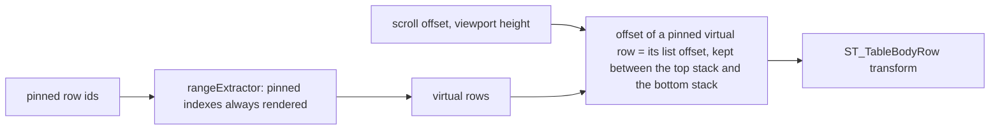

# 61: Pinned rows stay in view with row virtualization
- Epic: E15

Follow the project planning rules: docs/code-of-conduct/planning-guidelines.md, CLAUDE.md:9. Keep the expedition contract.

## 1. Architecture

### 1.1 Overview

With sticky row pinning a pinned row stays stuck at the top or bottom of the body while the other rows scroll. With row virtualization on it does not: a virtual row is always placed by position, so the pinned row scrolls away, and once it leaves the rendered range it is not rendered at all. The story named for this case shows the bug, and the Row Pinning guide says the two do not combine. D128 makes them combine, which Material React Table does not do either.

Branch: created from `origin/claude/review`, merges into `claude/review` (process.md P1). It reaches `v0.9/docs-layout` through spec 63.

### 1.2 Goals

- With `enableRowVirtualization` and a sticky pinning mode, a pinned row stays in view at the top or the bottom of the table body while the other rows scroll under it, exactly as without virtualization: it keeps its place in the list until scrolling would take it out of view, then it stays at the edge (D128).
- It holds for several pinned rows at the top and at the bottom, with a sticky header, and for a pinned row whose place in the list is far outside the rendered range (D128).
- The modes that move pinned rows into the top and bottom groups (`top`, `bottom`, `top-and-bottom`, `select-top`, `select-bottom`) and every table without virtualization behave as today.
- Base, radix and aria get the same code.
- Acceptance: programmatic. `pnpm test storybook-tests --base base|radix|aria`, `pnpm test typecheck --base base|radix|aria`, `pnpm test lint`, `pnpm test validate-repo` green; the play of Task 1, failing before the fix (P11). Reference for the behaviour: the story `Features/Row Pinning`, `PinRowSticky` (no virtualization) on `claude/review`: the virtualized story behaves the same at every scroll position checked in the play.

### 1.3 Current structure

`L` = `packages/shadcn-table/registry/<base>/components/ui/shadcn-table`; the three bases are the same.

```
L/components/body/ST_TableBodyRow.tsx:172-179    ← pinned indexes
L/components/body/ST_TableBodyRow.tsx:230-264    ← a virtual row: `absolute`, translateY, top 0; `sticky` with top or bottom offsets only when there is no virtualRow
L/components/body/ST_TableBody.tsx:72-79         ← pinnedRowIds, rowVirtualizer, virtualRows
L/components/body/ST_TableBody.tsx:88-128        ← in a sticky mode pinned rows stay among centerRows, taken from virtualRows when virtualization is on
L/components/body/ST_TableBody.tsx:163-177       ← the separate sticky top and bottom groups of the other modes
L/hooks/useST_RowVirtualizer.ts:64-66,86         ← rangeExtractor keeps only the dragged row rendered
L/shared/utils/virtualization.utils.ts:7         ← extraIndexRangeExtractor
L/features/stConfigFeature.ts:488-495            ← the mode names
packages/shadcn-table/stories/features/RowPinning.stories.tsx:268   ← RowPinningStickyWithVirtualization (no play); plays on PinRowTopMode, PinRowSticky, UnpinRow
apps/shadcn-table-docs/content/docs/guides/row-pinning.mdx:77       ← "Sticky Row Pinning is not currently compatible with row virtualization."
```

- This spec shares `ST_TableBodyRow.tsx` and `ST_TableBody.tsx` with spec 60's first milestone and runs after it.

### 1.4 Target structure: the same files; no new file, no new option

### 1.5 Flow



### 1.6 Components

#### 1.6.1 Data artifacts

- `CHANGELOG.md` (P9): `#### Spec 61` under `## Unreleased`, `### Fixed`.
- `registry.json`: no file added; must not change.

#### 1.6.2 Pinned rows stay rendered

- In a sticky mode the row virtualizer's range always includes the indexes of the pinned rows, through the same `extraIndexRangeExtractor` the dragged row uses.

#### 1.6.3 Pinned virtual row position

- A pinned virtual row keeps `position: absolute`; its vertical offset is its own offset in the list, kept inside the visible body: not above the stack of the top-pinned rows before it (below the sticky header when there is one), not below the stack of the bottom-pinned rows after it. The stack offsets use the same numbers the non-virtual sticky rows use today (`:236-253`).
- A pinned virtual row is drawn above the unpinned rows and keeps the pinned background it has today.
- Does NOT change how an unpinned virtual row is placed, the overscan, or the non-sticky modes.

#### 1.6.4 Guide line

- `row-pinning.mdx:77`: the blockquote line "Sticky Row Pinning is not currently compatible with row virtualization." is removed, because it is no longer true: line 77 and one blank line beside it. No other sentence changes.

**Stays unchanged:** `stConfigFeature.ts`, `types.ts`, `index.ts`, every other guide.

### 1.7 Dependencies and env: none

## 2. Instructions for AI

### 2.1 Milestones

### Milestone: Pinned rows with row virtualization

- Files owned: `packages/shadcn-table/registry/*/components/ui/shadcn-table/components/body/ST_TableBodyRow.tsx`, `packages/shadcn-table/registry/*/components/ui/shadcn-table/components/body/ST_TableBody.tsx`, `packages/shadcn-table/registry/*/components/ui/shadcn-table/hooks/useST_RowVirtualizer.ts`, `packages/shadcn-table/registry/*/components/ui/shadcn-table/shared/utils/virtualization.utils.ts`, `packages/shadcn-table/stories/features/RowPinning.stories.tsx`, `apps/shadcn-table-docs/content/docs/guides/row-pinning.mdx`
- Depends on: Sticky header switch and resize grip
- Review: fable
- Local CI: `pnpm test typecheck --base base`, `pnpm test typecheck --base radix`, `pnpm test typecheck --base aria`, `pnpm test lint`, `pnpm test validate-repo`, `pnpm test storybook-tests --base base`, `pnpm test storybook-tests --base radix`, `pnpm test storybook-tests --base aria`
- Task 1: The play first (P11), on `RowPinningStickyWithVirtualization`, with the sticky header on (switched on in the play through `View settings` when the story does not start sticky): pin two rows to the top and two to the bottom; scroll the body to the middle and to the end; after each scroll all four rows are in the DOM and their boxes lie inside the body's visible box, the top two stacked directly under the sticky header in their order, the bottom two stacked at the lower edge; unpin one, it scrolls with the rest again. It runs on the code before the fix and fails. Checks: the failure in the tracker
- Task 2: Pinned rows stay rendered and placed (1.6.2, 1.6.3) on base, radix and aria. Checks: the play passes on the three bases; `PinRowTopMode`, `PinRowSticky` and `UnpinRow` still pass; the `Features/Virtualization` plays still pass
- Task 3: Same as without virtualization: in a browser on a P6 port, `PinRowSticky` and `RowPinningStickyWithVirtualization` side by side, two rows pinned at the top and two at the bottom, scrolled slowly end to end: the pinned rows stop at the same places and in the same order, and no row jumps while scrolling. Checks: one line in the tracker per base; the server stopped
- Task 4: The guide line (1.6.4). Checks: `git diff origin/claude/review -- apps/shadcn-table-docs/content/docs/guides/row-pinning.mdx` shows line 77 and one blank line removed, nothing else
- Task 5: Cleanup: `pnpm format`, the changelog block, `pnpm registry:build` leaves `registry.json` unchanged. Checks: 2.2

### 2.2 Checks

- The Local CI line green, one base at a time (P5)
- The Acceptance checks of 1.2
- Review: fable on the whole diff (row rendering in the virtualized body)
