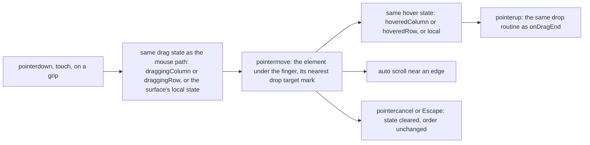

# 62: Reorder by touch
- Epic: E15

Follow the project planning rules: docs/code-of-conduct/planning-guidelines.md, CLAUDE.md:9. Keep the expedition contract.

## 1. Architecture

### 1.1 Overview

Every reorder drag in the table uses the browser's HTML5 drag and drop, which a finger does not start. On a phone or tablet a column reorder begins but never changes the order, and a row reorder never begins. D108 makes every reorder drag work by touch on five surfaces and three bases, and replaces the line "touch screens have no drag" of v0.8.x D37. Column resize and the range slider already work by touch and are the in-repo precedent.

The work is cut in two milestones by file set: the shared touch path with columns and rows first, then the menu, the sort rules and the grouping drop zone on top of it.

Branch: each milestone's branch is created from `origin/claude/review` and merges into `claude/review` (process.md P1). It reaches `v0.9/docs-layout` through spec 63.

### 1.2 Goals

- A finger reorders, as a mouse does today: columns by the grip and by the header cell, rows by the grip, the columns in the show/hide menu, the sort rules in the sort popover, and a column dropped on the grouping drop zone (D108).
- The same on base, radix and aria (D108).
- A touch that starts on a grip does not scroll the page; a touch anywhere else scrolls as before (D108).
- Mouse dragging, column resize and the range slider are unchanged (D108).
- An app's own reorder code keeps working: the handlers an app passes for a drag end (the documented row ordering pattern) run for a touch drop as they do for a mouse drop.
- Acceptance: programmatic. `pnpm test storybook-tests --base base|radix|aria`, `pnpm test typecheck --base base|radix|aria`, `pnpm test lint`, `pnpm test validate-repo` green; one touch play per surface, each recorded failing before the change (P11); the emulation run of the last task of each milestone. Reference: the mouse plays of the same stories on `claude/review` (`ColumnDraggingEnabled`, `DragReordersRows`, `MenuReorderMovesColumn`, `ReorderRemoveDelete`): the touch play ends in the same order as the mouse play. The check on a real phone or tablet that D108 asks for belongs to the release that carries this spec; the tracker's Notes say it is still owed.

### 1.3 Current structure

`L` = `packages/shadcn-table/registry/<base>/components/ui/shadcn-table`; lines are base.

```
L/features/stColumnDraggingFeature.ts:41-99           ← draggingColumn, hoveredColumn and their setters
L/features/stRowDraggingFeature.ts:46-95              ← draggingRow, hoveredRow and their setters
L/shared/utils/drag.utils.ts:30-53                    ← getST_ColumnDropTargetProps (onDragEnter, onDragOver), isColumnDragCancelled (dataTransfer.dropEffect)
L/hooks/useST_DragAutoScroll.ts                       ← called from components/head/ST_TableHead.tsx:51
L/components/head/ST_TableHeadCellGrabHandle.tsx:28-118  ← getST_ColumnDragHandlers: onDragStart (setDragImage), onDragEnd (drop zone grouping, or applyColumnReorder)
L/components/head/ST_TableHeadCell.tsx:91,276-278     ← the whole header cell draggable
L/components/buttons/ST_GrabHandleButton.tsx:27-28,47 ← draggable="true" (aria differs: :32, :64-66)
L/components/body/ST_TableBodyCell.tsx:161-173,326-327   ← column drop target on body cells
L/components/body/ST_TableBodyRowGrabHandle.tsx:36-69    ← row drag start and end
L/components/body/ST_TableBodyRow.tsx:97-105,221-222     ← row drop target
L/hooks/useST_RowVirtualizer.ts:38-66                 ← keeps the dragged row rendered
L/components/menus/ST_ShowHideColumnsMenuItems.tsx:70-151   ← local isDragging; drop and grip (radix and aria differ)
L/components/menus/ST_ShowHideColumnsMenu.tsx:118     ← local hover state (radix and aria differ)
L/components/toolbar/ST_SortPopover.tsx:74-210        ← local dragIndex, overIndex (radix :74-202, aria :69-184)
L/components/toolbar/ST_ToolbarDropZone.tsx:37-67     ← setHoveredColumn({ id: 'drop-zone' })
L/components/head/ST_TableHeadCellResizeHandle.tsx:31-73 ← the precedent: getResizeHandler, onTouchStart, `touch-none`
packages/shadcn-table/stories/features/{ColumnDragging,RowOrdering,RowDragging,ColumnOrdering,ColumnHiding,SortPopover,ColumnGrouping}.stories.tsx  ← the mouse plays
apps/shadcn-table-docs/content/docs/guides/column-ordering-dnd.mdx:158   ← "Touch screens have no column drag."
```

- No drag and drop library is a dependency, and Material React Table has no touch reorder either (`MRT_GrabHandleButton.tsx:37`).
- No reorder surface has a touch or pointer handler today, and no grip has `touch-none`.
- `tools/registry/aria-diff.json` lists `ST_GrabHandleButton`; `drag.utils`, `ST_TableBodyRow` and `ST_TableHeadCell` must stay identical across bases.
- `ST_TableHeadCell.tsx` and `ST_TableBodyRow.tsx` are also changed by specs 60 and 61; this spec runs after them.

### 1.4 Target structure

```
L/hooks/useST_TouchDrag.ts                 ← new: the one touch path, used by all five surfaces
L/shared/utils/drag.utils.ts               ← + the drop target marks the touch path looks up
(the files of 1.3)                         ← each surface: grip marked `touch-none`, drop targets marked, the touch path wired in
```

### 1.5 Flow



### 1.6 Components

#### 1.6.1 Data artifacts

- `CHANGELOG.md` (P9): `#### Spec 62 <milestone>` under `## Unreleased`, `### Added`.
- `registry.json` follows the new hook file (`pnpm registry:build`); committed with the change. No registry item is renamed or removed (P7).
- `tools/registry/base-diff.json`, `aria-diff.json`: a file that newly differs between bases is added there by this spec; the hook itself is identical on the three.

#### 1.6.2 The touch path (`useST_TouchDrag`)

- Pointer events with `pointerType` `touch` only (D108 states a finger); a mouse never enters it, so the HTML5 path stays the mouse path, untouched.
- It writes the same state the mouse path writes and ends in the same drop routine, so highlights, the slide animation, the drop zone, a locked column and a cancelled drag behave the same. The drop routine no longer needs `dataTransfer` to tell a cancel when the drag came from touch.
- The drop target under the finger is found from the element at the pointer's position and a mark on each drop target; near an edge of the scroll container it scrolls as `useST_DragAutoScroll` does for a mouse.
- The handlers an app passed for the grip (`onDragStart`, `onDragEnd`) are called at the same moments as on the mouse path. On touch they receive the pointer event of that moment in place of the drag event: it has the same `target` and `currentTarget` and no `dataTransfer`. The documented reorder pattern reads only the table's dragging and hovered state, so it works unchanged. `types.ts` is unchanged: no prop type is added, removed or narrowed (P7).
- Start: on a grip the drag starts at once and the grip carries `touch-none`. On a header cell that is itself draggable (no grip) it starts after the finger has rested about 300 ms without moving; a swipe before that scrolls the table as today.
- Internal: not exported from `index.ts`, no new public option or type.

#### 1.6.3 Columns and rows

- Column grip, draggable header cell, body cell drop targets, row grip and row drop targets use the touch path. The dragged column or row shows the same dragging style as on the mouse path; no drag image is drawn for touch.
- A row dragged by touch stays rendered under virtualization, as a mouse-dragged row does.

#### 1.6.4 Menu, sort rules and grouping

- The show/hide columns menu items, the sort popover's rules and the toolbar drop zone use the same touch path with their own local state; the menu and the popover stay open during a touch drag.
- Does NOT change the keyboard paths or the buttons these surfaces already offer.

#### 1.6.5 Guide line

- `column-ordering-dnd.mdx:158`: the bullet line "Touch screens have no column drag." is removed, because it is no longer true. No other sentence changes.

**Stays unchanged:** the features' state and setters, `types.ts`, `index.ts`, the resize handle, the range slider.

### 1.7 Dependencies and env: none (no library is added)

## 2. Instructions for AI

### 2.1 Milestones

### Milestone: Touch drag for columns and rows

- Files owned: `packages/shadcn-table/registry/*/components/ui/shadcn-table/hooks/useST_TouchDrag.ts`, `packages/shadcn-table/registry/*/components/ui/shadcn-table/hooks/useST_DragAutoScroll.ts`, `packages/shadcn-table/registry/*/components/ui/shadcn-table/shared/utils/drag.utils.ts`, `packages/shadcn-table/registry/*/components/ui/shadcn-table/components/head/ST_TableHeadCell.tsx`, `packages/shadcn-table/registry/*/components/ui/shadcn-table/components/head/ST_TableHeadCellGrabHandle.tsx`, `packages/shadcn-table/registry/*/components/ui/shadcn-table/components/buttons/ST_GrabHandleButton.tsx`, `packages/shadcn-table/registry/*/components/ui/shadcn-table/components/body/ST_TableBodyCell.tsx`, `packages/shadcn-table/registry/*/components/ui/shadcn-table/components/body/ST_TableBodyRowGrabHandle.tsx`, `packages/shadcn-table/registry/*/components/ui/shadcn-table/components/body/ST_TableBodyRow.tsx`, `packages/shadcn-table/stories/features/ColumnDragging.stories.tsx`, `packages/shadcn-table/stories/features/RowOrdering.stories.tsx`, `packages/shadcn-table/stories/features/RowDragging.stories.tsx`, `apps/shadcn-table-docs/content/docs/guides/column-ordering-dnd.mdx`, `tools/registry/base-diff.json`, `tools/registry/aria-diff.json`
- Depends on: Pinned rows with row virtualization
- Review: fable
- Local CI: `pnpm test typecheck --base base`, `pnpm test typecheck --base radix`, `pnpm test typecheck --base aria`, `pnpm test lint`, `pnpm test validate-repo`, `pnpm test storybook-tests --base base`, `pnpm test storybook-tests --base radix`, `pnpm test storybook-tests --base aria`
- Task 1: Touch plays first (P11), with pointer events of `pointerType: 'touch'`. The touch steps are appended to the existing play of the named story; no new story export is added, because a new export becomes a docs page on `v0.9/docs-layout` (D106). On `ColumnDraggingWithGrip` a column moved by its grip; on `ColumnDraggingEnabled` a column moved by its header after the rest; on `ColumnDraggingLockedColumn` a locked column stays; on `ColumnDraggingCancelled` a `pointercancel` leaves the order; on `DragReordersRows` a row moved by its grip; on `DragBetweenTables` a row moved to the second table. Each ends in the order its mouse play ends in. They run on the code before the change and fail. Checks: the failures in the tracker
- Task 2: The touch path and the drop target marks (1.6.2). Checks: `pnpm test typecheck --base base|radix|aria`; the hook file is identical on the three bases (`pnpm test validate-repo`)
- Task 3: Columns and rows (1.6.3) on base, radix and aria. Checks: the touch plays of Task 1 pass on the three bases; every mouse play of the three story files still passes (`RowOrdering` "Drag Reorders Rows" on aria is a known flake under load, P5: rerun once)
- Task 4: Scrolling: with touch emulation in a browser on a P6 port (the method of card Q90: Chromium device emulation with CDP touch events, on the local Storybook), a drag that starts on a grip does not scroll the page or the table; a swipe on a body cell and a quick swipe on a header cell scroll as before; a row dragged to the edge of a virtualized body scrolls it. Checks: one line per base in the tracker; the server stopped
- Task 5: The guide line (1.6.5). Checks: `git diff origin/claude/review -- apps/shadcn-table-docs/content/docs/guides/column-ordering-dnd.mdx` shows the bullet line 158 removed, nothing else
- Task 6: Cleanup: `pnpm format`, the changelog block, `pnpm registry:build` and the regenerated `registry.json` committed. Checks: 2.2

### Milestone: Touch drag in menus and toolbars

- Files owned: `packages/shadcn-table/registry/*/components/ui/shadcn-table/components/menus/ST_ShowHideColumnsMenuItems.tsx`, `packages/shadcn-table/registry/*/components/ui/shadcn-table/components/menus/ST_ShowHideColumnsMenu.tsx`, `packages/shadcn-table/registry/*/components/ui/shadcn-table/components/toolbar/ST_SortPopover.tsx`, `packages/shadcn-table/registry/*/components/ui/shadcn-table/components/toolbar/ST_ToolbarDropZone.tsx`, `packages/shadcn-table/stories/features/ColumnOrdering.stories.tsx`, `packages/shadcn-table/stories/features/ColumnHiding.stories.tsx`, `packages/shadcn-table/stories/features/SortPopover.stories.tsx`, `packages/shadcn-table/stories/features/ColumnGrouping.stories.tsx`
- Depends on: Touch drag for columns and rows
- Review: fable
- Local CI: `pnpm test typecheck --base base`, `pnpm test typecheck --base radix`, `pnpm test typecheck --base aria`, `pnpm test lint`, `pnpm test validate-repo`, `pnpm test storybook-tests --base base`, `pnpm test storybook-tests --base radix`, `pnpm test storybook-tests --base aria`
- Task 1: Touch plays first (P11). The touch steps are appended to the existing play of the named story; no new story export is added (D106). On `MenuReorderMovesColumn` a menu item moved by its grip moves the column; on `LockedColumnStaysPut` the locked one stays; on `ReorderRemoveDelete` a sort rule moved above another changes the sort order; on a grouping story of `ColumnGrouping.stories.tsx` that shows the drop zone, a column dragged by its grip onto the drop zone groups the table. Each runs on the code before the change and fails. Checks: the failures in the tracker
- Task 2: The three surfaces (1.6.4) on base, radix and aria; the per-base differences of these files stay as they are. Checks: the touch plays pass on the three bases; every mouse play of the four story files still passes; the menu and the popover are still open after a touch drop (asserted in the plays)
- Task 3: The same emulation run as the first milestone's Task 4 for the three surfaces: a touch drag on a menu item or a sort rule does not scroll the page behind the popup. Checks: one line per base in the tracker; the server stopped; the tracker's Notes carry the line that the real device check of D108 is owed before the release
- Task 4: Cleanup: `pnpm format`, the changelog block, `tools/registry/*-diff.json` still true, `registry.json` unchanged or regenerated. Checks: 2.2

### 2.2 Checks

- The Local CI line green, one base at a time (P5)
- The Acceptance checks of 1.2
- Review: fable on each milestone's diff (a new input path across the table)
