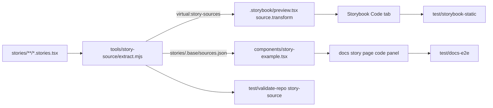

# 66: Code panels show the table's code

Follow the project planning rules: docs/code-of-conduct/planning-guidelines.md, CLAUDE.md:9. Keep the expedition contract.

## 1. Architecture

### 1.1 Overview

On the live 0.9.5 Storybook the Code tab of "Basic / Basic" shows `{ render: () => <BasicExample />, play: async ... }`: a wrapper and its test, none of the table's code. The built-in Code panel prints the text of the story export as it is written in the story file (`docs.source.originalSource`), so an object story shows its whole object with `play`, and an arrow story shows its function without the columns and data it reads from the file. The docs story pages under `/docs/examples/more/` show the whole story file, every story and every test in it. D142 asks that every code panel shows the code of the table itself, complete enough to copy and run, and never the test. This spec audits every panel first, then gives each story one generated code text, used by the Storybook Code tab and by the docs story pages, and proves it by reading the panels. Three milestones in a row, all on `claude/review`.

D142 changes one line of D106 to this extent: "The code tab shows the story's source" now means the story's table code as this spec builds it, not the story file.

### 1.2 Goals

- Audit: every story of the Storybook and every code panel of the docs is listed with what its panel shows today and whether it meets D142; stories that show the same table twice in one group are listed and settled by D106's rule (D142).
- One code text per story, generated from the story file: the imports it needs, the declarations of the file it uses (columns, data, helper components, the wrapped component), and the story's table as one component. No `play`, no `expect`, no import of `storybook/test`, no `parameters`, `tags` or `args` object (D142).
- The Storybook Code tab of every story shows that text, on base, radix and aria (D142).
- The code panel of every docs story page shows that text; the 42 example pages and the guides keep showing the example files, where the audit finds them right (D142, D131).
- The proof reads the panels: a check opens the Code tab of every story on each static Storybook and the code panel of every docs story page on a production build, and asserts the text. It fails on the shipped 0.9.5 first (D142, P11).
- The line above each story, "View Source code for these examples in the code tab below or here on GitHub.", is unchanged (D124).
- No library file changes: `packages/shadcn-table/registry/**` and `registry.json` are untouched, so no docs library copy is regenerated.
- Acceptance: programmatic. `pnpm test validate-repo` green with its new story code check; `pnpm test storybook-static --base base|radix|aria` green with the Code tab read for every id of `index.json`; `pnpm test docs-e2e --base base|radix|aria` green with the code panel read on every story page; `pnpm test storybook-tests --base base|radix|aria` green (no play lost). Reference: `reference/code-panels/audit.md`, whose failing rows all read "pass" in the rerun of the audit reader at the end.

### 1.3 Current structure

```
packages/shadcn-table/
├── .storybook/main.ts:34-40,54                      ← addons (addon-docs), viteFinal
├── .storybook/manager.ts:12                         ← opens the Code panel by default
├── .storybook/preview.tsx:132-155                   ← docs.codePanel: true; source.transform rewrites args stories only
├── stories/Basic.stories.tsx:158-166                ← const BasicExample = () => {...}; export const Basic = { render: () => <BasicExample />, play }
└── stories/**/*.stories.tsx                         ← 85 files; exports: about 400 arrow functions, about 215 objects with render and play, 63 of them one-line wrappers
apps/shadcn-table-docs/
├── lib/story-pages.mjs                              ← readStories: every story with its id, file key and export
├── lib/story-variants.mjs:95-110                    ← writes stories/.base/index.json and sources.json (the story files as written)
├── components/story-example.tsx:58-61               ← Code tab of a story page: sources[story.key], the whole file
├── components/story-example.tsx:41-52               ← codeFrom: a guide shows an example folder's files instead (D131)
└── lib/storybook-map.ts                             ← the 42 example pages and their exact stories
test/
├── storybook-static/test.mjs                        ← static Storybook checks, one story id (:34), index.json (:72-91)
├── docs-e2e/lib/examples.mjs:364-408                ← story page: "Code shows the story file"
└── validate-repo/test.mjs, lib/*.mjs                ← repo checks, each lib file imported by test.mjs
```

- Facts from the lookup of card Q133 (code read, live pages fetched): of the 42 exact stories 32 are `{ render: () => <X />, play }`, 7 wrap a component in `<WithQueryClient>`, 3 define the table inside `render: function`; each wrapped component is defined higher in the same story file, nothing is imported. 59 test stories of the wrapper shape existed in 0.9.4 already, and every object story showed its `play`. A `more/` story page shows the whole story file with its tests. "Default" and "Basic" under Basic are different tables.

### 1.4 Target structure

```
tools/story-source/extract.mjs                       ← NEW: storyCode(fileText, exportName): the story's code text (TypeScript compiler API)
packages/shadcn-table/
├── .storybook/story-source-plugin.ts                ← NEW: Vite plugin, module `virtual:story-sources`: story id to code text
├── .storybook/main.ts                               ← viteFinal adds the plugin
└── .storybook/preview.tsx                           ← source.transform returns the text of the story id; the args one-liner is gone
apps/shadcn-table-docs/
├── lib/story-variants.mjs                           ← sources.json: one text per story id, from the same extractor
└── components/story-example.tsx                     ← Code tab reads the story's own text; codeFrom unchanged
test/
├── validate-repo/lib/story-source.mjs               ← NEW: every story has a code text that stands alone and holds no test
├── validate-repo/test.mjs                           ← imports it
├── storybook-static/test.mjs                        ← reads the Code tab of every id
└── docs-e2e/lib/examples.mjs                        ← reads the code panel of every story page
.ai/plans/v0.9.x/anindosarker/reference/code-panels/ ← NEW: audit.md, read-panels.mjs (the audit's reader)
```

### 1.5 Flow



### 1.6 Components

#### 1.6.1 Data artifacts

- `reference/code-panels/audit.md`: the audit. A header with the counts, then one row per Storybook story (id, shape of the export, what the Code tab shows: table code complete / table code without its columns or data / wrapper only / with test, pass or fail against D142) and one row per docs code panel kind (the 42 example pages, the story pages, the guide Example sections with and without `codeFrom`, the guides' own tables), with the count that fails. A last list: stories of one group that show the same table, each with D106's verdict (merge the copy, or both stay and why).
- `reference/code-panels/read-panels.mjs`: the reader the audit used, kept so the last task of the spec can rerun it.
- `apps/shadcn-table-docs/stories/.base/sources.json` (generated, git-ignored as today): keyed by story id, one code text each.
- Trackers: `run/trackers/66-code-panel-audit-tracker.md`, `66-storybook-code-tab-tracker.md`, `66-docs-code-panels-tracker.md`.

#### 1.6.2 Audit (D142)

- Read-only on code. Builds the static Storybook of base (`pnpm --filter shadcn-table storybook:build:base`) and a production docs build in a pool worktree at `origin/claude/review`, one heavy step at a time (P5), servers on P6 ports and stopped after.
- Storybook: for every id of `storybook-static/base/index.json` the reader opens the story in the manager, reads the text of the Code panel and classifies it. The story files are the same for the three bases, so radix and aria are read for one story per story file, to confirm the text does not depend on the base.
- Docs: the code panel is read on every story page, on the 42 example pages, and on every guide's Example section and own tables.
- Same-table stories: within each story group, stories whose tables have the same columns, data and options are listed; D106's rule decides each (a copy without a check of its own merges; a different table stays). "Default" and "Basic" under Basic are recorded with their difference.
- The audit also reads card Q133's lookup fact and corrects or confirms its counts.
- Does NOT edit a story, a config or a docs file; does NOT file a queue card for a panel this spec fixes.

#### 1.6.3 The story's code text (D142)

- `storyCode(fileText, exportName)` in `tools/story-source/extract.mjs`, with the TypeScript compiler API (`typescript` is already a dev dependency of the package and the docs app), no text matching:
  - The table: an arrow or function story gives its body as the component; an object story gives its `render`; a story with `args` and no `render` gives the meta component called with those args, written out as props.
  - Declarations: every top-level declaration of the story file that the table uses, found by following identifiers, and the ones those use: columns, data, types, helper functions, the wrapped component (`BasicExample`), a wrapper such as `WithQueryClient`. They come before the component, in file order.
  - Local imports: a declaration imported from a relative path inside `stories/` is taken from that file the same way, one text, so the reader has it. Package imports stay as import lines; only the names used are kept.
  - The library import is written as the docs examples write it (`@/components/ui/shadcn-table`), as `story-variants.mjs` already maps it for the docs copies.
  - Left out: `play`, `parameters`, `tags`, `argTypes`, the meta object, the default export, every import of `storybook/test` and of Storybook types, and any declaration only the test uses.
  - The component is the default export of the text, named after the story export.
- The text stands alone: it parses as TSX and every identifier in it is declared in it, imported in it, or a global. The validate-repo check proves this for every story.

#### 1.6.4 Storybook Code tab (D142, D124)

- `.storybook/story-source-plugin.ts`: a Vite plugin that serves `virtual:story-sources`, an object from story id to code text, built from the story files with `readStories` of `apps/shadcn-table-docs/lib/story-pages.mjs` (the ids it computes are already checked against `index.json` by validate-repo) and `storyCode`. It watches the story files in dev.
- `.storybook/preview.tsx`: `docs.source.transform` returns the text for the story's id (the transform's second argument is the story context; it reads `args` and `parameters` from it today, :143-153). The args one-liner branch is removed. `codePanel: true`, `excludeDecorators` and the three intro lines stay.
- Same-table copies the audit marks "merge" are merged as D106 says (the check moves onto the story it copies, the copy is deleted); then `node lib/story-pages.mjs` in the docs app, so its page under `more/` and the `meta.json` row go with it.
- No story is rewritten to change what the panel shows; the stories keep their shape and their plays.
- Does NOT add a dependency; does NOT change `registry/**`.

#### 1.6.5 Docs code panels (D142, D131)

- `lib/story-variants.mjs` writes `sources.json` keyed by story id with `storyCode` of each story, in place of the story files as written; `index.json` is unchanged.
- `components/story-example.tsx`: the Code tab of a story page shows that story's text, file name `<StoryExport>.tsx`; `codeFrom` (D131) is unchanged.
- A docs panel of another kind that the audit marks as failing is corrected here, in the files the milestone owns; one the audit marks as passing is not touched.
- Does NOT change the story page texts, the Try it steps or the guides.

#### 1.6.6 Checks that read the panels (D142, P11)

- `test/validate-repo/lib/story-source.mjs`, imported by `test/validate-repo/test.mjs`: for every story, the code text exists, parses, stands alone (1.6.3), contains `<ShadcnTable` or a component of the text that renders it, and contains none of `play`, `expect(`, `storybook/test`, `userEvent`.
- `test/storybook-static/test.mjs`: on the static build of each base, for every id of `index.json`, the Code panel of the manager shows the text of `virtual:story-sources` for that id (compared after trimming) and none of the four words above. One browser page, the story switched through the manager, not one page load per story.
- `test/docs-e2e/lib/examples.mjs`: on every story page the code panel shows the story's text and none of the four words; the old check "Code shows the story file" is replaced. Example pages and guides keep their checks.
- First run on the shipped code: the two reading checks run against `origin/master` (0.9.5) builds before the fix and fail; the failure is recorded in the tracker (P11).

**Stays unchanged:** `packages/shadcn-table/registry/**`, `registry.json`, the example folders `apps/shadcn-table-docs/examples/**`, the story plays, the story page texts, `lib/storybook-map.ts` apart from a merged copy's row, the three intro lines of `preview.tsx`.

### 1.7 Dependencies and env

- No new dependency. `typescript` ~5.8.3 is in `packages/shadcn-table/package.json:86` and `apps/shadcn-table-docs/package.json:76`; `tools/` resolves it from the root workspace as `tools/registry` does its imports.
- Ports 5340 to 5360 for the audit's servers (P6).

## 2. Instructions for AI

### 2.1 Milestones

### Milestone: Code panel audit

- Files owned: `.ai/plans/v0.9.x/anindosarker/reference/code-panels/audit.md`, `.ai/plans/v0.9.x/anindosarker/reference/code-panels/read-panels.mjs`
- Depends on: none
- Review: none
- Local CI: none (read-only on code)
- Task 1: The Storybook Code tab of every story on base, and one story per story file on radix and aria (1.6.2). Checks: `audit.md` has one row per id of `storybook-static/base/index.json` (the two counts are equal); each row has its class and pass or fail; the header counts add up to the row count; the servers stopped
- Task 2: The docs code panels (1.6.2). Checks: one row per panel kind with the pages read and the count that fails; `/docs/examples/basic`, one `more/` page and one guide with `codeFrom` are quoted with the first three lines their panel shows
- Task 3: Same-table stories and the lookup (1.6.2). Checks: the list names "Default" and "Basic" under Basic with their difference; every listed pair has D106's verdict; the counts of card Q133's lookup are confirmed or corrected in one line each
- Task 4: Commit `reference/code-panels/` on `claude/review` (plan files). Checks: `git log -1 --stat` lists the two files only

### Milestone: Storybook Code tab

- Files owned: `tools/story-source/extract.mjs`, `packages/shadcn-table/.storybook/story-source-plugin.ts`, `packages/shadcn-table/.storybook/main.ts`, `packages/shadcn-table/.storybook/preview.tsx`, `packages/shadcn-table/stories/**`, `test/validate-repo/lib/story-source.mjs`, `test/validate-repo/test.mjs`, `test/storybook-static/test.mjs`, `apps/shadcn-table-docs/content/docs/examples/more/**`, `apps/shadcn-table-docs/lib/storybook-map.ts`
- Depends on: Code panel audit
- Review: fable
- Local CI: `pnpm test typecheck --base base`, `pnpm test typecheck --base radix`, `pnpm test typecheck --base aria`, `pnpm test lint`, `pnpm test validate-repo`, `pnpm test storybook-tests --base base`, `pnpm test storybook-tests --base radix`, `pnpm test storybook-tests --base aria`, `pnpm test storybook-static --base base`, `pnpm test storybook-static --base radix`, `pnpm test storybook-static --base aria`
- Task 1: The reading check for the Code tab, first (P11, 1.6.6): `test/storybook-static/test.mjs` reads the Code panel of every id. Checks: run against a static build of `origin/master` (0.9.5) on base it fails, and the tracker records the count of failing ids and the text of `basic--basic`
- Task 2: `storyCode` (1.6.3) and the validate-repo check (1.6.6). Checks: `pnpm test validate-repo` green; the check names zero stories without a text; the tracker quotes the text of `basic--basic`, of one `WithQueryClient` story, of one `render: function` story and of one args story, each with its columns and data and no test
- Task 3: The plugin and the transform (1.6.4). Checks: `pnpm test typecheck --base base|radix|aria`, one at a time; `pnpm test storybook-static --base base|radix|aria`, one at a time, green with the Code tab read for every id; the run time of the reading check per base is in the tracker
- Task 4: Same-table copies the audit marks "merge" (1.6.4); none marked: the tracker says so and the task is done. Checks: `pnpm test storybook-tests --base base|radix|aria`, one at a time, green; the moved check runs under the story it moved to; `pnpm test validate-repo` passes its story-pages check; no story id is missing from `index.json` except the merged copies
- Task 5: Cleanup: `pnpm format`, the changelog block. Checks: 2.2

### Milestone: Docs code panels

- Files owned: `apps/shadcn-table-docs/lib/story-variants.mjs`, `apps/shadcn-table-docs/components/story-example.tsx`, `apps/shadcn-table-docs/components/example-playground.tsx`, `apps/shadcn-table-docs/lib/example-source.ts`, `test/docs-e2e/lib/examples.mjs`, `test/docs-e2e/lib/helpers.mjs`, `.ai/plans/v0.9.x/anindosarker/reference/code-panels/audit.md`
- Depends on: Storybook Code tab
- Review: none
- Local CI: `pnpm test typecheck --base radix`, `pnpm test lint`, `pnpm test validate-repo`, `pnpm test docs-e2e --base base`, `pnpm test docs-e2e --base radix`, `pnpm test docs-e2e --base aria`
- Task 1: The reading check for the story pages, first (P11, 1.6.6). Checks: run against a production docs build of `origin/master` (0.9.5) on base it fails on the story pages, and the tracker records the count and the first lines of one failing panel
- Task 2: `sources.json` per story and the story page's Code tab (1.6.5). Checks: `pnpm --filter shadcn-table-docs build` passes on a clean checkout; `pnpm test docs-e2e --base base|radix|aria`, one at a time, green with the code panel read on every story page; a guide with `codeFrom` (production-ready-tables) still lists its five files
- Task 3: Any other docs panel the audit marks as failing (1.6.5); none: the tracker says so. Checks: each named panel quoted in the tracker after the fix, with its first three lines
- Task 4: The audit reader rerun on the final builds (`reference/code-panels/read-panels.mjs`, Storybook base and docs). Checks: every row of `audit.md` that failed reads pass in the rerun; the result is appended to `audit.md` as a dated section and committed on `claude/review`; the servers stopped
- Task 5: Cleanup: `pnpm format`, the changelog block. Checks: 2.2

### 2.2 Checks

- The Local CI line of each milestone green, heavy checks one at a time (P5); every server stopped
- The Acceptance checks of 1.2
- `git diff origin/master --stat -- packages/shadcn-table/registry apps/shadcn-table-docs/examples registry.json` prints nothing
- Review: fable on the diff of "Storybook Code tab" (the extractor and what every reader sees in the Code tab), rounds as run.md says
- Worktrees from the pool 01 to 09 only; the root checkout, `wt1` and `wt2` are never used for a checkout, an install or a build (P2)
