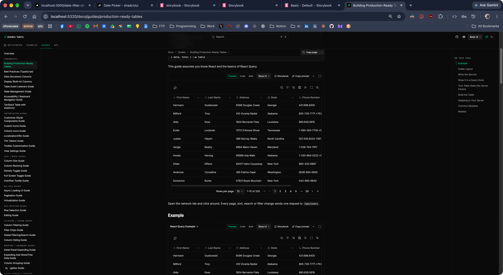
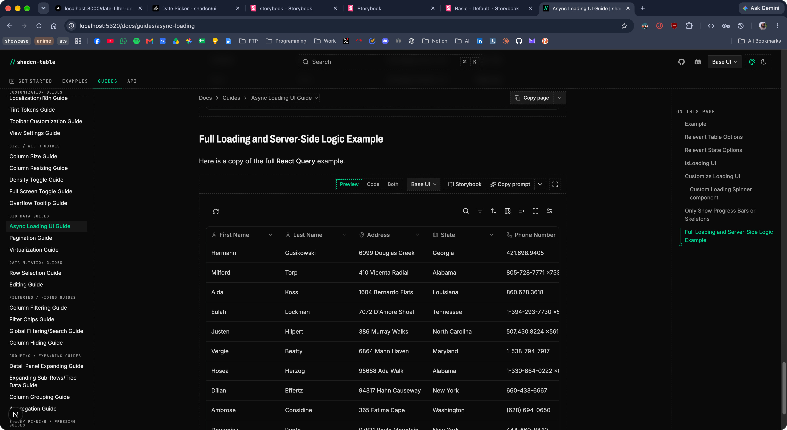
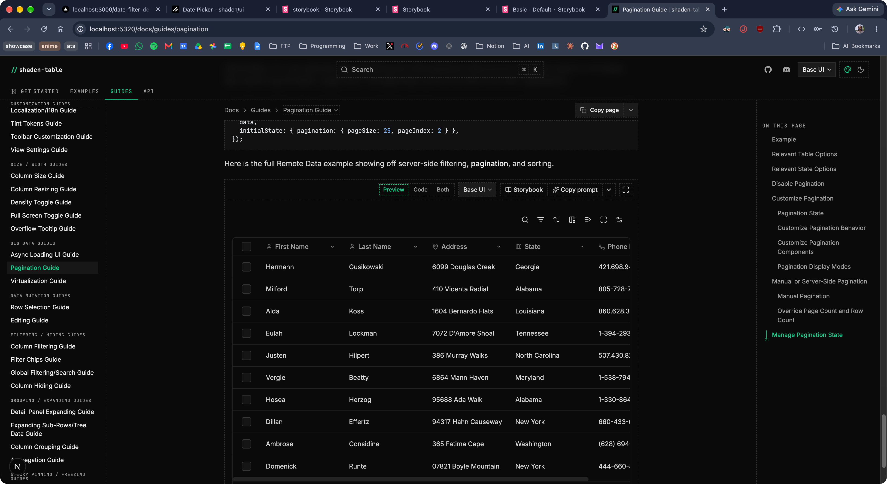
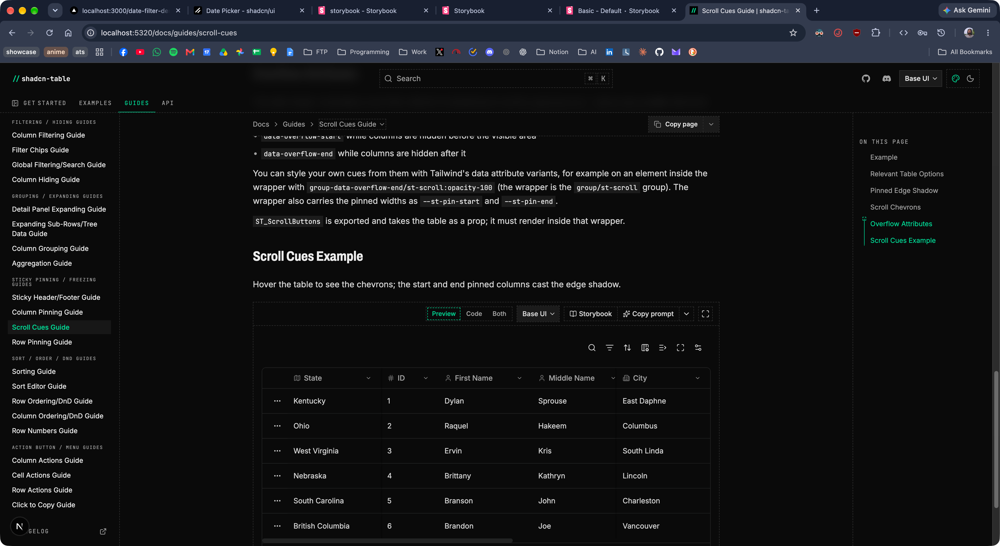
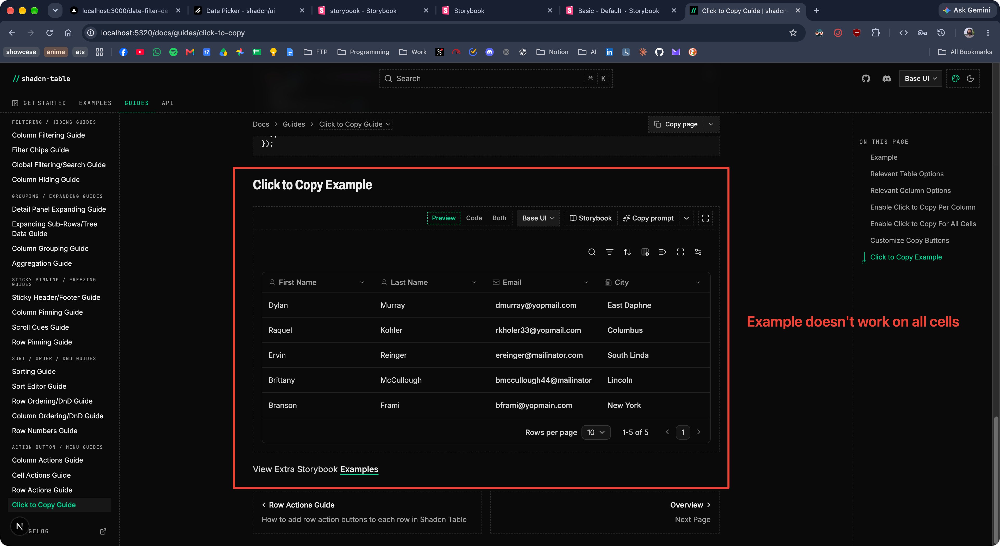
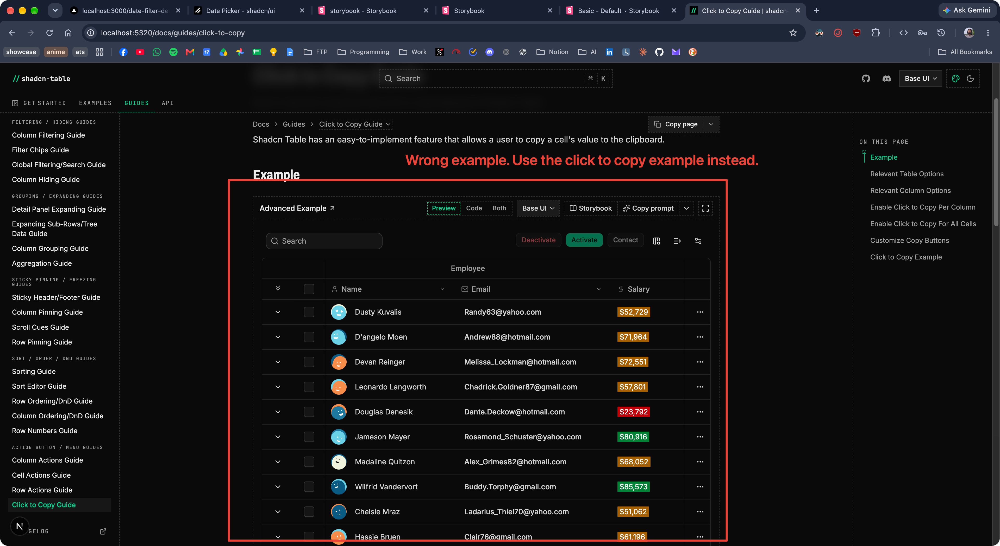

# Guide checklist

Spec 55, milestone "Guide pages" (D105). One line per guide in the order of `apps/shadcn-table-docs/content/docs/guides/meta.json` on `v0.9/docs-layout`: the page its Example section links to, and the heading of the table removed from the guide, if any. Tick a line once the guide is checked by hand.

- [X] Building Production-Ready Tables: Example links React Query Example (/docs/examples/react-query); removed: none : **Table duplicated twice** 
- [X] Best Practices (TypeScript): Example links Basic Example (/docs/examples/basic); removed: none
- [X] Data (Accessor) Columns: Example links Basic Example (/docs/examples/basic); removed: none
- [X] Display (Built-in) Columns: Example links Advanced Example (/docs/examples/advanced); removed: none
- [X] Table Event Listeners Guide: Example links Row Dragging Example (/docs/examples/row-dragging); removed: none
- [X] State Management Guide: Example links Persistent View Example (/docs/examples/persistent-view); removed: none
- [X] Accessibility / Keyboard Navigation Guide: Example links Basic Example (/docs/examples/basic); removed: none
- [X] TanStack Table with shadcn/ui: Example links Basic Example (/docs/examples/basic); removed: none
- [X] Customize (Style) Components Guide: Example links Minimal Example (/docs/examples/minimal); removed: none
- [X] Custom Icons Guide: Example links Provider Icon Set (/docs/examples/more/features-icons--provider-icon-set); removed: none
- [X] Column Icons Guide: Example links Persistent View Example (/docs/examples/persistent-view); removed: Column Icons Example
- [X] Localization/i18n Guide: Example links Spanish (/docs/examples/more/features-localization--spanish); removed: none
- [X] Tint Tokens Guide: Example links Sticky Row Selection Example (/docs/examples/sticky-row-selection); removed: none
- [X] Toolbar Customization Guide: Example links Advanced Example (/docs/examples/advanced); removed: none
- [X] View Settings Guide: Example links Persistent View Example (/docs/examples/persistent-view); removed: View Settings Example
- [X] Column Size Guide: Example links Basic Example (/docs/examples/basic); removed: none
- [X] Column Resizing Guide: Example links Basic Example (/docs/examples/basic); removed: none
- [X] Density Toggle Guide: Example links Basic Example (/docs/examples/basic); removed: none
- [X] Full Screen Toggle Guide: Example links Basic Example (/docs/examples/basic); removed: none
- [X] Overflow Tooltip Guide: Example links Basic Example (/docs/examples/basic); removed: none
- [X] Async Loading UI Guide: Example links React Query Example (/docs/examples/react-query); removed: none : **Seems duplicate** 
- [X] Pagination Guide: Example links Remote Data Fetching Example (/docs/examples/remote); removed: none **Seems duplicate** 
- [X] Virtualization Guide: Example links Row Virtualization Example (/docs/examples/row-virtualization), Column Virtualization Example (/docs/examples/column-virtualization); removed: none
- [X] Row Selection Guide: Example links CSV Export Example (/docs/examples/export-csv); removed: none
- [X] Editing Guide: Example links Editing CRUD Example (/docs/examples/editing-crud), Editing CRUD Inline Row Example (/docs/examples/editing-crud-inline-row), Editing CRUD Inline Cell Example (/docs/examples/editing-crud-inline-cell), Editing CRUD Inline Table Example (/docs/examples/editing-crud-inline-table), Editing CRUD Tree Example (/docs/examples/editing-crud-tree); removed: CRUD Examples
- [X] Column Filtering Guide: Example links Filter Variants Example (/docs/examples/filter-variants); removed: none
- [X] Filter Chips Guide: Example links Basic Example (/docs/examples/basic); removed: Filter Chips Example
- [X] Global Filtering/Search Guide: Example links Basic Example (/docs/examples/basic); removed: none
- [X] Column Hiding Guide: Example links Basic Example (/docs/examples/basic); removed: none
- [X] Detail Panel Expanding Guide: Example links Detail Panel Example (/docs/examples/detail-panel); removed: none
- [X] Expanding Sub-Rows/Tree Data Guide: Example links Expanding Tree Example (/docs/examples/expanding-tree); removed: none
- [X] Column Grouping Guide: Example links Column Grouping Example (/docs/examples/column-grouping); removed: none
- [X] Aggregation Guide: Example links Aggregation and Grouping Example (/docs/examples/aggregation-and-grouping); removed: Aggregation/Grouping Example
- [X] Sticky Header/Footer Guide: Example links Sticky Header Example (/docs/examples/sticky-header); removed: Enable Sticky Header and Footer Demo
- [X] Column Pinning Guide: Example links Column Pinning Example (/docs/examples/column-pinning); removed: Column Pinning Example
- [X] Scroll Cues Guide: Example links Column Pinning Example (/docs/examples/column-pinning); removed: none; **Seems duplicate and the top example doesn't say to hover and see the cue** 
- [X] Row Pinning Guide: Example links Sticky Row Pinning Example (/docs/examples/sticky-row-pinning); removed: none
- [X] Sorting Guide: Example links Basic Example (/docs/examples/basic); removed: none
- [X] Sort Editor Guide: Example links Basic Example (/docs/examples/basic); removed: none
- [X] Row Ordering/DnD Guide: Example links Row DnD Ordering Example (/docs/examples/row-ordering); removed: none
- [X] Column Ordering/DnD Guide: Example links Column DnD Ordering Example (/docs/examples/column-ordering); removed: none
- [X] Row Numbers Guide: Example links Row Virtualization Example (/docs/examples/row-virtualization); removed: none
- [X] Column Actions Guide: Example links Basic Example (/docs/examples/basic); removed: none
- [X] Cell Actions Guide: Example links Editing CRUD Inline Cell Example (/docs/examples/editing-crud-inline-cell); removed: none
- [X] Row Actions Guide: Example links Advanced Example (/docs/examples/advanced); removed: none
- [X] Click to Copy Guide: Example links Advanced Example (/docs/examples/advanced); removed: none; **Wrong example and the original one also don't work. Use this example instead. Fix both. remove the end example and keep only one on top** 
