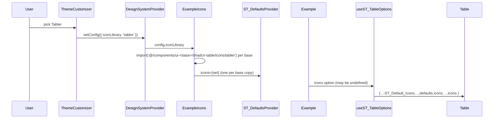

# 14: The Icon Library select switches the example tables' icons

Follow the project planning rules: docs/code-of-conduct/planning-guidelines.md, CLAUDE.md:9. Keep the expedition contract.

## 1. Architecture

### 1.1 Overview

The theme panel's Icon Library select is hard-coded and disabled at Lucide (`theme-customizer.tsx:220-227`), and the config's `iconLibrary` field is stored but never applied. D27 makes the select pick one of the five libraries the registry ships an edition for (lucide, tabler, phosphor, hugeicons, remixicon) and shows that set in every docs example table. The docs copies of the library under `components/ui-<base>/shadcn-table/` are written by `lib:install` and carry no shared hook, and every example calls `useST_TableOptions` itself, so the library gains `ST_DefaultsProvider`: a context whose `icons` the hook merges between `ST_Default_Icons` and the table's own `icons` option. The docs mount one provider per base copy, fed the chosen set, loaded on demand. The docs chrome (nav, panel, shadcn parts) stays Lucide.

### 1.2 Goals

- `useST_TableOptions` merges `ST_Default_Icons`, then the nearest `ST_DefaultsProvider`'s `icons`, then the table's `icons` option (D27); a table outside any provider behaves as today.
- The select offers Lucide, Tabler, Phosphor, Hugeicons, Remix Icon; a pick switches every example table on the page (home demo and docs examples, all three base copies), persists with the rest of the config (D2 storage), and Reset returns to Lucide (D27).
- Public surface (P7): `ST_DefaultsProvider` exported from the library index, documented in the ST Components API page and the custom icons guide, one story with a play, a changelog entry.
- Acceptance: programmatic. `pnpm test docs-e2e --base base /` green with the checks of 1.6.6 (pick Tabler, the home example's toolbar icons carry the `tabler-icon` class, the choice survives a reload, `Shift+R` returns to `lucide`), `pnpm test docs-e2e --base base /docs/examples/basic` green with the example check (the base copy switches too); the `ProviderIconSet` play green on the three bases (`pnpm test storybook-tests --base <base>`), red on the shipped code first (P11); `pnpm test typecheck --base radix|base|aria`, `pnpm test lint`, `pnpm test validate-repo` green; `pnpm install --frozen-lockfile` clean.

### 1.3 Current structure

```
packages/shadcn-table/registry/<base>/components/ui/shadcn-table/   (three bases identical for these files)
├── hooks/useST_TableOptions.ts:2            ← import { ST_Default_Icons } from '.../icons'
├── hooks/useST_TableOptions.ts:83           ← icons (the per-table option)
├── hooks/useST_TableOptions.ts:113-116      ← definedIcons = useMemo(() => ({ ...ST_Default_Icons, ...icons }), [icons])
├── hooks/useST_TableOptions.ts:234          ← icons: definedIcons on the table
├── hooks/stTableHook.tsx:26-27              ← createTableHookContexts (the one context pattern the library has)
├── icons.ts:72                              ← ST_Default_Icons (Lucide)
├── icons/{tabler,phosphor,hugeicons,remixicon}.ts ← each exports ST_Default_Icons for its set (imports `@/lib/utils` cn, `.../types`)
├── index.ts:14,24                           ← export { ST_TableProvider }, export * from hooks/useST_TableOptions
└── types.ts:208,558                         ← ST_Icons, the icons table option
packages/shadcn-table/
├── registry.json:722-800,2122-2200,3522-3600 ← items shadcn-table-<base>-<set>, file icons/<set>.ts, target @ui/shadcn-table/icons.ts
├── package.json:52-55,63                    ← @hugeicons/core-free-icons ^4.4.0, @hugeicons/react ^1.1.10, @phosphor-icons/react ^2.1.10, @remixicon/react ^4.9.0, @tabler/icons-react ^3.50.0
└── stories/features/ViewSettings.stories.tsx:13-15 ← imports icons/phosphor, icons/tabler (per-table icons option)
tools/registry/lib.mjs:63-80                 ← ICON_MAP, ICON_SET_DIR, ICON_SETS (set name, title, packages)
apps/shadcn-table-docs/
├── components/theme-customizer.tsx:220-227   ← SelectField "Icon Library", value "lucide", disabled, one item
├── components/theme-customizer.tsx:401       ← SelectField
├── lib/design-system/config.ts:267,287       ← iconLibrary: PresetConfig['iconLibrary'] ("read-only here"), DEFAULT 'lucide'
├── lib/design-system/config.ts:355-357       ← normalizeConfig accepts any string for iconLibrary
├── lib/design-system/config.ts:599           ← randomFields keeps iconLibrary at the default
├── components/design-system-provider.tsx:98-120 ← applyToDocument (classes, attributes, theme style element)
├── components/design-system-provider.tsx:239 ← the config store (useSyncExternalStore)
├── app/layout.tsx:65                         ← <DesignSystemProvider>{children}</DesignSystemProvider>
├── components/example-variant.tsx:19-58      ← dynamic import of examples/.<base>/<name>/TS, <Example /> with no props
├── components/ui-<base>/shadcn-table/icons.ts ← the Lucide copy (import cn from '@/lib/utils'); no icons/ directory
├── lib/install.mjs:94-122                    ← merges core + Lucide item + locale items, rewrites `@/components/ui/` to `@/components/ui-<base>/`
├── lib/install.ts:92-110                     ← iconLibraries, defaultIconLibrary, iconLibraryLabels (install commands)
├── lib/prop-tables/tableOptions.ts:906-914   ← the icons table option entry
├── content/docs/api/st-components.mdx:54     ← #### <ST_TableProvider />
└── content/docs/guides/customize-icons.mdx:9-18 ← Icon editions, the icons option
test/docs-e2e/lib/getting-started.mjs:190-310 ← themeCustomizer checks on /
test/docs-e2e/lib/examples.mjs:531           ← examplePage('persistent-view', ...) pattern
```

### 1.4 Target structure

```
packages/shadcn-table/registry/<base>/components/ui/shadcn-table/
├── hooks/useST_Defaults.tsx                 ← new: ST_DefaultsContext, ST_DefaultsProvider, useST_Defaults
├── hooks/useST_TableOptions.ts              ← definedIcons merges the provider's icons
└── index.ts                                 ← export { ST_DefaultsProvider, useST_Defaults }
packages/shadcn-table/stories/features/Icons.stories.tsx ← new: ProviderIconSet story with a play
apps/shadcn-table-docs/
├── package.json, pnpm-lock.yaml             ← the four icon packages (P6)
├── lib/install.mjs                          ← also installs icons/<set>.ts into ui-<base>/shadcn-table/icons/
├── components/ui-<base>/shadcn-table/icons/{tabler,phosphor,hugeicons,remixicon}.ts ← generated (P9)
├── components/example-icons.tsx             ← new: loads the chosen set per base, mounts the three ST_DefaultsProviders
├── components/theme-customizer.tsx          ← the Icon Library select enabled, five items
├── lib/design-system/config.ts              ← ICON_LIBRARIES, normalizeConfig picks from it
├── app/layout.tsx                           ← <ExampleIcons> inside DesignSystemProvider
├── lib/prop-tables/tableOptions.ts          ← icons entry names the provider
├── content/docs/api/st-components.mdx       ← #### <ST_DefaultsProvider />
└── content/docs/guides/customize-icons.mdx  ← the provider section
test/docs-e2e/lib/getting-started.mjs        ← the icon library checks (1.6.6)
test/docs-e2e/lib/examples.mjs               ← the basic example check (1.6.6)
generated (P9): apps/shadcn-table-docs/components/ui-<base>/shadcn-table/**, public/r/**
```

### 1.5 Flow



### 1.6 Components

#### 1.6.1 Data artifacts

- `apps/shadcn-table-docs/package.json` and `pnpm-lock.yaml`: `@tabler/icons-react ^3.50.0`, `@phosphor-icons/react ^2.1.10`, `@hugeicons/react ^1.1.10`, `@hugeicons/core-free-icons ^4.4.0`, `@remixicon/react ^4.9.0` (the library's versions, `packages/shadcn-table/package.json:52-55,63`), added by this milestone (P6: it owns both for E5).
- `CHANGELOG.md` (P9): `#### Spec 14 ST_DefaultsProvider; the docs icon library select` under `## Unreleased` (D27).
- Generated copies: `pnpm registry:build`, `pnpm registry:hosted`, then `pnpm --filter shadcn-table-docs lib:install <base>` for the three bases; `pnpm test validate-repo` green afterwards (P9).

#### 1.6.2 Defaults provider (library)

`hooks/useST_Defaults.tsx`, status `new`, three bases identical.

- `ST_DefaultsContext` (`createContext<ST_Defaults>({})`), `ST_DefaultsProvider({ icons, children })`, `useST_Defaults()`. `ST_Defaults` holds `icons?: Partial<ST_Icons>` only; nothing else is added in this spec.
- Nested providers merge: a provider's value is `{ ...parent, ...own }`.
- `index.ts`: `export { ST_DefaultsProvider, useST_Defaults } from '@/components/ui/shadcn-table/hooks/useST_Defaults';` beside the `ST_TableProvider` export (`:14`); `types.ts` gains the `ST_Defaults` type next to `ST_Icons` (`:208`).

**Interfaces:**

```typescript
export interface ST_Defaults {
  /** Icons for every table under the provider; a table's own `icons` option wins. */
  icons?: Partial<ST_Icons>;
}
export const ST_DefaultsProvider: (props: ST_Defaults & { children: ReactNode }) => ReactNode;
export const useST_Defaults: () => ST_Defaults;
```

#### 1.6.3 Table options (library)

`hooks/useST_TableOptions.ts`, status `refactor`, three bases identical.

- `const defaults = useST_Defaults();` and `definedIcons = useMemo(() => ({ ...ST_Default_Icons, ...defaults.icons, ...icons }), [defaults.icons, icons])` (`:113-116`).
- Does NOT change localization or any other option; `ST_Default_Icons` stays the base.

#### 1.6.4 Installer and docs copies

`lib/install.mjs`, status `refactor`.

- After the locale items (`:102-110`), the four icon set items `<itemName>-<set>.json` (`set` from `ICON_SETS` of `tools/registry/lib.mjs`) are merged in with each file's `target` rewritten from `@ui/shadcn-table/icons.ts` to `@ui/shadcn-table/icons/<set>.ts`, their `dependencies` dropped (the packages are docs dependencies, 1.6.1), and the same `@/components/ui/` rewrite (`:111-122`).
- Result: `components/ui-<base>/shadcn-table/icons/{tabler,phosphor,hugeicons,remixicon}.ts` per base, generated (P9), `icons.ts` still Lucide.
- Does NOT change `EXTRA_PARTS`, `KEEP`, the style or the parts install.

#### 1.6.5 Docs: select, config, providers

- `lib/design-system/config.ts`, status `refactor`: `export const ICON_LIBRARIES = [{ name: 'lucide', title: 'Lucide' }, { name: 'tabler', title: 'Tabler' }, { name: 'phosphor', title: 'Phosphor' }, { name: 'hugeicons', title: 'Hugeicons' }, { name: 'remixicon', title: 'Remix Icon' }] as const` (titles as `lib/install.ts:105-110`); `normalizeConfig` (`:355-357`) picks `iconLibrary` from the five names with `pick`, fallback `lucide`; the "read-only here" comment at `:266` goes. `randomFields` (`:599`) keeps the default: Random does not change the icon library. `DEFAULT_CONFIG.iconLibrary` stays `lucide`, so Reset returns to it (D27).
- `components/theme-customizer.tsx:220-227`, status `refactor`: the select is enabled, `value={config.iconLibrary}`, `onChange={(iconLibrary) => setConfig({ iconLibrary })}`, items from `ICON_LIBRARIES`. One history entry per pick (D2 undo).
- `components/example-icons.tsx`, status `new`, `'use client'`: reads `config.iconLibrary` from `useDesignSystem()`; for each base (`radix`, `base`, `aria`) loads `import('@/components/ui-<base>/shadcn-table/icons/<set>')` on demand (template literal per base as `example-variant.tsx:19-23`, one cached promise per base and set), `undefined` for `lucide`; renders the three `ST_DefaultsProvider`s nested (radix, base, aria, each from its own copy) with `icons` = the loaded set's `ST_Default_Icons`, or `undefined` until it has loaded (the tables show Lucide meanwhile). The four sets are never bundled into the page until picked.
- `app/layout.tsx:65`, status `refactor`: `<DesignSystemProvider><ExampleIcons>{children}</ExampleIcons></DesignSystemProvider>`, so the home demo tables and the docs examples are under the providers.
- Does NOT touch `components/icon-library-selector.tsx` (the install-command picker stays its own state) or the docs chrome.

#### 1.6.6 Docs, story and checks

- `content/docs/api/st-components.mdx`, status `refactor`: `#### <ST_DefaultsProvider />` after `<ST_TableProvider />` (`:54`): props, the merge order, nesting.
- `content/docs/guides/customize-icons.mdx`, status `refactor`: a section "One icon set for every table" with the provider example; the editions section (`:9-18`) unchanged.
- `lib/prop-tables/tableOptions.ts:906-914`, status `refactor`: the `icons` entry's description names the provider and the merge order.
- `stories/features/Icons.stories.tsx`, status `new`: `ProviderIconSet` renders two tables under `<ST_DefaultsProvider icons={tabler}>` (import as `ViewSettings.stories.tsx:15`), the second with its own `icons: { AddIcon: ... }` from phosphor; the play asserts the first table's toolbar svg has class `tabler-icon` and the second's AddIcon is not a tabler svg. Red on the shipped code (no `ST_DefaultsProvider` export: the story does not compile; the tracker records the typecheck red) (P11).
- `test/docs-e2e/lib/getting-started.mjs`, status `refactor`, in `themeCustomizer` on `/`: `icons: Tabler switches the home tables` (pick Tabler in the Icon Library select; the first `svg` inside the home example's top toolbar gets class `tabler-icon` within 5 s), `icons: the pick survives a reload` (stored config has `iconLibrary: 'tabler'`, the class is present after reload), `icons: Shift+R returns to Lucide` (class `lucide`). They run on the shipped code first and fail there (the select is disabled) (P11).
- `test/docs-e2e/lib/examples.mjs`, status `refactor`: `/docs/examples/basic` gains a check that sets `iconLibrary: 'tabler'` in the stored config (`DESIGN_SYSTEM_KEY`, with `savedAt`), reloads, and asserts the example's toolbar svg has class `tabler-icon` (the base copy's provider); red first (P11).

### 1.7 Dependencies and env

- Docs app: `@tabler/icons-react`, `@phosphor-icons/react`, `@hugeicons/react`, `@hugeicons/core-free-icons`, `@remixicon/react` at the library's versions (1.6.1). No library dependency change.

## 2. Instructions for AI

### 2.1 Milestones

### Milestone: Icon library select

- Files owned: `packages/shadcn-table/registry/radix/components/ui/shadcn-table/hooks/useST_Defaults.tsx`, `packages/shadcn-table/registry/base/components/ui/shadcn-table/hooks/useST_Defaults.tsx`, `packages/shadcn-table/registry/aria/components/ui/shadcn-table/hooks/useST_Defaults.tsx`, `packages/shadcn-table/registry/radix/components/ui/shadcn-table/hooks/useST_TableOptions.ts`, `packages/shadcn-table/registry/base/components/ui/shadcn-table/hooks/useST_TableOptions.ts`, `packages/shadcn-table/registry/aria/components/ui/shadcn-table/hooks/useST_TableOptions.ts`, `packages/shadcn-table/registry/radix/components/ui/shadcn-table/index.ts`, `packages/shadcn-table/registry/base/components/ui/shadcn-table/index.ts`, `packages/shadcn-table/registry/aria/components/ui/shadcn-table/index.ts`, `packages/shadcn-table/registry/radix/components/ui/shadcn-table/types.ts`, `packages/shadcn-table/registry/base/components/ui/shadcn-table/types.ts`, `packages/shadcn-table/registry/aria/components/ui/shadcn-table/types.ts`, `packages/shadcn-table/stories/features/Icons.stories.tsx`, `apps/shadcn-table-docs/package.json`, `pnpm-lock.yaml`, `apps/shadcn-table-docs/lib/install.mjs`, `apps/shadcn-table-docs/components/example-icons.tsx`, `apps/shadcn-table-docs/components/theme-customizer.tsx`, `apps/shadcn-table-docs/lib/design-system/config.ts`, `apps/shadcn-table-docs/app/layout.tsx`, `apps/shadcn-table-docs/lib/prop-tables/tableOptions.ts`, `apps/shadcn-table-docs/content/docs/api/st-components.mdx`, `apps/shadcn-table-docs/content/docs/guides/customize-icons.mdx`, `test/docs-e2e/lib/getting-started.mjs`, `test/docs-e2e/lib/examples.mjs`
- Depends on: 10
- Review: fable
- Local CI: `pnpm test typecheck --base radix`, `pnpm test typecheck --base base`, `pnpm test typecheck --base aria`, `pnpm test lint`, `pnpm test validate-repo`, `pnpm test storybook-tests --base <base>` for base, radix and aria one after another (P5), `pnpm test docs-e2e --base base /`, `pnpm test docs-e2e --base base /docs/examples/basic`
- Task 1: Reproduce: write the story and the docs E2E checks (1.6.6), run `pnpm test typecheck --base radix` and `pnpm test docs-e2e --base base /` on the shipped code, record the red lines in the tracker (P11). Checks: the story typecheck and the three icon checks fail
- Task 2: Dependencies: the five packages in the docs app (1.6.1), `pnpm install`. Checks: `pnpm install --frozen-lockfile` clean
- Task 3: Library: `useST_Defaults.tsx`, the hook merge, exports and types, radix first then copied to base and aria (1.6.2, 1.6.3). Checks: `pnpm test typecheck --base radix|base|aria`; the `ProviderIconSet` play green on the three bases
- Task 4: Installer and copies: `install.mjs` (1.6.4), `pnpm registry:build`, `registry:hosted`, `lib:install` for the three bases. Checks: `ls components/ui-<base>/shadcn-table/icons/` lists the four files per base; `pnpm test validate-repo`
- Task 5: Docs: config, select, `example-icons.tsx`, layout (1.6.5); the API page, guide and prop entry (1.6.6). Checks: `pnpm --filter shadcn-table-docs types:check`; `pnpm test docs-e2e --base base /` and `/docs/examples/basic` green
- Task 6: Cleanup: `pnpm format`, the changelog block. Checks: 2.2

### 2.2 Checks

- `pnpm test typecheck --base radix|base|aria` and `pnpm test lint` green
- `pnpm test storybook-tests --base base|radix|aria` green (`Icons` plays included)
- `pnpm test validate-repo` green: registry, copies and `public/r` in step
- `pnpm test docs-e2e --base base /` green: the theme checks and the three icon checks; `/docs/examples/basic` green
- Review: fable (public API, three bases, the docs layout)
