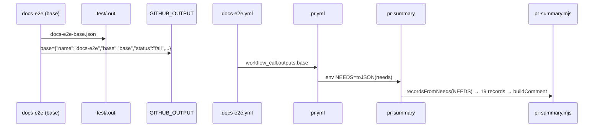

# 19: PR Summary reads job outputs

Follow the project planning rules: docs/code-of-conduct/planning-guidelines.md, CLAUDE.md:9. Keep the expedition contract.

## 1. Architecture

### 1.1 Overview

Each of the nineteen test jobs zips its one record (`test/.out/<name>[-<leg>].json`, about 460 bytes) into an artifact `test-out-<job>`; PR Summary downloads them all (`pr.yml:152-156`) and every run leaves sixteen artifacts for 90 days. D38 hands the records over as job outputs: a last step in every test job prints the record under one key (`base`, `radix`, `aria`, the scenario, or `record` for the single jobs), the matrix jobs declare those keys as outputs (each leg fills its own; an empty output does not override another leg's value, GitHub docs "Using job outputs in a matrix job"), the four called workflows expose them through `workflow_call.outputs`, and PR Summary gets `toJSON(needs)` in an env variable. The `test-out-*` uploads and the download go; `installation-e2e.yml` keeps its upload, whose captures the reference refresh reads (v0.8.x D86). The open question, whether a failed leg's output reaches the caller, is proven first under `act`, then once on GitHub, before the switch (D38, D32, P3).

### 1.2 Goals

- No `upload-artifact` of `test-out-*` in `pr.yml`, `typecheck.yml`, `storybook-tests.yml`, `docs-e2e.yml`; `installation-e2e.yml` keeps its one upload; no `download-artifact` anywhere in `pr.yml` (D38).
- Every test job exposes its record as an output; PR Summary builds the same comment from `needs` as it did from the files; a cancelled or skipped job shows as skipped (spec 18).
- The record copy in the output keeps `name`, `base`, `scenario`, `status`, `summary`, `details`, `startedAt`, `durationMs`, `sha` and at most five `errors`, each cut at 400 characters (D38 cap: 1 MB per job, about 128 KB for the env variable; nineteen capped records stay under 60 KB).
- Acceptance: programmatic. The proof workflow of 1.6.4 under `act` prints all three keys including the failed leg's; one GitHub `workflow_dispatch` of the same proof prints the same (its run id in the tracker); `node --test tools/release/pr-summary.test.mjs` and `pnpm test validate-repo` green; `act pull_request -W .github/workflows/pr.yml -j lint` green with the record step; on the next GitHub PR run `gh api repos/anindosarker/shadcn-table/actions/runs/<id>/artifacts --jq '.artifacts[].name'` lists only `test-out-installation-e2e-*` and the comment is complete (nineteen rows filled).

### 1.3 Current structure

```
.github/workflows/
├── pr.yml:55-61, 88-94, 125-131      ← upload-artifact test-out-lint | validate-repo | validate-pr (path test/.out/, overwrite)
├── pr.yml:133-157                    ← pr-summary: download-artifact pattern test-out-*, merge-multiple, then node tools/release/pr-summary.mjs
├── typecheck.yml:30-36               ← upload test-out-typecheck-<base>
├── storybook-tests.yml:31-37         ← upload test-out-storybook-tests-<base>
├── docs-e2e.yml:49-55                ← upload test-out-docs-e2e-<base>
├── installation-e2e.yml:51-57        ← upload test-out-installation-e2e-<scenario> (records plus captures, D86: stays)
├── typecheck.yml:7-8 docs-e2e.yml:10-11 storybook-tests.yml installation-e2e.yml:10-16 ← workflow_call without outputs
tools/release/
├── pr-summary.mjs:190-204            ← readRecords(dir) over test/.out/*.json
└── pr-summary.mjs:215                ← main: readRecords(ROOT/test/.out)
test/lib/report.mjs:8-10, 20-25       ← recordName, writeRecord: one file per run, pretty JSON
test/run.mjs:200-211                  ← the record shape
```

### 1.4 Target structure

```
tools/release/record-output.mjs      ← new: prints `<key>=<compact capped record>` for $GITHUB_OUTPUT
.github/workflows/
├── pr.yml                           ← lint, validate-repo, validate-pr: record step + outputs.record; pr-summary: no download, env NEEDS; the callers unchanged (outputs flow through needs)
├── typecheck.yml, storybook-tests.yml, docs-e2e.yml ← record step keyed by base, job outputs base|radix|aria, workflow_call.outputs the same three; test-out upload removed
└── installation-e2e.yml             ← record step keyed by scenario, seven job outputs and workflow_call.outputs; the capture upload stays
tools/release/pr-summary.mjs         ← readRecords(dir) kept for local use; recordsFromNeeds(json) new; main prefers NEEDS
tools/release/pr-summary.test.mjs    ← recordsFromNeeds tests
```

### 1.5 Flow



### 1.6 Components

#### 1.6.1 Data artifacts

- `CHANGELOG.md` (P9): `#### Spec 19 PR Summary reads job outputs` under `## Unreleased`, `### Changed` (D38).
- The two proof workflow files of 1.6.4 exist on the milestone branch only and are deleted before the merge.

#### 1.6.2 `record-output.mjs`

`tools/release/record-output.mjs`, status `new`.

- `node tools/release/record-output.mjs --key <k>` reads the one `test/.out/*.json` (the newest when several), copies it with `errors` cut to five entries of 400 characters each (an `…` marks a cut), and prints one line `<k>=<JSON.stringify(record)>`; the caller appends it to `$GITHUB_OUTPUT`. No record file: prints nothing and exits 0 (the summary shows skipped).
- Does NOT write files and does NOT read `GITHUB_OUTPUT` itself (the shell redirect does), so the same command works under `act` and in a local shell.

**Interfaces:**

```
node tools/release/record-output.mjs --key base   →  base={"name":"docs-e2e","base":"base","status":"pass",...}
```

#### 1.6.3 Workflows

Status `refactor`.

- Every test job (the four called matrix jobs, `lint`, `validate-repo`, `validate-pr`): after the `pnpm test ...` step, a step `id: record`, `if: always()`, `run: node tools/release/record-output.mjs --key <key> >> "$GITHUB_OUTPUT"` with `<key>` = `${{ matrix.base }}`, `${{ matrix.scenario }}` or `record`.
- Matrix jobs: `outputs:` with one entry per leg, `base: ${{ steps.record.outputs.base }}` and so on (seven for installation-e2e); the called workflow's `on.workflow_call.outputs` mirrors them, `value: ${{ jobs.<job>.outputs.<key> }}`, each with a one-line description.
- Single jobs: `outputs: { record: ${{ steps.record.outputs.record }} }`.
- The `test-out-*` uploads in `pr.yml`, `typecheck.yml`, `storybook-tests.yml`, `docs-e2e.yml` are deleted; `installation-e2e.yml:51-57` stays as is (captures).
- `pr-summary`: the `download-artifact` step is deleted; the run step gets `env: NEEDS: ${{ toJSON(needs) }}`; `needs` and `if: always()` unchanged. The job comment (`:133-136`) describes the outputs path.
- The file header comments (`pr.yml:4-10`, each called workflow) drop "uploaded as the artifact test-out-<job>" for "handed to PR Summary as the job output <key>".
- Does NOT change any `if:`, the `skip` input (spec 16) or the action majors (spec 17).

#### 1.6.4 The proof

Two throwaway files on the milestone branch, status `new` then deleted.

- `.github/workflows/zz-outputs-proof-call.yml`: `workflow_call` with outputs `base`, `radix`, `aria`; one job, matrix over the three, step `id: rec` writing `${{ matrix.base }}={"leg":"${{ matrix.base }}"}` to `$GITHUB_OUTPUT`, then `run: exit 1` when `matrix.base == 'radix'`; job outputs the three keys.
- `.github/workflows/zz-outputs-proof.yml`: `workflow_dispatch`; job `call` uses the file above; job `consume` with `needs: [call]`, `if: always()`, `run: echo '${{ toJSON(needs) }}'`.
- Under `act`: `act workflow_dispatch -W .github/workflows/zz-outputs-proof.yml`; pass when the echoed JSON holds all three keys with `call.result == 'failure'`. Then on GitHub: push the branch, `gh workflow run zz-outputs-proof.yml --ref <branch>`, `gh run view <id> --log` shows the same; the run id goes to the tracker. The pass line of each run is a `Check:` line in the tracker.
- Fallback when GitHub drops the failed leg's key: the record step keeps running, and a second step `if: failure()` uploads `test-out-<job>` for the failed leg only; `pr-summary` adds `download-artifact` back for `test-out-*` and merges both sources (outputs first). The builder applies the fallback only on a failed GitHub proof and writes an Attention line.

#### 1.6.5 `pr-summary.mjs` and tests

- `pr-summary.mjs`, status `refactor`: `recordsFromNeeds(json)` parses the `NEEDS` JSON, takes `Object.values(needs).flatMap((j) => Object.values(j.outputs ?? {}))`, `JSON.parse` each in try/catch, keeps records with `name` and `status`. `main()` uses it when `process.env.NEEDS` is set, else `readRecords(ROOT/test/.out)` (local runs, spec 18's act check). The header comment names both sources.
- `pr-summary.test.mjs`, status `refactor`: `recordsFromNeeds` with a `needs` fixture of two matrix jobs (three keys, one empty) and one single job returns the four records and skips the empty and an invalid value; red first (P11: the export does not exist).

### 1.7 Dependencies and env

- `act` with Docker (P3); network for the GitHub proof dispatch and for `act` to pull the actions.

## 2. Instructions for AI

### 2.1 Milestones

### Milestone: PR summary job outputs

- Files owned: `.github/workflows/pr.yml`, `.github/workflows/typecheck.yml`, `.github/workflows/storybook-tests.yml`, `.github/workflows/docs-e2e.yml`, `.github/workflows/installation-e2e.yml`, `tools/release/record-output.mjs`, `tools/release/pr-summary.mjs`, `tools/release/pr-summary.test.mjs`
- Depends on: CI Node 24 actions, PR summary layout
- Review: fable
- Local CI: `act workflow_dispatch -W .github/workflows/zz-outputs-proof.yml`, `act pull_request -W .github/workflows/pr.yml -j lint`, `node --test tools/release/pr-summary.test.mjs`, `pnpm test validate-repo`, `pnpm test lint`
- Task 1: Proof (1.6.4): the two files, `act` run, GitHub dispatch; both pass lines in the tracker. A GitHub failure: apply the fallback and write the Attention line. Checks: the three keys in both outputs
- Task 2: Reproduce: the `recordsFromNeeds` test (1.6.5), red on the shipped code (P11). Checks: `node --test tools/release/pr-summary.test.mjs` fails on it
- Task 3: `record-output.mjs` (1.6.2), the workflow steps, outputs and removals (1.6.3), `recordsFromNeeds` and `main()` (1.6.5). Checks: `node --test` green; `act pull_request -W .github/workflows/pr.yml -j lint` shows the `record` step printing `record={...}`; `grep -rn 'test-out-' .github/workflows/` lists only `installation-e2e.yml`
- Task 4: Cleanup: delete the two proof files, header comments, the changelog block, `pnpm format`. Checks: 2.2

### 2.2 Checks

- `node --test tools/release/pr-summary.test.mjs`, `pnpm test validate-repo`, `pnpm test lint` green
- `act pull_request -W .github/workflows/pr.yml -j lint` green with the record step
- `grep -rn 'download-artifact' .github/workflows/pr.yml` empty; `grep -rn 'test-out-' .github/workflows/` lists only `installation-e2e.yml`; `ls .github/workflows/zz-*` empty
- Review: fable (the CI pipeline of every PR, the called workflows' outputs)
- The next GitHub PR run: artifacts list only `test-out-installation-e2e-*`, the comment has nineteen filled rows (tracker of the spec whose PR runs first)
