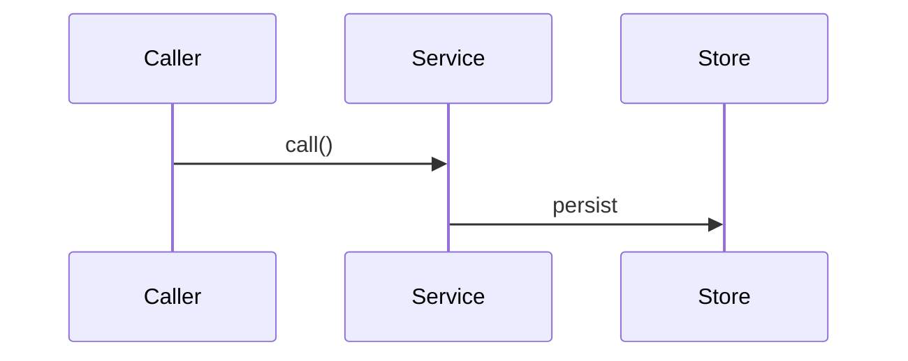

# Planning Guidelines

For a release with `status/data/status.json`. A release without it is format 1.0: follow [old-form/planning-guidelines.md](old-form/planning-guidelines.md).

How to write an implementation plan for this repository. Applies to humans and agents.

## Contents

- Location
- Rules
- Template
- Example
- Task file

## Location

```
.ai/plans/<name>/<git_username>/
├── <name>-plan/
│   ├── <name>-plan.md   ← the plan file, in a folder of the same name
│   └── tasks/           ← one file per task
└── reference/           ← optional supporting material
```

Every plan sits in a folder named like its file, with its task files in `tasks/` beside it.

`<git_username>` is the output of `git config user.name`. Any other file in the folder belongs
to the workflow or tool that runs the plan and is not described here. This doc says how to
write one plan file (template below).

## Rules

1. **Discuss before writing.** Agree scope in chat first. The plan implements what was agreed
   and never re-decides.
2. **Draft during the discussion** for anything non-trivial, so both sides argue against the
   same text.
3. **No questions in plan files.** Open items are asked in chat.
4. **Structure over prose.** Tables, trees, bullets. Short prose only for a module intro.
5. **Mermaid for flows, ASCII trees for structure.** No hand-drawn box diagrams. Sketches
   made with Excalidraw go in `reference/` as `.excalidraw`, linked from the section they
   illustrate.
6. **No marketing prose.** Plain section names, direct descriptions, exact technical terms.
7. **Status on every operation**: `new`, `keep` or `refactor`. A stub is `new` with "stub,
   implement in task NN".
8. **Pin what stays unchanged.** Every module lists what it touches but does not modify.
9. **Design in, implementation out.** Include data models and fields, interfaces, types,
   constants, file shapes, usage examples. Never method bodies or algorithm walkthroughs.
   Test: a decision goes in; how to do it stays in the code.
10. **Cleanup task always last.** Delete old code, update references.
11. **Verification per task.** Each task file ends with a checklist of facts that can be seen
    when the task is done. The project's checks as listed in
    `docs/code-of-conduct/coding-standards.md` hold for every task and are never listed.
12. **No em dashes.** Use a comma, a colon or a new sentence.
13. **Dependency edges need a reason.** A milestone depends on another only through a listed
    dependency or a shared file. Milestones that share no file and list no dependency are
    built at the same time.
14. **Three levels, one home each.** A module (section 1.6) says what is wanted and cites the
    decision. A task (a file in `tasks/`) is the work. A milestone (section 2.2) is the tasks
    that are built and merged together.
15. **New work is the same three additions.** The next module, one or more task files, a
    milestone. Numbers only go up. Each new piece of work is its own milestone; a task joins
    an existing milestone only while that milestone has not started.
16. **A finished plan takes nothing.** A plan that is not done takes new modules, tasks and
    milestones. Once it is done, later work on the same subject is a new plan.
17. **Suggestions, not rules.** `Files owned` on a milestone is written when it could clash
    with other work in progress, `Depends on` only where two milestones touch the same thing.
    Sections 1.3, 1.4, 1.5 and 1.7 are left out when they would be empty.
18. **No status by hand.** The `status` line of a plan file or a task file is one of
    `not started`, `in progress`, `blocked`, `done`, `skipped`. A tool, not a person, may
    maintain it.

## Template

Numbering is strict: every heading under `## 1.` and `## 2.` carries its dotted number. A
module is `#### 1.6.2 <title>`, a milestone `#### 2.2.1 Milestone: <name>`. A task has a
two-digit number that runs across the plan and starts the name of its file, `tasks/03-<slug>.md`.
A number is never reused. Sections 1.3, 1.4, 1.5 and 1.7 are left out when empty; the other
numbers stay as they are.

````markdown
---
status: not started
---
# [Feature name] plan

## 1. Architecture

### 1.1 Overview

Two or three sentences: the problem and why this plan exists. Link the decision.

### 1.2 Goals

- Measurable outcome
- Measurable outcome
- Acceptance: the one check the builder runs itself and loops on, programmatic (`tsc`, a grep, a `diff` against a baseline, a test)

### 1.3 Current structure _(optional, skip for greenfield)_

```
path/today/
├── file-a.ts
└── file-b.ts
```

### 1.4 Target structure

```
path/after/
├── file-a.ts        ← one-line purpose
└── sub/
    └── file-c.ts    ← one-line purpose
```

### 1.5 Flow _(optional, for dispatch, state machines, cross-service flows)_



Sketch: [reference/flow.excalidraw](reference/flow.excalidraw) _(when one exists)_

### 1.6 Modules

A module in a plan is one unit of the design, which may be a NestJS module, a set of pages,
a job or a shared helper. One block per module the plan introduces or modifies, grouped by
logical unit, not by file. Required: a short description and a bullet list of what it does
and does not do. Optional: operations table, interfaces, dependencies, stays unchanged,
usage examples.

#### 1.6.1 Data artifacts _(optional, always first when present)_

Data models and fields, stored enums, config files, generated files: what changes in them.
One entry per data model, with every field.

| Field       | Type   | Notes                                   |
| ----------- | ------ | --------------------------------------- |
| `id`        | string | key                                     |
| `expiresAt` | date   | set on create, default 30 days, indexed |

#### 1.6.2 [Module]

Description and the scope decisions that shaped it.

- Does X
- Does NOT do Y

**Operations:**

| Operation | Status | Notes |
| --------- | ------ | ----- |
| `doX()`   | new    |       |

**Interfaces:**

```typescript
export interface Example {
  readonly id: string;
}
```

**Stays unchanged:** files this module touches without modifying.

**Usage:** one example per distinct caller pattern.

```typescript
example.doX({ id });
```

### 1.7 Dependencies and env _(optional)_

New packages, env vars (name, default, purpose), reused infrastructure.

## 2. Instructions for AI

### 2.1 Tasks

One pointer line per task: its number, its title, its module, its file.

- 01 [Task title] · module 1.6.2 · tasks/01-[slug].md
- 02 [Task title] · module 1.6.2 · tasks/02-[slug].md
- 03 Cleanup, delete old code, update references · module 1.6.2 · tasks/03-cleanup.md

### 2.2 Milestones

One block per milestone. A milestone is a named group of tasks that is built and merged as
one piece of work.

#### 2.2.1 Milestone: [Name]
- Tasks: 01, 02, 03
- Files owned: [a, b]
- Depends on: [milestone names, or none]

### 2.3 Checks

- `command`, what green means
````

## Example

Minimal shape:

````markdown
# Notification module plan

## 1. Architecture

### 1.1 Overview

Notifications are sent from the `auth`, `payment` and `payroll` modules, each with its own
email sender. Decision: one `notification` module with pluggable channels.

### 1.2 Goals

- One entry point for all outbound notifications
- Email and SMS channels behind one interface
- Acceptance: a grep finds no direct email sender call outside `notification/`

### 1.3 Current structure

```
auth/auth-email.sender.ts
payment/payment-email.sender.ts
payroll/payroll-email.sender.ts
```

### 1.4 Target structure

```
notification/
├── notification.service.ts      ← public API, send(channel, payload)
└── channels/
    ├── email.channel.ts         ← email provider wrapper
    └── sms.channel.ts           ← SMS provider wrapper (stub)
```

### 1.5 Flow: none

### 1.6 Modules

#### 1.6.1 Data artifacts: none

#### 1.6.2 NotificationService

Single entry point other modules call to send notifications. Owns dispatch only.

- Dispatches a send request to the right channel
- Does NOT handle retries, the job queue does

**Operations:**

| Operation | Status | Notes            |
| --------- | ------ | ---------------- |
| `send()`  | new    | Main entry point |

**Interfaces:**

```typescript
export interface NotificationChannel {
  readonly name: 'email' | 'sms';
  deliver(payload: NotificationPayload): Promise<void>;
}
```

**Stays unchanged:** subject lines, recipients, the job queue setup.

**Usage:**

```typescript
await notificationService.send('email', { to, subject, body });
```

### 1.7 Dependencies and env: none

## 2. Instructions for AI

### 2.1 Tasks

- 01 Create `NotificationService` and the email channel · module 1.6.2 · tasks/01-notification-service.md
- 02 Add the SMS channel as a stub · module 1.6.2 · tasks/02-sms-channel-stub.md
- 03 Point `auth`, `payment` and `payroll` at `send()` · module 1.6.2 · tasks/03-move-callers.md
- 04 Cleanup, delete the three old senders, update imports · module 1.6.2 · tasks/04-cleanup.md

### 2.2 Milestones

#### 2.2.1 Milestone: Notification core
- Tasks: 01, 02
- Files owned: `notification/notification.service.ts`, `notification/channels/email.channel.ts`, `notification/channels/sms.channel.ts`

#### 2.2.2 Milestone: Move callers
- Tasks: 03, 04
- Files owned: `auth/auth-email.sender.ts`, `payment/payment-email.sender.ts`, `payroll/payroll-email.sender.ts`
- Depends on: Notification core

### 2.3 Checks

- The project's checks as listed in `docs/code-of-conduct/coding-standards.md`, all green
- A grep for the email provider client outside `notification/`, no match
````

## Task file

Every task is a file, `tasks/NN-<slug>.md` in the plan's folder. Mandatory: the front matter,
the title, Goals, Verification. Optional, left out when unused: the quote, Instructions.

````markdown
---
status: not started
type: [feat | bug]
---
# [The result, in one line]

> [Optional. The words of the person who asked, copied. An agent never writes it.]

## Goals
- [What we want to do. One to three bullets.]

## Instructions
- [Optional. Only when the order matters, a guess must be checked first, or a bug must be reproduced.]

## Verification
- [ ] [A fact that can be seen when the task is done.]
- [ ] Browser: [what to look at in the browser.]
- [ ] Owner: [a check the owner does himself.]
````

- Verification is a checklist of facts that can be seen when the task is done. Every box is
  ticked before the task is done.
- A plain line is checked by the builder. A `Browser:` line is checked by the builder in a
  browser. An `Owner:` line is checked by the owner; the builder does not open a browser for it.
- A line that would be true for every task does not belong in the file: lint, type-check and
  build are never listed.
- `status` is one of `not started`, `in progress`, `blocked`, `done`, `skipped`. A tool, not a
  person, may maintain it.
