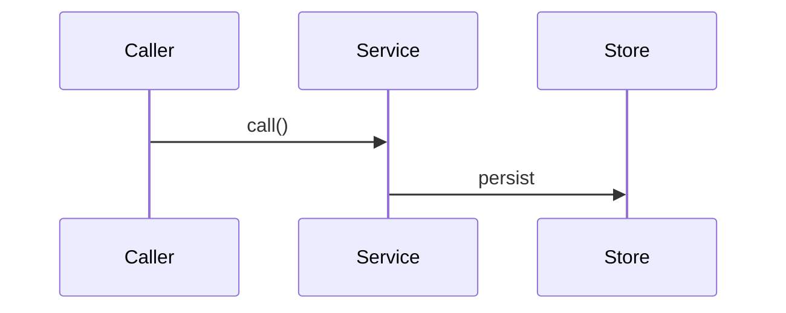

# Planning Guidelines

How to write an implementation plan for this repository. Applies to humans and agents.

## Location

```
.ai/plans/<name>/<git_username>/
├── <name>-plan.md       ← the root plan file
└── reference/           ← optional supporting material
```

`<git_username>` is the output of `git config user.name`. Any other file in the folder belongs
to the workflow or tool that runs the plan and is not described here. This doc says how to
write one plan file (template below).

## Rules

1. **Discuss before writing.** Agree scope in chat first. The plan implements what was agreed
   and never re-decides.
2. **Draft during the discussion** for anything non-trivial, so both sides argue against the
   same text.
3. **No questions in plan files.** Open items are asked in chat.
4. **Structure over prose.** Tables, trees, bullets. Short prose only for a module intro.
5. **Mermaid for flows, ASCII trees for structure.** No hand-drawn box diagrams. Sketches
   made with Excalidraw go in `reference/` as `.excalidraw`, linked from the section they
   illustrate.
6. **No marketing prose.** Plain section names, direct descriptions, exact technical terms.
7. **Status on every operation**: `new`, `keep` or `refactor`. A stub is `new` with "stub,
   implement in task N".
8. **Pin what stays unchanged.** Every module lists what it touches but does not modify.
9. **Design in, implementation out.** Include data models and fields, interfaces, types,
   constants, file shapes, usage examples. Never method bodies or algorithm walkthroughs.
   Test: a decision goes in; how to do it stays in the code.
10. **Cleanup task always last.** Delete old code, update references, run the project's checks.
11. **Checks per task.** Each task names the commands that must pass. The commands are the
    project's checks as listed in `docs/code-of-conduct/coding-standards.md`.
12. **No em dashes.** Use a comma, a colon or a new sentence.
13. **Dependency edges need a file reason.** Each milestone block names its `Files owned` and
    `Depends on`. A milestone depends on another only through a listed dependency or a shared
    file. Milestones that share no file and list no dependency can be built at the same time.

## Template

Numbering is strict: every heading under `## 1.` and `## 2.` carries its dotted number,
except the `### Milestone: <name>` blocks under 2.1, which carry the milestone name.
A skipped optional section keeps its heading with `: none` after the name, so numbers stay
stable and no reader guesses at a gap.

````markdown
# [Feature name] plan

## 1. Architecture

### 1.1 Overview

Two or three sentences: the problem and why this plan exists. Link the decision.

### 1.2 Goals

- Measurable outcome
- Measurable outcome
- Acceptance: the one check the builder runs itself and loops on, programmatic (`tsc`, a grep, a `diff` against a baseline, a test)

### 1.3 Current structure _(optional, skip for greenfield)_

```
path/today/
├── file-a.ts
└── file-b.ts
```

### 1.4 Target structure

```
path/after/
├── file-a.ts        ← one-line purpose
└── sub/
    └── file-c.ts    ← one-line purpose
```

### 1.5 Flow _(optional, for dispatch, state machines, cross-service flows)_



Sketch: [reference/flow.excalidraw](reference/flow.excalidraw) _(when one exists)_

### 1.6 Modules

A module in a plan is one unit of the design, which may be a NestJS module, a set of pages,
a job or a shared helper. One block per module the plan introduces or modifies, grouped by
logical unit, not by file. Required: a short description and a bullet list of what it does
and does not do. Optional: operations table, interfaces, dependencies, stays unchanged,
usage examples.

#### 1.6.1 Data artifacts _(optional, always first when present)_

Data models and fields, stored enums, config files, generated files: what changes in them.
One entry per data model, with every field.

| Field       | Type   | Notes                                   |
| ----------- | ------ | --------------------------------------- |
| `id`        | string | key                                     |
| `expiresAt` | date   | set on create, default 30 days, indexed |

#### 1.6.2 [Module]

Description and the scope decisions that shaped it.

- Does X
- Does NOT do Y

**Operations:**

| Operation | Status | Notes |
| --------- | ------ | ----- |
| `doX()`   | new    |       |

**Interfaces:**

```typescript
export interface Example {
  readonly id: string;
}
```

**Stays unchanged:** files this module touches without modifying.

**Usage:** one example per distinct caller pattern.

```typescript
example.doX({ id });
```

### 1.7 Dependencies and env _(optional)_

New packages, env vars (name, default, purpose), reused infrastructure.

## 2. Instructions for AI

### 2.1 Milestones

One block per milestone. A milestone is a named group of tasks that is built and checked as
one piece of work.

### Milestone: [Name]

- Files owned: [a, b]
- Depends on: [milestone names, or none]
- Task 1: [what]. Checks: [commands]
- Task 2: [what]. Checks: [commands]
- Task N: Cleanup, delete old code, update references. Checks: the project's checks

### 2.2 Checks

- `command`, what green means
````

## Example

Minimal shape:

````markdown
# Notification module plan

## 1. Architecture

### 1.1 Overview

Notifications are sent from the `auth`, `payment` and `payroll` modules, each with its own
email sender. Decision: one `notification` module with pluggable channels.

### 1.2 Goals

- One entry point for all outbound notifications
- Email and SMS channels behind one interface
- Acceptance: a grep finds no direct email sender call outside `notification/`

### 1.3 Current structure

```
auth/auth-email.sender.ts
payment/payment-email.sender.ts
payroll/payroll-email.sender.ts
```

### 1.4 Target structure

```
notification/
├── notification.service.ts      ← public API, send(channel, payload)
└── channels/
    ├── email.channel.ts         ← email provider wrapper
    └── sms.channel.ts           ← SMS provider wrapper (stub)
```

### 1.5 Flow: none

### 1.6 Modules

#### 1.6.1 Data artifacts: none

#### 1.6.2 NotificationService

Single entry point other modules call to send notifications. Owns dispatch only.

- Dispatches a send request to the right channel
- Does NOT handle retries, the job queue does

**Operations:**

| Operation | Status | Notes            |
| --------- | ------ | ---------------- |
| `send()`  | new    | Main entry point |

**Interfaces:**

```typescript
export interface NotificationChannel {
  readonly name: 'email' | 'sms';
  deliver(payload: NotificationPayload): Promise<void>;
}
```

**Stays unchanged:** subject lines, recipients, the job queue setup.

**Usage:**

```typescript
await notificationService.send('email', { to, subject, body });
```

### 1.7 Dependencies and env: none

## 2. Instructions for AI

### 2.1 Milestones

### Milestone: Notification core

- Files owned: `notification/notification.service.ts`, `notification/channels/email.channel.ts`, `notification/channels/sms.channel.ts`
- Depends on: none
- Task 1: Create `NotificationService` and the email channel. Checks: type check
- Task 2: Add the SMS channel as a stub. Checks: type check, unit tests

### Milestone: Move callers

- Files owned: `auth/auth-email.sender.ts`, `payment/payment-email.sender.ts`, `payroll/payroll-email.sender.ts`
- Depends on: Notification core
- Task 1: Point `auth`, `payment` and `payroll` at `send()`. Checks: type check, unit tests
- Task 2: Cleanup, delete the three old senders, update imports. Checks: the project's checks

### 2.2 Checks

- The project's checks as listed in `docs/code-of-conduct/coding-standards.md`, all green
- A grep for the email provider client outside `notification/`, no match
````
